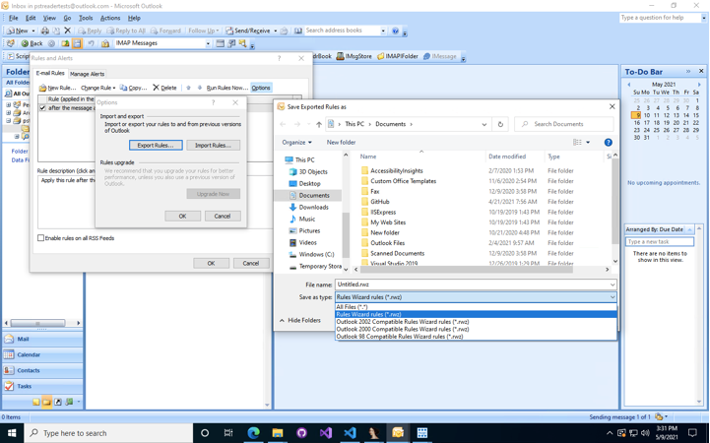

# Outlook Rules Wizard (.rwz) File Format

This document specifies the binary format used by Microsoft Outlook to store client-side rules ("Rules Wizard" rules), both in exported `.rwz` files and in the `PidTagRwRulesStream` property. It is a reverse-engineered specification: nothing here is published by Microsoft.

## Contents

* [1. Introduction](#1-introduction)
  * [1.1 Storage](#11-storage)
  * [1.2 Glossary](#12-glossary)
  * [1.3 References](#13-references)
  * [1.4 Conventions](#14-conventions)
* [2. Common data types](#2-common-data-types)
  * [2.1 The stream is an MFC CArchive](#21-the-stream-is-an-mfc-carchive)
  * [2.2 String](#22-string)
  * [2.3 Counted entry ID](#23-counted-entry-id)
  * [2.4 OleDateTime](#24-oledatetime)
  * [2.5 Object tag](#25-object-tag)
  * [2.6 GUID](#26-guid)
* [3. Format generations](#3-format-generations)
* [4. Top-level structure](#4-top-level-structure)
  * [4.1 Version stamps](#41-version-stamps)
  * [4.2 RulesHeader](#42-rulesheader)
  * [4.3 Rule](#43-rule)
  * [4.4 RulesFooter](#44-rulesfooter)
* [5. Element identifiers](#5-element-identifiers)
  * [5.1 Mandatory](#51-mandatory)
  * [5.2 Conditions](#52-conditions)
  * [5.3 Actions](#53-actions)
  * [5.4 Exceptions](#54-exceptions)
  * [5.5 Downgrading](#55-downgrading)
* [6. Parameters](#6-parameters)
  * [6.1 EventParameter](#61-eventparameter)
  * [6.2 ItemTypeParameter](#62-itemtypeparameter)
  * [6.3 WordParameter](#63-wordparameter)
  * [6.4 AddressParameter](#64-addressparameter)
  * [6.5 FlaggedForActionParameter](#65-flaggedforactionparameter)
  * [6.6 ImportanceParameter](#66-importanceparameter)
  * [6.7 SensitivityParameter](#67-sensitivityparameter)
  * [6.8 CategoryParameter](#68-categoryparameter)
  * [6.9 FormParameter](#69-formparameter)
  * [6.10 SizeParameter](#610-sizeparameter)
  * [6.11 TimeParameter](#611-timeparameter)
  * [6.12 FormTypeParameter](#612-formtypeparameter)
  * [6.13 SendersListParameter](#613-senderslistparameter)
  * [6.14 RelevanceRangeParameter](#614-relevancerangeparameter)
  * [6.15 AccountParameter](#615-accountparameter)
  * [6.16 ProfileStampParameter](#616-profilestampparameter)
  * [6.17 AddressBookParameter](#617-addressbookparameter)
  * [6.18 AlertParameter](#618-alertparameter)
  * [6.19 FolderParameter](#619-folderparameter)
  * [6.20 PathParameter / MessageParameter](#620-pathparameter--messageparameter)
  * [6.21 FlagParameter](#621-flagparameter)
  * [6.22 DeferParameter](#622-deferparameter)
  * [6.23 CustomActionParameter](#623-customactionparameter)
  * [6.24 RelevanceParameter](#624-relevanceparameter)
  * [6.25 ServerReplyParameter](#625-serverreplyparameter)
  * [6.26 ScriptParameter](#626-scriptparameter)
  * [6.27 FlagForFollowUpParameter](#627-flagforfollowupparameter)
  * [6.28 RetentionPolicyParameter](#628-retentionpolicyparameter)
  * [6.29 FlagColorParameter](#629-flagcolorparameter)
* [7. Writing](#7-writing)
* [Appendix A. Worked example](#appendix-a-worked-example)
* [Appendix B. Open questions](#appendix-b-open-questions)
* [Appendix C. Corrections to earlier notes](#appendix-c-corrections-to-earlier-notes)
* [Appendix D. Findings from RULESWIZ.DLL](#appendix-d-findings-from-ruleswizdll)
  * [D.1 Element definitions](#d1-element-definitions)
  * [D.2 Parameter classes](#d2-parameter-classes)
  * [D.3 Server rules](#d3-server-rules)
  * [D.4 The rule evaluator](#d4-the-rule-evaluator)
  * [D.5 Saving and exporting](#d5-saving-and-exporting)
* [Appendix E. Findings from Outlook 98](#appendix-e-findings-from-outlook-98)
  * [E.1 Server forms of elements](#e1-server-forms-of-elements)
  * [E.2 Exchange server rules](#e2-exchange-server-rules)
  * [E.3 Client and server rules conflict](#e3-client-and-server-rules-conflict)
  * [E.4 Running client rules](#e4-running-client-rules)
* [Appendix F. Findings from Outlook 2000](#appendix-f-findings-from-outlook-2000)
* [Appendix G. Findings from Outlook 2002](#appendix-g-findings-from-outlook-2002)
  * [G.1 Format](#g1-format)
  * [G.2 Definitions and parameters](#g2-definitions-and-parameters)
  * [G.3 Exchange server rules](#g3-exchange-server-rules)
  * [G.4 Running client rules](#g4-running-client-rules)
  * [G.5 Rules Wizard UI](#g5-rules-wizard-ui)
* [Appendix H. Outlook Express rule import (Outlook 2002)](#appendix-h-outlook-express-rule-import-outlook-2002)
* [Appendix I. Findings from Outlook 2003](#appendix-i-findings-from-outlook-2003)
  * [I.1 Format](#i1-format)
  * [I.2 Definitions and parameters](#i2-definitions-and-parameters)
  * [I.3 Exchange server rules](#i3-exchange-server-rules)
  * [I.4 Running client rules](#i4-running-client-rules)
  * [I.5 Import](#i5-import)
  * [I.6 Rules and Alerts dialogs](#i6-rules-and-alerts-dialogs)
  * [I.7 The rules message and Cached Exchange Mode](#i7-the-rules-message-and-cached-exchange-mode)
  * [I.8 Evaluating conditions on the client](#i8-evaluating-conditions-on-the-client)
  * [I.9 Out of Office rules](#i9-out-of-office-rules)
* [Appendix J. Findings from Outlook 2007](#appendix-j-findings-from-outlook-2007)
  * [J.1 Format](#j1-format)
  * [J.2 The "Clear categories on mail" rule](#j2-the-clear-categories-on-mail-rule)
  * [J.3 Definitions and parameters](#j3-definitions-and-parameters)
  * [J.4 Exchange server rules](#j4-exchange-server-rules)
  * [J.5 Running client rules](#j5-running-client-rules)
  * [J.6 Import](#j6-import)
  * [J.7 Rules and Alerts dialogs](#j7-rules-and-alerts-dialogs)
  * [J.8 Unchanged from Outlook 2003](#j8-unchanged-from-outlook-2003)
* [Appendix K. Findings from Outlook 2010](#appendix-k-findings-from-outlook-2010)
  * [K.1 Format](#k1-format)
  * [K.2 Definitions and parameters](#k2-definitions-and-parameters)
  * [K.3 Exchange server rules](#k3-exchange-server-rules)
  * [K.4 Running client rules](#k4-running-client-rules)
  * [K.5 Import](#k5-import)
  * [K.6 Rules and Alerts dialogs](#k6-rules-and-alerts-dialogs)
  * [K.7 Unchanged from Outlook 2007](#k7-unchanged-from-outlook-2007)
* [Appendix L. Findings from Outlook 2013](#appendix-l-findings-from-outlook-2013)
  * [L.1 Format](#l1-format)
  * [L.2 Definitions and parameters](#l2-definitions-and-parameters)
  * [L.3 Exchange server rules](#l3-exchange-server-rules)
  * [L.4 Running client rules](#l4-running-client-rules)
  * [L.5 Import](#l5-import)
  * [L.6 Rules and Alerts dialogs](#l6-rules-and-alerts-dialogs)
  * [L.7 Unchanged from Outlook 2010](#l7-unchanged-from-outlook-2010)
* [References](#references)

## Status of this document

Each statement is marked with how it was established:

| Marker | Meaning |
|---|---|
| *(none)* | **Verified.** Checked against every sample file in `Tests/OutlookRulesReaderTests/Resources` (330 files written by Outlook 97, 98, 2000, 2003, 2007 and 2019) by an independent parser. |
| **[Inferred]** | Consistent with all samples, but the *meaning* comes from interpretation (for example, a match with an MFC or MAPI structure), not observation. |
| **[O97]** | Read from the Outlook 97 Rules Wizard's code (`docs/Internals/RULESWIZ.DLL`, disassembled). This shows how Outlook 97 writes and uses the field. Later versions are assumed to keep the meaning wherever the samples agree. See [Appendix D](#appendix-d-findings-from-ruleswizdll). |
| **[O98]** | Read from Outlook 98's code (`OUTLLIB.DLL` from the Outlook 98 CD, disassembled). See [Appendix E](#appendix-e-findings-from-outlook-98). |
| **[O2000]** | Read from Outlook 2000's code (`OUTLLIB.DLL` and its Turkish resource DLL `1055/OUTLLIBR.DLL` from an Outlook 2000 CD, disassembled). See [Appendix F](#appendix-f-findings-from-outlook-2000). |
| **[O2002]** | Read from Outlook 2002's code (`OUTLLIB.DLL` and `IMPMAIL.DLL` from an English Outlook 2002 CD, disassembled). See [Appendix G](#appendix-g-findings-from-outlook-2002) and [Appendix H](#appendix-h-outlook-express-rule-import-outlook-2002). |
| **[O2003]** | Read from Outlook 2003's code (`OUTLLIB.DLL` and `OUTLLIBR.DLL` from an English Office 2003 DVD, disassembled). See [Appendix I](#appendix-i-findings-from-outlook-2003). |
| **[O2007]** | Read from Outlook 2007's code (`OUTLOOK.EXE`, which now holds the rules code, and `OUTLLIBR.DLL` from an English Office 2007 Ultimate DVD, disassembled). See [Appendix J](#appendix-j-findings-from-outlook-2007). |
| **[O2010]** | Read from Outlook 2010's code (the 32-bit `OUTLOOK.EXE` 14.0.4760.1000, `OUTLLIBR.DLL` and `IMPMAIL.DLL` from an English Office 2010 Professional Plus SP2 ISO, disassembled). See [Appendix K](#appendix-k-findings-from-outlook-2010). |
| **[O2013]** | Read from Outlook 2013's code (the 32-bit `OUTLOOK.EXE` 15.0.4420.1017, `OLMAPI32.DLL` and `OUTLLIBR.DLL` from an English Office 2013 Professional Plus ISO, disassembled), with the update build 15.0.4517.1509 compared against it. See [Appendix L](#appendix-l-findings-from-outlook-2013). |
| **[Unknown]** | The field's layout is known but its meaning is not. Observed values are listed. |

A marker can name a range of versions, such as **[O2002–2013]**: the statement was checked in the code of every version studied in that range (97, 98, 2000, 2002, 2003, 2007, 2010 and 2013), and the behaviour is the same in all of them. Where a note says a later version was **not traced**, that version reads and writes the same bytes but the behaviour described was not looked for in its code. Outlook 2003's code was checked against every structure in this document ([Appendix I](#appendix-i-findings-from-outlook-2003)), Outlook 2007's against the ones [Appendix J](#appendix-j-findings-from-outlook-2007) lists, Outlook 2010's against the ones [Appendix K](#appendix-k-findings-from-outlook-2010) lists, and Outlook 2013's against the ones [Appendix L](#appendix-l-findings-from-outlook-2013) lists.

Writers SHOULD reproduce observed values for fields marked [Unknown]. Readers SHOULD accept any value.

`docs/RWZ Format.docx` contains earlier experimental notes. Where those notes and this document disagree, this document has been checked against the sample corpus and takes precedence (see [Appendix C](#appendix-c-corrections-to-earlier-notes)).

---

## 1. Introduction

An Outlook rule is a set of conditions, actions and exceptions that Outlook evaluates against messages as they arrive or are sent<sup>[1]</sup>. Rules began in Outlook 97 as the *Rules Wizard* add-in (`RULESWIZ.DLL`)<sup>[2]</sup> and were built into Outlook from Outlook 98 onwards<sup>[3]</sup>.

### 1.1 Storage

Where Outlook stores rules depends on its version<sup>[4]</sup>:

* **Outlook 2002 and later.** Rules are stored in the mailbox or PST<sup>[5]</sup>. The rules stream is the `PidTagRwRulesStream` (`PR_RW_RULES_STREAM`, `0x68020102`) property of a message named `Outlook Rules Organizer`, whose message class is `IPM.RuleOrganizer`<sup>[6]</sup>. The message is in the associated contents table<sup>[7]</sup> of the Inbox folder.

  

* **Outlook 2000 and earlier.** Rules are stored on disk at `%APPDATA%\Microsoft\Outlook\<ProfileName>.rwz`. **[O2003–2007]** When a store has no rules message yet, Outlook 2003 and 2007 import this file once and save the rules into the store ([Appendix I.7](#i7-the-rules-message-and-cached-exchange-mode)). **[O2010–2013]** Not traced.

Users can also import and export rules as `.rwz` files. When exporting, Outlook 2007 offers to write the file in the current format or in a format for Outlook 2002, 2000 or 98:



The server treats this format as client-specific and opaque<sup>[8]</sup>. `.rwz` files and `PidTagRwRulesStream` values share the format defined here. A few header values are known to differ between them.

### 1.2 Glossary

**ANSI string**: a sequence of 8-bit characters in the writer's code page. In practice this is ASCII or Windows-1252.

**COleDateTime**: the MFC date/time class. See [§2.4](#24-oledatetime).

**DATE / OLE Automation date**: an 8-byte IEEE double holding the number of days since 1899-12-30 00:00. The fractional part is the time of day. See [MS-DTYP] and [MS-OAUT].

**Format generation**: one of the four layouts described in [§3](#3-format-generations).

**VersionStamp**: the version stamp at the start of the stream. See [§4.1](#41-version-stamps).

**UTF-16**: UTF-16 little-endian, with no byte order mark and no terminating NUL unless stated otherwise.

**MAY, SHOULD, MUST, SHOULD NOT, MUST NOT**: as defined in [RFC2119].

### 1.3 References

* [MS-DTYP] Microsoft, "Windows Data Types". https://learn.microsoft.com/en-us/openspecs/windows_protocols/ms-dtyp
* [MS-OXCDATA] Microsoft, "Data Structures". https://learn.microsoft.com/en-us/openspecs/exchange_server_protocols/ms-oxcdata
* [MS-OXPROPS] Microsoft, "Exchange Server Protocols Master Property List".
* [MS-OXORULE] Microsoft, "Email Rules Protocol".
* [MFC-CArchive] Microsoft, "CArchive Class" and Technical Note TN002, "Persistent Object Data Format".
* [RFC2119] Bradner, S., "Key words for use in RFCs to Indicate Requirement Levels", BCP 14, RFC 2119, March 1997.

### 1.4 Conventions

* All integers are **little-endian**.
* `u8`, `u16` and `u32` are unsigned integers of 1, 2 and 4 bytes. `i32` is a signed 32-bit integer and `f64` is an IEEE 754 double.
* Structures are packed. There is no alignment padding anywhere in the stream.
* Field sizes are shown in parentheses, for example **Count (2 bytes)**. "Variable" means the size depends on the content.

---

## 2. Common data types

### 2.1 The stream is an MFC `CArchive`

The format is the output of MFC's `CArchive` serialization **[O97]**. Most of the structure follows from this:

* Rule elements are `CObject`s of class `CRuleElement` (runtime-class schema 0), written with `CArchive::WriteObject`. Each element is preceded by an object tag ([§2.5](#25-object-tag)).
* A rule (`CRule`) writes its name, Enabled, RunError and ServerRule, then its element list, a `CObList`. `CRule` is not written as an object, so it has no tag.
* `CRuleElement::Serialize` writes the element ID, a has-parameter flag ([§4.3.2](#432-element)), and then calls the parameter object's own `Serialize`.
* Length-prefixed strings use `CString`'s length encoding ([§2.2](#22-string)).
* Dates are written with `operator<<(CArchive&, COleDateTime)` ([§2.4](#24-oledatetime)).
* `RULESWIZ.DLL` (Outlook 97) statically links MFC. It contains the class names `CObject`, `CArchive`, `CRule`, `CRuleComponent` and `CRuleElement`.
* **[O98–2013]** Outlook 98 and later no longer use MFC's `CArchive`, but their own archive classes write the same bytes ([§2.5](#25-object-tag), [Appendix E](#appendix-e-findings-from-outlook-98)).

Parameter objects all derive from one base class, whose `Serialize` writes the Reserved field ([§6](#6-parameters)). Each element's definition says which parameter class to create, so the class is never written: parameters carry no class tag. Most string parameters (words, categories, paths, messages) share a single "Reserved + CString" class **[O97]**. Class names such as `CWordParameter` and `CFolderParameter` come from Outlook's binaries (`docs/Rules Sever Side.xlsx`).

### 2.2 String

A length-prefixed string. The same prefix encodes two kinds of character data:

* **String8**: the characters are ANSI, and the length counts bytes.
* **StringW**: the characters are UTF-16, and the length counts UTF-16 code units, not bytes or grapheme clusters.

| Field | Size | Description |
|---|---|---|
| Length | 1 | Number of characters if less than `0xFF`. |
| Length16 | 2, optional | Present only if Length is `0xFF`. Number of characters if less than `0xFFFF`. |
| Length32 | 4, optional | Present only if Length16 is `0xFFFF`. Number of characters. **[Inferred]** from MFC; never observed. |
| Value | variable | The characters. There is no NUL terminator. |

Writers MUST use the shortest encoding: 1 byte for 0–254, 3 bytes for 255–65534.

MFC writes a `0xFF 0xFFFE` marker before Unicode `CString`s. This format never contains that marker: the format generation alone decides whether a string is ANSI or UTF-16.

In this document, **String** means "String8 in the ANSI generations and StringW in the Unicode generation" ([§3](#3-format-generations)). StringW and String8 mean that encoding in every generation.

### 2.3 Counted entry ID

| Field | Size | Description |
|---|---|---|
| Size | 4 | Length of EntryID in bytes. |
| EntryID | Size | A MAPI entry ID ([MS-OXCDATA] §2.2). |

### 2.4 OleDateTime

The serialized form of an MFC `COleDateTime` (12 bytes).

| Field | Size | Description |
|---|---|---|
| Status | 4 | `0` = valid, `1` = invalid, `2` = null. Only `0` and `2` have been observed. |
| Date | 8 | An OLE Automation date (`f64`). |

When Status is null, Date is `0.0`.

### 2.5 Object tag

Every rule element is preceded by an MFC object tag (`u16`):

| Value | Meaning |
|---|---|
| `0xFFFF` | **New class** (`wNewClassTag`). A class descriptor follows: Schema (`u16`, always `0`), NameLength (`u16`, always `12`), Name (NameLength ANSI bytes, always `CRuleElement`). |
| `0x8001` | **Class reference** (`wClassTag \| 1`). The object's class is entry 1 of the archive's class map, which is `CRuleElement`. |

The class descriptor is written once per stream, before the first element of the first rule. Every later element in the stream, including the first element of rules 2…N, uses `0x8001`. A rule with zero elements writes no tag.

`docs/RWZ Format.docx` described these tags as a "separator" in the rule header. They are part of each element's encoding.

MFC can also emit `0x7FFF` (big object tag) and object back-references (`0x0001`–`0x7FFE`). Neither has been observed. Readers MAY treat them as corruption.

**[O2000]** Outlook 2000 no longer uses MFC's `CArchive`, but its own archive class writes the same bytes. Its writer emits the class descriptor once per archive (a flag on the archive object) and `0x8001` after that. Its reader is looser than MFC's: after `0xFFFF` it reads Schema, NameLength and the name into a 456-byte buffer without checking the name, and it treats **any** other tag as a reference to `CRuleElement`.

**[O2002–2013]** Outlook 2002, 2003, 2007, 2010 and 2013 read tags the same way. When they write a rule whose element list has an empty slot, they write the null tag `0x0000` with nothing after it, which their own reader would then misread. No sample contains one. **[O2007]** Outlook 2007 (`0x307E5ADA`) reads the class name into a 260-byte buffer, still without checking it, and writes the null tag at `0x3070D3A8`. **[O2010–2013]** Outlook 2010 and 2013 read and write tags in their element lists (Outlook 2010: `0x3015EA55`; Outlook 2013: `0xEEF119`), writing `0xFFFF`, the schema and the class name for the first element and the class tag `0x8001` for the others (`0x3015EBE3`). For an empty slot they write the null tag `0x0000` (Outlook 2010: `0x303D2432`; Outlook 2013: `0xEEF304`), and Outlook 2010's reader (`0x3015EAD9`) has no case for that tag.

### 2.6 GUID

16 bytes, laid out as a Windows `GUID` ([MS-DTYP] §2.3.4).

---

## 3. Format generations

The first four bytes of the stream identify one of four layouts:

| Generation | First u32 | Written by | Strings | Library (`OutlookRulesVersion`) |
|---|---|---|---|---|
| **G0** (Outlook 97) | anything not listed below | Outlook 97's Export Rules | ANSI | `.outlook97` |
| **G0s** (version stamp 0) | `0x00000000` | Outlook 2003's Export Rules, when the rules were last saved by a newer Outlook; see note | ANSI | `.signatureZero` |
| **G1** (ANSI) | `970102`, `970812`, `980413` | Outlook 97's profile copy; Outlook 98; Outlook 2000 (usually as `970812`, see [§4.1](#41-version-stamps)); Outlook 2002+ exporting "for Outlook 98/2000" | ANSI | `.outlook97Profile`, `.outlook98`, `.outlook2000` |
| **G2** (Unicode) | `1000000`, `1100000`, `1200000`, `0x00140000` | Outlook 2002 and later | UTF-16 | `.outlook2002`, `.outlook2003`, `.outlook2007`, `.outlook2010` |

Within G1, version stamp 970102 lacks two fields that 970812 has ([§4.1.1](#411-version-dependent-fields)).

**G0** has no version stamp. Its first 2 bytes are the rule count, and its next byte is the first rule name's length. Every Outlook 97 sample starts `01 00` (one rule). **[O97]** G0 is Outlook 97's **Export Rules** format: the exporter writes the rule count with `CArchive::WriteCount` and then each rule, with no header or footer. The rules Outlook 97 keeps in the profile use the G1 layout with VersionStamp 970102 ([§4.1](#41-version-stamps)).

A G0 stream can only begin with four zero bytes if it has no rules, and then it is only 2 bytes long (`00 00`). Readers MUST therefore treat a stream shorter than 4 bytes as G0.

Readers SHOULD identify the format by **range** rather than by exact stamp, as Outlook does (Outlook 98 accepts any stamp from 960706 to 970812 **[O98]**). Later builds of a version may then write slightly different stamps, and Outlook 2013 knows `0x150000`. A G0 stream's first four bytes are its rule count, then the first rule name's length and first character (or the Enabled field when the name is empty). They are therefore either below 960706 or at least `0x01000000`, never inside a stamp range:

| First u32 | Format |
|---|---|
| `0` | G0s |
| below 960706, or `0x01000000` and above | G0 |
| 960706 – 970811 | G1, Outlook 97 profile layout (no rule Flags or folder SecondaryStore) |
| 970812 – 980412 | G1, Outlook 98 |
| 980413 – 999999 | G1, Outlook 2000 |
| 1000000 – 1099999 | G2, Outlook 2002 |
| 1100000 – 1199999 | G2, Outlook 2003 |
| 1200000 – `0x13FFFF` | G2, Outlook 2007 |
| `0x140000` – `0xFFFFFF` | G2, Outlook 2010 and later |

Stamps 960706–970811 also cover pre-release builds whose footer or folder fields differ ([§4.1.1](#411-version-dependent-fields)). No such file has been seen.

**[O2002]** Outlook 2002 tests differently: a first u32 with any of its top four bits set (`0x10000000` or more) is G0, which it reads as version 970102. Any stamp above 1000000 is read with the Outlook 2002 layout, and rules whose own stamp is newer are kept unparsed ([§4.3.1](#431-ruleheader)). **[O2003]** Outlook 2003 does the same with 1100000 in place of 1000000: any stamp above 1100000 is read with the Outlook 2003 layout and kept as 1100000. **[O2007]** Outlook 2007 does the same with 1200000. **[O2010–2013]** Outlook 2010 and 2013 do the same with `0x140000` (Outlook 2010: `0x302E66CD`; Outlook 2013: `0xEF10EF`): a G0 stream is read as 970102, and any stamp above `0x140000` is read with the Outlook 2010 layout, which is the Outlook 2002 layout ([Appendix K.1](#k1-format), [Appendix L.1](#l1-format)). So Outlook 2013 reads a stream stamped `0x150000` with that layout too.

**G0s** has two samples (`Versions/Outlook2003/*`). The layout is G1 with VersionStamp = 0 and without the rule's Flags. The missing field follows from its version stamp: rule Flags are only read and written when the version is 970812 or later, and 0 is below that **[O98–2013]**.

**[O2003]** Outlook 2003's Export Rules writes it. Its default file type, "Rules Wizard rules", uses the stamp at WriterVersion's index in its version table ([§4.2](#42-rulesheader)). When WriterVersion holds a stamp the table doesn't have, such as Outlook 2010's `0x140000`, the index is the table's length, 7, and the entry there is the table's terminating `0`. Outlook then writes the whole file at version 0: no WriterVersion or ExtraData, no rule VersionStamp, Flags, ServerRuleId or DataSize, no folder SecondaryStore or DocumentProperty MatchIfMissing ([§4.1.1](#411-version-dependent-fields)), ANSI strings, and the footer, which its writer always adds. Neither G0s sample has a folder or document property to confirm the last two.

The rest of the G0s header fits too: Outlook 2003 writes both server settings as `0` and keeps ClearCategoriesRuleCreated as it found it, here `1`, which Outlook 2007 had set and Outlook 2010 kept ([§4.2](#42-rulesheader)). Outlook 2003 imports such a file at version 0, reading the same fields, but stops before the footer, which its loader only reads from version 960723 on ([§4.4](#44-rulesfooter)).

Field presence by generation:

| Structure / field | G0 | G0s | G1 (970102) | G1 (970812+) | G2 |
|---|---|---|---|---|---|
| RulesHeader.VersionStamp | – | ✓ (=0) | ✓ | ✓ | ✓ |
| RulesHeader.WriterVersion | – | – | – | – | ✓ |
| RulesHeader.Unknown1 … ConvertInboxAssistantRules | – | ✓ | ✓ | ✓ | ✓ |
| RulesHeader.ExtraDataSize, ExtraData | – | – | – | – | ✓ |
| RuleHeader.VersionStamp | – | – | – | – | ✓ |
| RuleHeader.Flags | – | – | – | ✓ | ✓ |
| RuleHeader.ServerRuleId, DataSize | – | – | – | – | ✓ |
| Folder parameter's SecondaryStore | – | – | – | ✓ | ✓ |
| DocumentProperty MatchIfMissing | ✓ | – | ✓ | ✓ | ✓ |
| RulesFooter | – | ✓ | ✓ | ✓ | ✓ |

---

## 4. Top-level structure

```
Stream := RulesHeader  Rule[RulesHeader.NumberOfRules]  RulesFooter?
```

The footer is absent in G0. After the footer the stream MUST end: no sample has trailing bytes.

### 4.1 Version stamps

Outlook identifies format versions with 24-bit "version stamps". Up to Outlook 2000 a stamp is a `YYMMDD` build date. From Outlook 2002 it is the product's major version × 100000. From Outlook 2010 it is the major version written as hex digits (`0x14` = 14):

| Index | Stamp (decimal) | Stamp (hex) | Meaning |
|---|---|---|---|
| — | 960706 | `0x0EA8C2` | The oldest version Outlook 97 accepts in its profile copy of the rules; anything older is rejected **[O97]**. |
| — | 960723 | `0x0EA8D3` | Footer TemplateDirectory added **[O97]**. |
| — | 960820 | `0x0EA934` | Footer Timestamp added **[O97]**. |
| — | 960918 | `0x0EA996` | "Version 960918" appears in `RULESWIZ.DLL`'s About text. Never written to files. |
| — | 960925 | `0x0EA99D` | Footer Unknown added **[O97]**. |
| 0 | 970102 | `0x0ECD76` | **Outlook 97.** The stamp `RULESWIZ.DLL` writes to its profile copy of the rules (the G1 layout), and the newest version it accepts **[O97]**. DocumentProperty MatchIfMissing ([§6.9](#69-formparameter)) was added in this version. Its exports (G0) have no stamp; Outlook 98 imports them as version 970102. Never observed in a sample. |
| — | 970718 | `0x0ECFDE` | Folder parameter SecondaryStore added **[O98]**. |
| 1 | 970812 | `0x0ED03C` | **Outlook 98.** Adds the rule Flags field ([§4.3.1](#431-ruleheader)) **[O98]**. Outlook 98 accepts 960706–970812 and doesn't know 980413. |
| 2 | 980413 | `0x0EF5BD` | **Outlook 2000.** Adds no fields: the layout is the same as 970812, but Outlook 2000 reads NumberOfParameters as a count ([§4.3.2](#432-element)) and defines more elements ([§5](#5-element-identifiers)). It refuses stamps of 1000000 or more and warns about stamps newer than its own **[O2000]**. Outlook 2000 only writes this stamp once the rules need it; otherwise it writes 970812 ([§4.1.2](#412-how-outlook-2000-chooses-the-stamp)). |
| 3 | 1000000 | `0x0F4240` | **Outlook 2002** (v10). Adds WriterVersion, the header's extra data, and the rule header's VersionStamp, ServerRuleId and DataSize, and switches strings to UTF-16 **[O2002]**. Outlook 2002 writes at most this stamp. It doesn't move rules to this version by itself: the Rules Wizard's Options dialog has a "Rules upgrade" section ("We recommend that you upgrade your rules for better performance, unless you also use a previous version of Outlook") whose "Upgrade Now" button is enabled only while the rules are older. After the user confirms, Outlook sets WriterVersion and every rule's VersionStamp to 1000000 **[O2002]**. |
| 4 | 1100000 | `0x10C8E0` | **Outlook 2003** (v11). Adds no fields: the layout is the same as 1000000. Outlook 2003 writes at most this stamp, and new profiles start with it. It adds elements that need it ([§5.5](#55-downgrading)) and the rule without an element list ([§4.3.1](#431-ruleheader)). Its "Upgrade Now" button raises WriterVersion and every rule's VersionStamp to 1100000 **[O2003]**. |
| 5 | 1200000 | `0x124F80` | **Outlook 2007** (v12). Adds no fields. Outlook 2007 writes at most this stamp, and new profiles start with it. It adds elements that need it ([§5.5](#55-downgrading)) **[O2007]**. |
| 6 | 1310720 | `0x140000` | **Outlook 2010** (v14) and later. Adds no fields: the layout is the same as 1000000. Outlook 2010 writes at most this stamp, and new profiles start with it. It adds the element that needs it, `0x0153` ([§5.5](#55-downgrading)) **[O2010]**. Outlook 2013 writes at most this stamp too, and new profiles start with it **[O2013]**. Outlook 2019 still writes this stamp. |
| 7 | 1376256 | `0x150000` | v15 (Outlook 2013). Known to Outlook; never observed in a file. **[O2010]** Outlook 2010's table already has it. **[O2013]** Outlook 2013's table has it too, but nothing in Outlook 2013 writes it: Outlook 2013 still writes `0x140000`, keeps a rule stamped `0x150000` unparsed, and reads a stream stamped `0x150000` with the Outlook 2002 layout ([Appendix L.1](#l1-format)). |

Indices 0–7 match the order of a table found in a disassembly of a modern 64-bit Outlook build (`docs/Internals/RWZ Decompilation Notes.docx`). Outlook 2002 has the same table up to index 5, then 1300000 at index 6 (a v13 that never shipped) **[O2002]**. Outlook 2003's table is the same as Outlook 2002's, ending with a `0` at index 7 **[O2003]**. Outlook 2007's table already has `0x140000` at index 6, as later versions do, so it knows Outlook 2010's stamp before Outlook 2010 existed **[O2007]**. Outlook 2010's table (`0x302219C4`) has all eight stamps, with `0x150000` at index 7, and ends with a `0` at index 8 **[O2010]**. Outlook 2013's table (`0x8AFA78`) is the same **[O2013]**. The index is used by RulesHeader.WriterVersion ([§4.2](#42-rulesheader)) and the rule header's VersionStamp ([§4.3.1](#431-ruleheader)).

#### 4.1.1 Version-dependent fields

Outlook 97 and 98 read and write these fields only when the stream's version is at least the stamp shown **[O97]** **[O98]**. No other field depends on the version. The format generations of [§3](#3-format-generations) differ in more ways than this, because Outlook 2002 also changed the string encoding and the rule header.

| Since | Field | Section |
|---|---|---|
| 960723 | Footer TemplateDirectory | [§4.4](#44-rulesfooter) |
| 960820 | Footer Timestamp | [§4.4](#44-rulesfooter) |
| 960925 | Footer Unknown | [§4.4](#44-rulesfooter) |
| 970102 | DocumentProperty MatchIfMissing | [§6.9](#69-formparameter) |
| 970718 | Folder parameter SecondaryStore | [§6.19](#619-folderparameter) |
| 970812 | RuleHeader Flags | [§4.3.1](#431-ruleheader) |

Unsigned (G0) streams count as version 970102. Every later version reads and writes the same fields under the same checks **[O97–2013]**: Outlook 2002 at `0x34AB9A4F`–`0x34AB9B28` (footer), `0x34AAA497` (document properties), `0x34AA9896` (folder) and `0x34AB88BC` (rule Flags); Outlook 2003 at `0x306194E5`–`0x306195BE` (footer); Outlook 2007 at `0x3078B94C`–`0x3078BA39` (footer), `0x304E106F` (document properties), `0x307E5F6B` (folder) and `0x309ACF12` (rule Flags); Outlook 2010 at `0x302E68BF`–`0x302E6963` (footer), `0x309EE5EE` (document properties), `0x309ECBAF` (folder) and `0x3015E6F3` (rule Flags); Outlook 2013 at `0xEF13DF`–`0xEF1511` (footer), `0xEE3963` (document properties), `0xEFD324` (folder) and `0xEF092C` (rule Flags). G0s streams are version 0, so they have none of these fields except the footer, which Outlook 2003 always writes but reads only from 960723.

#### 4.1.2 How Outlook 2000 chooses the stamp

**[O2000]** Outlook 2000 keeps a "save version" with its rules and writes that stamp, not its own:

* A new profile starts at 970812. Loading or importing a stream sets it to the stream's stamp, or 970102 if that is lower (so G0 imports count as 970102).
* Some rules need 980413: rules using an element that Outlook 98 doesn't have (`0x00ED`, `0x00EE`, `0x0144`–`0x014A` and `0x0214`), or a word condition with more than one word. When the user creates or imports one of these while the save version is below 980413, Outlook asks first. One message says the rule "will not be compatible with Outlook versions before Outlook 2000"; another says that a rule searching for several words or phrases can't be used by an earlier version. If the user agrees, the save version becomes 980413 for good.
* When saving at a version below 980413, Outlook leaves out every rule that contains an Outlook 2000-only element, and NumberOfRules counts only the rules written. When the version is exactly 970812, each element is written with at most one parameter: NumberOfParameters is `1` and only the first parameter follows ([§4.3.2](#432-element)).
* Export offers two file types: "Rules Wizard rules (\*.rwz)" uses the current save version, and "Outlook 98 Compatible Rules Wizard rules (\*.rwz)" uses 970812.

That is why most streams written by Outlook 2000 carry 970812. In the samples, the Outlook 2000 files saved with the default settings are 970812, except the one with the Outlook 2000-only "print it" action (980413). The same rules exported for Outlook 98 have 970812, and that "print it" file has no rules at all.

**[O2002–2013]** Outlook 2002 and later replace the save version with WriterVersion ([§4.2.1](#421-writerversion)) and each rule's own VersionStamp ([§4.3.1](#431-ruleheader)). They keep the per-element version check: a rule is left out of an export to a version that can't hold its elements ([§5.5](#55-downgrading)), and an export at exactly 970812 writes at most one parameter per element ([§4.3.2](#432-element); Outlook 2010: `0x3015EE4E`; Outlook 2013: `0xEF3781`).

Outlook 2007 doesn't follow these rules: its exports "for Outlook 98" keep every word of a word condition as a separate parameter. Writers that target Outlook 97 or 98 SHOULD write at most one parameter per element, because those versions read only one ([§4.3.2](#432-element)).

### 4.2 RulesHeader

| Field | Size | Generations | Description |
|---|---|---|---|
| VersionStamp | 4 | G0s, G1, G2 | The target format's version stamp ([§4.1](#41-version-stamps)), or `0` in G0s. Writers converting between formats SHOULD write the stamp of the target format; readers SHOULD preserve an unrecognised stamp within a known range ([§3](#3-format-generations)). |
| WriterVersion | 4 | G2 | A version word for the rules as a whole. Bits 0–23: the version stamp the rules have been brought up to, normally the stamp of the newest Outlook that saved them. Bits 24–31: that version's position in the table in [§4.1](#41-version-stamps). See [§4.2.1](#421-writerversion). |
| Unknown1 | 4 | not G0 | Writers SHOULD write `0`; readers MUST accept any value. See [§4.2.2](#422-unknown13). |
| Unknown2 | 4 | not G0 | As Unknown1. |
| Unknown3 | 4 | not G0 | As Unknown1. |
| ClearCategoriesRuleCreated | 4 | not G0 | **[O2007]** Flags, of which only bit `0x1` is known: Outlook 2007 has created its "Clear categories on mail (recommended)" rule. Readers MUST accept any value. See [§4.2.3](#423-clearcategoriesrulecreated). |
| ServerRulesOutOfDate | 4 | not G0 | **[O97]** `1` when the copy of the rules on the Exchange server needs updating. See [§4.2.4](#424-server-settings). |
| ServerUpdateMode | 4 | not G0 | **[O97]** The "Update server" option in the Rules Wizard's Options dialog: `1` = Manually, `2` = Automatically, `0` = not set. See [§4.2.4](#424-server-settings). |
| PromptToConvertInboxAssistantRules | 4 | not G0 | **[O97]** The "Prompt to convert Inbox Assistant rules" option: `1` = ask whether to convert the old Exchange Inbox Assistant rules found on the server. Cleared by "Do not prompt me again". Always `1` observed. **[O98]** Outlook 98 has the same option and prompt ([Appendix E.2](#e2-exchange-server-rules)). **[O2000]** Outlook 2000's Options dialog (2322) no longer has the option, but the prompt (dialog 2323) is unchanged, so "Do not prompt me again" still clears it. **[O2002–2013]** Only kept: Outlook 2002 and later load, save and copy it unchanged. No such option was found in Outlook 2003's, 2007's, 2010's or 2013's resources. |
| ConvertInboxAssistantRules | 4 | not G0 | **[O97]** The last answer to that prompt: `1` = Yes (convert), `0` = No. Always `1` observed, but `0` is valid. Readers MUST accept both. **[O98]** **[O2000]** Outlook 98 and 2000 still show the prompt (dialog 2323, with Yes, No, "Do not prompt me again" and "I want to use the Inbox Assistant instead"). **[O2002–2013]** Only kept, as PromptToConvertInboxAssistantRules. |
| ExtraDataSize | 4 | G2 | Number of bytes of ExtraData. Always `0` observed. |
| ExtraData | ExtraDataSize | G2 | Readers MUST skip it and SHOULD preserve it. See [§4.2.5](#425-extradata). |
| NumberOfRules | 2 | all | Number of Rule structures that follow. |

The header is 38 bytes in G0s and G1, 46 bytes plus ExtraDataSize in G2, and 2 bytes in G0.

**[O2000–2013]** Outlook 2000 and later read and write these fields in the same order (Outlook 2010: load `0x302E66CD`, save `0x3015E14E`; Outlook 2013: load `0xEF10EF`, save `0xEF1986`).

What a new profile starts with:

| Version | VersionStamp | Unknown1–3, ClearCategoriesRuleCreated | ServerRulesOutOfDate, ServerUpdateMode | Inbox Assistant fields |
|---|---|---|---|---|
| Outlook 98 **[O98]** | — | `0` | `0`, `2` (Automatically) | `1`, `1` |
| Outlook 2000 **[O2000]** | 970812 | `0` | `0`, `2` (Automatically) | `1`, `1` |
| Outlook 2002 **[O2002]** | 1000000 | `0` (Unknown1 always written as `0`) | always written as `0` | `1`, `1` |
| Outlook 2003 **[O2003]** | 1100000, WriterVersion `0x0010C8E0` | `0` | always written as `0` | `1`, `1` |
| Outlook 2007 **[O2007]** | 1200000 | `0` | always written as `0` | `1`, `1` |
| Outlook 2010 **[O2010]** | `0x140000`, WriterVersion `0x06140000` | `0` | always written as `0` | `1`, `1` |
| Outlook 2013 **[O2013]** | `0x140000`, WriterVersion `0x06140000` (constructor `0x570EE1`) | `0` | always written as `0` | `1`, `1` |

#### 4.2.1 WriterVersion

The position in the version table lets versions with different stamp schemes compare versions; a stamp missing from the reader's table gets the table's length.

* **[O2002]** When loading, Outlook 2002 raises the index until its table entry is at least the low 24 bits. It raises both parts when it upgrades the rules, and uses the stamp at that index as the default format for "Export Rules".
* **[O2003]** Outlook 2003 does the same. A stamp it doesn't know, such as Outlook 2010's `0x140000`, gets index 7, whose table entry is `0`, so its default export then writes a G0s stream ([§3](#3-format-generations)). A new profile starts with `0x0010C8E0` (index 0) until the index is next set.
* **[O2007]** Outlook 2007's table has `0x140000` at index 6, so it knows Outlook 2010's stamp ([§4.1](#41-version-stamps)). Otherwise it handles the word as Outlook 2003 does: the loader (`0x3078B761`) recomputes the index when the table entry is below the low 24 bits, the index is the position of an exact match or the table's length, 7, for an unknown stamp (`0x309BB31C`), and the entry at index 7 is `0`. Its getter for the stamp at the index is `0x304DDCF4`, and "Upgrade Now" raises WriterVersion and every rule (`0x304EC800`).
* **[O2007–2013]** When the rules are below 1000000 and there are rules, Outlook asks before going on (message `0x390030`) and on Yes raises them to its own stamp: Outlook 2007 to 1200000 (`0x304EC7D3`), Outlook 2010 to `0x140000` (`0x30A19FA4`), and Outlook 2013 also to `0x140000` (`0xF24A81`). In Outlook 2010, Cancel fails with `MAPI_E_USER_CANCEL`, and with no rules the version is raised without asking (`0x30A19FD6`); Outlook 2007's handling of those two cases was not traced. Which actions trigger the prompt was not traced in Outlook 2007. Outlook 2010 calls it (`0x30A19FA4`) after loading the rules in three places: the folder pass of Run Rules Now (`0x309E452B`, used as a callback at `0x309E48A7`), the Rules and Alerts code that loads a store's rules (`0x30A07380`, called at `0x30A09EFD`), and code next to the Create Rule dialog (`0x309DF763`; the dialog, 3002, is created at `0x309DFA12`).
* **[O2010]** Outlook 2010 handles the word the same way. Its loader recomputes the index when the table entry is below the low 24 bits (`0x302E6770`), the index is the position of an exact match or the table's length, now 8, for an unknown stamp (`0x3015D6D2`), and the entry at index 8 is `0`. The getter for the stamp at the index is `0x30A03F05`. The upgrade routine (`0x30A04993`) raises WriterVersion and every rule to the stamp it is given; "Upgrade Now" passes `0x140000`, and the button is enabled only while WriterVersion is below `0x140000` (`0x30A00761`). The Options dialog's advice now reads "unless you also use Outlook 2002 or earlier".
* **[O2013]** Outlook 2013 does the same. Its loader recomputes the index at `0xEF11F2`, an unknown stamp still gets index 8 (`0x570F50`), "Upgrade Now" still passes `0x140000` (`0xF0EDC1`) and is enabled only below it (`0xF0ED7B`), and the Options dialog (2322) is unchanged. So Outlook 2013 never raises rules to `0x150000`.

Observed WriterVersion values:

| Writer | Target (VersionStamp) | WriterVersion |
|---|---|---|
| Outlook 2007 | 1200000 or 1000000 | `0x05124F80` (index 5, stamp 1200000) |
| Outlook 2007 (one file, `FormsException.rwz`) | 1000000 | `0x03124F80` (index 3) |
| Outlook 2010+ | 0x140000 or 1000000 | `0x06140000` (index 6, stamp 0x140000) |
| Outlook 2010+ (`New732.rwz`) | 1000000 | `0x03140000` (index 3) |
| Outlook 2010+ (`Outlook2003All.rwz`) | 1100000 | `0x04140000` (index 4) |

#### 4.2.2 Unknown1–3

Always `0` in the samples, but hughbe/OutlookRulesReader#2 reports fields like these being `1` in the copy of the rules stored in the mailbox.

* **[O97–2000]** Outlook 97, 98 and 2000 load and save Unknown1–3 and ClearCategoriesRuleCreated unchanged; nothing else reads or writes them, and new profiles start with 0.
* **[O2002–2013]** Outlook 2002, 2003, 2007, 2010 and 2013 discard Unknown1 when loading and always write `0`. They still load and save Unknown2 and Unknown3 unchanged.
* **[O2007–2010]** Outlook 2007 and 2010 keep Unknown2 and Unknown3 at `+0x2C` and `+0x30` of the rules object. Besides the loader and saver, only two routines use them: the constructor for new profiles, which sets them to `0` (Outlook 2007: `0x309BAFBC`; Outlook 2010's constructor `0x3015BB87` doesn't set them, but its allocator `0x30009ADF` fills the object with zeros), and the routine that copies the rules object, which copies them (Outlook 2007: `0x304E7AF6`; Outlook 2010: `0x30A04CD2`). So both versions only preserve them. **[Inferred]** The search looked for code that reads or writes those offsets near the other header fields (`+0x20`, `+0x24`, `+0x28`, `+0x4C`), so a use in an unrelated routine could still be missed.
* **[O2013]** Outlook 2013 keeps Unknown2 and Unknown3 at the same offsets (loader `0xEF1235`; the copy routine `0xEF1D89` has the same instructions as Outlook 2010's). Other uses were not searched for.

#### 4.2.3 ClearCategoriesRuleCreated

**[O97–2003]** Outlook 97–2003 only preserve the field (new profiles get 0). **[O2007]** Bit `0x1` records that Outlook 2007 has created its "Clear categories on mail (recommended)" rule ([Appendix J.2](#j2-the-clear-categories-on-mail-rule)). Outlook 2010 and later keep a `1` they find. **[O2010]** Outlook 2010 runs the same code as Outlook 2007 (`0x3015D25F`): it creates the same rule, still with VersionStamp 1200000, and sets, keeps or clears the bit in the same cases. Every sample with `1` was written by Outlook 2007 (stamp 1200000), by Outlook 2010+ over rules that had been through Outlook 2007, or by Outlook 2003 exporting such rules (the G0s samples). **[O2013]** Outlook 2013 still loads and saves the field (`+0x20`, loaded at `0xEF1279`), but no longer makes the rule: the registry value `AcceptCategories` and the rule's name (string 30009) are gone, and the code after loading (`0x570F68`) no longer calls a routine like `0x3015D25F`. So it keeps a `1` it finds. Whether anything else in Outlook 2013 sets the bit was not traced. This field was called Unknown4 before Outlook 2007 explained it.

#### 4.2.4 Server settings

* **ServerRulesOutOfDate** **[O97]** is set when the rules or options change, or when an upload fails for lack of server space, and cleared after a successful upload. When updates are automatic, Outlook uploads at startup if it's set.
* **ServerUpdateMode** **[O97]** **[O98]** **[O2000]** (Outlook 98's and 2000's Options dialogs still have the setting, with Update Now): `1` = Manually (only when the user clicks "Update Now"), `2` = Automatically. `0` = not set, as written by Outlook 2010+. Switching from Manually to Automatically triggers an immediate upload.
* **[O2002–2013]** Outlook 2002, 2003, 2007, 2010 and 2013 discard ServerRulesOutOfDate and ServerUpdateMode when loading and write `0` for both, which is why later writers have `(…, 0, 0)` below. No "Update server" option was found in Outlook 2003's, 2007's, 2010's or 2013's resources.

#### 4.2.5 ExtraData

**[O2002–2013]** Outlook 2002, 2003, 2007, 2010 and 2013 load these bytes and write them back unchanged. Nothing else reads them, and even the routine that copies the header leaves them out (Outlook 2002 `0x34AB9F95`, Outlook 2003 `0x3061A0D1`, Outlook 2007 `0x304E7AF6`, Outlook 2010 `0x30A04CD2`, Outlook 2013 `0xEF1D89`). Outlook 2010 and 2013 write nothing of their own there: their savers write ExtraDataSize `0` when they hold no bytes (Outlook 2010: `0x3015E2AE`; Outlook 2013: `0xEF1B23`). **[Inferred]** Room for later versions to add header data that older ones keep.

#### 4.2.6 Values by writer

ClearCategoriesRuleCreated, ServerRulesOutOfDate and ServerUpdateMode depend on the writer, not the target format:

| Writer | (ClearCategoriesRuleCreated, ServerRulesOutOfDate, ServerUpdateMode) |
|---|---|
| Outlook 98 / 2000 | (0, 1, 2) |
| Outlook 2002 | (kept, 0, 0) **[O2002]** |
| Outlook 2003 | (kept, 0, 0) **[O2003]** |
| Outlook 2007 | (1 once it has made its Clear categories rule, 0, 0) **[O2007]** |
| Outlook 2010+ | (0 or kept `1`, 0, 0). **[O2010]** Outlook 2010 sets `1` once it has made the Clear categories rule, as Outlook 2007 does. **[O2013]** Outlook 2013 no longer makes the rule, so it only keeps a `1` it finds ([§4.2.3](#423-clearcategoriesrulecreated)). |

### 4.3 Rule

```
Rule := RuleHeader  Element[RuleHeader.NumberOfElements]
```

#### 4.3.1 RuleHeader

| Field | Size | Generations | Description |
|---|---|---|---|
| VersionStamp | 4 | G2 | The rule's own version word, laid out like RulesHeader.WriterVersion: bits 0–23 a version stamp, bits 24–31 its index ([§4.2](#42-rulesheader)). Always equal to RulesHeader.VersionStamp in the samples. Readers SHOULD honour it; writers SHOULD write the stream's stamp. See notes. |
| Name | variable | all | String (String8 in G0, G0s and G1; StringW in G2). Outlook limits rule names to 255 characters. May hold a template name after a tab; see notes. |
| Enabled | 4 | all | `1` = enabled, `0` = disabled. Readers SHOULD treat any non-zero value as enabled. New rules default to enabled **[O97]**. |
| RunError | 4 | all | **[O2000]** `1` after the rule failed while Outlook was running it on the client. Always `0` observed. See notes. |
| ServerRule | 4 | all | **[O97]** `1` once the rule has been saved to the Exchange server's rules table. Usually `0`; `1` in 3 rules written by Outlook 2010+. See notes. |
| Flags | 4 | G1, G2 | Added in version 970812. `0` for rules the user creates; Outlook sets bits on rules it creates itself ([§4.3.1.1](#4311-rule-flags)). See notes. |
| ServerRuleId | 4 | G2 | **[O2002]** The ID of the rule's copy on the Exchange server. `0` for rules never saved to the server. Observed `0`, `1` and `2`, non-zero exactly when ServerRule is `1`. See notes. |
| DataSize | 4 | G2 | Number of bytes from the end of this field to the end of the rule: NumberOfElements, every object tag, and every element. Matched exactly in all 116 G2 rules. `0` means the rule has **no element list**. Readers MUST accept a DataSize of `0`. See notes. |
| NumberOfElements | 2 (or 6) | all | Number of elements in this rule. Absent when DataSize is `0`. **[O97]** Written by `CObList::Serialize` with `CArchive::WriteCount`: a `u16`, or `0xFFFF` followed by a `u32` if the count is 65535 or more. |

Notes:

* **VersionStamp.**
  * **[O2002]** The rest of the rule uses this stamp: a rule with an older stamp keeps that version's layout (for example ANSI strings and no ServerRuleId or DataSize below 1000000). When reading, Outlook 2002 uses the rule's stamp as it is; when writing, it uses the older of the stream's version and the rule's (`0x34AB87A5`). Outlook raises a rule's version when the user accepts a prompt that the rule needs a newer one, and when it upgrades all the rules.
  * **[O2003–2013]** Outlook 2003, 2007, 2010 and 2013 use the rule's stamp for both reading and writing, except when exporting, which uses the target version (Outlook 2007: `0x309ACE81`; Outlook 2010: `0x3015EA19`; Outlook 2013: in the rule serializer `0xEF0770`). They keep rules newer than their own version (1100000, 1200000, `0x140000`, and `0x140000` again for Outlook 2013) unparsed.
  * **[O2003]** New rules start at 970812 (rule constructor, `0x30617E7D`) and are raised as Outlook 2002's are.
  * **[O2007]** New rules start at 1000000 instead (`0x309AC7DD`), and the rule Outlook 2007 creates itself gets 1200000 ([Appendix J.2](#j2-the-clear-categories-on-mail-rule)). A rule below 980413 whose word condition has more than one word is raised to 980413 (`0x304EBAE9`).
  * **[O2010]** New rules still start at 1000000 (rule constructor `0x3015D5F7`, which also sets the in-memory state to `9`: enabled). The Clear categories rule still gets 1200000, and a rule rebuilt from a server rule with a retention-policy action gets `0x140000` ([Appendix K.3](#k3-exchange-server-rules)).
  * **[O2013]** Outlook 2013's rule constructor (`0xEEFF33`) also starts new rules at 1000000 with state `9`, and a rule rebuilt with a retention-policy action still gets `0x140000` (`0xEE48FB`). It no longer makes the Clear categories rule ([§4.2.3](#423-clearcategoriesrulecreated)).
* **Name.**
  * **[O97]** Outlook 97 writes `<rule name>` TAB `<template name>`, where the template is the wizard template the rule was made from, for example `Forward within 20 days\tBuild as I go`. Every Outlook 97 sample has the tab; samples from later versions sometimes do.
  * **[O98–2013]** Outlook 98 and later split the name at the first tab when loading and save only the part before it, so they drop the template name (Outlook 98: `0x6E454A6A`, which keeps the template name in memory at rule `+0x48`; Outlook 2003: `0x30618C1A`; Outlook 2007: `0x308B2E88`; Outlook 2010: `0x3015E65F`; Outlook 2013: `0xEF081A`).
* **RunError.**
  * **[O97]** New rules get `0`; Outlook 97 copies and saves it but never reads it.
  * **[O98]** Outlook 98 runs the actions one by one (`0x6E408F3B`). After each it sets RunError to the action's HRESULT, so a failure stores an error code such as `0x80004005` rather than `1`, and sets Enabled to whether the action succeeded. A failure also shows an error naming the rule; the remaining actions still run, and a later success resets both fields. Readers SHOULD treat any non-zero RunError as an error.
  * **[O2000]** When an action of a client rule fails, Outlook 2000 sets this field to `1`, turns the rule off (Enabled = `0`) and shows an error message naming the rule. A rule that runs without error gets `0`.
  * **[O2002]** Outlook 2002 does the same as Outlook 2000, but adds the rule to a "Rules in Error" window instead of showing a message, and doesn't turn a rule back on when it later runs without error.
  * **[O2002–2007]** Outlook 2002, 2003 and 2007 run the actions one by one and, after each, set RunError to whether that action failed (Outlook 2002: `0x34AA0749`; Outlook 2003: setter `0x30335DAB` called at `0x305FD240`; Outlook 2007: `0x30569244`). When an action fails they also turn the rule off and add it to the "Rules in Error" list. Because the field is set after every action, a later action that succeeds sets it back to `0`, though the rule stays off.
  * **[O2010–2013]** Outlook 2010 and 2013 do the same (Outlook 2010: `0x309E322E`; Outlook 2013: `0xEDEE04`), through rule method `+0x50` (Outlook 2013: `0xEEFD12`), but no longer keep RunError as a separate word. Like Enabled (bit `0x8`), it is a bit (`0x10`) of the rule's in-memory state at `+0x64`. Loading sets the bit for any non-zero value, and saving writes `1` or `0` (Outlook 2010: `0x3015E6AE`; Outlook 2013: in `0xEF0770`). So an older error code such as the `0x80004005` Outlook 98 stores is written back as `1`.
* **ServerRule.** **[O97]** Outlook 97 serializes the rule and writes `PR_RULE_PROVIDER_DATA`, `PR_RULE_STATE` and the other server-rule properties through MAPI, then sets this to `1`. It is cleared again if saving fails or the server rules are reset. **[O98–2007]** Later versions read and write the field in the same place, and every version sets it through a one-line setter called only from the server-rules code. In every version the setter is called to:
  * set `1` once a rule's server copy has been written;
  * set `0` when that fails or the rule isn't uploaded;
  * reset every rule to `0` before the server rules are rebuilt.

  **[O98]** Setter `0x6E76D301` (rule `+0x6C`), called four times: the upload loop sets `1` after writing a row (`0x6E777097`) and `0` on failure (`0x6E77742B`).
  **[O2000]** Setter `0x3A5256A5` (rule `+0x6C`), called seven times, including the same upload pair (`0x3A5254E8` sets `1`, `0x3A87E7CD` sets `0`) and a loop that sets `0` (`0x3A8831CF`). Two more calls set `1` (`0x3A87EB61`, `0x3A87ECE4`; the second also enables the rule); what they handle was not traced.
  **[O2002]** Setter `0x34AB9555` (rule `+0x70`), called six times:
  * `0x34AC445C` sets every rule to `0`;
  * `0x34AC70F8` sets `1` once the rule's server actions are built;
  * `0x34AC72AC` sets `1` if saving the server rule (`0x34ABAFD0`) succeeded, else `0`;
  * `0x34AC7E96` sets `1` after the server row is written;
  * `0x34AC8045` sets `1` on a rule Outlook builds from a server rule it didn't create, naming it from `PR_RULE_NAME` (or a generated name, string `0x180088`) and enabling it if the server rule's `ST_ENABLED` bit is set;
  * `0x34AC830A` sets `0` on a rule the upload loop skips (stamp above 1000000, among other checks).

  **[O2003]** Rule `+0xA4`. The setter is shared with unrelated classes by identical-code folding (`0x301DEED1`), which is why it wasn't found before. It has the same six callers as Outlook 2002: `0x3062582D` (all `0`), `0x3062BC3C`, `0x3062BE3E` (save at `0x3061A780`), `0x30629D98`, `0x3062A9E8` (server rule Outlook didn't create) and `0x3062C094`. Besides the serializer and copy routine, one other routine reads ServerRule (`0x30619E21`). When the junk-mail options (`0x305FA19B`) or Download options (`0x305FE8BF`) save their own special rule, it keeps the stored rule unchanged if its ServerRule and Enabled match the new one. Otherwise it replaces the rule and marks the rules changed (collection `+0x54`). An earlier note said Outlook 2003 reads ServerRule at `0x3062E65C`. That code reads an account-settings row, not the rule.
  **[O2007]** Rule `+0x90`, setter `0x3004459A` (also shared by folding). The same pattern appears at `0x304DC30B` (all `0`), `0x304EFFC2` (server rule Outlook didn't create), `0x306658D0`, `0x3099D357` and `0x3099D426` (`1`). The skip path is at `0x302891C1`, for stamps above 1200000.
  **[O2010]** Rule `+0x74`, setter `0x3013FB51` (shared by folding; 12 callers, six in the rules code). `0x30A1C9D3` sets every rule to `0`; `0x30A22475` sets `1` once the server actions are built; `0x30A226F6` sets `1` if saving the server rule succeeded, else `0`; `0x30A20E55` and `0x30A229B7` set `1`; `0x30A22E12` is the skip path, which tests for stamps above `0x140000` (`0x30A22D38`).
  **[O2013]** Rule `+0x74` again. The loop that sets every rule to `0` (`0xF25C4A`) is the same as Outlook 2010's, and the server-rule builder (`0xEF63E6`) still tests for stamps above `0x140000` (`0xEF7720`). The other callers were not traced.
* **Flags.**
  * **[O98–2013]** Outlook 98 and later read and write it only for streams of version 970812 or later, which is why Outlook 97 exports don't have it ([§4.1.1](#411-version-dependent-fields)).
  * **[O98]** **[O2000]** Outlook 98 and 2000 copy it to and from offset `0x18` of the rule's Exchange server rule (`PR_RULE_PROVIDER_DATA`). **[O2002]** From Outlook 2002 the provider data embeds the whole rule instead ([Appendix E](#appendix-e-findings-from-outlook-98)).
  * **[O98]** **[O2000]** Outlook 98 and 2000 clear it to `0` when the user edits a rule that has bit `0x1` or `0x2` set, so those bits **[Inferred]** mark errors that editing fixes. **[O2002]** Outlook 2002 still does (`0x34ABD8AB`, in a rules-dialog command handler for control `0x3025`). **[O2003–2013]** So do Outlook 2003 (`0x3061DA1C`), 2007 (`0x304E8DDB`), 2010 (`0x30A09494`) and 2013 (`0xF140C9`), in the handler for the same control. (An earlier note said no such code was found in Outlook 2003, where the only test of these bits would be the reader's. Outlook 2003 tests both bits at once, `test …, 0x3`, which the search missed.) Outlook 2003, 2007, 2010 and 2013 also forgive read errors in rules with these bits ([§4.3.1.1](#4311-rule-flags)). The other bits mark rules that Outlook 2000 and later create themselves and find again by their flag.
* **ServerRuleId.** **[O2002]** When Outlook 2002 first saves a rule to the server it gives it the next number from a counter. The counter isn't stored anywhere: when Outlook reads the server's rules it sets it to the highest ID found in their provider data. It also stores the number at offset 4 of the rule's `PR_RULE_PROVIDER_DATA`, and uses it to match local rules with server rules. Importing a rules file clears it. **[O2003–2007]** Outlook 2003 and 2007 give a rule with ServerRuleId `0` the next number from the counter when they build its server rule (Outlook 2003: `0x3062BC41`; Outlook 2007: `0x3099D35C`), and their import mode clears it (Outlook 2007: `0x307E59B7`; Outlook 2010: `0x303D2628`; [Appendix I.3](#i3-exchange-server-rules), [Appendix I.7](#i7-the-rules-message-and-cached-exchange-mode)). When they read the server's rules they reset the counter to `0` and raise it to the highest ID at offset 4 of the provider data, as Outlook 2002 does (Outlook 2003: `0x300C5DBB`, raised at `0x302AF8BE`; Outlook 2007: `0x308B3338`). **[O2010]** Outlook 2010 uses ServerRuleId (rule `+0x68`) to match a deferred action message to its rule (`0x309E8720`). Its counter works like Outlook 2007's: a rule with ServerRuleId `0` gets the next number when its server rule is built (`0x30A2247A`), and reading the server's rules resets the counter to `0` (`0x3016B7D8`) and raises it to the highest ID at offset 4 of the provider data (`0x303D2CBA`). **[O2013]** Outlook 2013 still matches deferred action messages by ServerRuleId (`0xEE0DB7`) and gives a rule the next number when its server rule is built (`0xEF69D0`). When it reads the server's rules (`0x59929E`) it resets the counter to `0` (`0x5992C7`) and raises it to the highest ID at offset 4 of the provider data (`0x7EDA81`), as Outlook 2010 does.
* **DataSize.**
  * **[O2002]** It lets an older version keep rules it can't read. Outlook 2002 parses the elements only when the rule's version is 1000000. For a newer rule it stores the DataSize bytes unparsed and writes them back unchanged.
  * **[O2003]** Outlook 2003 does the same for rules newer than 1100000.
  * **[O2007]** Outlook 2007 does the same for rules newer than 1200000.
  * **[O2010–2013]** Outlook 2010 and 2013 do the same for rules newer than `0x140000` (Outlook 2010: `0x303D2631`; Outlook 2013: `0xEF09B9`). So Outlook 2013 keeps a rule stamped `0x150000` as bytes.
  * **No element list.** When DataSize is `0`, NumberOfElements and the elements are absent and the next rule follows at once. **[O2003]** Outlook 2003 writes the Download Options rule (Flags `0x40`, [§4.3.1.1](#4311-rule-flags)) this way at version 1100000, and skips that rule's element list when reading it at that version. **[O2007–2013]** Outlook 2007, 2010 and 2013 do this only at exactly 1100000 (Outlook 2010: `0x3015EA39`; Outlook 2013: in `0xEF0770`); at later versions they write the rule's elements.

##### 4.3.1.1 Rule flags

**[O2000]** **[O2002]** Outlook 2000 and 2002 create some rules themselves and set their flags (Outlook 2003 and 2007 keep only the last, see below): three junk-mail rules from a built-in table, and the Download Options rule. They then look for them by flag, not by name, which is why a renamed rule is still recognised. Copying a rule in the Rules Wizard clears all flags on the copy:

| Bit | Rule | Elements Outlook 2000 creates |
|---|---|---|
| `0x01`, `0x02` | **[Unknown]** | **[O98–2010]** No version up to Outlook 2010 sets these bits (in Outlook 2010, the few writes of `1` to offset `0x70` found near the rules code are to other objects). Outlook 98 and 2000 never set them. They only clear all the flags when the user edits a rule with either bit set, and carry the bits unchanged to and from the server copy of the rule. So another writer sets them, probably a later Outlook or an Exchange client. **[O2003]** Outlook 2003 doesn't set them either, but tolerates bad rules that have them: if reading the elements of a rule with either bit set fails, it moves back to where the elements began and carries on instead of failing the load. It doesn't then skip DataSize bytes, so this only works when the rule is the last thing in the stream, as when Outlook reads one rule from a server rule's provider data (`0x30622D34`). In a rules stream the next rule would be read from the wrong place. **[O2007–2013]** Outlook 2007, 2010 and 2013 do the same (Outlook 2007: `0x308B2F95`; Outlook 2010: `0x303D274B`; Outlook 2013: `0xEF0B6D`). **[O2013]** Outlook 2013 doesn't set them either: in the rules code, its only stores of a constant to `+0x70` are to other objects (for example `0xF00CB4`). |
| `0x08` | Junk e-mail rule | Condition `0x00EB` (junk senders), action `0x012C` (move to folder). |
| `0x10` | Adult content rule | Condition `0x00EC` (adult content senders), action `0x012C`. |
| `0x20` | "Exception List" rule | Condition `0x00E9` (senders on my Exception List), action `0x0143` (don't search for commercial or adult content). |
| `0x40` | The "big item rule" of the "Download Options" dialog ("Don't download messages larger than *n* KB", with exceptions for chosen senders, high importance and a flag, and a "Restore Default Rule" button) | Condition `0x00E0` (size), actions `0x0130` and `0x012C`, exceptions `0x01F7`, `0x01FE` and `0x01FC`. |

The sample `ExceptionList/Outlook2000_ExceptionList_*.rwz` holds the `0x20` rule as Outlook 2000 creates it.

When Outlook reads a rule back from the Exchange server, the rule's MAPI state maps onto elements: `ST_ENABLED` becomes Enabled, and `ST_EXIT_LEVEL` adds the action `0x0142` (stop processing more rules) **[O98–2002]**. Outlook 2000 copies Flags from offset `0x18` of `PR_RULE_PROVIDER_DATA` ([Appendix E](#appendix-e-findings-from-outlook-98)). From Outlook 2002 the rule, Flags included, comes back from the copy embedded in the provider data **[O2002–2003]** ([Appendix G.3](#g3-exchange-server-rules), [Appendix I.3](#i3-exchange-server-rules)).

**[O2003]** Outlook 2003 replaced these junk-mail rules with its Junk E-mail Filter. Every time it saves the rules, it first deletes each rule with Flags `0x08`, `0x10` or `0x20`, and each rule containing condition `0x00E9`, `0x00EB` or `0x00EC`. It still keeps the Download Options rule (`0x40`), but at version 1100000 it writes that rule with no element list (DataSize `0`, [§4.3.1](#431-ruleheader)). **[O2007]** Outlook 2007 deletes the same junk-mail rules on every save (`0x309CD433`) and keeps the Download Options rule, writing its elements at 1200000. It also creates one new rule of its own, which it finds by its elements rather than by a flag ([Appendix J.2](#j2-the-clear-categories-on-mail-rule)). **[O2010]** Outlook 2010's save loop (`0x3015DFE7`) deletes the same junk-mail rules (test `0x3015E020`), keeps the Download Options rule, and also deletes any rule named `#NET FOLDERS#` (`0x3015E09E`), the hidden rule of Outlook 98's and 2000's Net Folders ([§5.2](#52-conditions), `0x00E7`). Outlook 2007's loop (`0x309AD4CF`) has no such name test. **[O2013]** Outlook 2013 does the same inside its save routine (`0xEF155D`), with the same tests (`0xEF0580`, `0xEF0561`).


#### 4.3.2 Element

| Field | Size | Description |
|---|---|---|
| ObjectTag | 2 (+ class descriptor) | See [§2.5](#25-object-tag). |
| Identifier | 4 | Element identifier ([§5](#5-element-identifiers)). |
| NumberOfParameters | 4 | Number of parameter structures that follow. **[O97]** **[O98]** Outlook 97 and 98 write `1` if the element has a parameter object and `0` if not, and read any non-zero value as "has a parameter"; Outlook 98's word parameter holds a single string. **[O2000–2013]** From Outlook 2000 on, Outlook **reads the field as a count** and reads that many parameters. It writes the number of parameters, except that at version 970812 exactly it writes at most `1` and only the first parameter ([§4.1.2](#412-how-outlook-2000-chooses-the-stamp); Outlook 2007: `0x309AC3D9`; Outlook 2010: `0x3015EE4E`; Outlook 2013: `0xEF3781`). Files that store several words as several parameters, as Outlook 2007 does even when exporting "for Outlook 98", therefore need Outlook 2000 or later **[Inferred]**. |
| Parameters | variable | NumberOfParameters parameters. Their layout depends on Identifier ([§6](#6-parameters)). |

Parameter counts:

* "Simple" elements, such as "sent only to me" and "delete it", have **0** parameters.
* Most elements have **1** parameter.
* Word-list elements ([§6.3](#63-wordparameter)) have **one parameter per word or phrase**. The condition matches if any of them matches.
* A simple element with a non-zero count is invalid.

**[O2000–2013]** An identifier that isn't in Outlook's tables makes the whole load fail, except `0x00EA`, which is read as `0x00EB` (Outlook 2007: `0x307E5C27`, failing with error `0x00380069` at `0x307E5C54`; Outlook 2010: `0x3015ED3D`, the same error at `0x303D2D70`; Outlook 2013: `0xEF3822`, the same error at `0xEF3850`). **[O2010–2013]** Outlook 2010 and 2013 no longer define `0x014D` and `0x014E`, so a stream containing either now fails to load. **[O2013]** Outlook 2013 still defines the relevance elements `0x00ED` and `0x0145`, but reads their parameters with the plain String class ([§6.14](#614-relevancerangeparameter)). A reader can't skip an unknown element on its own, because the parameter layout is unknown; in G2 it can skip the whole rule using DataSize.

**[O2003–2007]** Outlook 2003 and 2007 also drop some elements they know: those whose rule-set mask lacks bit `0x2` ([§4.3.4](#434-rule-set-mask)). **[O2010–2013]** Outlook 2010 and 2013 drop none: their element lists (Outlook 2010: `0x3015EA55`; Outlook 2013: `0xEEF119`) add every element they read.

#### 4.3.3 Element order

Every rule observed starts with:

1. `0x0190` — the message-type element ([§6.1](#61-eventparameter)), and
2. `0x0064` — "for each *item type*" ([§6.2](#62-itemtypeparameter)).

These are followed by conditions, then actions, then exceptions, in the order the user added them. Readers SHOULD NOT depend on this order. Writers MUST emit `0x0190` and `0x0064` first.

#### 4.3.4 Rule-set mask

**[O2003]** Each of Outlook 2003's element definitions has a mask of the kinds of rule set the element belongs to, and Outlook's own rules always use kind `2`. The mask isn't written to the file, but it decides which elements survive loading:

* After reading an element whose mask lacks bit `0x2`, Outlook discards it and doesn't add it to the rule. Only the hidden actions `0x014D` and `0x014E` have such a mask (`1`). Nothing in `OUTLLIB.DLL` creates either of them: they appear only in the definition table, so Outlook 2003 can neither make nor keep them.
* The rule's mask also switches off one more check: the Rules Wizard offers only elements whose mask overlaps the rule's (`0x306053CE`), and in a rule set without bit `0x1`, Outlook treats `0x0136` (play a sound), `0x0149` (start application), `0x014B` (run a script), `0x00EE`/`0x0214` (account), `0x00F0`/`0x0215` (address book), and moving or copying to some folders, as tied to this computer, and links them to the condition "on this computer only" (`0x00EF`, check at `0x3061AB45`).

**[Inferred]** Bit `0x1` marks rules that run on the server: no element there depends on the computer, and `0x014D` is the only element whose event mask is `0x2`, the event bit that Appendix D.1 suggests was meant for "after the server receives the message". Nothing in Outlook 2003 or 2007 supports this guess, though ([Appendix I.9](#i9-out-of-office-rules)).

**[O2007]** Outlook 2007 still drops these elements ([Appendix J.1](#j1-format)).

**[O2010]** Outlook 2010 removes the rule-set mask. Its definition records still have the field, but it is `0` in every record, the code that builds the definition objects (`0x3015B718`) no longer copies it, the element-list reader no longer takes a mask or drops elements, and the two elements with mask `1`, `0x014D` and `0x014E`, are gone from the tables ([Appendix K.2](#k2-definitions-and-parameters)). Outlook 2010 also clears event bit `0x2` in every definition ([§6.1](#61-eventparameter)). So the whole mechanism this section describes is gone, and with it any use of bit `0x1`. **[O2013]** Outlook 2013's records are the same: the mask is `0` in every record, and the two elements are still gone ([Appendix L.2](#l2-definitions-and-parameters)).

### 4.4 RulesFooter

| Field | Size | Description |
|---|---|---|
| TemplateDirectoryLength | 4 | Number of characters in TemplateDirectory. Outlook keeps it ≤ 260 (`MAX_PATH`). |
| TemplateDirectory | variable | The directory used most recently in the "reply using template" browse dialog, for example `C:\Users\<user>\AppData\Roaming\Microsoft\Templates`. ANSI bytes in G0s and G1; UTF-16 code units in G2. No length prefix (unlike [§2.2](#22-string)) and no NUL terminator. Often empty. Writers MUST keep it under 260 characters (see notes). |
| Timestamp | 12 | An OleDateTime ([§2.4](#24-oledatetime)): when the rules were last synchronized with the Exchange server. Null if they never have been. See notes. |
| Unknown | 4 | MUST be `0` (all 291 footers). **[O97]** Loaded and saved unchanged; nothing else reads or writes it. **[O98]** Outlook 98 loads and saves it in the same routine (`0x6E454949`, app `+0x2C`); other uses were not looked for. **[O2000–2013]** Loaded and saved unchanged; nothing else reads or writes it. **[O2007–2010]** Outlook 2007 and 2010 keep it at `+0x38` of the rules object; apart from the loader and saver, only the code for new profiles (which leaves it `0`) and the copy routine use it ([§4.2.2](#422-unknown13)). **[O2013]** Outlook 2013's loader and saver handle it in the same place (`0xEF10EF`, `0xEF1986`); other uses were not searched for. |

**[O97]** Outlook 97's loader reads each footer field only if the stream's version is new enough: TemplateDirectory from 960723, Timestamp from 960820, and Unknown from 960925 ([§4.1](#41-version-stamps)). Every stream with a version stamp is newer than that, so all three are always present. **[O98–2013]** Every later version applies the same three checks ([§4.1.1](#411-version-dependent-fields)); G0s streams (version 0) are the one case where they matter, and Outlook 2003 reads them without the footer ([§3](#3-format-generations)).

TemplateDirectory notes:

* **[O97]** Outlook 97 reads at most 259 bytes into a 260-byte buffer, so writers MUST keep it under 260 characters.
* **[O2000–2013]** Outlook 2000 and later read at most 260 characters; if the length is larger, they don't skip the rest, and the following fields are read from the wrong place (Outlook 2003: `0x30619532`, Outlook 2007: `0x3078B9B6`, Outlook 2010: `0x303AAE4C`, Outlook 2013: `0xEF1442`).

Timestamp notes:

* **[O97]** When the Rules Wizard window saves, it supplies this timestamp; other saves write the stored value again. `RULESWIZ.DLL` has the message "Your client rules have been modified more recently than your Exchange Server rules", but no code uses it, so Outlook 97 never compares this timestamp.
* **[O98]** Outlook 98 is the first version to compare: when it reads the server rules it finds the newest provider-data timestamp and shows a conflict dialog when they disagree with this field ([Appendix E.3](#e3-client-and-server-rules-conflict)).
* **[O2002]** Outlook 2002 keeps it in memory as minutes since 1601-01-01 (OLE days × 1440 + 157255200). It uses `0x5AE980E0` for "none", and writes that value as a null OleDateTime. When it reads the server rules, it finds the newest timestamp in their provider data ([Appendix E](#appendix-e-findings-from-outlook-98)) and compares it with this field. If they differ, it asks: "The rules on this machine do not match the rules on your Exchange server. Only one set of rules can be kept. You will usually want to keep the rules on the server. Which rules do you want to keep?" (Client / Server).
* **[O2003]** **[O2007]** Both keep the "none" value `0x5AE980E0` and the same prompt. The same pass that sets the ServerRuleId counter also finds the newest provider-data timestamp, in minutes, starting from "none" (Outlook 2003: `0x300C5DBB`; Outlook 2007: `0x308B3193`). The comparison is a method of the server-rules object (Outlook 2003: `0x300C5855`, vtable slot `+0x1C`; Outlook 2007: `0x309ABB3E`). It counts the local rules that can go to the server and compares this field with the newest server timestamp. Any difference counts, whichever side is newer. If neither side has anything, nothing happens. If the two differ (in one mode also when only the local side has rules), Outlook shows the prompt, but only on its main thread; elsewhere it gives up (`E_ABORT`). The prompt's buttons are Client (ID 1: keep the local rules and this timestamp), Server (ID 3: take the server's rules and timestamp) and Cancel (ID 2: give up). **[O2003–2007]** The comparison takes a flag word. **[O2003]** In Outlook 2003 it is passed down from the function that finds or creates a store's rules object (`0x300C1890`, through `0x300C18B6`, `0x300C3C57` and `0x300C4936`). There, bit `0x8` skips the check and bit `0x2` marks the call from saving, which also clears bit `0x1` (`0x30619CFA`). Bit `0x1` makes an empty side prompt too, but no caller in Outlook 2003 sets it: every caller passes `0` or `4`. So in Outlook 2003 the prompt appears only when the server has rules and its newest timestamp differs from this field. **[O2007]** Outlook 2007 rewords the prompt: "The rules on this computer do not match the rules on Microsoft Exchange. …". **[O2007–2010]** Outlook 2007's and 2010's comparisons have the same branches as Outlook 2003's (Outlook 2010: `0x303AB45E`, main-thread check `0x303AB4B8`, prompt `0x303AB4FB`). Both also test bit `0x10` just before the prompt (Outlook 2007: `0x3078BB44`; Outlook 2010: `0x303AB4E2`); in Outlook 2010 it makes the comparison give up with `E_ABORT` instead of asking. **[O2007]** Outlook 2007's callers have the same structure as Outlook 2003's: the save path clears bit `0x1` and sets `0x2` (`0x309EBF35`), and every literal flag value passed down (through `0x30A28A12`, `0x30A28A3F` and `0x309EBC50` to `0x309BB0C3`) is `0`, `4`, `0x10` or `0x1C`, none with bit `0x1`. A few callers pass computed values that weren't followed. **[O2010]** Outlook 2010 keeps the "none" value (`0x302E69EE`) and the reworded prompt (dialog 234). The comparison (`0x3016B6B2`) is slot `+0x20` of the server-rules object (vtable `0x30223CE4`). It is called from `0x3015C5BD`, which skips it when bit `0x8` is set (`0x3015C51E`). The save path clears bit `0x1` and sets `0x2` (`0x3015DE2E`). The load path passes its flags down from `0x3015A022` (through `0x3015A0F8`, `0x3015B9F0` and `0x3015BC2B`). Every caller of `0x3015A022` passes `0`, `4` or `0x1C`. The ones that pass a register pass one the function keeps at `0`. So no caller sets bit `0x1`. If the first load fails, `0x3015A022` tries again with bit `0x8` cleared (`0x3015C402`). **[O2013]** Outlook 2013 keeps the "none" value (`0x570FAC`), dialog 234 and the prompt's text. Its comparison (`0x5991AF`) is slot `+0x20` of the server-rules object (vtable `0x62D3E4`) and has the same branches as Outlook 2010's: bit `0x1` at `0x7ED86B`, the main-thread check at `0x7ED8C1` (`E_ABORT` elsewhere, with the same trace tag as Outlook 2010, `0x6F787077`, at `0x7ED8CF`), bit `0x10` at `0x7ED8EA`, then the prompt. It is called from `0x57154C`, which skips it when bit `0x8` is set (`0x571594`, call at `0x5715FE`). The save path clears bit `0x1` and sets `0x2` (`0xEF16A5`). The load path (`0x56F491`) retries with bit `0x8` cleared if the first load fails (`0x571524`), and every one of its 15 callers passes `0`, `4` or `0x1C` (the ones that pass a register pass one the function has set to `0`). So no caller sets bit `0x1`. The read pass is `0x59929E`; it starts the newest timestamp at "none" (`0x5992B7`) and raises it at `0x7EDA69`.
* Status is null in 231 of 291 samples: those rules were never synchronized with an Exchange server.
* A valid timestamp of `-109205.0` is 1601-01-01 00:00, the `FILETIME` epoch. It is a zero `FILETIME` converted to an OLE date, and means "never saved".
* Several Outlook 2000 samples hold `-649728.2264`, about the year 120 AD. This is presumably garbage: an uninitialised value or a conversion bug.

---

## 5. Element identifiers

Identifiers are grouped by range:

| Range | Group |
|---|---|
| `0x0064`, `0x0190` | Mandatory |
| `0x00C8`–`0x012B` (200–299) | Conditions |
| `0x012C`–`0x018F` (300–399) | Actions |
| `0x01F4`–`0x0257` (500–599) | Exceptions |

Which elements each version knows:

| Version | Conditions | Actions | Exceptions | Source |
|---|---|---|---|---|
| Outlook 97 | `0x00C8`–`0x00E6` | `0x012C`–`0x0140` | `0x01F4`–`0x0212` | **[O97]**, plus `0x0064` and `0x0190`; table in [Appendix D](#appendix-d-findings-from-ruleswizdll) |
| Outlook 98 | to `0x00EC` | to `0x0143` | to `0x0213` | **[O98]**; table in [Appendix E](#appendix-e-findings-from-outlook-98) |
| Outlook 2000 | to `0x00EE` | to `0x014A` | adds `0x0214` | **[O2000]** ([Appendix F](#appendix-f-findings-from-outlook-2000)) |
| Outlook 2002 | to `0x00F0` | to `0x014C` | to `0x0215` | **[O2002]** |
| Outlook 2003 | adds `0x00F1`, `0x00F3` | adds `0x014D`–`0x0150` | adds `0x0216` | **[O2003]** |
| Outlook 2007 | adds `0x00F4`–`0x00F7` | adds `0x0151`, `0x0152` | adds `0x0218`–`0x021B` | **[O2007]** |
| Outlook 2010 | no change | adds `0x0153`; drops `0x014D`, `0x014E` | no change | **[O2010]** ([Appendix K.2](#k2-definitions-and-parameters)) |
| Outlook 2013 | no change, but `0x00ED` is switched off | no change, but `0x0145` is switched off | no change | **[O2013]** ([Appendix L.2](#l2-definitions-and-parameters)) |

For conditions `0x00C8`–`0x00E6`, the matching exception is the condition's identifier + 300 (`0x012C`). After that the exception numbers are assigned in sequence and the +300 relationship breaks: `0x00E8` → `0x0213`, `0x00EE` → `0x0214`, `0x00F0` → `0x0215`, and so on.

The "Param" column refers to [§6](#6-parameters). "—" means the element has no parameters. "Client" marks elements that make a rule client-only, according to `docs/Rules Sever Side.xlsx`. "Defined in" lists the versions whose element definition tables contain the element (Outlook 97: [Appendix D.1](#d1-element-definitions); later versions: the tables in Appendices E, F, G.2, I.2, J.3, K.2 and L.2). "—" means no table from Outlook 97 to 2013 has it.

### 5.1 Mandatory

| ID | Meaning | Param | Defined in |
|---|---|---|---|
| `0x0064` | "For each *message*": which kinds of item the rule applies to **[O97]**. | §6.2 | 97–2013 |
| `0x0190` | "Apply this rule *after the message arrives*": when the rule runs **[O97]**. | §6.1 | 97–2013 |

**[O97–2013]** Every version defines both, and every rule it writes starts with them ([§4.3.3](#433-element-order)).

### 5.2 Conditions

| ID | UI text | Param | Client | Notes | Defined in |
|---|---|---|---|---|---|
| `0x00C8` | where my name is in the To box ("sent directly to me" in Outlook 97) | — | | | 97–2013 |
| `0x00C9` | sent only to me | — | | | 97–2013 |
| `0x00CA` | where my name is not in the To box | — | | | 97–2013 |
| `0x00CB` | from *people or public group* | §6.4 | | | 97–2013 |
| `0x00CC` | sent to *people or public group* | §6.4 | | | 97–2013 |
| `0x00CD` | with *specific words* in the subject | §6.3 | | | 97–2013 |
| `0x00CE` | with *specific words* in the body | §6.3 | | | 97–2013 |
| `0x00CF` | with *specific words* in the subject or body | §6.3 | | | 97–2013 |
| `0x00D0` | flagged for *action* | §6.5 | | | 97–2013 |
| `0x00D2` | marked as *importance* | §6.6 | | | 97–2013 |
| `0x00D3` | marked as *sensitivity* | §6.7 | | | 97–2013 |
| `0x00D4` | where my name is in the To box and it is a meeting | — | | Never created by the Rules Wizard; supported by Outlook 97's evaluator ([Appendix D.4](#d4-the-rule-evaluator)). | — |
| `0x00D5` | where my name is not in the To box and it is a meeting | — | | As `0x00D4`. | — |
| `0x00D7` | assigned to *category* category | §6.8 | ✓ | | 97–2013 |
| `0x00DA` | sent to *people or public group* as Cc | §6.4 | | As `0x00D4`. **[Inferred]** parameter, from the evaluator reading the element's address list. | — |
| `0x00DB` | sent to *people or public group* | §6.4 | | As `0x00DA`, but the same test as `0x00CC`. | — |
| `0x00DC` | which is an automatic reply / Out of Office message | — | | **[O2003–2010]** Matches messages whose `PR_MESSAGE_CLASS` is `IPM.Note.Rules.OofTemplate.Microsoft`, ignoring case (`lstrcmpiA`), on the client and in the server form (Outlook 2007: `0x304E4BD8`, `0x30665A9E`; Outlook 2010: `0x309F8EE8`, `0x30A217B4`): the class of the Exchange Out of Office template, which Exchange's auto-replies carry. **[O2010]** The UI text becomes "which is an automatic reply". **[O2013]** Outlook 2013's client case is the same (`0xEDE78A`) and keeps the class name; its server form was not traced. | 97–2013 |
| `0x00DE` | which has an attachment | — | | | 97–2013 |
| `0x00DF` | with *selected properties* of documents or forms | §6.9 | ✓ | | 97–2013 |
| `0x00E0` | with a size *in a specific range* | §6.10 | | | 97–2013 |
| `0x00E1` | received *in a specific date span* | §6.11 | | | 97–2013 |
| `0x00E2` | where my name is in the Cc box | — | | | 97–2013 |
| `0x00E3` | where my name is in the To or Cc box | — | | | 97–2013 |
| `0x00E4` | uses the *form name* form | §6.12 | | Not functional in Outlook 2019. | 97–2013 |
| `0x00E5` | with *specific words* in the recipient's address | §6.3 | ✓ | | 97–2013 |
| `0x00E6` | with *specific words* in the sender's address | §6.3 | | | 97–2013 |
| `0x00E7` | *none* (Net Folders) | — | | Only seen in the hidden `#NET FOLDERS#` rule created by Outlook 98/2000 Net Folders (`NetFolders/Outlook2000_NetFolders_Default.rwz`). Outlook 98 defines it with no parameter, the text "(none)" and empty masks, so the wizard never offers it **[O98]**. **[O2000]** It means "the subject begins with `#NET FOLDERS#`": Outlook 2000 turns it into a prefix content restriction on `PR_SUBJECT`. Net Folders' own messages carry that subject. | 98–2013 |
| `0x00E8` | with *specific words* in the message header | §6.3 | | Added in Outlook 98 **[O98]**. | 98–2013 |
| `0x00E9` | from senders on my *Exception List* | §6.13 | ✓ | Junk-mail feature of Outlook 98/2000. Parameter kind `0x18` **[O98]**. **[O98–2002]** Never matches when Outlook 98, 2000 or 2002 runs rules ([§6.13](#613-senderslistparameter)). **[O2003]** Removed in 2003, which still reads it but deletes rules that use it when it saves ([§4.3.1.1](#4311-rule-flags)), and never matches it, or `0x00EA`–`0x00EC`, when running rules. **[O2007]** Outlook 2007 still deletes such rules when it saves. **[O2010–2013]** Outlook 2010 and 2013 still define it and delete such rules when they save, but its UI text is gone (the definition points to "(none)"); they read the parameter with the plain String class ([§6.13](#613-senderslistparameter)) and never match it (Outlook 2013: `0xEDE865`). | 98–2013 |
| `0x00EA` | *older form of `0x00EB`* | §6.13 | ✓ | Not in Outlook 98's or 2000's tables, but Outlook 2000 reads it as `0x00EB` **[O2000]**. Probably from pre-release Outlook 98 builds. | — |
| `0x00EB` | suspected to be junk e-mail or from *Junk Senders* | §6.13 | ✓ | Added in Outlook 98, removed in 2003 (as `0x00E9`, and in Outlook 2010 and 2013 likewise). Parameter kind `0x1A` **[O98]**. | 98–2013 |
| `0x00EC` | containing adult content or from *Adult Content Senders* | §6.13 | ✓ | Added in Outlook 98, removed in 2003 (as `0x00E9`, and in Outlook 2010 and 2013 likewise). Parameter kind `0x1B` **[O98]**. | 98–2013 |
| `0x00ED` | with a relevance *in a specific range* | §6.14 | ✓ | Added in Outlook 2000 **[O2000]**. Hidden unless `HKCU\Software\Microsoft\Office\8.0\Outlook\Relevance` exists. **[O2002–2007]** Not traced. **[O2010]** Outlook 2010 RTM still has its own condition case for it (`0x30254FEF`), but its definition method `+0x18` refuses it ([Appendix K](#appendix-k-findings-from-outlook-2010)). **[O2013]** Outlook 2013 switches it off: it still defines it, but with parameter kind `0` and empty masks, so the wizard never offers it and its parameter is read with the plain String class ([§6.14](#614-relevancerangeparameter)). Its condition case only raises a debug assertion and fails (`0xEDE865`). | 2000–2013 |
| `0x00EE` | through the *specified* account | §6.15 | ✓ | Added in Outlook 2000 **[O2000]**. Offered only for incoming mail until Outlook 2002 allowed it on sent mail too **[O2002]**. | 2000–2013 |
| `0x00EF` | on this computer only ("on this machine only" in 2002–2007, and "on this computer only" again in 2010 and 2013) | §6.16 | ✓ | Added in Outlook 2002 (parameter kind `0x21`) **[O2002]**. | 2002–2013 |
| `0x00F0` | sender is in *specified* Address Book | §6.17 | ✓ | Added in Outlook 2002 (kind `0x22`) **[O2002]**. Requires `0x00EF`. | 2002–2013 |
| `0x00F1` | which is a meeting invitation or update | — | | Added in Outlook 2003 **[O2003]**. | 2003–2013 |
| `0x00F3` | which is an *Alert E-mail* | §6.18 | | Added in Outlook 2003 (parameter kind `0x26`) **[O2003]**. Created only from an Office alert source. **[O2007]** Still kind `0x26`. **[O2010–2013]** Parameter kind `0x25` in Outlook 2010 and 2013; Outlook 2010 renumbers the kinds above `0x23` ([Appendix K.2](#k2-definitions-and-parameters)). | 2003–2013 |
| `0x00F4` | of the *specific* form type (InfoPath) | §6.12 | ✓ | Requires InfoPath. Added in Outlook 2007 (parameter kind `0x29`: Reserved, String, String8) **[O2007]**. **[O2010–2013]** Kind `0x28`. | 2007–2013 |
| `0x00F5` | from RSS feeds with *specified text* in the title | §6.3 | | Added in Outlook 2007 (parameter kind `0x2A`, the plain String class) **[O2007]**. Matches the feed's name exactly, ignoring case, not words in the item's title ([Appendix J.5](#j5-running-client-rules)). **[O2010–2013]** Kind `0x29`. | 2007–2013 |
| `0x00F6` | assigned to any category | — | | Added in Outlook 2007 **[O2007]**. | 2007–2013 |
| `0x00F7` | from any RSS feed | — | | Added in Outlook 2007 **[O2007]**. Its definition has parameter kind `0x2B`, whose class holds only Reserved, but the wizard creates the element without one, so it is written with NumberOfParameters `0` (as in the sample). Outlook reads a parameter if the count says there is one: readers SHOULD accept zero or one 4-byte Reserved parameter. Its exception `0x021B` is the same. **[O2010–2013]** Kind `0x2A`, the same class. | 2007–2013 |

### 5.3 Actions

| ID | UI text | Param | Client | Notes | Defined in |
|---|---|---|---|---|---|
| `0x012C` | move it to the *specified* folder | §6.19 | | | 97–2013 |
| `0x012D` | delete it | — | | | 97–2013 |
| `0x012E` | forward it to *people or public group* | §6.4 | | | 97–2013 |
| `0x012F` | reply using *a specific template* | §6.20 | ✓ | Path to an `.oft` file. | 97–2013 |
| `0x0130` | display *a specific message* in the New Item Alert window ("notify me using …" in Outlook 98–2002) | §6.20 | ✓ | | 97–2013 |
| `0x0131` | flag message for *action in a number of days* | §6.21 | ✓ | Pre-2007 flag. **[O2007–2013]** Outlook 2007, 2010 and 2013 offer it only for rules on sent messages; `0x0151` replaces it for received mail. | 97–2013 |
| `0x0132` | clear the Message flag | — | ✓ | | 97–2013 |
| `0x0133` | assign it to the *category* category | §6.8 | ✓ | | 97–2013 |
| `0x0136` | play *a sound* | §6.20 | ✓ | | 97–2013 |
| `0x0137` | mark it as *importance* | §6.6 | ✓ | **[O2013]** Offered only when the store doesn't support a certain interface (definition method `+0x2C`, [Appendix L.2](#l2-definitions-and-parameters)), which **[Inferred]** only Exchange ActiveSync stores support. | 97–2013 |
| `0x0138` | mark it as *sensitivity* | §6.7 | ✓ | | 97–2013 |
| `0x0139` | move a copy to the *specified* folder | §6.19 | | | 97–2013 |
| `0x013A` | notify me when it is read | — | ✓ | Sent-mail rules. | 97–2013 |
| `0x013B` | notify me when it is delivered | — | ✓ | Sent-mail rules. | 97–2013 |
| `0x013C` | Cc the message to *people or public group* | §6.4 | | Sent-mail rules. | 97–2013 |
| `0x013E` | defer delivery by *a number of* minutes | §6.22 | ✓ | Sent-mail rules. | 97–2013 |
| `0x013F` | perform *a custom action* | §6.23 | ✓ | Reported as removed in Outlook 2010. **[O2010]** Outlook 2010 RTM still defines it (with its UI text "perform %s" and "a custom action"), still has the "Select Custom Action" dialog (2309), and still runs it (`0x309E309B`, calling `0x309F926B`), so that removal, if any, came after the RTM build. **[O2013]** Outlook 2013 removes it in practice: it still defines it and reads and writes its parameter, but its definition method `+0x18` refuses it (`0xEF99F8`), its action case is the default one (no handler, `0xEDF4DB`), and "Select Custom Action" (2309) and the text "a custom action" are gone ([Appendix L](#appendix-l-findings-from-outlook-2013)). | 97–2013 |
| `0x0140` | *none* | — | | **[O97]** Defined by Outlook 97 with no UI text, no parameter and every flag clear: a hidden or retired action. | 97–2013 |
| `0x0141` | *none* (Net Folders) | — | ✓ | Only seen in the hidden `#NET FOLDERS#` rule, with `0x00E7`. Defined by Outlook 98 as client-only, with empty masks **[O98]**. **[O2000]** It hands the message to Net Folders: Outlook 2000 moves it into a folder whose entry ID is kept in property `0x60010102`, schedules Net Folders to process it, and stops processing more rules. **[O2002]** Not traced. **[O2003–2007]** Outlook 2003 (`0x305FD012`) and 2007 (`0x30282105`) still stop processing more rules after it. **[O2010–2013]** Outlook 2010 and 2013 no longer do anything for it: the case only raises a debug assertion (Outlook 2010: `0x309E2D1D`, shared with `0x0143`; Outlook 2013: `0xEDF161`, shared with `0x0143` and `0x0145`). Outlook 2010 and 2013 also delete the `#NET FOLDERS#` rule whenever they save ([§4.3.1.1](#4311-rule-flags)), and remove any server rule whose name starts with `#NET` when they read the server's rules ([Appendix K.3](#k3-exchange-server-rules), [Appendix L.3](#l3-exchange-server-rules)). | 98–2013 |
| `0x0142` | stop processing more rules | — | | Added in Outlook 98 **[O98]**. When Outlook 98 imports an Exchange server rule that has `ST_EXIT_LEVEL` set, it adds this action. **[O2000]** **[O2002]** Outlook 2000 and 2002 do the same ([§4.3.1.1](#4311-rule-flags)), and send this action to the server as `ST_EXIT_LEVEL` (Outlook 2000: `0x3A52534B`; [Appendix G.3](#g3-exchange-server-rules)). | 98–2013 |
| `0x0143` | do not search message for commercial or adult content | — | ✓ | Added in Outlook 98 with empty masks, so only the junk-mail feature creates it **[O98]**. Removed in 2003. **[O2000–2002]** Not traced. **[O2003–2007]** Outlook 2003 and 2007 still define it but do nothing for it ([Appendix I.4](#i4-running-client-rules); Outlook 2007: `0x304DCC68`). **[O2010–2013]** Outlook 2010 and 2013 still define it, without its UI text, and do nothing for it. | 98–2013 |
| `0x0144` | redirect it to *people or public group* | §6.4 | | Added in Outlook 2000 **[O2000]**. | 2000–2013 |
| `0x0145` | add *number* to relevance | §6.24 | ✓ | Added in Outlook 2000 **[O2000]**. Hidden; see `0x00ED`. **[O2002–2010]** Not traced, apart from Outlook 2003's handler (message method `+0xD0`, [Appendix I.4](#i4-running-client-rules)) and Outlook 2010 RTM's definition method `+0x18`, which refuses it ([Appendix K](#appendix-k-findings-from-outlook-2010)). **[O2013]** Outlook 2013 switches it off as it does `0x00ED`: parameter kind `0`, empty masks, the parameter read with the plain String class, and an action case that only raises a debug assertion (`0xEDF161`). | 2000–2013 |
| `0x0146` | have server reply using *a specific message* | §6.25 | | Added in Outlook 2000 **[O2000]**. | 2000–2013 |
| `0x0147` | forward it to *people or public group* as an attachment | §6.4 | | Added in Outlook 2000 **[O2000]**. | 2000–2013 |
| `0x0148` | print it | — | ✓ | Added in Outlook 2000 **[O2000]**. | 2000–2013 |
| `0x0149` | start *application* | §6.20 | ✓ | Added in Outlook 2000 **[O2000]**. Hidden in Outlook 2016+. | 2000–2013 |
| `0x014A` | permanently delete it | — | ✓ | Added in Outlook 2000 **[O2000]**. Outlook also requires `0x0142`. | 2000–2013 |
| `0x014B` | run *a script* | §6.26 | ✓ | Added in Outlook 2002 (kind `0x23`) **[O2002]**. Hidden in Outlook 2016+. | 2002–2013 |
| `0x014C` | mark it as read | — | ✓ | Added in Outlook 2002 **[O2002]**. | 2002–2013 |
| `0x014D` | have server reply using *a specific message* | §6.20 | | **[O2003]** A hidden twin of `0x0146` with the same text, defined by Outlook 2003 with parameter kind `0x24` (Reserved and one String), event mask `0x2` and no item types. Outlook 2003 discards it when loading ([§4.3.4](#434-rule-set-mask)), so it never appears in a rule it saves. **[O2007]** Outlook 2007 still defines and discards it, and still runs it like "reply using a template". Never observed in a file. **[O2010–2013]** No longer defined, so a stream holding it fails to load, and its action case is the default one (no handler). | 2003–2007 |
| `0x014E` | notify me using a .NET notification | — | | **[O2003–2007]** Hidden, with no parameter and empty masks. Discarded when loading, as `0x014D`, and has no handler. Never observed in a file. **[O2010–2013]** No longer defined, as `0x014D`. | 2003–2007 |
| `0x014F` | display a Desktop Alert | — | ✓ | Added in Outlook 2003 **[O2003]**. | 2003–2013 |
| `0x0150` | flag message with *a colored flag* (`RuleElementFlagColorAction`) | §6.29 | ✓ | Added in Outlook 2003 (parameter kind `0x25`) **[O2003]**. Never observed in a file. **[O2007–2013]** Outlook 2007, 2010 and 2013 still read and run it but hide it: its event mask is empty, so the wizard no longer offers it. **[O2010–2013]** Kind `0x24`. | 2003–2013 |
| `0x0151` | flag message for *follow up at this time* | §6.27 | ✓ | Added in Outlook 2007 (parameter kind `0x28`) **[O2007]**. **[O2010–2013]** Kind `0x27`. | 2007–2013 |
| `0x0152` | clear message's categories | — | | Added in Outlook 2007 **[O2007]**. | 2007–2013 |
| `0x0153` | apply retention policy: *retention policy* | §6.28 | | **[O2010]** Added in Outlook 2010 (parameter kind `0x2B`), and the only element that needs version `0x140000` ([§5.5](#55-downgrading)). Offered only when retention policies are available (definition method `+0x2C`, `0x30A2C1D7`). It sets the message's `PR_POLICY_TAG` and `PR_RETENTION_PERIOD`, on the client and on the server ([Appendix K.3](#k3-exchange-server-rules), [Appendix K.4](#k4-running-client-rules)). **[O2013]** Outlook 2013 is the same (availability `0xEAF066`, client case `0xEDF4CC`, server form `0xEF9174`; [Appendix L](#appendix-l-findings-from-outlook-2013)). | 2010–2013 |

### 5.4 Exceptions

Every exception has the same parameter layout as its condition, and is defined in exactly the same versions **[O97–2013]**. The conditions without an exception are `0x00E7`, `0x00E9`, `0x00EB`, `0x00EC`, `0x00ED`, `0x00EF` and `0x00F3`.

| ID | Condition | ID | Condition |
|---|---|---|---|
| `0x01F4` | `0x00C8` | `0x020B` | `0x00DF` |
| `0x01F5` | `0x00C9` | `0x020C` | `0x00E0` |
| `0x01F6` | `0x00CA` | `0x020D` | `0x00E1` |
| `0x01F7` | `0x00CB` | `0x020E` | `0x00E2` |
| `0x01F8` | `0x00CC` | `0x020F` | `0x00E3` |
| `0x01F9` | `0x00CD` | `0x0210` | `0x00E4` |
| `0x01FA` | `0x00CE` | `0x0211` | `0x00E5` |
| `0x01FB` | `0x00CF` | `0x0212` | `0x00E6` |
| `0x01FC` | `0x00D0` | `0x0213` | `0x00E8` |
| `0x01FE` | `0x00D2` | `0x0214` | `0x00EE` |
| `0x01FF` | `0x00D3` | `0x0215` | `0x00F0` |
| `0x0203` | `0x00D7` | `0x0216` | `0x00F1` |
| `0x0208` | `0x00DC` | `0x0218` | `0x00F4` |
| `0x020A` | `0x00DE` | `0x0219` | `0x00F5` |
| | | `0x021A` | `0x00F6` |
| | | `0x021B` | `0x00F7` |

### 5.5 Downgrading

When Outlook exports to an older format, it omits every rule that contains an element the older format cannot represent. Rules are dropped whole, never partially. For example, `Outlook2007_RunScript_98.rwz`, `…_FlagForFollowUp_2000.rwz` and `…_DisplayDesktopAlert_98.rwz` all contain zero rules.

As a result, parameters that only exist in G2 are always written as UTF-16 in practice.

**[O2003]** Outlook 2003 decides with a table of the version each element needs; every other element fits any version:

| Version needed | Elements |
|---|---|
| 980413 | `0x00ED`, `0x0144`–`0x014A` |
| 1000000 | `0x00EE`–`0x00F0`, `0x014B`, `0x014C`, `0x0214` |
| 1100000 | `0x00F1`, `0x00F3`, `0x014F`, `0x0150`, `0x0216` |
| 1200000 | `0x00F4`–`0x00F7`, `0x0151`, `0x0152`, `0x0218`–`0x021B` **[O2007]** |
| `0x140000` | `0x0153` **[O2010]** (table `0x30A2C032`, otherwise the same as Outlook 2007's); Outlook 2013's is the same (`0xEF9B1C`) **[O2013]** |

The account condition (`0x00EE`, `0x0214`) came with Outlook 2000, but Outlook 2003 only exports it for Outlook 2002 and later. **[O2003–2013]** Export Rules offers four file types: "Rules Wizard rules (\*.rwz)" (the stamp at WriterVersion's index, [§4.2](#42-rulesheader)), and "Outlook 2002", "Outlook 2000" and "Outlook 98 Compatible Rules Wizard rules (\*.rwz)" (1000000, 980413 and 970812). **[O2010–2013]** Outlook 2010's and 2013's Export Rules (Outlook 2010: `0x30A08049`; Outlook 2013: `0xF11EFC`, cap at `0xF120F7`) cap the first type at `0x140000`, so rules last upgraded by a newer Outlook (WriterVersion index 7, `0x150000`) are exported at `0x140000`. A WriterVersion with an unknown stamp still gives index 8 and stamp `0`, the G0s layout ([§3](#3-format-generations)). The file-type names are no longer in `OUTLLIBR.DLL`; the dialog takes them from Office's shared strings (`0x18006B`, `0x18006C`; Outlook 2013: `0xF1208E`).

---

## 6. Parameters

MFC class names in the headings below are matched to parameters by name only, from strings in Outlook's binaries **[Inferred]**.

Every parameter starts with a 4-byte **Reserved** field. It MUST be `0` (all 791 parameters observed). **[O97]** It is a field of the common parameter base class. The constructor sets it to `0`, the base `Serialize` writes it first, and the class has a virtual getter and setter for it. Nothing in Outlook 97 calls them, and no parameter class reads or writes the field directly: it is reserved. **[O98]** Outlook 98's base class (vtable `0x6E405FD0`) is the same: its `Serialize` (`0x6E454D4B`) writes the field first, and it still has the getter and setter (slots `0x8` and `0xC`). The getter's code is shared with other classes, so its callers can't be told apart. **[O2000]** **[O2002]** Every parameter of Outlook 2000 and 2002 reads and writes it in the same place ([Appendix F](#appendix-f-findings-from-outlook-2000), [Appendix G.2](#g2-definitions-and-parameters)); other uses were not looked for. **[O2003–2013]** Outlook 2003's, 2007's, 2010's and 2013's base classes still set it to `0` and serialize it, but no longer have the getter and setter, and nothing else reads it (Outlook 2003: vtable `0x30124B70`, `Serialize` `0x3061626A`; Outlook 2010: vtable `0x30220B5C`, `Serialize` `0x3015EE9C`; Outlook 2013: vtable `0x62D248`, `Serialize` `0xEEEADF`). Outlook 2013's String class writes the field with the `u32` helper itself (`0xEEEAF2`) rather than through the base `Serialize`, which gives the same bytes.

**[O2010]** Outlook 2010 renumbers the parameter kinds above `0x23` but keeps each class: every kind maps to a class of the same object size as Outlook 2007's ([Appendix K.2](#k2-definitions-and-parameters)). Every class's serializer was checked field by field against the layouts below. Each one starts with the Reserved field (`0x3015EE9C`) and uses the same helpers for `u32` values (`0x3015E809`) and Strings (`0x3015E846`, UTF-16 from version 1000000).

**[O2013]** Outlook 2013 keeps Outlook 2010's kinds and classes (factory `0xEF9BFA`, jump table `0xEFA2B7`), and every class's serializer writes the same fields in the same order, with the helpers `0x4864A7` (`u32`) and `0xEF4E37` (String). Two exceptions: kind `0x1C` (add to relevance) now creates the plain String class, and the relevance elements' definitions now have kind `0`, which also creates the plain String class ([§6.14](#614-relevancerangeparameter), [§6.24](#624-relevanceparameter), [Appendix L.2](#l2-definitions-and-parameters)).

The tables below list the fields after Reserved.

### 6.1 EventParameter
Used by `0x0190`.

| Field | Size | Description |
|---|---|---|
| Flags | 4 | When the rule runs. A bitmask; the UI joins set bits with " or ". `0x01` = after the message arrives, `0x04` = after I send the message, `0x08` = after the server receives the message **[O97]**. |

Observed values: `0x01` (272 rules) and `0x04` (6 rules).

**[O98–2013]** Every later version reads and writes this parameter the same way ([Appendices E–L](#appendix-e-findings-from-outlook-98)). What each bit means was traced only in Outlook 97. **[O98]** Outlook 98's resources still offer all three choices, including "after the server receives the message". **[O2003–2013]** Outlook 2003's, 2007's, 2010's and 2013's offer only "after the message arrives" and "after I send the message" (Outlook 2010 and 2013 name their blank-rule templates "Apply rule on messages I receive" and "Apply rule on messages I send"). **[O2003–2010]** When a rule runs, `0x01` matches received messages and `0x04` sent ones, through the run mode ([Appendix I.4](#i4-running-client-rules); Outlook 2007: `0x303E73E6`; Outlook 2010: `0x30162959`). **[O2010]** Outlook 2010 clears event bit `0x2` from every element definition: masks that were `7` or `3` become `5` or `1`, and `0x014D`, the one element whose mask was only `0x2`, is gone ([Appendix K.2](#k2-definitions-and-parameters)). **[O2013]** Outlook 2013's masks are the same, except that `0x00ED` and `0x0145` have none at all ([Appendix L.2](#l2-definitions-and-parameters)). Its event test (`0xEEA58A`, mode at message `+0x164`) is the same: `0x01` matches in modes `0` and `4`, and `0x04` in mode `2`.

### 6.2 ItemTypeParameter
Used by `0x0064` ("For each %s"). `ItemTypeParameter` in the library; `Rule.itemTypes` holds its value.

| Field | Size | Description |
|---|---|---|
| ItemTypes | 4 | **[O97]** A bitmask of the kinds of item the rule applies to, shown joined with " or ". Outlook 97 defines only `0x1` = "message", which is also the constructor's default. Its rule evaluator treats this element as always matching. Always `1` (278 of 278). |

**[O98–2013]** Every later version reads and writes this parameter the same way, and every sample uses `1`. **[O98–2002]** Their element definitions' item-type masks are `7`, `5` or `1`, reserving bits `0x2` and `0x4` that no item type ever uses. **[O2003–2013]** From Outlook 2003 every mask is `1` (or `0`), so "message" is the only item type left.

### 6.3 WordParameter
`CWordParameter`. Used by `0x00CD`–`0x00CF`, `0x00E5`, `0x00E6`, `0x00E8`, `0x00F5` and their exceptions.

| Field | Size | Description |
|---|---|---|
| Value | variable | String. One word or phrase. |

An element has one WordParameter per word or phrase. The words are combined with OR. They are not delimited inside one string.

Outlook 97 and 98 allow only **one phrase per condition** **[O97]** **[O98]**:

* the prompt is "Specify a word or phrase to search for…", typed into a single text box (the "Parameter Text" dialog);
* the element reads at most one parameter;
* Outlook 97 matches the whole phrase as a substring of the subject or body, ignoring case.

**[O98]** Outlook 98 lowercases the text and the word (`CharLowerA`) and does a substring search through its string-function table (`0x6E76F7AC`), so it also ignores case and word boundaries.

Several words per condition, stored as several parameters, came with Outlook 2000 **[O2000]**.

**[O2002]** Outlook 2002 uses `MSO.DLL` ordinal 1353 with mode `1`, as Outlook 2003 does (`0x34AB2E5A`).

**[O2003]** Outlook 2003 matches if any parameter occurs anywhere in the text: a substring search with no word boundaries, through `MSO.DLL` ordinal 1353 with comparison mode `1`, which compares upper-cased characters, so it ignores case. An empty or missing subject or body never matches ([Appendix I.8](#i8-evaluating-conditions-on-the-client)). **[O2007–2010]** Outlook 2007 and 2010 are the same. Outlook 2007 uses ordinal 1353 with mode `1` (`0x304E4D6B`). Outlook 2010's test (`0x309F980B`) uses ordinal 9139 with mode `1` (`0x309F98D1`), which slides the word along the text and compares it at each position (`MSO.DLL` 14.0: `0x390F1B95`). Neither matches empty text (Outlook 2007: `0x304E4D24`; Outlook 2010: `0x309F988E`). For "subject or body" (`0x00CF`) Outlook 2010 tests the subject first, then the body (`0x30254E68`). **[O2013]** Outlook 2013's cases for the word conditions are the same (`0xEDE68F`–`0xEDE6D5`), and so is the test (`0xEE9972`, with the same trace tags as Outlook 2010's at `0xEE99C0` and `0xEE99EE`). It calls `MSO.DLL` ordinal 3761 with mode `1` (`0xEE9A39`), which slides the word along the text as Outlook 2010's ordinal 9139 does (`MSO.DLL` 15.0: `0x10074362`).

### 6.4 AddressParameter
Used by `0x00CB`, `0x00CC`, `0x012E`, `0x013C`, `0x0144`, `0x0147`, `0x01F7` and `0x01F8`.

This is a serialized MAPI `ADRLIST` **[O97]**. For each `ADRENTRY`, Outlook 97 writes `ulReserved1` and `cValues`, copies the property array into one block (MAPI `ScCopyProps`), relocates its pointers to offsets from 0 (`ScRelocProps`), and writes the block's size and bytes. The uninitialised bytes inside `SPropValue`s are copied as they were in memory.

| Field | Size | Description |
|---|---|---|
| NumberOfEntries | 4 | `ADRLIST.cEntries`. |
| Entries | variable | NumberOfEntries × AdrEntry. |
| MatchAny | 4 | **[O97]** How the names are combined in the rule text: non-zero = " or ", `0` = " and ". Outlook 97 sets `1` for the conditions and exceptions (`0x00CB`, `0x00CC`, `0x01F7`, `0x01F8`) and `0` for the actions. All samples agree: 14 conditions with `1`, 11 actions with `0`. |
| IsCc | 4 | **[O97]** Set to `1` only for the "Cc the message to" action (`0x013C`); `0` otherwise. Outlook 97 never reads it: the Cc action always sets `PR_RECIPIENT_TYPE` to `MAPI_CC` itself. |

**AdrEntry**

| Field | Size | Description |
|---|---|---|
| Reserved1 | 4 | `ADRENTRY.ulReserved1`. Values vary and are often uninitialised memory; some are property tags such as `0x0FFF0102`. Readers MUST ignore it. Writers SHOULD write `0`. |
| NumberOfValues | 4 | `ADRENTRY.cValues`. |
| BlockSize | 4 | Size in bytes of the block that follows: the PropValue array plus the data area. |
| PropValues | 16 × NumberOfValues | SPropValue records. |
| Data | variable | Strings and binary values referenced by offsets. Offsets are measured from the first byte of PropValues. |

**[O98]** Outlook 98 copies each entry's properties with `ScDupPropset` and relocates them with `ScRelocProps` (`0x6E778891`, `0x6E7788AA`; reading relocates at `0x6E778A1E`), loading both from MAPI by name. It has no conversion step, since every format it writes is ANSI.

**[O2000]** Outlook 2000 writes an entry with no values as BlockSize `0` and no block, and an empty address list as NumberOfEntries `0`. When showing the rule, it lists at most 10 names, and takes each name from a `PT_STRING8` PR_DISPLAY_NAME.

**SPropValue (16 bytes)**

| Field | Size | Description |
|---|---|---|
| PropTag | 4 | A property tag: the type in the low 16 bits and the ID in the high 16 bits ([MS-OXCDATA] §2.9). |
| AlignPad | 4 | `dwAlignPad`. Uninitialised memory. MUST be ignored and SHOULD be preserved when round-tripping. |
| Value | 8 | `union _PV`. Its encoding depends on the property type (below). |

| Type | Value encoding |
|---|---|
| `PT_LONG` (`0x0003`), `PT_ERROR` (`0x000A`) | `u32` in bytes 0–3. Bytes 4–7 are uninitialised. |
| `PT_BOOLEAN` (`0x000B`) | **[Inferred]** `u16` in bytes 0–1; the rest is uninitialised. Supported by the library but never observed. |
| `PT_UNICODE` (`0x001F`) | Bytes 0–3: offset to a NUL-terminated UTF-16 string in Data. |
| `PT_STRING8` (`0x001E`) | Bytes 0–3: offset to a NUL-terminated ANSI string in Data. |
| `PT_BINARY` (`0x0102`) | Bytes 0–3: `cb`. Bytes 4–7: offset to `cb` bytes in Data. |
| Others | Never observed. Readers SHOULD reject them. |

Observed property tags:

| Tag | Name | Notes |
|---|---|---|
| `0x0C150003` | PR_RECIPIENT_TYPE | `1` = MAPI_TO |
| `0x0FFE0003` | PR_OBJECT_TYPE | |
| `0x0FFF0102` | PR_ENTRYID | |
| `0x300B0102` | PR_SEARCH_KEY | |
| `0x3001001E/1F` | PR_DISPLAY_NAME | |
| `0x3002001E/1F` | PR_ADDRTYPE | |
| `0x3003001E/1F` | PR_EMAIL_ADDRESS | |
| `0x39000003` | PR_DISPLAY_TYPE | |
| `0x39FE000A` | PR_SMTP_ADDRESS | Stored as `PT_ERROR` `MAPI_E_NOT_FOUND` (`0x8004010F`) when unresolved. |
| `0x3A13001F`, `0x3D010102`, … | others | Copied from the address book entry. |

Even G2 files may use `PT_STRING8` properties. The property types are independent of the format generation.

**[O2002]** Outlook 2002 copies each entry's properties with `ScDupPropset` and relocates them with `ScRelocProps`, giving the same layout as Outlook 97. When writing a format older than 1000000 it first converts the properties with `HrConvertSPropValues`, presumably to ANSI so that older versions can read them. **[O2003–2010]** Outlook 2003 (`0x305FAAD9`, through function pointers it loads by name), Outlook 2007 (`0x307E5DF4`, MAPI ordinals 174 and 172) and Outlook 2010 (`0x309E0DC5`, `OLMAPI32.DLL` ordinals 174 and 172, and `HrConvertSPropValues` below 1000000 at `0x309E0EB9`) do the same. **[O2013]** Outlook 2013's serializer (`0xEFB573`) writes the same fields; its MAPI calls were not traced.

### 6.5 FlaggedForActionParameter
Used by `0x00D0` and `0x01FC`. **[O97]** This is the same class as FlagParameter ([§6.21](#621-flagparameter)), with IsCondition set.

| Field | Size | Description |
|---|---|---|
| Days | 4 | Unused by conditions. Always `0`. |
| Action | variable | String. Localised flag text, for example `Follow up`, `Forward`, `Do not Forward`, or `Any`. "Any" is only offered when IsCondition is set **[O97]**. |
| IsCondition | 4 | `1` **[O97]**: the factory sets it for these elements. It switches the text from "*action* within *n* days" to just "*action*". |

**[O98–2007]** Every later version reads and writes this layout the same way. **[O2003]** Outlook 2003's parameter factory still sets IsCondition for the conditions (kind `0x11`, `0x306329E7`) and leaves it `0` for the action (kind `0x0C`). What sets it was not traced in Outlook 98, 2000, 2002 or 2007. **[O2010]** Outlook 2010 does the same: the factory's case for kind `0x11` sets IsCondition (`+0x18`) to `1` (`0x30255CBC`, setter `0x300A4611`), and the constructor leaves it `0` for kind `0x0C` (`0x30A29A7A`). **[O2013]** Outlook 2013 does the same: the case for kind `0x11` calls the setter with `1` (`0xEF9F54`).

### 6.6 ImportanceParameter
`CImportanceDialog`. Used by `0x00D2`, `0x0137` and `0x01FE`.

| Field | Size | Description |
|---|---|---|
| Importance | 4 | PR_IMPORTANCE value: `0` = low, `1` = normal, `2` = high. |

**[O2003]** Outlook 2003 gives the action `0x0137` its own parameter kind, `0x27`: the same class as the conditions' kind `0x06`, created with an in-memory flag set. The flag isn't written, so the layout is unchanged.

**[O2007]** Outlook 2007 also gives `0x0137` kind `0x27` (its definition record), and its parameter factory still has that kind ([Appendix J.3](#j3-definitions-and-parameters)).

**[O2010]** Outlook 2010 renumbers it to `0x26`, still a class of the same size as kind `0x06`'s ([Appendix K.2](#k2-definitions-and-parameters)).

**[O2013]** Outlook 2013 keeps kind `0x26`, which shares kind `0x06`'s code with a flag (`0xEF9E69`). New: it offers the action only when the store doesn't support the interface `{1291AD20-0F92-4833-BF72-A0F763DDB434}`, which **[Inferred]** only Exchange ActiveSync stores support ([Appendix L.2](#l2-definitions-and-parameters)).

### 6.7 SensitivityParameter
`CSensitivityDialog`. Used by `0x00D3`, `0x0138` and `0x01FF`.

| Field | Size | Description |
|---|---|---|
| Sensitivity | 4 | PR_SENSITIVITY value: `0` = normal, `1` = personal, `2` = private, `3` = confidential. |

### 6.8 CategoryParameter
`CCategoryParameter`. Used by `0x00D7`, `0x0133` and `0x0203`.

| Field | Size | Description |
|---|---|---|
| Categories | variable | String. Category names separated by `;`. |

### 6.9 FormParameter
`CFormParameter`. Used by `0x00DF` and `0x020B`.

| Field | Size | Description |
|---|---|---|
| Forms | variable | String. Form display names separated by `;`. |
| NumberOfProperties | 2 (or 6) | Number of DocumentProperty records that follow. **[O97]** Written by MFC `CArray::Serialize` with `CArchive::WriteCount` (`u16`, or `0xFFFF` + `u32`), which is why it is narrower than NumberOfClasses. |
| Properties | variable | DocumentProperty records. |
| NumberOfClasses | 4 | Number of message classes that follow. This count is a `u32`. |
| Classes | variable | String8 (ANSI in every generation). Message classes, for example `IPM.Appointment`. |

**DocumentProperty**

| Field | Size | Description |
|---|---|---|
| Field | variable | String. Display name of the property, for example `Author`. Outlook limits it to 32 characters. |
| PropTag | 4 | A property tag. Observed IDs are named-property IDs (≥ `0x8000`, for example `0x81A2001F` and `0x8308001F`), which are **mapped per store**. The ID is not portable between stores; Field identifies the property. |
| StringMatch | 4 | `0` = contains, `1` = is exactly, `2` = does not contain. |
| StringValue | variable | String. |
| NumberMatch | 4 | `0` = equals, `1` = not equal to, `2` = at most, `3` = at least, `4` = more than, `5` = less than. |
| NumberValue1 | 4 | `i32`. Compared with 16-bit (`PT_I2`) properties **[O97]**. |
| NumberValue2 | 4 | `i32`. Compared with 32-bit (`PT_LONG`) properties **[O97]**. |
| BoolMatch | 4 | `0` = yes / true, `1` = no / false. |
| Unknown1 | 4 | **[Unknown]** Always `1`. **[O97–2010]** Every constructor sets it to `1` (Outlook 98: the four from `0x6E789D93`; Outlook 2007: three; Outlook 2010: four, at `0x309EDD05`, `0x309EDD90`, `0x309EDE06` and `0x309EE113`). **[O97]** **[O98]** **[O2000]** **[O2003]** Nothing but serializing and copying uses it (Outlook 98's copy routine: `0x6E78A2EC`): the matching code never reads it, and the Document or Form Properties dialog never changes it. **[O2010]** In Outlook 2010 (object `+0x34`) only the constructors, the serializer (`0x309EE5A0`) and the copy routine (`0x309EE018`) use it. Other uses were not looked for in Outlook 2002 or 2007. **[O2013]** Outlook 2013's four constructors still set it to `1` (`0xEE31BA`, `0xEE322E`, `0xEE32A1`, `0xEE354C`), and its copy routine copies it (`0xEE3C53`); other uses were not looked for. |
| DateMatch | 4 | `0` = before, `1` = after. |
| DateValue | 12 | OleDateTime. Defaults to the current time **[O97]**. |
| MatchIfMissing | 4 | **[O98–2013]** `1`: if the message lacks this property, test the next property instead; any other value: a missing property fails the condition. Only present when the stream's version is 970102 or later: every format except G0s, which is version 0 **[O2003]**. G0 streams count as 970102. Always `0` in the samples, none of which uses a document property. See [§6.9.1](#691-matchifmissing). |

**[O2002]** When writing a format older than 1000000, Outlook 2002 changes a `PT_UNICODE` type in PropTag to `PT_STRING8`. When loading, it maps Field back to a property ID in the current store by name, so the stored ID only matters if the name isn't found. **[O2003–2010]** Outlook 2003 (`0x3060766B`), 2007 (`0x306556B5`) and 2010 (`0x309EE4DB`, which checks for `PT_UNICODE`, `0x1F`) make the same type change when writing below 1000000. When loading, they look Field up, ignoring case (`_wcsicmp`), in a table of the 26 Office document properties' menu texts (Outlook 2003: `0x306077C8`; Outlook 2007: `0x304E11B0`; Outlook 2010: `0x30220E80`, used at `0x309EE2B7`). Outlook 2010's table is identical to Outlook 2007's. On a match they use the property's internal name ([§6.9.2](#692-office-document-properties)), and otherwise Field itself. They then call `GetIDsFromNames` with `MAPI_CREATE` on the default store's Inbox for that name in `PS_PUBLIC_STRINGS`, and replace PropTag's ID with the result, keeping its type (Outlook 2003: `0x30607627`; Outlook 2007: `0x304E0F53`; Outlook 2010: `0x309EE46A`). With `MAPI_CREATE` the name always gets an ID, so the stored ID is always replaced when the lookup succeeds. **[O2013]** Outlook 2013's serializer has the same trace tags at the same places (`0xEE3886`–`0xEE38BD` for the type change, `0xEE37F1`–`0xEE3840` for the lookup); its name table (`0xEE3A28`, used at `0xEE35BE` and `0xEE3647`) is identical to Outlook 2010's.

#### 6.9.1 MatchIfMissing

* **[O97]** Non-zero: a message without this property counts as a match; `0`: it does not. Every constructor sets it to `0`, and the dialog has no control for it, so Outlook 97 never creates a non-zero value. Its matcher does honour one.
* **[O98–2007]** Every matcher from Outlook 98 on tests the properties in order and needs all of them to match. MatchIfMissing changes that for the property and the one after it: if the message has the property, Outlook tests it and **skips the next property**; if the message doesn't have it, Outlook ignores it and tests the next property instead. So a pair means "test the property under its first name, or under its other name if the first is missing". A missing property without MatchIfMissing fails the condition. The matchers test for MatchIfMissing equal to `1`, not just non-zero, so any other value behaves like `0` (Outlook 98: `0x6E76FF44`; Outlook 2000: `0x3A877F18`; Outlook 2002: `0x34AB38D9`; Outlook 2003: matcher `0x30612940`, test at `0x30612C79`; Outlook 2007: `0x303AD79E`). The pair behaviour therefore dates from Outlook 98, although only Outlook 2003 and later create pairs.
* **[O2000]** Outlook 2000 never sets it either. Its Document Properties dialog keeps a non-zero value when it saves the list again, and adds a copy of that property with the tag of the property's other name (for example `Subject` and `Document Subject`) and MatchIfMissing `0`.
* **[O2003–2007]** Outlook 2003 and 2007 do set MatchIfMissing (Outlook 2007's constructor for Office document properties, [Appendix J.8](#j8-unchanged-from-outlook-2003)). When the user picks one of the Office document properties listed in [§6.9.2](#692-office-document-properties) from the dialog's menu, the new property gets MatchIfMissing `1` (`0x30607080`, called from `0x3060A64A`), and saving the list adds the copy under the other name with MatchIfMissing `0` (`0x30607FA4`). Fields of a form get `0`. **[O2010]** Outlook 2010 does the same, and still reads and writes MatchIfMissing under the same version check ([§4.1.1](#411-version-dependent-fields)). The property object keeps MatchIfMissing at `+0x48`. Its dialog loads each of the 26 Office document properties under both names (`0x309F04BA`): the internal name, shown with its menu text (string resources 31200–31225), and the display name, with an empty label. It gets IDs for all 52 names with `GetIDsFromNames` and `MAPI_CREATE` (`0x309F0625`). Choosing a property from the menu (command IDs from 4000, `0x309F1725`) creates it with MatchIfMissing `1` (`0x309EDDAE`), which also records its place in the table (`+0x4C`). Fields of a form (command IDs from 5000, `0x309F1690`) and names typed in (`0x309F1A0A`) get `0` (`0x309EDD38`). When the list is saved (`0x309EF172`), each property with MatchIfMissing set is followed by a copy under its other name with MatchIfMissing `0` (`0x309EE73C`). **[O2013]** Outlook 2013 has the same constructors ([§6.9](#69-formparameter)) and the same list-saving code (`0xEE3479`). Its dialog does the same: choosing a property from the menu (command IDs from 4000, `0xF08F27`) creates it with MatchIfMissing `1` and its place in the table (`0xEE31D6`), and fields of a form (command IDs from 5000, `0xF08E8B`) get `0` (`0xEE3162`). How it loads the 52 names and handles typed names was not traced.

#### 6.9.2 Office document properties

**[O2003]** The document properties Outlook offers are named properties in `PS_PUBLIC_STRINGS` (`{00020329-0000-0000-C000-000000000046}`), each under two names: Office's internal name and its display name. The pair below is what MatchIfMissing links:

| Internal name | Display name | Type |
|---|---|---|
| `Author` | `Author` | `PT_UNICODE` |
| `ByteCount` | `Bytes` | `PT_LONG` |
| `Category` | `Category` | `PT_UNICODE` |
| `CharCount` | `Characters` | `PT_LONG` |
| `Comments` | `Comments` | `PT_UNICODE` |
| `Company` | `Company` | `PT_UNICODE` |
| `CreateDtmRo` | `Created` | `PT_SYSTIME` |
| `Subject` | `Document Subject` | `PT_UNICODE` |
| `EditTime` | `Edit Time` | `PT_UNICODE` |
| `HiddenCount` | `Hidden Slides` | `PT_LONG` |
| `Keywords` | `Keywords` | `PT_MV_UNICODE` |
| `LastAuthor` | `Last Saved By` | `PT_UNICODE` |
| `LastSaveDtm` | `Modified` | `PT_SYSTIME` |
| `LineCount` | `Lines` | `PT_LONG` |
| `Manager` | `Manager` | `PT_UNICODE` |
| `MMClipCount` | `Multimedia Clips` | `PT_LONG` |
| `NoteCount` | `Notes` | `PT_LONG` |
| `PageCount` | `Pages` | `PT_LONG` |
| `ParCount` | `Paragraphs` | `PT_LONG` |
| `PresFormat` | `Presentation Format` | `PT_UNICODE` |
| `LastPrinted` | `Printed` | `PT_SYSTIME` |
| `RevNumber` | `Revision Number` | `PT_UNICODE` |
| `SlideCount` | `Slides` | `PT_LONG` |
| `Template` | `Template` | `PT_UNICODE` |
| `Title` | `Title` | `PT_UNICODE` |
| `WordCount` | `Words` | `PT_LONG` |

The table is at `0x306095B0`. The first property of a pair has the internal name's tag, and Field holds the menu text (string IDs `0x79E0`–`0x79F9`, which differ slightly from the display names, for example `Creation Time` and `Last Author`).

**[O2007]** Outlook 2007's constructor for Office document properties still sets MatchIfMissing `1` ([Appendix J.8](#j8-unchanged-from-outlook-2003)); its table of the 26 properties used when loading (`0x304E11B0`) is identical to Outlook 2003's (`0x306077C8`). Its dialog menu was not traced. **[O2010]** Outlook 2010's table (`0x30220E80`) is identical to Outlook 2007's. Its dialog offers each property from the menu by its internal name, with the text from string resources 31200–31225, and also loads the display names ([§6.9.1](#691-matchifmissing)). **[O2013]** Outlook 2013's table (`0xEE3A28`) is identical to Outlook 2010's, and string resources 31200–31225 are unchanged.

#### 6.9.3 Comparisons

**[O2003]** How Outlook 2003 compares each type (`0x30612940`):

* Strings (`PT_UNICODE`): "contains" and "does not contain" use `wcsstr`, which is case-sensitive; "is exactly" uses `_wcsicmp`, which ignores case. A multi-valued string (`PT_MV_UNICODE`, for example Keywords) is joined with `;` first.
* Integers: `PT_I2` properties are compared with NumberValue1 and `PT_LONG` properties with NumberValue2, as signed numbers.
* Booleans: BoolMatch `0` matches a non-zero value and `1` matches zero.
* Dates (`PT_SYSTIME`): DateMatch `0` matches dates before DateValue and `1` dates after it.

The property type in PropTag selects which match/value pair applies: strings use StringMatch, integers NumberMatch, booleans BoolMatch and `PT_SYSTIME` DateMatch. The unused fields are written as zero or null.

**[O2007–2010]** Outlook 2007's matcher (`0x303AD79E`, [§6.9.1](#691-matchifmissing)) and Outlook 2010's (`0x309FB4AE`) compare the same way where checked: "contains" uses `wcsstr` (Outlook 2007: `0x3065A1F4`; Outlook 2010: `0x309FB61C`), and integers are compared with NumberValue1 for `PT_I2` and NumberValue2 for `PT_LONG` as signed numbers (Outlook 2007: `0x3065A1C8`, `0x3065A212`; Outlook 2010: `0x309FB7B8`, `0x309FB75F`). **[O2007]** Outlook 2007's other branches were not checked. **[O2010]** Outlook 2010's other branches are as in Outlook 2003. Its matcher handles `PT_I2`, `PT_LONG`, `PT_ERROR`, `PT_BOOLEAN`, `PT_UNICODE`, `PT_SYSTIME` and `PT_MV_UNICODE`, and reads MatchIfMissing from each property (`0x309FB51C`):

* StringMatch `0` is "contains" and `2` "does not contain" (`wcsstr`), and `1` is "is exactly" (`_wcsicmp`) (`0x309FB6C4`).
* A `PT_MV_UNICODE` value is joined with `;` (`0x309FB5A7`) and then compared in the same way.
* BoolMatch `0` matches a non-zero value and `1` zero (`0x309FB735`).
* DateMatch `0` matches dates before DateValue and `1` dates after it (`0x309FB680`).
* `PT_ERROR`, a property the message doesn't have, records that it is missing (`0x309FB753`) for MatchIfMissing ([§6.9.1](#691-matchifmissing)).

**[O2013]** Outlook 2013's matcher reads MatchIfMissing in the same place (`0xEE9B75`); its branches were not compared one by one.

### 6.10 SizeParameter
`CSizeParameter`. Used by `0x00E0` and `0x020C`.

| Field | Size | Description |
|---|---|---|
| Minimum | 4 | Minimum size in KB. |
| Maximum | 4 | Maximum size in KB. |

### 6.11 TimeParameter
`CTimeParameter`. Used by `0x00E1` and `0x020D`.

| Field | Size | Description |
|---|---|---|
| HasAfter | 4 | Non-zero if the "after" bound applies. |
| After | 12 | OleDateTime. |
| HasBefore | 4 | Non-zero if the "before" bound applies. |
| Before | 12 | OleDateTime. |

### 6.12 FormTypeParameter
Used by `0x00E4`, `0x0210`, `0x00F4` (`CInfoPathFormTypeParameter`) and `0x0218`.

| Field | Size | Description |
|---|---|---|
| Name | variable | String. Form display name. |
| MessageClass | variable | String8 (ANSI in every generation). For example `IPM.Contact` or `IPM.InfoPathForm.<id>$<id>`. |

### 6.13 SendersListParameter
Used by `0x00E9`, `0x00EB` and `0x00EC`. These elements exist only in G1.

| Field | Size | Description |
|---|---|---|
| Name | variable | String8. Observed values: `Exception List`, `Junk Senders` and `Adult Content Senders`. |

**[O98]** Outlook 98's junk filter is a hidden rule that Outlook builds in memory (`0x6E408934`) rather than saving: one "perform a custom action" element (`0x013F`) whose location is `4.0;<Office path>\outlas.dll;1;00000101001100` and whose name is `AntiSpam`. `OUTLAS.DLL` (an Exchange client extension exporting `ScanMessage` and `HrGetAntiSpamList`) turns its built-in keyword lists into MAPI restrictions (`0x6E241F22` onwards): `SUBJECT` tests `PR_NORMALIZED_SUBJECT`, `BODY` `PR_BODY`, `HEADER` `PR_TRANSPORT_MESSAGE_HEADERS` and `FROM` `PR_SENDER_EMAIL_ADDRESS`, grouped with `BEGIN_AND`/`BEGIN_OR` tokens, one list for junk and one for adult content. The file `filters.txt` on the CD describes the same lists in prose. The sender lists are the files `Junk Senders.txt`, `Adult Content Senders.txt` and `Exception List.txt`, edited through `OUTLAS.DLL`'s dialogs.

**[O98–2002]** The client test doesn't read the parameter. For `0x00EA` and `0x00EB` it checks that the message's property `0x1083` (`PT_LONG`, one of the properties Outlook fetches for every message it runs rules on) is `1`, and for `0x00EC` that it is `2` (Outlook 98: `0x6E76FD4E`; Outlook 2002: `0x34AB3521`, tag array `0x34BA2988`). `0x00E9` never matches. Outlook reads property `0x1083` from the message with `GetProps`, using the same static list as the other properties (Outlook 98: `0x6E4083F2`, list `0x6E84CE10`), so it is a property stored on the message. No code in `OUTLLIB.DLL` or `OUTLAS.DLL` writes it: its tag appears only in that list. What sets it was not found in these binaries.

**[O2003–2013]** All four never match ([Appendix I.8](#i8-evaluating-conditions-on-the-client); Outlook 2010: the shared case `0x30254FDC`, which only raises a debug assertion; Outlook 2013: the same case, `0xEDE865`, which `0x00ED` now shares).

**[O2010–2013]** Outlook 2010 and 2013 no longer have a class for kinds `0x18`–`0x1B`: the factory raises a debug assertion and creates the plain String class (Outlook 2010: `0x30255F80`; Outlook 2013: `0xEFA24A`), which reads the same single string. Their UI texts and the list names (`Exception List`, `Junk Senders`, `Adult Content Senders`) are gone from the resources.

### 6.14 RelevanceRangeParameter
Used by `0x00ED`.

| Field | Size | Description |
|---|---|---|
| Minimum | 4 | |
| Maximum | 4 | |

**[O2013]** Outlook 2013's definition of `0x00ED` has parameter kind `0` instead of `0x14`. Its factory sends kind `0` to the default case, the plain String class (`0xEFA255`), so it reads and writes a `0x00ED` parameter as Reserved and one String, not this layout. Kind `0x14` still has its own class (`0xEFE8DA`), which nothing uses ([Appendix L.2](#l2-definitions-and-parameters)).

### 6.15 AccountParameter
`CAccountParameter`. Used by `0x00EE` and `0x0214`, from Outlook 2000.

| Field | Size | Description |
|---|---|---|
| AccountName | variable | String: ANSI in the Outlook 2000 format **[O2000]**, UTF-16 in G2. |
| AccountStamp | variable | String8. **[Inferred]** An account identifier formatted as a signed decimal `i32`, for example `1285009305` or `-458008816`. |

**[O2002–2007]** AccountName is a String like any other: UTF-16 from version 1000000, ANSI below ([Appendix G.1](#g1-format)). **[O2003]** The account test (`0x30612234`) reads the message's account from the named properties `0x8580` (account name) and `0x8581` (account stamp) in `PSETID_Common` (`{00062008-0000-0000-C000-000000000046}`), looks the account up through Outlook's account manager, and compares the account's property `0x00030003` with the number the AccountParameter gives (`0x30612384`). So accounts are matched by ID, not by name. Not traced in Outlook 2000, 2002 or 2007. **[O2010]** Outlook 2010's test (`0x309FAE3C`) also matches by ID: it gets the account's property `0x00030003` (`0x309FAF97`) and compares it with the AccountParameter's number (`0x309FAFA9`). **[O2013]** Outlook 2013's test (`0xEE9696`) is the same.

### 6.16 ProfileStampParameter
Used by `0x00EF`.

| Field | Size | Description |
|---|---|---|
| Stamp | 16 | GUID identifying the machine that "this machine" refers to. Files exported from the same machine carry the same GUID. **[O2002]** When Outlook 2002 uploads such a rule to Exchange, it appends this GUID to the rule's `PR_RULE_PROVIDER` as 32 uppercase hex digits. A deferred action from that rule is then handled only on the machine whose ID matches (see [Appendix G](#appendix-g-findings-from-outlook-2002)). **[O2003]** The Outlook 2003 Exchange store provider uses this computer's ID to pick out its rules in Cached Exchange Mode ([Appendix I.7](#i7-the-rules-message-and-cached-exchange-mode)). |

**[O2007]** Outlook 2007's test (`0x302C4746`) compares the GUID with this computer's ID (`0x30A79CA8`), as Outlook 2003 does, and it still exports `HrGetRulesMachineID`. How it uses the GUID when uploading was not traced. **[O2010]** Outlook 2010 no longer exports `HrGetRulesMachineID` (its only rules export is `HrImportRules`), but its test (`0x30254D10`) still compares the GUID with this computer's ID, which it works out once and keeps at `0x30D0C378` (`0x301491C4`). When it builds a server rule (`0x30A053FE`), the provider name is `RuleOrganizer`, then `2` if the version is 1000000 or later (`0x30A054E1`), then the rule's own GUID as 32 hex digits (`0x30A05495`, through the same conversion `0x3014925C` that makes this computer's ID string at `0x30D360EC`). The rules list marks a rule whose GUID isn't this computer's (`0x30A04229`, used at `0x30A0CA74` and `0x30A02164`). **[O2013]** Outlook 2013 exports no rules functions at all. Its condition case is the same (`0xEDE554`), and it builds the provider name the same way (`0xEF2D81`; `2` from 1000000 at `0xEF2E5E`; the GUID at `0xEF2E1E`).

### 6.17 AddressBookParameter
`CABContListDialog`. Used by `0x00F0` and `0x0215`.

| Field | Size | Description |
|---|---|---|
| EntryID | variable | Counted entry ID ([§2.3](#23-counted-entry-id)) of the address book container. |
| Name | variable | String **[O2002]**: UTF-16 in G2, ANSI if written in an older format. |

**[O2003–2007]** Read and written as in Outlook 2002 ([Appendix I.1](#i1-format), [Appendix J.1](#j1-format)). **[O2003]** The address book test (`0x30613410`) takes the sender's address (`PR_SENDER_EMAIL_ADDRESS`), opens the chosen container and looks for an entry with that `PR_EMAIL_ADDRESS` and `PR_ADDRTYPE`. Not traced in Outlook 2002 or 2007. **[O2010]** Outlook 2010's test (`0x309FCF13`) does the same with the Unicode properties: `PR_SENDER_EMAIL_ADDRESS_W` (`0x0C1F001F`), `PR_EMAIL_ADDRESS_W` and `PR_ADDRTYPE_W`. **[O2013]** Outlook 2013's test (`0xEEA320`) is the same, with the same three properties.

### 6.18 AlertParameter
Used by `0x00F3`.

| Field | Size | Description |
|---|---|---|
| Name | variable | String **[O2003]**: UTF-16 in every format that can hold `0x00F3`, which needs version 1100000. The alert's name, a U+0001 character, and the text that identifies messages from the alert. |

**[O2003]** Outlook 2003 splits Name at the last U+0001 (`MsoWzIndexRight`). It shows the part before it as the alert's name (`0x30633648`), and looks for the part after it in the message's transport headers (`0x306336A5`, [Appendix I](#appendix-i-findings-from-outlook-2003)). In the sample (`Conditions/AlertCondition`) the second part is a GUID: `Alert from "Home" about "Documents (All Changes)"` U+0001 `{1D7EAA7A-B10A-485D-A8E9-5B3D611597E1}`. The library exposes the two parts as `AlertParameter.displayName` and `identifier`. **[O2007–2010]** Outlook 2007 and 2010 are the same. Outlook 2007 splits with `MsoWzIndexRight` (`0x304F5AB9`, `0x304F5B42`) and searches `PR_TRANSPORT_MESSAGE_HEADERS` with `MsoWzStrStr` (`0x304E4C28`). Outlook 2010's test (`0x309F9759`) gets the part after the last U+0001 with `wcsrchr` (parameter method `+0x10`, `0x30A2CDEF`) and searches `PR_TRANSPORT_MESSAGE_HEADERS_W` for it with `wcsstr` (`0x3042A5F8`), which is case-sensitive. **[O2013]** Outlook 2013's test (`0xEEA4F7`, called from the case at `0xEDE60A`) is the same. The parameter (kind `0x25`, vtable `0x62D4B8`, the String class's serializer) finds the last U+0001 with `wcsrchr` (method `+0x10`, `0xEFF990`), and the headers are searched with `wcsstr` (`0x9B2BC8`).

### 6.19 FolderParameter
`CFolderParameter`. Used by `0x012C` and `0x0139`.

| Field | Size | Description |
|---|---|---|
| FolderEntryID | variable | Counted entry ID of the target folder. |
| StoreEntryID | variable | Counted entry ID of the store that holds the folder. |
| FolderName | variable | String. Display name. |
| SecondaryStore | 4 | Added in version 970718 **[O98–2013]** (Outlook 2010: `0x309ECB43`, which sets it to `0` when loading an older stream; Outlook 2013: `0xEFD2B8`, check at `0xEFD324`), so it is absent in Outlook 97's formats (G0 and version stamp 970102) and in G0s (version 0) **[O2003]**. **[Unknown]** Always `1` observed. |

### 6.20 PathParameter / MessageParameter
`CLaunchFileParameter`, `CMessageParameter` and `CTemplateParameter`. Used by `0x012F` (template path), `0x0130` (alert message text), `0x0136` (sound file) and `0x0149` (application path). Outlook 2003's hidden action `0x014D` uses the same layout **[O2003]**.

| Field | Size | Description |
|---|---|---|
| Value | variable | String. |

**[O2007]** Outlook 2007 still defines `0x014D` and runs it like "reply using a template" ([Appendix J.5](#j5-running-client-rules)); its definition record gives it parameter kind `0x24`, as in Outlook 2003. **[O2010–2013]** Outlook 2010 and 2013 no longer define `0x014D`, and their kind `0x24` is the coloured-flag class ([§6.29](#629-flagcolorparameter)).

### 6.21 FlagParameter
Used by `0x0131`.

| Field | Size | Description |
|---|---|---|
| Days | 4 | Due in this many days. Shown as "*action* within *days* days". |
| Action | variable | String. Flag text. |
| IsCondition | 4 | `0` for this action **[O97]**. See [§6.5](#65-flaggedforactionparameter). |

**[O98–2007]** Every later version reads and writes this layout the same way. **[O2007–2013]** Outlook 2007, 2010 and 2013 offer `0x0131` only for rules on sent messages ([§5.3](#53-actions)). **[O2010–2013]** The serializer for kinds `0x0C` and `0x11` (Outlook 2010: `0x30A299CC`; Outlook 2013: `0xEFEBFE`) writes Days, Action and IsCondition in that order.

### 6.22 DeferParameter
`CDeferDialog`. Used by `0x013E`.

| Field | Size | Description |
|---|---|---|
| Minutes | 4 | |

### 6.23 CustomActionParameter
Used by `0x013F`.

| Field | Size | Description |
|---|---|---|
| Location | variable | String. The DLL implementing the action. |
| Name | variable | String. |
| Options | variable | String. |
| Value | variable | String. |

**[O2013]** Outlook 2013 still reads and writes this layout (kind `0x16`, serializer `0xEFC5B8`), but no longer runs the action ([§5.3](#53-actions)).

### 6.24 RelevanceParameter
`CRelevanceParameter`. Used by `0x0145`.

| Field | Size | Description |
|---|---|---|
| Value | 4 | The number to add to the relevance. |

**[O2013]** Outlook 2013 has no class for this layout. Kind `0x1C` and the kind `0` that its definition of `0x0145` now has both create the plain String class (`0xEFA255`), so a `0x0145` parameter is read and written as Reserved and one String ([§6.14](#614-relevancerangeparameter)).

### 6.25 ServerReplyParameter
`CReplyServerParameter`. Used by `0x0146`.

| Field | Size | Description |
|---|---|---|
| MessageEntryID | variable | Counted entry ID of the reply template message, which is stored in the mailbox. |
| Name | variable | String: ANSI in the Outlook 2000 format **[O2000]**, UTF-16 in G2. |

**[O2002–2007]** Name is a String like any other: UTF-16 from version 1000000, ANSI below ([Appendix G.1](#g1-format)). The server reply action is in the server-rule tables ([Appendix G.3](#g3-exchange-server-rules), [Appendix I.3](#i3-exchange-server-rules)); its client handler is the reply-with-template handler in Outlook 2000 (`0x3A874036`), 2002 (`0x34AA0B0B`) and 2003 ([Appendix I.4](#i4-running-client-rules)). Not traced in Outlook 2007. **[O2010–2013]** Outlook 2010 and 2013 run `0x0146` with the reply-with-template handler again (Outlook 2010: `0x309E2E0D`; Outlook 2013: `0xEDF25B`; shared with `0x012F`) and still send it to the server ([Appendix K.3](#k3-exchange-server-rules), [Appendix L.3](#l3-exchange-server-rules)).

### 6.26 ScriptParameter
Used by `0x014B`.

| Field | Size | Description |
|---|---|---|
| Name | variable | String **[O2002]**: UTF-16 in G2, ANSI if written in an older format. **[O2003]** The full name of the VBA procedure to run, such as `Project1.CustomMailMessageRule`. This is the string Outlook passes to VBA and shows in the rule. |
| Function | variable | String, like Name. **[O2003]** A second string from the same macro-list entry. Outlook stores and copies it but doesn't use it to run the script. Observed equal to Name. |

**[O2002]** Read and written as described above; how the script is run was not traced. **[O2003]** Read and written as in Outlook 2002 ([Appendix I.1](#i1-format)). The name is not split between the two strings. The parameter object (kind `0x23`, vtable `0x30125330`) holds Name at `+0x14` and Function at `+0x8`, and serializes them in that order (`0x3060FB69`).
* **Running it.** The script action (`0x305FCE68`) gets the text through the element (`0x3061EB3E`, parameter method `+0x10` = `0x3060023A`), which returns Name only, and calls VBA with it (`0x303F11A7`). If that fails, the error (`0x1E025C`) quotes Name.
* **Choosing it.** The "select script" dialog (`0x3060FEB0`) lists the procedures from a list Outlook reads from its VBA project (`0x303F14E6`). Each entry has two strings of up to 255 characters, and choosing one (`0x3060FD1B`) copies the first into Name and the second into Function. The current choice is found by comparing Name. With no procedures, both strings are cleared (`0x3060FB55`).

**[O2007]** Read and written as in Outlook 2002 ([Appendix J.1](#j1-format)). The script action (`0x303A9FA0`) opens the message as an Outlook item (message method `+0xB4`), gets the text through the element (`0x30650F3F`, parameter method `+0x10`) and runs it; on failure it reports error `0x1E025C`, as Outlook 2003 does.

**[O2010]** Kind `0x23`, vtable `0x302214D0`. Name is at `+0x14` and Function at `+0x8`, serialized in that order (`0x309F8704`). The script action (`0x309E2FC7`, through `0x309FC331`) gets the text through the element (`0x30A0A819`) and parameter method `+0x10` (`0x309FF958`), which returns Name, and reports error `0x1E025C` on failure. So Outlook 2003 to 2010 all run Name.

**[O2013]** Outlook 2013 is the same: kind `0x23` (vtable `0x62D618`), serialized in the same order (`0xEFDF2B`), and the script case (`0xEDF3E4`) reports error `0x1E025C` (`0xEDF42C`).

### 6.27 FlagForFollowUpParameter
`ToDoActionDlg`. Used by `0x0151`.

| Field | Size | Description |
|---|---|---|
| FollowUp | 4 | `1` = today, `2` = tomorrow, `3` = this week, `4` = next week, `7` = no date, `10` = complete. |
| Action | variable | StringW. Flag text. |

**[O2007–2010]** What the action does (Outlook 2007: `0x304E5750`; Outlook 2010: `0x309FC6B4`):

* **Every value:**
  * the flag text (PidLidFlagRequest) is set from Action;
  * `PR_TODO_ITEM_FLAGS` is set to `1`;
  * the to-do title (PidLidToDoTitle) is set from the subject;
  * the to-do ordinal date and sub-ordinal are set.
* **`10` (complete):**
  * `PR_FLAG_STATUS` = `1` (complete);
  * task status = `2` (complete), percent complete = 100% and task complete = true;
  * date completed = now.
* **Any other value:**
  * `PR_FLAG_STATUS` = `2` (flagged) and `PR_FLAG_ICON` = `6` (red).
  * `7` (no date) removes the start and due dates (PidLidCommonStart/End and the task start and due dates) and resets the task's status, percent complete and completion.
  * Values `1`–`6` look up a start and due date rule in a table (Outlook 2007: `0x30B64330`; Outlook 2010: `0x30DDFE88`, read at `0x309CA328`; indexed by FollowUp), so `5` and `6` are also valid, though the samples use only `1`–`4`. **[Inferred]** `5` and `6` are this month and next month, from their table entries.

**[O2010]** Kind `0x27`. The action's case (`0x309E2ECB`) calls `0x309FC6B4`, described above. It has the same branches: complete (`0x309FC83B`), no date (`0x309FC930`) and the dated values.

**[O2013]** Kind `0x27` (serializer `0xEFF2E8`). The action's case (`0xEDF30B`) calls `0xEEBB92`, which has the same branches as Outlook 2010's: complete (`0xEEBD15`), no date (`0xEEBE06`) and the dated values.

### 6.28 RetentionPolicyParameter
Used by `0x0153`.

| Field | Size | Description |
|---|---|---|
| PolicyId | 16 | GUID of the retention tag. |
| Name | variable | StringW. |

**[O2010]** Kind `0x2B` (class vtable `0x30A0147C`, object size `0x28`), new in Outlook 2010. Its serializer (`0x30A01374`) writes Reserved, the 16-byte GUID and then Name as a String (so String8 below version 1000000, though `0x0153` itself needs `0x140000`). In memory the object also holds a retention period (`+0x24`), which isn't written: Outlook fills it in from the policy. The action sets the message's `PR_POLICY_TAG` (`0x30190102`) to PolicyId and `PR_RETENTION_PERIOD` (`0x301A0003`) to that period (`0x309FA596`). Its server form is two `OP_TAG` actions for the same two properties (`0x30A1F746`). The UI text is "apply retention policy: %s", with the placeholder "retention policy".

**[O2013]** The same: kind `0x2B` (vtable `0xEFB378`), serializer `0xEFE288`, action case `0xEDF4CC`, server form `0xEF9174`, and the same UI text.

### 6.29 FlagColorParameter
Used by `0x0150`. `FlagColorParameter` in the library.

| Field | Size | Description |
|---|---|---|
| Color | 4 | **[O2003]** The flag colour, chosen from a list of six colours, `1`–`6`: a `PR_FLAG_ICON` value (`1` = purple … `6` = red), which the action writes to the message ([Appendix I.4](#i4-running-client-rules)). Outlook 2003 shows the colour's name, or nothing for `0`; a colour of `0` removes the colour. **[O2007]** Outlook 2007's follow-up action writes `6` for its red flag, which confirms the numbering ([§6.27](#627-flagforfollowupparameter)). **[O2010–2013]** Kind `0x24` in Outlook 2010 and 2013 (class size `0xC`, as before; Outlook 2013's serializer: `0xEFC33D`). |

---

## 7. Writing

To produce a stream that Outlook accepts:

1. Choose a generation and VersionStamp. Unless backward compatibility is needed, write G2 with VersionStamp `0x00140000` and WriterVersion `0x06140000`.
2. Header Unknown1–3 and ClearCategoriesRuleCreated = `0`, ServerRulesOutOfDate = `0`, ServerUpdateMode = `0`, PromptToConvertInboxAssistantRules = `1`, ConvertInboxAssistantRules = `1`, ExtraDataSize = `0` with no ExtraData.
3. For each rule, write RuleHeader.VersionStamp = the stream's VersionStamp, and compute DataSize as defined in [§4.3.1](#431-ruleheader).
4. Write `CRuleElement`'s class descriptor before the stream's first element, and `0x8001` before every other element.
5. Every rule MUST begin with elements `0x0190` and `0x0064`.
6. Write all Reserved fields as `0`. Write SPropValue.AlignPad and AdrEntry.Reserved1 as `0`, or preserve the original values.
7. Write the footer with Status = null (`2`) and Date = `0.0` unless a real timestamp is known.
8. When writing an older format, follow [§4.1.2](#412-how-outlook-2000-chooses-the-stamp) and [§5.5](#55-downgrading): leave out rules that use elements the format doesn't have, and write at most one parameter per element for Outlook 97 and 98.

## Appendix A. Worked example

The smallest G2 stream: one enabled rule named `RULENAME`, applied "after the message arrives", written by this library (`ExportTests.testEmptyRule`):

```
00 00 14 00                         VersionStamp        0x00140000 (v14)
00 00 14 06                         WriterVersion       index 6, stamp 0x140000
00 00 00 00 ×3                      Unknown1–3
00 00 00 00                         ClearCategoriesRuleCreated
00 00 00 00  00 00 00 00             ServerRulesOutOfDate, ServerUpdateMode
01 00 00 00                         PromptToConvertInboxAssistantRules
01 00 00 00                         ConvertInboxAssistantRules
00 00 00 00                         ExtraDataSize = 0
01 00                               NumberOfRules = 1
  00 00 14 00                       Rule.VersionStamp
  08 52 00 55 00 … 45 00            Name = StringW "RULENAME"
  01 00 00 00                       Enabled
  00 00 00 00 ×4                    RunError, ServerRule, Flags, ServerRuleId
  36 00 00 00                       DataSize = 54
  02 00                             NumberOfElements = 2
  FF FF 00 00 0C 00 "CRuleElement"  new-class tag, schema 0
    90 01 00 00  01 00 00 00        Identifier 0x190, 1 parameter
    00 00 00 00  01 00 00 00          Reserved, Flags = after received
  01 80                             class tag 1
    64 00 00 00  01 00 00 00        Identifier 0x064, 1 parameter
    00 00 00 00  01 00 00 00          Reserved, Value = 1
00 00 00 00                         TemplateDirectoryLength = 0
02 00 00 00  00 00 … 00             Timestamp: null
00 00 00 00                         Unknown
```

## Appendix B. Open questions

1. RulesHeader Unknown1–3 and the footer's Unknown. Outlook 97–2013 only preserve them (Outlook 2002 and later discard Unknown1). Outlook 2007's loader (`0x3078B710`) keeps Unknown2 and Unknown3 at `+0x2C` and `+0x30` of the rules object, and Outlook 2010's loader (`0x302E66CD`) at the same offsets. A search of the other code of both versions found only the constructor and the copy routine besides the loader and saver ([§4.2.2](#422-unknown13)). Outlook 2013 keeps them at the same offsets and loads, saves and copies them in the same way ([§4.2.2](#422-unknown13)). What wrote the `1`s reported in the mailbox copy is still unknown; a version after Outlook 2013 is now the most likely source.
2. What later versions put in the header's ExtraData. Outlook 2002–2013 only preserve it, and Outlook 2010 and 2013 write none of their own ([§4.2.5](#425-extradata)).
3. Whether versions after Outlook 2013 give the parameter Reserved field a meaning. Outlook 2007's, 2010's and 2013's base parameter classes still only set it to `0` and serialize it. (Outlook 2003 writes MatchIfMissing `1` for document properties, [§6.9](#69-formparameter).)
4. Whether `PidTagRwRulesStream` differs from an exported `.rwz` in versions after Outlook 2003. In Outlook 2003 both are written by the same code with the same layout; only the mode differs (Outlook's own copy keeps rule VersionStamps and ServerRuleIds, [Appendix I.7](#i7-the-rules-message-and-cached-exchange-mode)). **Answered for Outlook 2010 and 2013.** Their rule serializers take a mode (Outlook 2013: `0xEF0770`). The rules in the mailbox are loaded and saved in mode `0` (Outlook 2010: `0x3015BD11`, `0x3015DEAE`; Outlook 2013: `0x7ED170`, `0xEF1785`), which writes every rule's VersionStamp and ServerRuleId whatever the version, as Outlook 2003's own-copy mode does. Export Rules uses mode `4` (Outlook 2010: `0x30A081DE`; Outlook 2013: `0xF12230`): it writes those two fields only from 1000000, and writes the target version as each rule's VersionStamp (Outlook 2013: `0xEF079C`). Import uses mode `2` (Outlook 2010: `0x30A09957`; Outlook 2013: `0xF12456`), which reads them only from 1000000 and clears ServerRuleId (Outlook 2013: `0xEF0988`). So at the same G2 version the two differ only in the rules' VersionStamps: the mailbox copy keeps each rule's own stamp (1000000 for a new rule until it is upgraded), and an export writes the target stamp. **[Inferred]** That is why every sample, all of them exports, has rule stamps equal to the header's.
5. DocumentProperty Unknown1: always `1`, and never read by Outlook 97–2003. Outlook 2007's three constructors still set it to `1`, and Outlook 2010's four do, with only the serializer and copy routine using it ([§6.9](#69-formparameter)). Outlook 2013's four constructors still set it to `1`.
6. Whether stamp 0x150000 changes the layout. Stamp `0x140000` doesn't: Outlook 2010 reads and writes it with the Outlook 2002 layout ([Appendix K.1](#k1-format)). Outlook 2013 doesn't write `0x150000` at all: it still writes `0x140000`, reads a stream stamped `0x150000` with the Outlook 2002 layout, and keeps a rule stamped `0x150000` unparsed ([Appendix L.1](#l1-format)). So no version studied gives `0x150000` a layout, and the library is right to read it as G2.
7. Rule Flags bits `0x1`/`0x2`. Outlook 97–2013 never set them; Outlook 2003, 2007, 2010 and 2013 forgive errors in single rules that have them, and every version from 98 to 2013 clears all the flags when the user edits such a rule ([§4.3.1](#431-ruleheader), [§4.3.1.1](#4311-rule-flags)). That supports the guess that they mark errors, but nothing studied writes them.
8. The meaning of the definition flags at `+0x20` and `+0x24` (Appendix D.1). Outlook 97–2003 never read `+0x24`; Outlook 2003 reads `+0x20` only to build the description of `0x00F3`, the one element where it is `0` (getter at vtable slot `0x4` of the definition class `0x30126BB0`, called at `0x30621993`). A search of every virtual call made on a definition reached through an element or the ID lookup (`0x306335E1`) found no other reader in Outlook 2002 or 2003. Outlook 2010 and 2013 copy `+0x20` into the definition object (`+0x1C`; Outlook 2013: `0x570C2B`) and read it in definition slot `+0x4` (Outlook 2010: `0x30A2C259`; Outlook 2013: `0xEF9986`). That method returns true when the flag is clear, which is only `0x00F3`'s case, and for the InfoPath elements (`0x00F4`, `0x0218`) when InfoPath isn't available; Outlook 2013's also returns true for `0x013F`. **[Inferred]** So `+0x20` means "the wizard may offer this element", and slot `+0x4` says when it may not. The callers of slot `+0x4` were not identified: a search of Outlook 2013 for virtual calls at `+0x4` on a definition reached from an element, the ID lookup or a loop over the tables found none.
9. The meaning of the field Outlook 2002 added to its definition records ([Appendix G.2](#g2-definitions-and-parameters)). The same search found no caller of its getter (Outlook 2003: definition object `+0x24`, vtable slot `0xC`, `0x30632403`) in Outlook 2002 or 2003, so neither version uses it. Outlook 2010 and 2013 still set it only for `0x0144` and `0x0146`; its getter is slot `0x14` of the definition class (`0x3010E2DC`, which is shared with other classes by folding; Outlook 2013: `0x45578E`), and its callers were not searched. In Outlook 2010 the record's `+0x24` flag changes for 41 elements, but the definition objects still don't copy it ([Appendix K.2](#k2-definitions-and-parameters)). Outlook 2013's records have the same values, and its definition constructor (`0x570BE4`) doesn't copy it either.
10. The meaning of bit `0x1` of the rule-set mask Outlook 2003 added ([§4.3.4](#434-rule-set-mask)). Outlook 2003 and 2007 never use it, and the Out of Office rules don't explain it ([Appendix I.9](#i9-out-of-office-rules)). Only `0x014D` and `0x014E` have it, and nothing creates them. Outlook 2010 removes the mask, `0x014D` and `0x014E` altogether, so it can't answer the question either. Neither can Outlook 2013, whose records are the same ([§4.3.4](#434-rule-set-mask)).

## Appendix C. Corrections to earlier notes

* **0x0064 "unknown element".** It is "For each *message*" ([§6.2](#62-itemtypeparameter)).

These items in `docs/RWZ Format.docx` contradict the sample corpus:

* **"Extended" field.** This is NumberOfParameters ([§4.3.2](#432-element)). It can be 2 or more for word lists.
* **"Separator" / "Padding" / "Class Name" in the rule header.** These are the MFC object tag and the class schema of the next element ([§2.5](#25-object-tag)).
* **"Unknown3 MUST NOT be present in Outlook 2000 and earlier."** That field is the rule's Flags, which G1 (Outlook 98/2000) has.
* **"Unknown8 always one … Unknown4–6 unknown."** Unknown7 (PromptToConvertInboxAssistantRules) is also always `1`, and Unknown4–6 are ClearCategoriesRuleCreated, ServerRulesOutOfDate and ServerUpdateMode, which follow the writer ([§4.2](#42-rulesheader)).
* **Fixed property IDs `0x8222`–`0x823A` for document properties.** Observed IDs differ because they are named-property mappings ([§6.9](#69-formparameter)).
* **PropertyValueArray "Unknown, always zero".** It is `ADRENTRY.ulReserved1`, and is usually non-zero garbage.
* **Signature (VersionStamp) format "major × 100000 + minor/build".** Only true for stamps 1000000–1200000 ([§4.1](#41-version-stamps)).

## Appendix D. Findings from RULESWIZ.DLL

`docs/Internals/RULESWIZ.DLL` is the Outlook 97 Rules Wizard add-in: a 32-bit DLL that statically links MFC. It was disassembled with `objdump`, starting from the MFC runtime-class records for `CRule`, `CRuleElement` and `CRuleComponent` and following their vtables. Code addresses are given so the work can be checked.

| Item | Address |
|---|---|
| `CRuleElement` runtime class (size `0x54`, schema 0) | `0x10084DF0` |
| `CRuleElement::Serialize` | `0x1003B475` |
| `CRule::Serialize` | `0x100334A9` |
| Parameter base `Serialize` (writes Reserved) | `0x10032DC9` |
| Parameter factory (definition kind → class) | `0x100492B6`, jump table `0x1006E2C0` |
| Element definition table, built in code | `0x1000629A`–`0x10008437` |
| Element ID → definition lookup | `0x1004A866` |
| Upload of rules to the Exchange server (sets ServerRule) | `0x10043185`, `0x10035A8D` |

### D.1 Element definitions

Outlook 97 builds one definition object per element. Its fields are:

* `+0x08`: a group letter: `C` for conditions, `A` actions, `X` exceptions, `E` for `0x0190`, `I` for `0x0064`.
* `+0x0C`: the parameter kind.
* `+0x18`: two packed 16-bit values ("Pair").
* `+0x1C`: the client-only flag. It matches the client-only column of `docs/Rules Sever Side.xlsx` for every Outlook 97 element.
* `+0x20`, `+0x24`: two more flags. Outlook 97 sets them in its constructors and copy constructor, but no code reads them: every read of those offsets in `RULESWIZ.DLL` belongs to another class **[O97]**. No reader was found in Outlook 98 or 2000 either. They have no effect on the file format. In Outlook 2000's tables, `+0x24` is `0` for `0x00E3`–`0x00ED`, `0x013E`–`0x0143`, the exceptions `0x020F`–`0x0213` and the exception `0x020A`, and `1` for every other element, including the ones Outlook 2000 added.
* `+0x28`: the string ID of the UI text, for example "with %s in the subject". Two more strings come from it: text + `0x3E8` is the placeholder shown underlined until a value is chosen ("specific words"), and text + `0x7D0` is the prompt in the edit dialog ("Specify a word or phrase to search for in the subject:").

The definition class is `CRuleComponent` (runtime class `0x10084F00`, size `0x30`). For `0x0064` the placeholder is "message" and the prompt is "Select a message type:".

Pair is a pair of masks that decide where the wizard offers an element **[O97]**:

* The first value is the **item types** the element applies to, matched against the rule's `0x0064` ItemTypes ([§6.2](#62-itemtypeparameter)).
* The second value is the **events** it can be used with, matched against the rule's `0x0190` flags ([§6.1](#61-eventparameter)): `0x1` = arrives, `0x4` = sent.

The rule's own mask is built from those two elements. An element is offered, and a rule is consistent, only if both of its values overlap the rule's. For example, "notify me when it is read" and "Cc the message to" have events `4`, so they're only offered for rules on sent messages. Bit `0x2` of either value is never set in the rule's mask by Outlook 97. In the item-type value it would be an item type Outlook 97 never defines. In the event value, the rule's events are copied as `0x1` → `0x1` and `0x4` → `0x4`, and the third event ("after the server receives", `0x8`) is never mapped. **[Inferred]** Bit `0x2` was meant for that third event.

| ID | Group | Kind | Pair | Client-only | `+0x20`/`+0x24` | Outlook 97 text |
|---|---|---|---|---|---|---|
| `0x0064` | I | `0x0E` item type | 7, 7 | | 1/1 | For each %s |
| `0x00C8` | C | — | 7, 3 | | 1/1 | sent directly to me |
| `0x00C9` | C | — | 7, 3 | | 1/1 | sent only to me |
| `0x00CA` | C | — | 7, 3 | | 1/1 | where my name is not in the To box |
| `0x00CB` | C | `0x01` address (OR) | 7, 3 | | 1/1 | from %s |
| `0x00CC` | C | `0x01` address (OR) | 7, 7 | | 1/1 | sent to %s |
| `0x00CD` | C | `0x09` words | 7, 7 | | 1/1 | with %s in the subject |
| `0x00CE` | C | `0x09` words | 5, 7 | | 1/1 | with %s in the body |
| `0x00CF` | C | `0x09` words | 5, 7 | | 1/1 | with %s in the subject or body |
| `0x00D0` | C | `0x11` flag (condition) | 1, 3 | | 1/1 | flagged for %s |
| `0x00D2` | C | `0x06` importance | 7, 7 | | 1/1 | marked as %s |
| `0x00D3` | C | `0x07` sensitivity | 7, 7 | | 1/1 | marked as %s |
| `0x00D7` | C | `0x08` category | 7, 7 | ✓ | 1/1 | assigned to %s |
| `0x00DC` | C | — | 7, 3 | | 1/1 | which is an Out of Office message |
| `0x00DE` | C | — | 1, 7 | | 1/1 | which has an attachment |
| `0x00DF` | C | `0x13` form properties | 1, 7 | ✓ | 1/1 | with %s of documents or forms |
| `0x00E0` | C | `0x14` size | 1, 7 | | 1/1 | with a size %s |
| `0x00E1` | C | `0x15` time | 1, 3 | | 1/1 | received %s |
| `0x00E2` | C | — | 7, 3 | | 1/1 | where my name is in the Cc box |
| `0x00E3` | C | — | 7, 3 | | 0/0 | where my name is in the To or Cc box |
| `0x00E4` | C | `0x17` form type | 1, 7 | | 1/0 | uses the %s form |
| `0x00E5` | C | `0x09` words | 1, 7 | ✓ | 1/0 | with %s in the recipient's address |
| `0x00E6` | C | `0x09` words | 1, 1 | | 1/0 | with %s in the sender's address |
| `0x012C` | A | `0x04` folder | 7, 3 | | 1/1 | move it to the %s folder |
| `0x012D` | A | — | 7, 3 | | 1/1 | delete it |
| `0x012E` | A | `0x02` address (AND) | 7, 3 | | 1/1 | forward it to %s |
| `0x012F` | A | `0x05` path | 7, 3 | ✓ | 1/1 | reply using %s |
| `0x0130` | A | `0x0A` message | 7, 3 | ✓ | 1/1 | notify me using %s |
| `0x0131` | A | `0x0C` flag (action) | 7, 7 | ✓ | 1/1 | flag message for %s |
| `0x0132` | A | — | 7, 3 | ✓ | 1/1 | clear the Message Flag |
| `0x0133` | A | `0x08` category | 7, 7 | ✓ | 1/1 | assign it to the %s category |
| `0x0136` | A | `0x0D` path | 7, 3 | ✓ | 1/1 | play %s |
| `0x0137` | A | `0x06` importance | 7, 7 | ✓ | 1/1 | mark it as %s |
| `0x0138` | A | `0x07` sensitivity | 7, 4 | ✓ | 1/1 | mark it as %s |
| `0x0139` | A | `0x04` folder | 7, 7 | | 1/1 | move a copy to the %s folder |
| `0x013A` | A | — | 7, 4 | ✓ | 1/1 | notify me when it is read |
| `0x013B` | A | — | 7, 4 | ✓ | 1/1 | notify me when it is delivered |
| `0x013C` | A | `0x10` address (AND, Cc) | 7, 4 | | 1/1 | Cc the message to %s |
| `0x013E` | A | `0x12` defer | 7, 4 | ✓ | 1/0 | defer delivery by %s minutes |
| `0x013F` | A | `0x16` custom action | 7, 7 | ✓ | 1/0 | perform %s |
| `0x0140` | A | — | 0, 0 | | 0/0 | *(none)* |
| `0x0190` | E | `0x0F` event | 7, 7 | | 1/1 | Apply this rule %s |

Each exception `0x01F4`–`0x0212` has the same kind as its condition (+300). Its text is the "except …" form, for example "except if sent directly to me".

### D.2 Parameter classes

| Kind | Used by | Layout after Reserved |
|---|---|---|
| `0x01`, `0x02`, `0x10` | address elements | ADRLIST, MatchAny, IsCc ([§6.4](#64-addressparameter)) |
| `0x04` | folders | [§6.19](#619-folderparameter) |
| `0x05`, `0x08`, `0x09`, `0x0A`, `0x0D` | path, category, words, message, sound | one CString |
| `0x06` / `0x07` | importance / sensitivity | `u32` |
| `0x0C`, `0x11` | flag action / flagged-for condition | Days, Action, IsCondition ([§6.21](#621-flagparameter)) |
| `0x0E` | `0x0064` | ItemTypes, default `1` |
| `0x0F` | `0x0190` | event Flags |
| `0x12`, `0x14`, `0x15`, `0x16`, `0x17` | defer, size, time, custom action, form type | [§6](#6-parameters) |
| `0x13` | form properties | CString, `CArray` of 112-byte document-property objects, then the message-class list |

### D.3 Server rules

A rule can run on the Exchange server only if all three of these hold **[O97]**:

* it has at least one action;
* none of its elements is client-only (`+0x1C`); and
* it doesn't run "after I send the message" (event flag `0x4`).

Otherwise Outlook warns that the rule "is a client-only rule, and will process only when Outlook is running".

### D.4 The rule evaluator

The client-side evaluator (`0x100122CF`) switches on the element ID and runs one test against the message. Message-class tests: "is a meeting" means `IPM.Appointment` or `IPM.Schedule.Meeting.Request`; "is a task" means `IPM.Task` or `IPM.TaskRequest`. "Sent directly to me" reads `PR_MESSAGE_TO_ME`, and "my name in the Cc box" reads `PR_MESSAGE_CC_ME`.

The evaluator also handles IDs that aren't in the definition table, so the wizard can't create them:

| ID | Exception | Test |
|---|---|---|
| `0x00D4` | `0x0200` | my name is in the To box **and** it is a meeting |
| `0x00D5` | `0x0201` | my name is **not** in the To box **and** it is a meeting |
| `0x00DA` | `0x0206` | sent to the element's addresses as Cc recipients: the recipient test with `PR_RECIPIENT_TYPE` = 2 (`MAPI_CC`) |
| `0x00DB` | `0x0207` | sent to the element's addresses: the same recipient test as "sent to" (`0x00CC`), with type 1 (`MAPI_TO`) |

None of these IDs is in Outlook 97's definition table, so Outlook 97 can't load a file that contains them. Readers SHOULD still accept them.

### D.5 Saving and exporting

| Operation | Code | Layout written |
|---|---|---|
| Save to the profile | `0x1003E031` | VersionStamp `970102`; the eight header fields of [§4.2](#42-rulesheader) from the application's settings; `WriteCount` + each rule; then the footer (template directory length and bytes, timestamp, Unknown). |
| Export Rules | `0x10039E30` | `WriteCount` + each rule (G0). |
| Load from the profile | `0x1000C713` | Rejects versions below 960706 or above 970102. |

## Appendix E. Findings from Outlook 98

`OUTLLIB.DLL` comes from `EN/OL98/CORE*.CAB` on the Outlook 98 CD. Its Rules Wizard extension is registered in `rwiz1.ecf` (`Path="OUTLLIB.DLL"`, `Entry Point=ExchEntryPoint`). The file is LZX-compressed across four cabinets and was extracted with `cabextract`.

**Serialization.** Outlook 98 doesn't use MFC's `CArchive`. It reimplements the same byte format on top of its own stream class, with one routine for both loading and storing:

* `CRule::Serialize` (`0x6E454A21`) handles the name (split on a tab into rule and template names), Enabled, RunError, ServerRule, then the Flags (only from 970812), then the element list.
* The element list (`0x6E454B20`) reads the count and, for each element, the object tag (`0xFFFF` plus class descriptor, or a class reference), then calls the element's serializer.
* Each element (`0x6E454C69`) reads its ID, looks up the definition, reads the has-parameter flag, and creates and serializes at most one parameter.

**Versions.** The current version is kept at app `+0x134`. Outside the loader, three fields depend on it: the folder SecondaryStore (≥ 970718), the rule Flags (≥ 970812) and DocumentProperty MatchIfMissing (≥ 970102). The loader (`0x6E4547C2`) accepts 960706–970812 and applies the same footer gates as Outlook 97. Importing an unsigned (G0) file treats it as version 970102 (`0x6E77767B`). The full list is in [§4.1.1](#411-version-dependent-fields).

**Header.** The header fields map to app fields U1 `+0x38`, U2 `+0x60`, U3 `+0x64`, U4 `+0x3C`, U5 `+0x18`, U6 `+0x1C`, U7 `+0x20` and U8 `+0x24`. A new profile starts with U1–U4 = 0.

**Element definitions.** Outlook 98 builds its definitions from five static tables of 40-byte records, built by `0x6E45444B`:

| Table | Address | Records |
|---|---|---|
| item type (`0x0064`) | `0x6E4553A0` | 1 |
| conditions | `0x6E4553C8` | 27 |
| actions | `0x6E455800` | 21 |
| exceptions | `0x6E455B48` | 23 |
| event (`0x0190`) | `0x6E455EE0` | 1 |

Each record is ID, group, kind, order, string ID, item-type mask (u16), event mask (u16), `+0x20` flag, client-only, `+0x24` flag, and UI text ID: the same fields as Outlook 97's definitions (Appendix D.1). The tables list elements in the order the wizard shows them.

Compared with Outlook 97, Outlook 98 adds:

* conditions `0x00E7` (hidden), `0x00E8` (message header), `0x00E9`, `0x00EB` and `0x00EC` (junk mail, parameter kinds `0x18`, `0x1A` and `0x1B`, all client-only);
* actions `0x0141` (hidden), `0x0142` (stop processing more rules) and `0x0143` (do not search for commercial or adult content);
* exception `0x0213` (message header).

Relevance (`0x00ED`, `0x0145`) isn't in Outlook 98, so it arrived with Outlook 2000.

**Importing Exchange server rules** (`0x6E77751B`). `PR_RULE_STATE`'s `ST_ENABLED` (`0x1`) and `ST_EXIT_LEVEL` (`0x10`) become Enabled and a "stop processing more rules" action. The rule Flags are restored from offset `0x18` of the rule's provider data.

**Saving rules to the Exchange server** (`0x6E776D15`, `0x6E77FB3A`). Each rule becomes a server rule with these properties:

* `PR_RULE_SEQUENCE`, from a running counter;
* `PR_RULE_STATE`, with `ST_EXIT_LEVEL` added when the rule stops processing;
* `PR_RULE_CONDITION` and `PR_RULE_ACTIONS`;
* `PR_RULE_PROVIDER`, `PR_RULE_LEVEL` and `PR_RULE_NAME`;
* `PR_RULE_PROVIDER_DATA`, laid out as follows.

| Offset | Size | Field |
|---|---|---|
| `0x00` | 4 | Version: `1`, or the version the serialized rule that follows was written with: `970812` from Outlook 98, the rule's own stamp (for example `1000000`) from Outlook 2002 **[O2002]**. |
| `0x04` | 4 | `0` before Outlook 2002. **[O2002]** The rule's ServerRuleId ([§4.3.1](#431-ruleheader)). |
| `0x08` | 8 | A timestamp (OLE date). |
| `0x10` | variable | Versions other than 1 only: the whole rule serialized in this file format (a RuleHeader and its elements, [§4.3](#43-rule)), in the layout of that version. Outlook 98 and 2002 embed it when the rule has parts the server can't run. The property's size is `0x18` + the rule's length, so 8 zero bytes follow the rule. |
| `0x18` | 4 | Version 1 only, when the rule's Flags are non-zero: the Flags. The property is then `0x1C` bytes; otherwise `0x18`. |

### E.1 Server forms of elements

The builder (`0x6E776D15`) first counts the rule's parts (`0x6E776C01`): restrictions, server actions, and whether any part needs the client.

* **Conditions** (switch `0x6E777180`) **and exceptions** (`0x6E77727D`). The elements with no server form are the same as in Outlook 2002 ([Appendix G.3](#g3-exchange-server-rules)): `0x00D1`, `0x00D7`, `0x00DA`, `0x00DB`, `0x00DD`, `0x00DF`, `0x00E5` and everything from `0x00E9` on, and their exceptions. `0x00D6` and `0x00D8` share the handler of "from" (`0x00CB`), and `0x00D9` that of "words in the body" (`0x00CE`), as they still do in Outlook 2003 ([Appendix I.3](#i3-exchange-server-rules)). The address conditions (`0x00CB`, `0x00CC`, `0x00D6`, `0x00D8`, `0x00DB`) and the forward actions set a flag of their own.
* **Client-only parts.** Conditions `0x00D7`, `0x00DD`, `0x00DF`, `0x00E5` and `0x00E9`–`0x00EC` (exceptions `0x0203`, `0x020B`, `0x0211`), and actions `0x012F`, `0x0130`, `0x0132`, `0x0133`, `0x0136`, `0x013A`, `0x013B`, `0x013F`, `0x0141` and `0x0143`, mark the rule as needing the client. Such a rule gets one more action, the deferred action that hands it back to Outlook, as in Outlook 2002. A rule with no server action is marked the same way.
* **Actions** (from `0x6E7771CB`): move to folder (`0x012C`, and the undefined `0x0134`) becomes a move; "delete it" (`0x012D`) a move to Deleted Items that also stops processing; forward (`0x012E`, and the undefined `0x0135`) a forward; copy (`0x0139`) a copy; and "stop processing more rules" (`0x0142`) sets `ST_EXIT_LEVEL`. No other action gets a server action. While building, Outlook asks each element whether it can run on the server (element method `+0x18`, from the definition's client-only flag). It skips a client-only element and marks the rule as needing the client (`0x6E776EF5`). After the loop, a rule that needs the client gets its whole action list replaced by a single deferred action (`0x6E776F16`): its server actions are dropped and Outlook runs the rule itself when the deferred action arrives. Outlook 2002 instead keeps the server actions alongside the deferred action ([Appendix G.3](#g3-exchange-server-rules)). A rule with no condition gets a restriction that matches every message: `PR_MESSAGE_CLASS` exists.

### E.2 Exchange server rules

* **Options dialog** (2322). Outlook 97's "Update server" section (Manually, Automatically, Update Now), Export Rules and Import Rules, and "Prompt to convert Inbox Assistant rules" ([§4.2](#42-rulesheader)).
* **Inbox Assistant conversion** (dialog 2323). "Rules Wizard has detected active Inbox Assistant rules located on the Microsoft Exchange Server. Would you like to convert these to Rules Wizard rules?" with Yes, No, "Do not prompt me again" and "I want to use the Inbox Assistant instead". Converted rules are deleted from the server, and rules that can't be converted are reported one by one: too complex, type not supported, form conditions, reply templates, or a limitation of the import (strings 59530–59534).
  * The reason codes (`0x6E7782B5`) are `2` too complex, `3` type not supported, `4` form conditions, `5` reply template (set when a server reply's template can't be imported, `0x6E78242A`) and anything else a limitation of the import. The condition converter (`0x6E781DD0`, recursive over the restriction) produces the others: code `2` for a recipient subrestriction on a property other than `PR_SENDER_NAME` or `PR_DISPLAY_NAME` (`0x6E781DC9`), code `3` for a restriction with more than one negated (`RES_NOT`) part (`0x6E781E45`), and code `4` for a test of `PR_MESSAGE_CLASS`, which is how forms are expressed (`0x6E781D2D`). `RES_COMPAREPROPS`, `RES_SIZE` and `RES_EXIST` are skipped.
  * Actions are converted by MAPI action type (`0x6E78210A`, switch `0x6E7821C8`): `OP_MOVE` and `OP_COPY` to move or copy, `OP_REPLY` to a reply, `OP_DEFER_ACTION` to an alert or sound, `OP_FORWARD` to forward, `OP_TAG` to a tag action, `OP_DELETE` to "delete it" (`0x012D`). `OP_OOF_REPLY`, `OP_BOUNCE` and any unknown type become `0x013D`, an action no definition table has, so Outlook 98 can't run them ([Appendix E.4](#e4-running-client-rules)). `OP_DELEGATE` adds no element.
* **Server space.** When the server has no room, Outlook deactivates the rules that failed to upload (string 59536).

### E.3 Client and server rules conflict

When Outlook 98 reads the server's rules (`0x6E77A1A7`) it notes whether any local rule could go to the server, and finds the newest timestamp in the server rules' provider data (`0x6E777A7A`).

* If neither side has rules, nothing happens. If both do and the stored footer Timestamp ([§4.4](#44-rulesfooter)) equals the server's newest, nothing happens either.
* Otherwise it shows dialog 234: "Rules created in this profile conflict with rules on the Microsoft Exchange Server. Only one set of rules can be saved. Which rules do you want to save?" with Client (ID 1), Server (ID 3) and Cancel (ID 2). Outlook 2002 has the same buttons with new wording.
* **Client** keeps the local rules to be uploaded. **Server** takes the server's timestamp and deletes the local rules that would go to the server (`0x6E77A309`). If the chosen side has no rules, Outlook first asks "There are no rules in your current selection. Do you wish to proceed?" and shows the dialog again on No.

The message "Your client rules have been modified more recently than your Exchange Server rules" (string 59286) is still in the resources and still unused, as in Outlook 97.

### E.4 Running client rules

* **Conditions** (`0x6E408E86`). Each condition calls a method of the message being processed, as in Outlook 2002 and 2003 ([Appendix I.8](#i8-evaluating-conditions-on-the-client)); the switch for `0x00C9`–`0x00EC` is at `0x6E408EF3`. `0x00D1`, `0x00D6`, `0x00D8`, `0x00D9` and `0x00DD` have no test, `0x00E9` never matches, and `0x00EA`–`0x00EC` use the junk-mail test ([§6.13](#613-senderslistparameter)). Document properties are matched with MatchIfMissing pairs ([§6.9.1](#691-matchifmissing)).
* **Actions** (`0x6E408F3B`, switch `0x6E408FE2` for `0x012C`–`0x0142`). Each action is a method of the message being processed; copy (`0x0139`) uses the same method as move, "play a sound" (`0x0136`) has its own handler, and "stop processing more rules" (`0x0142`) is handled by the loop. `0x0134`, `0x0135`, `0x013D` and `0x0140` have no handler, as in Outlook 2003 ([Appendix I.4](#i4-running-client-rules)). After each action Outlook stores its result in RunError and sets Enabled ([§4.3.1](#431-ruleheader)).
* **Reading foreign server rules back.** The restriction reader (around `0x6E781000`) recognises the same properties as Outlook 2003's ([Appendix I.3](#i3-exchange-server-rules)), except `PR_NEWSGROUP_NAME`.

## Appendix F. Findings from Outlook 2000

The CD image (an Alcohol 120% `.mdf`, a Turkish Outlook 2000) stores raw 2448-byte sectors with 2048 data bytes at offset 16. `PFILES/MSOFFICE/OFFICE/OUTLLIB.DLL` holds the code. From Outlook 2000 on, the UI strings and dialogs are in a separate resource DLL (`1055/OUTLLIBR.DLL` for Turkish), with the same string IDs as before.

* **Serialization.** Serializers now take the stream's version as an argument. The only version checks on fields are the same as Outlook 98's ([§4.1.1](#411-version-dependent-fields)), so the Outlook 2000 format adds no fields. Every structure in this document was checked against Outlook 2000's code: header (`0x3A528E9B`), rule (`0x3A52830D`), element list (`0x3A528426`), element (`0x3A528652`), and every parameter kind. Apart from the differences noted in each section (marked **[O2000]**), they match.
* **Save version** (`[rules + 0x130]`). 970812 for a new profile, the loaded stamp (at least 970102) after a load, and 980413 once the user accepts a rule that needs it ([§4.1.2](#412-how-outlook-2000-chooses-the-stamp)). The check that a rule can be saved at a version is `0x3A526103`, which asks each element's definition (`0x3A526149`).
* **Version check** (`0x3A529056`). A stamp of 1000000 or more is refused, and a stamp newer than 980413 gets a warning.
* **Element reader** (`0x3A5286D9`). It reads the ID, rewrites `0x00EA` as `0x00EB`, looks up the definition (`0x3A52663B`: conditions `0x00C8`–`0x00EE`, actions `0x012C`–`0x014A`; anything else fails the load), then reads NumberOfParameters as a **count** and that many parameters. The writer writes the count of the element's parameter list, or at most 1 at version 970812.
* **Built-in rules** (`0x3A8723C6`, table at `0x3A4FE7E0`). The junk-mail rules and their flags ([§4.3.1.1](#4311-rule-flags)). The `#NET FOLDERS#` rule is created by `0x3A528163`: elements `0x00E7` and `0x0141`, added to the rules, and found again by name.
* **Running client rules** (`0x3A873D94`). The action switch is at `0x3A873EF9`. A failing action sets RuleHeader RunError to `1` and disables the rule ([§4.3.1](#431-ruleheader)).
* **Download Options** (dialog 1129, `0x3A86F375`). Builds the large-message rule with Flags `0x40`.
* **Definition tables** (40-byte records, the same layout as Outlook 98's): item type `0x3A5271A8`, conditions `0x3A5271D0` (29), actions `0x3A527658` (28), exceptions `0x3A527AB8` (24), event `0x3A527E78`.
* **New elements:** `0x00ED` (relevance range, client-only), `0x00EE` and `0x0214` (account, client-only), `0x0144` (redirect), `0x0145` (add to relevance, client-only), `0x0146` (server reply), `0x0147` (forward as attachment), `0x0148` (print, client-only), `0x0149` (start application, client-only) and `0x014A` (permanently delete, client-only). "Play a sound" (`0x0136`) moved to a new parameter class with the same layout.
* **Parameter factory** (jump table `0x3A5269F4`, kinds 1–`0x20`). New kinds: `0x1C` add to relevance (Reserved, u32), `0x1D` server reply (Reserved, entry ID, String), `0x1E` account (Reserved, String, String), and `0x1F`/`0x20` sound and application paths (Reserved, String). Every other kind's layout is unchanged from Outlook 98.
* **Server forms** (condition switch `0x3A525315`). The conditions with no server form are the same as in Outlook 98 and 2002: `0x00D1`, `0x00D7`, `0x00DA`, `0x00DB`, `0x00DD`, `0x00DF`, `0x00E5` and everything from `0x00E9` on ([Appendix E.1](#e1-server-forms-of-elements)). `0x00D6` and `0x00D8` share the handler of "from" (`0x00CB`); `0x00D9` now has its own. The actions with a server form are those of Outlook 2002's table ([Appendix G.3](#g3-exchange-server-rules)): move (`0x012C`, and `0x0134`), copy, delete, forward (`0x012E`, and `0x0135`), redirect (`0x0144`), forward as attachment (`0x0147`), have server reply (`0x0146`) and stop processing (`0x0142`).
* **Client conditions** (`0x3A873784`). The same design and tests as Outlook 98's and 2002's ([Appendix E.4](#e4-running-client-rules)), plus relevance (`0x00ED`).
* **Client and server rules conflict** (`0x3A884321`). The same check as Outlook 98's ([Appendix E.3](#e3-client-and-server-rules-conflict)): the newest server timestamp (`0x3A87EF19`) against the footer Timestamp, then dialog 234 (`0x3A88F2D7`).

## Appendix G. Findings from Outlook 2002

The CD image (`OFFICE10.mdf`, an English Outlook 2002 from April 2001) stores raw 2448-byte sectors with 2048 data bytes at offset 16. `OFFICE1.CAB` holds `OUTLLIB.DLL` (version of 7 March 2001), which contains the code, and `OUTLLIBR.DLL`, which holds the resources. Addresses below are in `OUTLLIB.DLL`.

### G.1 Format

* **Header** (load `0x34AB9841`, save `0x34AB9CC9`). Same field order as before, plus WriterVersion and the ExtraData block ([§4.2](#42-rulesheader)). Unknown1, ServerRulesOutOfDate and ServerUpdateMode are read and discarded and written as `0`. Unknown2, Unknown3, ClearCategoriesRuleCreated, the two Inbox Assistant settings, ExtraData and the footer's Unknown are only loaded, saved and copied (`0x34AB9F95`). New profiles get Unknown2, Unknown3 and ClearCategoriesRuleCreated = `0`, both Inbox Assistant settings = `1` and stamp 1000000 (constructor `0x3463EA33`).
* **Version words** (table at `0x347B6890`: 970102, 970812, 980413, 1000000, 1100000, 1200000, 1300000). Both WriterVersion and each rule's VersionStamp hold a stamp in bits 0–23 and a table index in bits 24–31. `0x34AB9648` reads the stamp at a word's index, `0x34AB960D` and `0x34AB871F` set the index from a stamp, and `0x34ABA443` upgrades the rules and copies the result into every rule. "Export Rules" (`0x34ABE0D0`) offers three file types: "Rules Wizard rules (\*.rwz)" writes the stamp at WriterVersion's index, "Outlook 2000 Compatible Rules Wizard rules" writes 980413, and "Outlook 98 Compatible Rules Wizard rules" writes 970812.
* **Rule** (`0x34AB8768`). VersionStamp, Name, Enabled, RunError, ServerRule, Flags (from 970812), ServerRuleId and DataSize (from 1000000), then the elements. The rule's contents use the older of the stream's version and the rule's own ([§4.3.1](#431-ruleheader)). Rules newer than 1000000 are kept as unparsed bytes. Load and save of Outlook's own copy pass mode 0; in that mode the rule's VersionStamp and ServerRuleId are read and written whatever the version. Import (mode 2) clears ServerRuleId, and export (mode 4) leaves out rules that the target version can't hold.
* **Element list** (`0x34ABA4B6`) and **element** (`0x34ABF690`). Unchanged from Outlook 2000, including writing at most one parameter at version 970812 and reading `0x00EA` as `0x00EB`. An unknown identifier fails the load.
* **Strings** (`0x34AC3468`). UTF-16 from 1000000, ANSI below. Every String in this document uses it, including the address book and script names.

### G.2 Definitions and parameters

* **Definition tables** (44-byte records): item type `0x34665280`, conditions `0x346652B0` (31), actions `0x34665808` (32, with `0x0130` and `0x0133` listed twice), exceptions `0x34665D88` (25), event `0x346661D8`. The records gain a field at `+0x20`, set only for `0x0144` (redirect) and `0x0146` (server reply). **[Unknown]** its meaning: the definition class has a getter for it (vtable slot 2), but no caller was found. The two older flags (record `+0x18` and `+0x24`) still have no reader. New elements: `0x00EF`, `0x00F0`, `0x014B`, `0x014C` and `0x0215`.
* **Parameter factory** (jump table `0x34ACC6C8`, kinds 1–`0x23`). New kinds: `0x21` "on this computer only" (Reserved, GUID), `0x22` address book (Reserved, entry ID, String) and `0x23` script (Reserved, String, String). Every other kind keeps its layout.
* **Built-in rules** (junk-mail table entries at `0x346F005C` and `0x346F0088`). Unchanged from Outlook 2000: Flags `0x08` (Junk Senders, `0x00EB`), `0x10` (Adult Content Senders, `0x00EC`), `0x20` (Exception List, `0x00E9` and `0x0143`) and `0x40` (Download Options). No code sets Flags bits `0x1` or `0x2`.

### G.3 Exchange server rules

* **Server rules** (upload `0x34AC6B1C`, provider data built at `0x34ABAFD0`, server rules read at `0x34ABAF64`). The provider data's layout is unchanged, but offset 0 now holds the embedded rule's own version stamp and offset 4 the rule's ServerRuleId ([Appendix E](#appendix-e-findings-from-outlook-98)). `PR_RULE_ID` is sent when known. While reading the server's rules, Outlook sets its ServerRuleId counter to the highest ID it finds.
* **Footer Timestamp** (date helper `0x34ACD3D2`, check `0x3464018C`, server rules read at `0x346402E9`). See [§4.4](#44-rulesfooter). The conflict dialog is resource `0xEA` ("Rules Wizard", buttons Client / Server).

Server rules are built at `0x34AC6B1C`. Each condition becomes a MAPI restriction and each server action a MAPI action.

* **Restriction.** Exceptions use the restriction of their matching condition (the condition's identifier + 300, or the pairs in [§5.4](#54-exceptions)), wrapped in `RES_NOT`. The rule's restriction is `RES_AND` of every condition and negated exception; a rule with just one becomes that restriction alone.
* **Client part.** An element whose definition is client-only is left out of the server rule. The rule then starts with an `OP_DEFER_ACTION` action whose data is the one byte `"1"`, and the whole rule is embedded in its provider data ([Appendix E](#appendix-e-findings-from-outlook-98)). When the rule fires, Exchange delivers a deferred action message (class `IPC.Microsoft Exchange 4.0.Deferred Action`). Outlook matches it to the rule by `PR_RULE_PROVIDER` and runs the client-only parts from the embedded copy. Failures arrive as `IPC.Microsoft Exchange 4.0.Deferred Error` messages and are listed in "Rules in Error".
* **Provider name.** `PR_RULE_PROVIDER` is `RuleOrganizer`, followed by `2` when the rule's version is 1000000 or later. For "on this machine only" (`0x00EF`), the machine's GUID follows as 32 uppercase hex digits. When reading the server's rules, Outlook treats any provider that starts with `RuleOrganizer` as its own and compares the machine ID. The Inbox Assistant's rules use the provider `MSFT:TDX Rules`.
* **Timestamp.** Each upload sets the provider-data timestamp to the current local time and then stores that same value as the footer Timestamp ([§4.4](#44-rulesfooter)).
* **Reading server rules back** (`0x34AC7EBF`). A rule created by Outlook comes back from the copy embedded in its provider data. Any other server rule, such as an Inbox Assistant rule, is rebuilt from its restriction and actions (`0x34AAFAF1`, `0x34AAFEC9`):
  * `OP_MOVE` and `OP_COPY` become move or copy to folder, or "delete it" when the target is Deleted Items;
  * `OP_REPLY` becomes "have server reply using";
  * `OP_FORWARD` becomes forward, redirect or forward as attachment, depending on its flags;
  * `OP_TAG` on `PR_IMPORTANCE` or `PR_SENSITIVITY` becomes "mark it as"; a flag tag becomes "flag message";
  * `OP_DELETE` becomes "delete it";
  * the Inbox Assistant's `OP_DEFER_ACTION`, whose data starts with `n`, becomes an alert or sound action;
  * `ST_ENABLED` becomes Enabled, and `ST_EXIT_LEVEL` adds "stop processing more rules";
  * `OP_OOF_REPLY`, `OP_BOUNCE` and `OP_DELEGATE` have no element.

The server form of each element:

| Element | Server form |
|---|---|
| `0x00C8` sent directly to me | `PR_MESSAGE_TO_ME` = true |
| `0x00C9` sent only to me | `PR_MESSAGE_TO_ME` = true, with tests on `PR_DISPLAY_TO` and `PR_DISPLAY_CC` |
| `0x00CA` my name is not in the To box | `PR_MESSAGE_TO_ME` = false |
| `0x00CB` from | sender restriction (uses `PR_SENDER_NAME`) |
| `0x00CC` sent to | subrestriction on `PR_MESSAGE_RECIPIENTS` (uses `PR_DISPLAY_NAME`) |
| `0x00CD`, `0x00CE`, `0x00E8` words in subject, body, header | content restriction (substring, ignore case) on `PR_SUBJECT`, `PR_BODY`, `PR_TRANSPORT_MESSAGE_HEADERS` |
| `0x00CF` words in subject or body | `PR_SUBJECT` or `PR_BODY` |
| `0x00D0` flagged for action | `PR_FLAG_STATUS` |
| `0x00D2`, `0x00D3` importance, sensitivity | `PR_IMPORTANCE`, `PR_SENSITIVITY` = value |
| `0x00D4`, `0x00D5` meeting conditions | `PR_MESSAGE_CLASS` and `PR_MESSAGE_TO_ME` |
| `0x00DC` Out of Office message | `PR_MESSAGE_CLASS` |
| `0x00DE` has an attachment | `PR_MESSAGE_FLAGS` |
| `0x00E0` size | `PR_MESSAGE_SIZE` range |
| `0x00E1` received date | `PR_MESSAGE_DELIVERY_TIME` range |
| `0x00E2` my name is in the Cc box | `PR_MESSAGE_CC_ME`, `PR_MESSAGE_RECIP_ME`, `PR_MESSAGE_TO_ME` |
| `0x00E3` my name is in the To or Cc box | `PR_MESSAGE_RECIP_ME` = true |
| `0x00E4` uses form | `PR_MESSAGE_CLASS` |
| `0x00E6` words in sender's address | `PR_SENDER_SEARCH_KEY` (substring) |
| `0x00E7` Net Folders | `PR_SUBJECT` begins with `#NET FOLDERS#`; also stops processing more rules |
| `0x012C` move to folder | `OP_MOVE` |
| `0x012D` delete | `OP_MOVE` to Deleted Items, and stops processing more rules |
| `0x012E` forward | `OP_FORWARD` |
| `0x0139` copy to folder | `OP_COPY` |
| `0x0142` stop processing more rules | `ST_EXIT_LEVEL` in `PR_RULE_STATE` |
| `0x0144` redirect | `OP_FORWARD` with flags `3` (preserve sender, don't change the message) |
| `0x0146` have server reply | `OP_REPLY` with the template message |
| `0x0147` forward as attachment | `OP_FORWARD` with flag `4` (as attachment) |

These have no server form: conditions `0x00D1`, `0x00D7` (category), `0x00DA`, `0x00DB`, `0x00DD`, `0x00DF` (document properties), `0x00E5` (words in recipient's address) and everything from `0x00E9` on, and every other action.

### G.4 Running client rules

* **Client rules.** Before running client rules on a message, Outlook 2002 fetches the message body only if a rule needs it: word conditions on the body (`0x00CE`, `0x00CF` and their exceptions) or the junk-mail conditions (`0x00E9`–`0x00EC`). The matching code (`0x34AA0050`) dispatches each condition to a method of the message being processed, exactly as Outlook 2003 does ([Appendix I.8](#i8-evaluating-conditions-on-the-client)); Outlook 2003's methods are the same ones one vtable slot further on. A test returns `0` for a match. The differences: Outlook 2002 tests `0x00EA`–`0x00EC` with a junk-mail method (vtable `+0xD8`), which Outlook 2003 replaced with "never matches". In both, `0x00D1`, `0x00D6`, `0x00D8`, `0x00D9`, `0x00DD` and `0x00E9` go to the default branch, which counts as no match.
* **Remote mail.** The "Filter Messages" dialog (1910), "Download only header for items larger than…", doesn't create a Rules Wizard rule; only "Download Options" (1129) does, with Flags `0x40`.

### G.5 Rules Wizard UI

Resources in `OUTLLIBR.DLL`.

* Main dialog 2300: "Apply changes to this folder", the ordered rule list with Move Up / Move Down, the rule description with underlined values to edit, and New, Copy, Modify, Rename, Delete, Run Now and Options. Copy (dialog 2999, "Copy rule to...") copies a rule to another folder's rules.
* Wizard pages 2301 (template or blank rule), 2303 (conditions), 2304 (actions), 2305 (exceptions) and 2306 (name, "Run this rule on messages already in the current folder", "Turn on this rule", "Create this rule on all accounts").
* One dialog per parameter, each matching the parameter's fields in [§6](#6-parameters): "Search Text" 2331 (a list of words, one parameter per entry), "Flagged Message" 2307, "Flag Message" 2316 (flag and "by" days), "Importance" 2312, "Sensitivity" 2314, "Message Size" 2315 (at least / at most, KB), "Date Received" 2318 (after / before), "Document or Form Properties" 2311 (field, condition, value), "Notification Message" 2313, "Deferred Delivery" 2310 (minutes), "Select Custom Action" 2309 (action and "Action value"), "Relevance" 2332, "Account" 2333, and "Edit Exception List" 23001 for the junk-mail lists.
* "Rules in Error" 2326: a list of the client rules that failed while running ([§4.3.1](#431-ruleheader)). "Run Rules Now" 2330 runs chosen rules on a folder, optionally with subfolders.
* Options dialog 2322 (`0x34AB6DDC`): "Import and export" with Export Rules and Import Rules buttons, and "Rules upgrade" with Upgrade Now ([§4.1](#41-version-stamps)).
* Download Options dialog 1129 builds the Flags `0x40` rule. Dialog 2215, "Offline rules turned on", offers "Turn off big item rule" and "Move big items back to Inbox".
* Each element's text comes from its definition record: text, placeholder (text + `0x3E8`) and prompt (text + `0x7D0`), as in Outlook 97. Outlook 2002's English wording matches [§5](#5-element-identifiers), with "people or distribution list" for *people or public group*.
* The resources still contain Outlook 97's "Rules Wizard rule set (\*.rst)" file type and its "Your client rules have been modified more recently than your Exchange Server rules" message, but no code that loads them was found.

## Appendix H. Outlook Express rule import (Outlook 2002)

Outlook 2002's Import and Export Wizard can import mail rules from Outlook Express 4 and 5 ("Outlook Import Tool" → "Import Rules"). The work is split between two DLLs **[O2002]**:

* `IMPMAIL.DLL` (`ImportRules` export) reads the Outlook Express rules.
* `OUTLLIB.DLL`'s `HrImportRules` export loads `IMPMAIL.DLL` and calls `ImportRules` with a table of callbacks (built at `0x34AA2E96`). IMPMAIL creates a rule, its elements and their values through those callbacks, so it never writes this file format itself.

Each imported rule is created **turned off**. When the import finishes, Outlook says "Rules and Filters were successfully imported. To enable and edit these rules please launch the Rules Wizard." A rule containing any criterion or action without an Outlook equivalent is left out completely, never partly imported.

**Element codes.** IMPMAIL asks for elements by code; `OUTLLIB.DLL` maps the codes to identifiers:

| Condition code | Element | | Action code | Element |
|---|---|---|---|---|
| 0, 1 | `0x00CC` sent to | | 1 | `0x012C` move to folder |
| 2 | `0x00CB` from | | 2 | `0x0139` copy to folder |
| 3 | `0x00CD` words in subject | | 3 | `0x012F` reply using template |
| 4 | `0x00E0` size | | 7 | `0x012E` forward |
| 5 | `0x00E5` words in recipient's address | | 9 | `0x0131` flag message |
| 6 | `0x00E6` words in sender's address | | 10 | `0x012D` delete it |
| 7 | `0x00CE` words in body | | 100 | `0x0142` stop processing more rules |
| 8 | `0x00DE` has an attachment | | | |
| 9 | `0x00D2` importance | | | |

**Outlook Express 4.** Rules are registry keys under `HKCU\Software\Microsoft\Outlook Express\Mail\Inbox Rules`, one subkey per rule. Each is named "Outlook Express rule #*n*", because Outlook Express 4 rules have no names.

| Value | Becomes |
|---|---|
| `All Messages` | No conditions. |
| `To`, `CC` | Addresses added to one "sent to" (`0x00CC`) condition. |
| `From` | "from" (`0x00CB`). |
| `Subject` | "with words in the subject" (`0x00CD`). |
| `Size` | "with a size in a specific range" (`0x00E0`), from *Size* + 1 KB to 999999 KB. |
| `Account` | Ignored. |
| `Actions` | A bitmask: `0x01` move to the folder in `Move To Handle`, `0x02` copy to the folder in `Copy To Handle`, `0x04` forward to the addresses in `Forward To`, `0x08` reply using the file in `Reply With File`, `0x20` delete. A rule with `0x10` is not imported. |

**Outlook Express 5.** Rules come from Outlook Express's own rules manager, a COM object (CLSID `{626BAFE0-E5D6-11D1-B1DD-006097D503D9}`; Outlook 2003's `IMPMAIL.DLL` creates it at `0x356BD08E`). IMPMAIL reads each rule's name (property 0), criteria (property 2: an array of 32-byte items, each with a type and a `PROPVARIANT` value) and actions (property 3: 24-byte items).

| Criterion type | Becomes | | Action type | Becomes |
|---|---|---|---|---|
| 5, 6, 21 | "sent to" (`0x00CC`) | | 1 | copy (`0x0139`) |
| 7 | "from" (`0x00CB`) | | 2 | forward (`0x012E`) |
| 8 | words in subject (`0x00CD`) | | 5 | reply using template (`0x012F`) |
| 9 | words in body (`0x00CE`) | | 6 | move (`0x012C`) |
| 10, 11, 22 | words in recipient's address (`0x00E5`) | | 7 | delete (`0x012D`) |
| 12 | words in sender's address (`0x00E6`) | | 11 | flag (`0x0131`) |
| 13 | importance (`0x00D2`) | | 12 | stop processing more rules (`0x0142`) |
| 14 | has an attachment (`0x00DE`) | | 0, 3, 4, 8–10, 13 | not imported |
| 15 | size (`0x00E0`) | | | |
| 20 | no conditions (all messages) | | | |
| 0–4, 16–19 | not imported | | | |

A criterion whose value is a list (`VT_BLOB` of strings) becomes one word parameter per string ([§6.3](#63-wordparameter)).

## Appendix I. Findings from Outlook 2003

The DVD image (`en_microsoft_office_2003_dvd.iso`, Office 2003 Professional, August 2003) is a plain ISO 9660 image. `L2561403.CAB` holds `OUTLLIB.DLL` (9 August 2003), which contains the code, and `OUTLLIBR.DLL` (English resources). Both were extracted with `cabextract` and disassembled with `objdump`. Addresses below are in `OUTLLIB.DLL` (image base `0x30040000`).

Every structure in this document was checked against this code. Outlook 2003 reads and writes exactly the layout Outlook 2002 does; the differences are in which versions and elements it accepts, and in what it does with some rules.

### I.1 Format

* **Version table** (`0x3032CCF8`). 970102, 970812, 980413, 1000000, 1100000, 1200000, 1300000, then `0`, as in Outlook 2002. `0x30617DF0` sets WriterVersion's index from a stamp (the table's length, 7, for an unknown stamp) and `0x30617E26` reads the stamp at the index ([§4.2](#42-rulesheader)).
* **Header** (load `0x3061929B`, save `0x30619600`, copy `0x3061A0D1`). Same fields and handling as Outlook 2002. A first u32 with a top-four bit set is G0, read as 970102; a stamp above 1100000 is read as 1100000. New profiles (constructor `0x300C3BF4`) get stamp 1100000, WriterVersion `0x0010C8E0`, Unknown1–3 and ClearCategoriesRuleCreated = `0` and both Inbox Assistant settings = `1`. When Outlook imports the rules from a message's `PR_RW_RULES_STREAM` (`0x302AF45F`), it then raises the stamp to 1100000 if it is lower.
* **Upgrade Now** (`0x30619895`). Raises WriterVersion to 1100000 (index 4) and copies it into every rule's VersionStamp.
* **Export Rules** (`0x3061CB05`). Four file types: the stamp at WriterVersion's index, 1000000, 980413 and 970812 ([§5.5](#55-downgrading)). With an unknown WriterVersion the first gives stamp 0, the G0s layout ([§3](#3-format-generations)).
* **Rule list** (`0x3061911B`). When saving at a lower version than a rule's own, a rule is left out unless all its elements fit that version (`0x306186F6`, element versions at `0x30632290`).
* **Rule** (`0x30618B6B`). VersionStamp (from 1000000, or always in Outlook's own copy), Name, Enabled, RunError, ServerRule, Flags (from 970812), ServerRuleId and DataSize (from 1000000), then the element list. The rule's contents use its own stamp. Rules above 1100000 are kept as raw bytes. DataSize `0` means no element list; the Flags `0x40` rule is written that way at 1100000. A failure reading the elements of a rule with Flags `0x1` or `0x2` is ignored ([§4.3.1](#431-ruleheader), [§4.3.1.1](#4311-rule-flags)).
* **Rule versions.** Reading and writing use the rule's own stamp; exporting uses the target's ([§4.3.1](#431-ruleheader)). Outlook 2002 instead writes with the older of the stream's and the rule's.
* **Single rules.** Each server rule's provider data holds one rule, which Outlook reads through a stream of its own (`0x30622D34`, mode 1). This is where tolerating errors in rules with Flags `0x1`/`0x2` is safe.
* **Element list** (`0x30618810`) and **element** (`0x3061EDAC`). Unchanged from Outlook 2002: `0x00EA` is read as `0x00EB`, an unknown identifier fails the load (error `0x0032007A`), and at version 970812 at most one parameter is written. New: an element whose definition's rule-set mask lacks bit `0x2` is discarded ([§4.3.4](#434-rule-set-mask)).
* **Saving** (`0x30619C51`). Before every save, deletes the Outlook 98–2002 junk-mail rules: Flags `0x08`, `0x10` or `0x20`, or an element `0x00E9`, `0x00EB` or `0x00EC` (test at `0x30618729`).

### I.2 Definitions and parameters

* **Definition tables** (48-byte records, built by `0x300C1A98` and `0x300C2DED`): item type `0x300C1B08` (1), conditions `0x300C1B38` (33), actions `0x300C2168` (34), exceptions `0x300C27C8` (26), event `0x300C2CA8` (1). Each record is ID, group, kind, order, string ID, item-type and event masks, the `+0x20` flag, client-only, Outlook 2002's field, the `+0x24` flag, UI text ID, and a new rule-set mask. The `+0x24` flag is no longer copied into the definition objects. The `+0x20` flag is `0` only for `0x00F3`, and Outlook reads it only when building that element's description. Outlook 2002's field is still set only for `0x0144` and `0x0146`, and its getter (vtable slot 3 of the definition class, `0x30126BB0`) still has no caller that was found. The rule-set mask is `3` for most elements, `2` for some (for example the client-only ones, the body word conditions `0x00CE` and `0x00CF`, and Cc `0x013C`), and `1` for `0x014D` and `0x014E`. Every rule Outlook 2003 makes or loads has mask `2` (stored at rule `+0x7C`; set at `0x305F86EC`, `0x3062A8F8`, and passed as `2` by every caller of the rule serializer). The only code that refers to `0x014D` or `0x014E` is their definition records.
* **New elements:** conditions `0x00F1` ("which is a meeting invitation or update") and `0x00F3` ("which is an Alert E-mail"), exception `0x0216`, and actions `0x014D` (a hidden "have server reply using"), `0x014E` ("notify me using a .NET notification", hidden), `0x014F` ("display a Desktop Alert") and `0x0150` ("flag message with a colored flag"). None of them is in Outlook 2002's definition tables, whose last IDs are `0x00F0`, `0x014C` and `0x0215`, so Outlook 2002 can't load them. Because they all need version 1100000 (or, for `0x014D` and `0x014E`, are never written), Outlook 2002 meets them only inside rules stamped 1100000, which it keeps unparsed ([§4.3.1](#431-ruleheader)).
* **Parameter factory** (`0x30632768`, jump table `0x30632C7A`, kinds 1–`0x27`). New kinds: `0x24` (`0x014D`: the default class, Reserved and a String), `0x25` (`0x0150`: Reserved and a `u32`, [§6.29](#629-flagcolorparameter)), `0x26` (`0x00F3`: Reserved and a String, [§6.18](#618-alertparameter)) and `0x27` (`0x0137`: the importance class, [§6.6](#66-importanceparameter)). Every other kind keeps its layout.
* **Rule-set mask** ([§4.3.4](#434-rule-set-mask)). The Rules Wizard lists only elements whose mask overlaps its own (`0x306053CE`). Outlook's own rules always use `2`; no code makes a rule set with bit `0x1`, and nothing creates `0x014D` or `0x014E`. For rule sets without bit `0x1`, `0x3061AB45` marks the computer-specific elements (sound, application, script, account, address book), which are tied to "on this computer only" (`0x00EF`, `0x3061EC0B`).
* **Document properties on load** (`0x30607459`). Field is mapped to a named property in the current store and PropTag's ID replaced ([§6.9](#69-formparameter)).
* **Document Properties dialog.** Its menu lists the 26 Office document properties ([§6.9](#69-formparameter), table `0x306095B0`) as commands 4000 and up, and form fields as commands 5000 and up. A document property is created with MatchIfMissing `1`, and its copy under the property's other name with `0`.
* **Parameter Reserved field** and **DocumentProperty Unknown1**: set (to `0` and `1`), serialized and copied, never otherwise read.

### I.3 Exchange server rules

Outlook 2003 builds server rules as Outlook 2002 does ([Appendix G](#appendix-g-findings-from-outlook-2002)): the condition switch is at `0x3062B4B2` and the action switch at `0x3062BB2E`. Compared with Outlook 2002's table, it adds two conditions and their exceptions:

| Element | Server form |
|---|---|
| `0x00F1`, `0x0216` meeting invitation or update | `RES_OR` of two content restrictions on `PR_MESSAGE_CLASS`, prefix and ignore case: `IPM.Schedule.Meeting.Request` and `IPM.Schedule.Meeting.Canceled` (`0x3062A543`) |
| `0x00F3` Alert E-mail | Content restriction on `PR_TRANSPORT_MESSAGE_HEADERS`, substring and ignore case, for the part of the alert's name after its last U+0001 (`0x3062A5E7`) |

The actions with a server form are unchanged (`0x012C`, `0x012D`, `0x012E`, `0x0139`, `0x0142`, `0x0144`, `0x0146`, `0x0147`). The switches also accept the IDs `0x00D6`, `0x00D8` (as "from"), `0x00D9` (as words in the body), `0x0202`, `0x0204`, `0x0205`, `0x0134` (as move) and `0x0135` (as forward), none of which is in the definition tables, so no rule can contain them.

`PR_RULE_PROVIDER` is still `RuleOrganizer` (`0x3012E210`), and a deferred action message is matched to its rule as in Outlook 2002 (`0x30601897`). Each server rule's provider data is read as a one-rule stream (`0x30622D34`).

**Reading foreign server rules back** (`0x3060BCCA` and the functions after it). Outlook 2003 rebuilds rules it didn't write, such as Inbox Assistant rules, from their restrictions. It dispatches on the property tag of each property or content restriction (`0x3060BD21`). A restriction inside `RES_NOT` becomes the matching exception (the condition's ID + `0x012C`).

| Property | Element |
|---|---|
| `PR_MESSAGE_TO_ME` | `0x00C8` my name is in the To box when true, `0x00CA` when false |
| `PR_MESSAGE_CC_ME` | `0x00E2` my name is in the Cc box |
| `PR_MESSAGE_RECIP_ME` | `0x00E3` my name is in the To or Cc box |
| `PR_IMPORTANCE` | `0x00D2` |
| `PR_SENSITIVITY` | `0x00D3` |
| `PR_MESSAGE_CLASS` | `0x00E4` uses the form, looked up by message class |
| `PR_SUBJECT`, `PR_NORMALIZED_SUBJECT` | `0x00CD` words in the subject |
| `PR_BODY` | `0x00CE` words in the body |
| `PR_TRANSPORT_MESSAGE_HEADERS` | `0x00E8` words in the message header |
| `PR_SENDER_SEARCH_KEY` | `0x00CB` from, or `0x00E6` words in the sender's address, depending on the test |
| `PR_SEARCH_KEY` in a recipient subrestriction | `0x00CC` sent to |
| `PR_MESSAGE_DELIVERY_TIME` | `0x00E1` received in a date span |
| `PR_MESSAGE_SIZE` | `0x00E0` size |
| `PR_FLAG_STATUS`, flag request named properties `0x8530`/`0x8531` | `0x00D0` flagged for action |
| `PR_NEWSGROUP_NAME` (`0x0E24`) | `0x00D7` assigned to category, with the property's value as the category |
| `PR_MESSAGE_FLAGS` & `MSGFLAG_HASATTACH` | `0x00DE` has an attachment; a test that the flag is clear becomes the opposite (`0x020A` as a condition) |

`PR_SENDER_NAME`, `PR_DISPLAY_NAME` and `PR_RECIPIENT_TYPE` restrictions are skipped. Other `PR_MESSAGE_FLAGS` tests ask for `0x00DD`, which isn't in the definition tables. Any other property fails with `MAPI_E_NO_SUPPORT` (`0x80040102`). Outlook 2003 reads no `0x00F1` or `0x00F3` back, and nothing produces `0x00E5` or `0x00CF` here.

### I.4 Running client rules

**Run modes in other versions.** **[O97–2002]** Not traced. **[O2003]** As described below. **[O2007–2010]** Outlook 2007 and 2010 have the same event test (Outlook 2007: `0x303E73E6`, mode at message `+0x16C`; Outlook 2010: `0x30162959`, mode at message `+0x168`) and the same mode test in the move/copy path (Outlook 2007: `0x302F223E`; Outlook 2010: `0x309FD69B`). Outlook 2010's run (`0x30161E24`) copies the context's mode into the message before the rules loop, and its deferred-action path passes mode `0` or `4` ([Appendix K.4](#k4-running-client-rules)); the callers of Outlook 2007's run were not followed. **[O2010]** Outlook 2010's run is reached through `0x3016063F`. Four triggers call it after building a context with their mode (`0x301605AC`): mode `0` (`0x30159E4E`), mode `2` for a sent message (`0x303D1DEB`), mode `0` or `4` for deferred action messages (`0x309E888F`; `4` when bit `0x2` of the message object's flags at `+0x30` is set, `0x309E887C`), and mode `4` for messages already in a folder (`0x30A1C24F`, 500 rows at a time). That folder run starts at `0x30A1C985`. It goes through the folder and its subfolders (`0x30A1C7AC`, which calls itself for each subfolder). It has four callers, among them code next to the Run Rules Now dialog (`0x30A0264D`; dialog 2330 at `0x30A02005`) and code next to the Rules Wizard's last page (`0x309EC646`; dialog 2306 at `0x309EBEE7`). **[Inferred]** These are Run Rules Now and "Run this rule now on messages already in the current folder". **[O2013]** Outlook 2013's run (`0xEDDEFD`) is reached through `0xEDF6C1`, after the context is built (`0xEDF5AD`; an earlier note named `0x561DF7`, another constructor whose first instructions match Outlook 2010's builder). Its deferred-action path is `0xEDE1A9`, and its folder run `0xF25BFD` (500 rows at a time, `0xF25F91`). Its event test is `0xEEA58A`, with the mode at message `+0x164` ([§6.1](#61-eventparameter)). Its four triggers pass the same modes as Outlook 2010's: `0` (`0x8699C5`), `2` for a sent message (`0x7FE3EB`), `0` or `4` for deferred action messages (`0xEE1073`, `4` when bit `0x2` of the flags at `+0x30` is set, `0xEE1055`), and `4` for the folder run (`0xF2632E`).

**How a run works.** **[O2003]** Every trigger first builds a run context (`0x305FC972`) and then calls the run (`0x305FD62E`), which goes through the rules in list order (`0x305FD3EA`). The context's mode (`+0x18`) depends on the trigger: Cached Exchange Mode passes `4` (`0x30625584`), one caller passes `2` (`0x30300BDE`), and the others `0` (`0x30300B17`, `0x306016D1`). The run copies the mode into the rule-evaluation object (`+0x13C`, at `0x305FD424` and in the deferred path `0x305FD2D1`). The mode says which kind of message is being processed. The event test (`0x30610131`) matches a rule whose `0x0190` flags have "arrives" (`0x1`) only in modes `0` and `4`, and "sent" (`0x4`) only in modes `2` and `4`. So `0` is a received message, `2` a sent one, and `4` (Cached Exchange Mode) runs both kinds of rule. In mode `2` the run first saves the message (`SaveChanges(KEEP_OPEN_READWRITE)`, `0x305FD677`). The move/copy helper (`0x30613960`) checks the message's store (`PR_MDB_PROVIDER`, `0x30237D10`) and may read named property `0x8578` (`0x30611642`), but only in modes `0` and `4`.

**[O2003]** For each rule:

1. The run stops if it was aborted or a rule stopped processing.
2. Rules Outlook can't run are skipped: rules newer than 1100000, which are kept unparsed, and rules with internal state bit `0x20` or `0x40` set (rule method `+0x8`, `0x30617F09`; these bits are in memory, not in the file's Flags).
3. A rule that can run entirely on the server is normally left to it. Rule method `+0x18` (`0x3061849F`) says whether it can: the rule has an action, doesn't run on sent mail (event bit `0x4`), and every element can run on the server, as in Outlook 97 ([Appendix D.3](#d3-server-rules)). Such a rule is skipped when a global state bit (`0x2`, read by `0x3009596E`) is set; **[Inferred]** that bit means Outlook is connected to the server. When the bit is clear, the rule runs on the client only if it moves or copies the message (`0x0139` or `0x012C`, checked at `0x306186BC`).
4. Disabled rules are skipped (rule method `+0x14`).
5. The conditions and exceptions are tested ([Appendix I.8](#i8-evaluating-conditions-on-the-client)). If they all pass, the actions run in order (`0x305FD1F2`), with RunError and Enabled updated after each ([§4.3.1](#431-ruleheader)).
6. After the rule, the run stops if one of its actions set the stop flag, and otherwise moves to the next rule. "Stop processing more rules" (`0x0142`) and the Net Folders action (`0x0141`) set it (`0x305FD012`). So do "delete it" and "permanently delete", which also mark the message as gone (`0x305FCBB4`, `0x305FCBCF`), so deleting a message always ends processing.

When the run finishes, Outlook saves the rules (`0x305FD5E2`, calling the save routine `0x30619C51`) if any action returned `1` (`0x305FD554`). An action returns `1` when it failed and has already reported the error itself, as the script and redirect handlers do, so the save records the changed RunError.

**Deferred actions.** For a rule that the server matched and handed back with a deferred action, Outlook runs a shorter routine (`0x305FD29E`). It skips the rule if it is disabled or can't be run (as above), and retests only the conditions and exceptions that are client-only, apart from "on this computer only" (element method `+0x28`, the definition's client-only flag). If there are none, it runs the actions without testing anything, because the server has already matched the rest.

**Action handlers** (message methods, vtable `0x301253E8`, from the switch at `0x305FCA9E`):

| Action | Method | Notes |
|---|---|---|
| `0x012C` move, `0x0139` copy | `+0xA8` (`0x30614A87`) | One method for both. |
| `0x012D` delete | `+0xBC` | Also stops processing (see step 6). |
| `0x014A` permanently delete | `+0xB0` | Separate from "delete it"; also stops processing. |
| `0x012E` forward | `+0xB4` | |
| `0x0147` forward as attachment | `+0xB8` | |
| `0x0144` redirect | own code (`0x305FD02E`) | |
| `0x012F` reply using template, `0x0146` server reply, `0x014D` | `+0xC0` (`0x306144F7`) | One method for all three; it uses `MSO.DLL` ordinal 1455 and `wcsncmp`. |
| `0x0130` alert window | `+0xC4` | |
| `0x0131` flag | `+0xDC` | Computes the due date (`LocalFileTimeToFileTime`). |
| `0x0132` clear flag | `+0xD4` | |
| `0x0133` category | `+0xCC` | |
| `0x0136` play a sound | `MSO.DLL` ordinal 6314 | Called directly. |
| `0x0137` importance, `0x0138` sensitivity | `+0xF4`, `+0xF0` | |
| `0x013A` read receipt, `0x013B` delivery receipt | `+0xF8`, `+0xFC` | |
| `0x013C` Cc | `+0x100` | Adds recipients with `PR_RECIPIENT_TYPE`. |
| `0x013E` defer delivery | `+0x108` | Computes the time (`LocalFileTimeToFileTime`). |
| `0x013F` custom action | `+0x104` | |
| `0x0145` add to relevance | `+0xD0` | |
| `0x0148` print | `+0xAC` | |
| `0x0149` start application | own code (`0x3061EB3E`) | |
| `0x014B` run a script | own code (`0x305FCE68`) | Opens the message as an Outlook item (`0x305FC73A`: `OpenEntry`, then its store, then item type `5`), passes it as a single VARIANT argument, and calls the VBA procedure the parameter names (`0x303F1215`, `0x303F11A7`). On failure it reports an error naming the procedure (string `0x1E025C`). |
| `0x014C` mark as read | `+0xEC` | |
| `0x014F` Desktop Alert, `0x0150` coloured flag | `+0xC8`, `+0xD8` | See below. |
| `0x0141` Net Folders, `0x0142` stop processing | `0x305FD012` | Set the run's stop flag. |
| `0x0143` | none | Returns without doing anything. |
| `0x0134`, `0x0135`, `0x013D`, `0x0140`, `0x014E` | none (`0x305FD01B`) | No handler. Outlook asks the element (element method `+0x18`) and, if it answers false, reports an error for the rule (message `0x32004F`). |

**[O98–2000]** Outlook 98 and 2000 don't have the move-or-copy check for server-capable rules (step 3) in this form. **[O2002–2007]** Outlook 2002 (`0x34AB9540`), 2003 (`0x306186BC`) and 2007 (`0x304E77C2`) have it. **[O2010]** Outlook 2010 has it too (`0x30A03E7A`, called from the run at `0x303D1583`). **[O2013]** So does Outlook 2013 (`0xEEF96F`). The run first asks whether the rule can run on the server (`0x30A041CF`) and reads the global state bit (`0x3008C948`).

The action switch for client rules is at `0x305FCA9E`. Each action calls a method of the object that runs the rule. Compared with Outlook 2002:

* `0x014F` (display a Desktop Alert) and `0x0150` (flag with a colour) have their own handlers. The actions are methods of the message being processed (vtable `0x301253E8`), which collects property changes in a fixed property list (`0x30712D0C`) and saves them together.
  * **Flag with a colour** (`0x306131C4`): sets `PR_FLAG_ICON` to the colour and `PR_FLAG_STATUS` to `2` (flagged). If the message has no flag text (named property, list index `0x24`), it sets the default flag text from Office's resources. Colour `0` instead marks the colour for removal, as "clear the Message flag" does. This confirms that [§6.29](#629-flagcolorparameter)'s Color is a `PR_FLAG_ICON` value.
  * **Display a Desktop Alert** (`0x3061198E`): shows Outlook's New Mail Desktop Alert for the message (`0x3026F08D`). When Outlook shows it for new mail, it first checks the "Display a New Mail Desktop Alert" option; the rule shows it whatever that option says.
* `0x014D` runs the same handler as "reply using a template" (`0x012F`) and "have server reply" (`0x0146`).
* `0x014E` has no handler: like `0x0134`, `0x0135`, `0x013D` and `0x0140`, it goes to the default case, which reports an error for the rule.
* **Run errors** (`0x305FD1F2`). After each action Outlook sets the rule's RunError to whether the action failed (setter `0x30335DAB`). When one fails, it also turns the rule off and adds it to the "Rules in Error" list (`0x306237DC`) ([§4.3.1](#431-ruleheader)).

### I.5 Import

`HrImportRules` (`0x305FF920`) maps the Outlook Express element codes exactly as Outlook 2002 does ([Appendix H](#appendix-h-outlook-express-rule-import-outlook-2002)): conditions 0–9 at `0x305FF29E`, actions 1, 2, 3, 7, 9, 10 and 100 at `0x305FF483`. `IMPMAIL.DLL` (23 July 2003) still reads `Software\Microsoft\Outlook Express\5.0`. The completion message now points to "Tools | Rules and Alerts".

### I.6 Rules and Alerts dialogs

Resources in `OUTLLIBR.DLL`, compared with Outlook 2002's:

* The Rules Wizard becomes **Rules and Alerts** on the Tools menu. Dialog 2300 is now "E-mail Rules", and a new page 2302, "Manage Alerts", lists Office alerts (2334 "New Alert", with an alert source or web site address; 2335 "Alert Properties", with Alert Source, Alert Description, Modify Alert and View Item). These alerts are what create condition `0x00F3`.
* New dialog 2336, "Select Flag Color" ("Flag message using this color"), for `0x0150` ([§6.29](#629-flagcolorparameter)).
* Renamed: 2313 "Notification Message" → "Alert Message", for `0x0130`; 2321 "New Messages of Interest" → "New Item Alerts".
* Removed: 1910 "Filter Messages" and 2323.
* The wizard's template strings come in two groups, "Stay Organized" and "Stay Up to Date", plus blank rules "Check messages when they arrive" and "Check messages after sending". New among them are "Flag messages from someone with a colored flag" and "Send an alert to my mobile device when I get messages from someone"; the others include moving messages from someone, with specific words in the subject or sent to a distribution list, deleting a conversation, showing mail in the New Item Alert window, playing a sound, and assigning categories.
* The old junk-mail lists remain as `Junk Senders.txt`, `Adult Content Senders.txt` and `Exception List.txt` strings, next to the new Junk E-mail Filter's options.
* The Options dialog keeps Outlook 2002's "Rules upgrade" section and "Upgrade Now" button.

### I.7 The rules message and Cached Exchange Mode

**Finding the rules message** (`0x300C3E70`). Outlook opens the folder's associated contents table, keeps the rows whose `PR_MESSAGE_CLASS` is `IPM.RuleOrganizer`, sorts them by `PR_LAST_MODIFICATION_TIME`, newest first, and uses the first. So if a store holds several rules messages, the most recently modified wins. It reads the rules from that message's `PR_RW_RULES_STREAM` in its own-copy mode, which reads and writes every rule's VersionStamp and ServerRuleId whatever the version ([§4.3.1](#431-ruleheader)).

**Creating it** (`0x302AF31F`). If there is no rules message and Outlook needs one, it creates an associated message with subject `Outlook Rules Organizer` and writes the stream to `PR_RW_RULES_STREAM`.

**Migrating older rules** (`0x300C4294`). When a store has no rules message, and a per-store "already migrated" setting is still clear, Outlook 2003 looks for older rules to import:

1. It reads the profile name (`PR_PROFILE_NAME`) from the profile section and opens `%APPDATA%\Microsoft\Outlook\<profile name>.RWZ`, the file Outlook 2000 and earlier keep ([§1.1](#11-storage)).
2. If it can't get the profile name, it opens `PR_RW_RULES_STREAM` on the profile section itself instead.

It loads what it found in import mode, which clears every ServerRuleId, and raises the stream's stamp to at least 1100000 (`0x302AF4A3`). It then sets the "migrated" setting and marks the rules to be saved into the store's rules message.

**Cached Exchange Mode.** `HrTriggerCachedExchangeRules` (exported, `0x30623A77`) is new in Outlook 2003. It takes a structure whose first field must be `1`. It queues a job on Outlook's main thread and waits for it (`0x306239C0`). The job opens the default store's Inbox (`GetReceiveFolder`) and runs the client rules on newly arrived items (`0x306021E4`). The caller is the Exchange store provider, `EMSMDB32.DLL` (Office 2003, version 11.0.5604). It finds the loaded `outllib.dll`, looks up `HrTriggerCachedExchangeRules` and calls it (`0x35C020ED`). It also loads `HrGetRulesMachineID` to get this computer's 33-character ID, and uses it to restrict the server's rules table to three providers (`0x35C04E98`): Outlook's own rules (`RuleOrganizer`), the Out of Office Assistant's (`MSFT:TDX OOF Rules`) and the Inbox Assistant's (`MSFT:TDX Rules`). For each provider it matches the plain name as a prefix, or the name (`RuleOrganizer2` for Outlook's rules) followed by the computer ID exactly. The rules themselves are stored and read exactly as in online mode. **[O2007]** Outlook 2007 no longer exports it, but still exports `HrGetRulesMachineID`. **[O2010]** Outlook 2010 exports neither. How Outlook 2007 runs rules in Cached Exchange Mode was not traced, apart from mode `4` still being matched ([Appendix I.4](#i4-running-client-rules)). **[O2010]** Outlook 2010 has no separate trigger that runs rules with mode `4` for Cached Exchange Mode. Its mode-`4` runs are the folder run used by Run Rules Now ([Appendix I.4](#i4-running-client-rules)) and deferred action messages whose flag bit `0x2` is set. That bit is set by `HrCleanupDAM` (`0x309E912B`, named by its own debug messages). It opens the message that a deferred action message refers to (`PR_DAM_ORIGINAL_ENTRYID`). If the message can't be found, it deletes the deferred action message. Otherwise it reads the message's property `0x0E2E0003`. When bit `0x1` of that property is clear, it sets bit `0x2` (`0x309E923B`), runs the deferred actions (`0x309E8AB2`) and clears the bit again. When bit `0x1` is set, it skips the message, which its debug message calls a "stale hidden message". **[O2013]** Outlook 2013 exports neither function either, and has the same `HrCleanupDAM` (`0xEDF97C`) and folder run ([Appendix L.4](#l4-running-client-rules)).

**Saving.** Each store has its own rules object, and Outlook saves every rules object marked as changed (`0x30623B37`, which calls `0x30619C51` for each).

### I.8 Evaluating conditions on the client

`0x305FC9F6` tests a rule's conditions and exceptions in order and stops at the first that fails, so they are combined with AND. `0x305FC012` tests one element by calling a method of the message being processed (vtable `0x301253E8`). Exceptions are tested as their condition with the result inverted.

| Element | Test |
|---|---|
| `0x00C8`, `0x00CA`, `0x00E2`, `0x00E3` | Read from `PR_MESSAGE_TO_ME`, `PR_MESSAGE_CC_ME` and `PR_MESSAGE_RECIP_ME`. |
| `0x00C9` sent only to me | Its own test (`0x306123D5`). |
| `0x00CB` from | The sender, against the parameter's addresses. |
| `0x00CC`, `0x00DB` sent to | Matches if any To recipient or any Cc recipient matches. |
| `0x00DA` sent to as Cc | Cc recipients only. |
| `0x00CD`, `0x00CE` words in subject, body | The words of [§6.3](#63-wordparameter), on `PR_SUBJECT` or on the body. |
| `0x00CF` words in subject or body | The subject first, then the body. |
| `0x00D4`, `0x00D5` | "To me" (or not) and a meeting message class. |
| `0x00D7` assigned to category | The parameter's categories, split at `;`, against the message's categories. |
| `0x00DF` document properties | [§6.9](#69-formparameter). |
| `0x00E5`, `0x00E6`, `0x00E8` | Words in the recipients' addresses, the sender's address, and `PR_TRANSPORT_MESSAGE_HEADERS`. |
| `0x00E9`–`0x00EC` junk mail | Never match. |
| `0x00EF` on this computer only | The parameter's GUID equals this computer's ID (`0x30701BD0`). |
| `0x00F1` meeting invitation or update | `PR_MESSAGE_CLASS` starts with `IPM.Schedule.Meeting.Request` or `IPM.Schedule.Meeting.Canceled`, ignoring case: the same test as the server form. |
| `0x00F3` Alert E-mail | `PR_TRANSPORT_MESSAGE_HEADERS` contains the text after the alert name's last U+0001 (`MsoWzStrStr`). |
| `0x0064`, `0x0190` | The item type and event are tested too. |

Every other condition has its own method; the switch is at `0x305FC057` (IDs `0x0064`–`0x00EF`), with the later IDs and the exceptions tested by comparisons after it.

### I.9 Out of Office rules

Out of Office rules are server rules whose `PR_RULE_PROVIDER` is `MSFT:TDX OOF Rules`. They are created by Exchange's Out of Office Assistant, not by the code that reads and writes this format:

* **Outlook 2003.** `OUTLLIB.DLL` has no Out of Office Assistant: neither it nor `OUTLLIBR.DLL` has its dialogs. Outlook only recognises the provider name:
  * on deferred action messages (`0x30601BF8`), where a provider of `MSFT:TDX OOF Rules` or `MSFT:TDX Rules` marks the message as coming from an Exchange assistant's rule rather than one of Outlook's;
  * through `EMSMDB32.DLL`'s cached-mode query ([Appendix I.7](#i7-the-rules-message-and-cached-exchange-mode)).
* **Outlook 2007.** `OUTLOOK.EXE` has an "Out of Office Assistant" dialog, but it is Exchange 2007's: on or off, a time range, and the reply text. It has no rule editor. Its only use of the provider name is the same deferred-action test (`0x303AA6F7`).
* **Outlook 2010.** Its Out of Office dialog is "Automatic Replies" (3662), which has a "Rules..." button (control `0x1100`). `OUTLOOK.EXE` has no rule editor for it. The Exchange assistants' dialogs are in `MAPIR.DLL`, the resources for Office 2010's MAPI: an older "Automatic Replies" dialog with a rule list (15110), "Inbox Assistant" (15109) and two "Edit Rule" dialogs (15105, 15106). Their conditions are From, Sent To, Sent directly to me, Copied (Cc) to me, Subject and Message body. Their actions include Alert, Delete, Move, Copy, Forward, Reply with template and Return to Sender. The provider names `MSFT:TDX OOF Rules` and `MSFT:TDX Rules` are in `OLMAPI32.DLL` (14.0.4760, `0x4092714C`, `0x4092713C`). **[Inferred]** The "Rules..." button opens that editor, which keeps its rules on the server under those providers rather than in this format. `OUTLOOK.EXE` still uses the provider names only in the deferred-action test (`0x309E74A5`).
* **Outlook 2013.** Its "Automatic Replies" dialog (3662) is unchanged, and `OUTLOOK.EXE` still has the provider names `MSFT:TDX OOF Rules` and `MSFT:TDX Rules`. Its `MAPIR.DLL` still has the same four Exchange assistant dialogs: "Automatic Replies" (15110), "Inbox Assistant" (15109) and two "Edit Rule" dialogs (15105, 15106), with the same conditions and actions. The provider names are in `OLMAPI32.DLL` too, and `OUTLOOK.EXE` uses them only in the deferred-action test (`0xEDFBD0`, names at `0xEDFC32` and `0xEDFC55`, next to `RuleOrganizer` at `0xEDFC0E`). **[Inferred]** So, as in Outlook 2010, the "Rules..." button opens that editor, which keeps its rules on the server rather than in this format.
* **Rule elements.** No code in Outlook 2003 or 2007 creates an element with ID `0x014D` or `0x014E`, or a rule with rule-set mask `1`. Outlook 2010 and 2013 no longer define those elements or the mask ([§4.3.4](#434-rule-set-mask)).

So the guess that mask bit `0x1` marks Out of Office or other server-only rules ([§4.3.4](#434-rule-set-mask)) is not supported by anything in Outlook 2003 or 2007. If those elements were meant for Out of Office rules, the code that would use them was never shipped in these versions.

## Appendix J. Findings from Outlook 2007

The DVD image (`en_office_ultimate_2007_DVD_X12-22244.iso`) is a plain ISO 9660 image. Outlook 2007 moved the code that was in `OUTLLIB.DLL` into `OUTLOOK.EXE` (27 October 2006, in `Ultimater.WW/UltrWW.cab`); the English resources are `OUTLLIBR.DLL` in `Outlook.en-us/OutlkLR.cab`. Addresses below are in `OUTLOOK.EXE` (image base `0x30000000`).

Outlook 2007 reads and writes the same layout as Outlook 2003. J.1–J.7 describe the differences, and J.8 what was checked and found unchanged.

### J.1 Format

* **Version table** (`0x309BB564`): 970102, 970812, 980413, 1000000, 1100000, 1200000, `0x140000`, then `0`. Index 6 is Outlook 2010's stamp rather than Outlook 2002's 1300000.
* **Header** (load `0x3078B710`, save `0x309AD4E2`). Same fields and handling as before: Unknown1, ServerRulesOutOfDate and ServerUpdateMode are discarded and written as `0`; Unknown2, Unknown3, the Inbox Assistant settings, ExtraData and the footer's Unknown are kept. A stamp above 1200000 is read as 1200000. New profiles (constructor `0x309BAFBC`) get stamp 1200000 and Unknown1–3 and ClearCategoriesRuleCreated = `0`.
* **Rule** (`0x309ACE2A`). Same fields. The name is split at the first tab (`0x308B2E88`). Import mode clears ServerRuleId (`0x307E59B7`). New rules start at version 1000000 rather than 970812 (constructor `0x309AC7DD`). Rules above 1200000 are kept unparsed. The Download Options rule (Flags `0x40`) is stored without elements only at exactly 1100000. Errors in rules with Flags `0x1`/`0x2` are tolerated as in Outlook 2003.
* **Element list** (`0x307E5A75`). Tags are read as before (`0x307E5ADA`), and an empty slot is written as the null tag (`0x3070D3A8`). An unknown identifier fails the load (`0x307E5C54`); `0x00EA` is read as `0x00EB`. At 970812 at most one parameter is written (`0x309AC3D9`). Elements whose rule-set mask lacks bit `0x2` are still dropped (`0x307E5BA0`); `0x014D` and `0x014E` still have mask `1`. The rule-list serializer passes mask `2` (`0x309ACDCE`), as Outlook 2003's callers do; no use of bit `0x1` was found.
* **Version needed** (`0x3032BED9`). As in Outlook 2003, plus 1200000 for `0x00F4`–`0x00F7`, `0x0151`, `0x0152` and `0x0218`–`0x021B` ([§5.5](#55-downgrading)).

### J.2 The "Clear categories on mail" rule

At `0x309AD2C2`, Outlook 2007 reads the registry value `AcceptCategories` and checks header ClearCategoriesRuleCreated bit `0x1` ([§4.2.3](#423-clearcategoriesrulecreated)):

* If `AcceptCategories` is `0` (the default) and the bit is clear, Outlook adds a rule named "Clear categories on mail (recommended)" (string `0x7539`). The rule has "assigned to any category" (`0x00F6`) and "clear message's categories" (`0x0152`) and VersionStamp 1200000. Outlook then sets the bit. It doesn't add the rule if WriterVersion is below 1000000, if a rule with exactly those elements already exists, or if a store property (`0x66570014`, an 8-byte value) has a top word of `8` or more, which **[Inferred]** marks a server of Exchange 2007 or later.
* If the bit is already set, Outlook only raises an existing rule of that shape to VersionStamp 1200000.
* If `AcceptCategories` is non-zero and the bit is set, Outlook marks the rule deleted and clears the bit.

So a user who deletes the rule doesn't get it back, because the bit stays set. Outlook finds the rule by its elements (`0x309AD253`: `0x0064`, `0x00F6` and `0x0152`), not by name or Flags.

### J.3 Definitions and parameters

* **Definition tables** (48-byte records from `0x309AA560`): item type (1), conditions (37), actions (36), exceptions (30), event (1). New elements: conditions `0x00F4`–`0x00F7`, actions `0x0151` and `0x0152`, exceptions `0x0218`–`0x021B`. Changed: `0x0131` (flag for action in days) has event mask `0x4`, so it is offered only for sent mail; `0x0150` (coloured flag) has an empty event mask and is no longer offered.
* **Parameter factory** (`0x309AC233`, jump table `0x309AC16B`, kinds 1–`0x2B`). New kinds: `0x28` follow-up flag (`0x0151`: Reserved, `u32`, String, [§6.27](#627-flagforfollowupparameter)), `0x29` InfoPath form type (`0x00F4`: Reserved, String, String8, [§6.12](#612-formtypeparameter)), `0x2A` RSS title words (`0x00F5`: the plain String class) and `0x2B` (`0x00F7`: Reserved only).

### J.4 Exchange server rules

The condition switch is at `0x3099D6CF`. New server forms:

* `0x00F6` and `0x021A` (any category): `RES_EXIST` on the `Keywords` named property in `PS_PUBLIC_STRINGS` (`PT_MV_UNICODE`).
* `0x00F5`, `0x00F7`, `0x0219` and `0x021B` (RSS): a placeholder that never matches on the server, `PR_MESSAGE_CLASS` equal to the empty string. RSS items only arrive on the client.
* "Assigned to category" (`0x00D7`) still has no server form.
* `0x0152` (clear categories) has a server form: an `OP_TAG` action on the `Keywords` named property in `PS_PUBLIC_STRINGS` with an empty value (action switch `0x3099D097`, building at `0x3099CFCF`). The server actions are then `0x012C`, `0x012D`, `0x012E`, `0x0134` (as move), `0x0135` (as forward), `0x0139`, `0x0142`, `0x0144`, `0x0146`, `0x0147` and `0x0152`.

### J.5 Running client rules

The client condition switch is at `0x302C459F` (IDs `0x0064`–`0x00F4`, later IDs by comparisons after it) and the action switch at `0x302F1676` (`0x012C`–`0x0152`). The tests and actions are methods of the message being processed (vtable `0x30197F1C`, with its property list at `0x30AB409C`). `0x014D` still runs like "reply using a template", and `0x014E` still has no handler. The new elements:

* `0x00F4` InfoPath form type: the message class against each parameter's message class.
* `0x00F5` RSS feed name: the message class starts with `IPM.Post.Rss`, an RSS setting is on, and the feed's subscription name (the PostRss named property `0x8906`) equals one of the parameter's strings (`_wcsicmp`, so whole name, ignoring case). Despite the UI text, this is the feed's name, not the item's title.
* `0x00F6` any category: the message's `Keywords` has at least one value.
* `0x00F7` any RSS feed: the message class starts with `IPM.Post.Rss` and the RSS setting is on.
* `0x0151` flag for follow-up: [§6.27](#627-flagforfollowupparameter).
* `0x0152` clear categories: removes the message's `Keywords`.
* Word conditions (`0x304E4C8F`), the Alert E-mail condition (`0x304E4C38`) and document properties (`0x303AD79E`) are tested as in Outlook 2003 ([§6.3](#63-wordparameter), [§6.18](#618-alertparameter), [§6.9.1](#691-matchifmissing)).
* Run errors (`0x30569244`) are handled as in Outlook 2003 ([§4.3.1](#431-ruleheader)).
* Rule-set mask bit `0x1`: no use was found in the rules code, but not every caller could be checked.
* Run modes and the event test match Outlook 2003's ([Appendix I.4](#i4-running-client-rules)).
* **Deferred actions** (`0x304DCD32`). As in Outlook 2003, Outlook retests only the client-only conditions and exceptions other than `0x00EF`, but it now also retests the RSS conditions `0x00F5` and `0x00F7` and their exceptions `0x0219` and `0x021B`.
* **Scripts** (`0x303A9FA0`): run as in Outlook 2003 ([§6.26](#626-scriptparameter)).
* `0x0141` (Net Folders) and `0x0142` still set the stop flag (`0x30282105`).

### J.6 Import

`HrImportRules` (`0x304DDDF6`) maps the import codes to the same elements as Outlook 2002 and 2003 ([Appendix H](#appendix-h-outlook-express-rule-import-outlook-2002)). The Import and Export Wizard now offers "Outlook Express 4.x, 5.x, 6.x or Windows Mail". `IMPMAIL.DLL` (26 October 2006) no longer contains the Outlook Express 5 registry key, and the "Outlook Express rule #*n*" naming string is gone from the resources; instead it creates the same Outlook Express rules-manager COM object as Outlook 2003's `IMPMAIL.DLL` (CLSID `{626BAFE0-E5D6-11D1-B1DD-006097D503D9}`, at `0x38630799` through the wrapper `0x386384BB`) and the identity manager (`{A9AE6C90-1D1B-11D2-B21A-00C04FA357FA}`). **[Inferred]** Outlook Express 6 and Windows Mail provide that object, which is how their rules are read. `IMPMAIL.DLL` exports `ImportRules` and names `outlook.exe` and `HrImportRules`; **[Inferred]** it calls `HrImportRules` back to build the Outlook rules. `OUTLOOK.EXE` itself has no `ImportRules` string.

### J.7 Rules and Alerts dialogs

Resources in `OUTLLIBR.DLL`, compared with Outlook 2003's:

* The main window (2300) adds a "Rule List" and an "Enable rules on all RSS Feeds" checkbox. That is the RSS setting the conditions `0x00F5` and `0x00F7` check.
* A new "Flag Message" dialog (2337, "Flag to:" and "For:") edits the follow-up action `0x0151`.
* "Document or Form Properties" (2311) gains an "Add to List" button.
* The junk-mail list editors are gone ("Edit Junk Senders" 23000, "Edit Exception List" 23001, and the sender dialog 23002), matching the removal of the old junk-mail conditions.

### J.8 Unchanged from Outlook 2003

These were checked and are the same as in Outlook 2003:

* **Document properties:** the serializer (`0x304E106F`) and the three constructors (`0x30655378`, `0x30655572`, `0x3065563F`) are the same. Unknown1 is always `1`, and the constructor used for Office document properties sets MatchIfMissing to `1` ([§6.9](#69-formparameter)).
* **Definition records:** the definition objects (`0x309ABA90`) still don't copy the record's `+0x24` flag.
* **Junk-mail rules:** they are still deleted on save (`0x309CD433`, called from the save loop at `0x309AD4D5`).
* **Old rules files:** the `.RWZ` migration path is kept (`0x309BB4E3`).
* **Rule Flags `0x1`/`0x2`:** no code sets them; the writes found at those offsets are on message objects, not rules.

## Appendix K. Findings from Outlook 2010

The ISO (`Microsoft Office 2010 Pro Plus SP2.ISO`) holds 32-bit and 64-bit Office. These findings come from the 32-bit build: `OUTLOOK.EXE` 14.0.4760.1000 (RTM, 23 March 2010) from `ProPlus.WW/ProPsWW2.cab`, `IMPMAIL.DLL` from `ProPlus.WW/ProPsWW.cab`, and the English resources `OUTLLIBR.DLL` from `Outlook.en-us/OutlkLR.cab`. As in Outlook 2007, the rules code is in `OUTLOOK.EXE` (image base `0x30000000`). The ISO's `Updates/outlook-x-none.msp` carries a full later `OUTLOOK.EXE`, 14.0.7261.5000 (17 September 2020), and `IMPMAIL.DLL` 14.0.7248.5000. Compared with RTM, that `OUTLOOK.EXE` has the same version table (`0x30117C90`), the same 104 element definitions (`0x3011D440`) and the same code constants for stamp `0x140000` and action `0x0153`. Its `IMPMAIL.DLL` still has no `ImportRules` export and no Outlook Express rules CLSID, so Outlook Express import is still unavailable ([Appendix K.5](#k5-import)). Its condition switch's index table is identical to RTM's (RTM `0x302553F6`, update `0x309B6488`), and its action switch (`0x309B6A7C`) sends the same actions to the same shared handlers as RTM's. Its parameter factory (`0x30A026F6`, table `0x30A02DCB`) maps every kind to the same class. Every parameter serializer has the same instructions as RTM's, apart from where its code is laid out, except the retention policy's (`0x309D67B0`). That one writes the same fields, but when loading it also looks the policy up by its GUID (`0x30962FFD`) and keeps a value from it at `+0x24` in memory. The functions cited in this appendix were also compared, ignoring addresses and code layout. Most are unchanged, including the header saver, the rules loader, the definition-table builders, the save loop, the element list, the run, the event test, the move-or-copy check and the server-rules read pass. These differ:

* **Unsafe actions** (new). The update reads the registry value `EnableUnsafeClientMailRules` under Outlook's `Security` key, once, through `MSO.DLL` ordinal 4861 (descriptor `0x3015BB6C`, cached at `0x30DB7ED0`). RTM has no such value. The definition method `+0x18` (update `0x30A022F9`, RTM `0x30A2C1AB`) says whether an element may be used; with a non-zero argument it also requires the element to run on the server. In both builds it refuses relevance (`0x00ED`, `0x0145`). The update also refuses "perform a custom action" (`0x013F`), "start application" (`0x0149`) and "run a script" (`0x014B`) unless that value is non-zero.
* **Rule serializer** (RTM `0x3015E5D4`, update `0x309DA5B0`). The update asks rule method `+0x20` (`0x309D954B`, unchanged from RTM's `0x30A03DE2`) whether every element passes definition method `+0x18` with argument `0`. When saving, a rule that fails is written with RunError `1` (`0x309DA741`). When loading, a rule that fails gets its RunError state bit set through rule method `+0x54` (`0x309DAAD9`; RTM's `+0x50`, [§4.3.1](#431-ruleheader)). The fields written are unchanged. RTM's `0x303D274B` is part of the same serializer and shows the same change. The update's rule vtable (`0x30117CD8`) has one more slot than RTM's (`0x309D9579`, at `+0x24`), so every later slot moves up by 4.
* **Condition switch** (update `0x309B5CF2`). It has the same cases. The extra calls are case code, such as "on this computer only", that RTM keeps in a separate block reached through the jump table and the update places inline.

The rest of the patched code was not traced.

Outlook 2010 reads and writes the same layout as Outlook 2007; stamp `0x140000` adds no fields. K.1–K.6 describe the differences, and K.7 what was checked and found unchanged.

### K.1 Format

* **Version table** (`0x302219C4`): 970102, 970812, 980413, 1000000, 1100000, 1200000, `0x140000`, `0x150000`, then `0`. An unknown stamp now gets index 8 (`0x3015D6D2`), whose entry is `0` ([§4.2.1](#421-writerversion)).
* **Header** (load `0x302E66CD`, save `0x3015E14E`, copy `0x30A04CD2`). Same fields and handling as Outlook 2007. A first u32 with a top-four bit set is G0, read as 970102; a stamp above `0x140000` is read as `0x140000`. New profiles (constructor `0x3015BB87`) get stamp `0x140000` and WriterVersion index 6. Unknown2, Unknown3 and the footer's Unknown are used only by the loader, saver, copy routine and new profiles ([§4.2.2](#422-unknown13)); ExtraData only by the loader and saver.
* **Rule** (`0x3015E5D4`, rule vtable `0x302219F8`, object size `0x84`). Same fields in the same order: VersionStamp `+0x60`, Name, Enabled (state bit `0x8` at `+0x64`), RunError (state bit `0x10`, new), ServerRule `+0x74`, Flags `+0x70` (from 970812), ServerRuleId `+0x68` and DataSize (from 1000000). Because RunError is now a bit, Outlook 2010 writes it back as `0` or `1` ([§4.3.1](#431-ruleheader)). Rules above `0x140000` are kept unparsed (`0x303D2631`), the Download Options rule (Flags `0x40`) has no element list only at exactly 1100000, and errors in rules with Flags `0x1`/`0x2` are tolerated (`0x303D274B`). New rules start at 1000000 (`0x3015D5F7`).
* **Element list** (`0x3015EA55`) and **element** (`0x3015ED0A`). Same tags and identifiers; `0x00EA` is read as `0x00EB`, and an unknown identifier fails the load with error `0x00380069`. New: no element is dropped for its rule-set mask, because the mask is gone ([§4.3.4](#434-rule-set-mask)). At 970812 at most one parameter is written (`0x3015EE4E`).
* **Version needed** (`0x30A2C032`). As in Outlook 2007, plus `0x140000` for `0x0153` ([§5.5](#55-downgrading)).
* **Saving** (`0x3015DFE7`). Deletes the old junk-mail rules as before (`0x3015E020`), and now also any rule named `#NET FOLDERS#` ([§4.3.1.1](#4311-rule-flags)).
* **Export** (`0x30A08049`). Four file types as before, with the first capped at `0x140000` ([§5.5](#55-downgrading)). When the rule list has been changed in the dialog (bit `0x1` at `+0x15F0` of the dialog object, set when a rule is edited or changes state, `0x30A07E8A` and `0x30A09B53`, and cleared when the list is reloaded, `0x30A0A078`), Outlook first checks that every element with a parameter has a complete description (rule method `+0x2C`, `0x30A04136`, which skips kinds `0x21` and `0x2A`), and otherwise stops with message `0x380030`. Whether Outlook 2007 has this check was not looked for.
* **Upgrades** to `0x140000` ([§4.2.1](#421-writerversion)).

### K.2 Definitions and parameters

* **Definition tables** (48-byte records from `0x3015A398`, built by `0x3015A303` through `0x3015B718`): item type (1), conditions (37), actions (35), exceptions (30), event (1). Compared with Outlook 2007:
  * **New:** action `0x0153`, "apply retention policy: %s" (kind `0x2B`, string `0xD00`).
  * **Removed:** `0x014D` and `0x014E`.
  * **Event masks:** bit `0x2` is cleared in every record (`7` → `5`, `3` → `1`) ([§6.1](#61-eventparameter)).
  * **Rule-set mask** (record `+0x2C`): `0` in every record, and no longer copied into the definition objects (class vtable `0x30224374`, object size `0x34`) ([§4.3.4](#434-rule-set-mask)).
  * **The `+0x24` flag** changes for 41 elements: for example it becomes `0` for `0x00C9`, `0x00CA`, `0x012F`, `0x0131`–`0x0133` and most client-only actions, and `1` for `0x00E3`, `0x013F`, `0x0142`, `0x020A` and `0x020F`. As before, the definition objects don't copy it, so it still has no effect.
  * **UI text:** `0x00E9`, `0x00EB`, `0x00EC` and `0x0143` now point to "(none)" (`0x797E`).
  * Group, order, string ID, client-only flag and Outlook 2002's field are unchanged.
* **Definition methods** (vtable `0x30224374`): slot `+0x2C` (`0x30A2C1D7`) says whether an element is available, which matters only for `0x0153` (retention policies must be available); slots `+0x8` and `+0xC` still pick out InfoPath (`0x00F4`, `0x0218`) and "any RSS feed" (`0x00F7`, `0x021B`).
* **Parameter factory** (`0x3015DB20`, jump table `0x30255FD7`, kinds 1–`0x2B`). Kinds 1–`0x23` are unchanged. Outlook 2007's kind `0x24` (`0x014D`'s) is gone, and its kinds `0x25`–`0x2B` move down by one: `0x24` coloured flag, `0x25` Alert E-mail, `0x26` importance action, `0x27` follow-up flag, `0x28` InfoPath form type, `0x29` RSS title words and `0x2A` any RSS feed. The new `0x2B` is the retention policy ([§6.28](#628-retentionpolicyparameter)). Kinds `0x18`–`0x1B` (the junk-mail sender lists) now create the plain String class after a debug assertion ([§6.13](#613-senderslistparameter)). The kind isn't written to the file, so the renumbering doesn't change the format.
* **Folder parameter** (kind 4): the object grows from `0x28` to `0x30` bytes, but the serializer (`0x309ECB43`) writes the same fields ([§6.19](#619-folderparameter)).
* **Document properties** ([§6.9](#69-formparameter)): four constructors set Unknown1 to `1`; only the serializer and copy routine use it.
* **Parameter Reserved field:** base class vtable `0x30220B5C`, still no getter or setter ([§6](#6-parameters)).

### K.3 Exchange server rules

* **Actions** (switch `0x30A221E7`): `0x012C`, `0x012D`, `0x012E`, `0x0134` (as move), `0x0135` (as forward), `0x0139`, `0x0142`, `0x0144`, `0x0146`, `0x0147`, `0x0152` (as in Outlook 2007, [Appendix J.4](#j4-exchange-server-rules)) and, new, `0x0153`: two `OP_TAG` actions setting `PR_POLICY_TAG` to the policy GUID and `PR_RETENTION_PERIOD` to the period (`0x30A1F746`).
* **Reading server rules back** (`0x309F67C9` onwards). An `OP_TAG` on `PR_SENSITIVITY` still becomes `0x0138` and the Keywords tag `0x0152` (rule raised to 1200000), and an `OP_TAG` on `PR_POLICY_TAG` now becomes `0x0153`, with the rule raised to `0x140000`.
* **ServerRule** is set by the same six callers as before ([§4.3.1](#431-ruleheader)); the skip path is for stamps above `0x140000`.
* **Deferred action messages** are matched to their rule by ServerRuleId, for rules from 1000000 to `0x140000` (`0x309E8720`).
* `PR_RULE_PROVIDER` is still `RuleOrganizer` (`0x3023841C`). The server code also compares `PR_RULE_NAME` with `#NET FOLDERS#` (`0x30A22F65`). When Outlook 2010 reads the server's rules (`0x3016B7AF`), it removes every server rule whose `PR_RULE_NAME` starts with `#NET` (`0x303D2C29`, compared through `MSO.DLL` ordinal 5098), with a `ROW_REMOVE` on its `PR_RULE_ID` (`0x30A0523E`). The same pass resets the ServerRuleId counter and finds the newest provider-data timestamp ([§4.3.1](#431-ruleheader), [§4.4](#44-rulesfooter)).
* **Hidden rules note.** On an Exchange server of version 14 or later, the rules window asks the server's "ExchangeMailboxRules14" interface whether the mailbox has rules Outlook can't show (`0x30A069CC`). If so, it shows "There are rules created with a different version of Outlook or Outlook Web Access that are not shown" (dialog 2300, control `0x3F3`). **[Inferred]** These are rules created by Outlook Web Access or Exchange 2010 that the RWZ format can't express.

### K.4 Running client rules

* **The run** (`0x30161E24`) copies the context's mode into the message (`+0x168`) and goes through the rules in order, checking the abort and stop flags, the server-capable test with the move-or-copy check (`0x30A041CF`, `0x30A03E7A`; [Appendix I.4](#i4-running-client-rules)) and Enabled (rule method `+0x10`), then tests the conditions (`0x3016217E`) and runs the actions (`0x309E322C`). The event test (`0x30162959`) and the move/copy mode test (`0x309FD69B`) are as in Outlook 2003 ([Appendix I.4](#i4-running-client-rules)).
* **Condition switch** (`0x30162789`, table for `0x0064`–`0x00F4` at `0x30162A73`; later IDs and the exceptions are handled by comparisons and smaller tables after it, such as `0x302550DF` and `0x302551D3`). The same elements as Outlook 2007. `0x00E7` and `0x00E9`–`0x00EC` share a case that raises a debug assertion and fails.
* **Deferred actions** (`0x309E337E`). As Outlook 2007, including the RSS conditions ([Appendix J.5](#j5-running-client-rules)). The mode passed is `0` or `4`.
* **Action switch** (`0x309E2B8A`, `0x012C`–`0x0153`). Changes from Outlook 2007:
  * `0x0153` (`0x309E30B5`) sets the retention properties ([§6.28](#628-retentionpolicyparameter)).
  * `0x0141` (Net Folders) no longer stops processing; it shares `0x0143`'s case, which only raises a debug assertion (`0x309E2D1D`).
  * `0x014D` goes to the default case (no handler), with `0x0134`, `0x0135`, `0x013D`, `0x0140` and `0x014E` (`0x309E30C4`, error `0x380043`).
  * `0x013F` (custom action) still runs (`0x309E309B`).
  * `0x0142` sets the stop flag (`+0x10`, `0x309E2D44`), and "delete it" also marks the message as deleted (`+0x18`) and stops.
* **Run errors** (`0x309E322E`). After each action Outlook sets RunError through rule method `+0x50` and, on failure, turns the rule off (`+0xC`) and adds it to "Rules in Error", posting that to the main thread when needed.
* **Scripts** run Name, as in Outlook 2003 and 2007 ([§6.26](#626-scriptparameter)).

### K.5 Import

* `HrImportRules` (exported, `0x309E5E40`) now gets an `ImportRules` function from `IMPMAIL.DLL` itself (`0x309E5D9A`): it loads the DLL through Office's component ID `0x170018`, which is `IMPMAIL.DLL` (the same ID is used next to the message "Failed loading impmail.dll!", `0x30383E0C`), and calls `GetProcAddress` for `ImportRules`, failing with `CO_E_ERRORINDLL` (`0x800401F9`) if it is missing.
* Outlook 2010's `IMPMAIL.DLL` (14.0.4760.1000) no longer exports `ImportRules` and no longer contains the Outlook Express rules-manager CLSID (`{626BAFE0-E5D6-11D1-B1DD-006097D503D9}`); it still has the identity manager's CLSID and still names `outlook.exe` and `HrImportRules`. **[Inferred]** So the RTM build can't import Outlook Express or Windows Mail rules, even though the Import and Export Wizard still offers "Outlook Express 4.x, 5.x, 6.x or Windows Mail" and the resources keep the rule-naming string "Outlook Express or Windows Mail rule #". The dialog "Importing Inbox Rules" (2325) and the message "%1 rules imported. Go to Tools | Rules and Alerts…" are gone.
* `HrImportRules` still passes `ImportRules` a table of 16 callbacks (built at `0x309E5D21`), and they map the import codes exactly as in Outlook 2002 ([Appendix H](#appendix-h-outlook-express-rule-import-outlook-2002)): conditions 0–9 at `0x309E57F4` and actions 1, 2, 3, 7, 9, 10 and 100 at `0x309E592E`. Around the call it loads the rules (`0x3015A022`) and saves them afterwards (`0x3015DDBD`). **[Inferred]** With `ImportRules` missing from `IMPMAIL.DLL`, this mapping code is never reached.

### K.6 Rules and Alerts dialogs

Resources in `OUTLLIBR.DLL`, compared with Outlook 2007's:

* **Main window (2300):** the RSS checkbox becomes "Enable rules on all messages downloaded from RSS Feeds", and the window gains the hidden-rules note ([Appendix K.3](#k3-exchange-server-rules)).
* **Options (2322):** "We recommend that you upgrade your rules for better performance, unless you also use Outlook 2002 or earlier".
* **Run Rules Now (2330):** adds Select All and Unselect All.
* **New Item Alerts (2321)** becomes "New Mail Alerts".
* **Retention policies:** new dialogs "Retention Policies" (3663) and "Add or Remove Retention Policies" (1361), used outside the Rules Wizard; the rule's parameter text is "retention policy".
* **Wording:** "people or distribution list" becomes "people or public group", the Out of Office condition becomes "which is an automatic reply", and "on this machine only" becomes "on this computer only". The blank-rule templates become "Apply rule on messages I receive" and "Apply rule on messages I send", and the template "Delete a conversation" is gone.
* **Removed:** the junk-mail texts ("from senders on my %s", "suspected to be junk e-mail or from %s", "containing adult content or from %s", "Do not search message for commercial or adult content" and the three list names), and the string table entry "Rules Wizard" (`0xE000`). The dialogs are still titled "Rules Wizard", and "Select Custom Action" (2309) is still there.
* **Export file types:** no longer in `OUTLLIBR.DLL` ([§5.5](#55-downgrading)).

### K.7 Unchanged from Outlook 2007

These were checked and are the same as in Outlook 2007:

* **Header fields and footer** ([§4.2](#42-rulesheader), [§4.4](#44-rulesfooter)), including the 260-character limit on TemplateDirectory (`0x303AAE4C`) and the "none" timestamp `0x5AE980E0`.
* **The Clear categories rule** (`0x3015D25F`, [Appendix J.2](#j2-the-clear-categories-on-mail-rule)).
* **Name split at the first tab** (`0x3015E65F`) and **import mode clearing ServerRuleId** (`0x303D2628`).
* **Version-dependent fields** ([§4.1.1](#411-version-dependent-fields)): footer, document properties, folder SecondaryStore and rule Flags.
* **The "upgrade" prompt for rules below 1000000** ([§4.2.1](#421-writerversion)).
* **Out of Office condition** `0x00DC` on the client and the server.
* **Condition tests:** words in the subject and body ([§6.3](#63-wordparameter)), document properties, including the load-time name lookup ([§6.9](#69-formparameter)), this computer ([§6.16](#616-profilestampparameter)) and Alert E-mail ([§6.18](#618-alertparameter)). Outlook 2010 now calls `wcsstr` and `wcsrchr` directly for the alert test.
* **Follow-up action** ([§6.27](#627-flagforfollowupparameter)).
* **The timestamp comparison** with the server's rules ([§4.4](#44-rulesfooter)).
* **The move-or-copy check** for server-capable rules ([Appendix I.4](#i4-running-client-rules)).
* **Import code mapping** ([Appendix K.5](#k5-import)).

## Appendix L. Findings from Outlook 2013

The ISO (`Office_2013_32bit.iso`) holds 32-bit Office 2013 Professional Plus. These findings come from `OUTLOOK.EXE` 15.0.4420.1017 (RTM, 1 October 2012) from `ProPlus.WW/propsww2.cab`, `OLMAPI32.DLL` from the same cab, and the English resources `OUTLLIBR.DLL` from `outlook.en-us/outlklr.cab`. The rules code is still in `OUTLOOK.EXE`, but its image base is now `0x400000` (Outlook 2007 and 2010: `0x30000000`), so no address can be compared with an earlier one. Functions were matched to Outlook 2010's by their constants, strings and imports, by the ULS trace tags they pass to Office's logging (the same values as in Outlook 2010, for example `0x6F756F65` in the header loader), and by comparing the instructions reachable through all branches. The vtables now sit in `.text`.

The ISO's `updates/outlook-x-none.msp` carries a full later `OUTLOOK.EXE`, 15.0.4517.1509 (20 July 2013). Compared with RTM, it has the same version table (`0x8BA290`) and the same 104 element definitions. The 28 rules functions compared, among them the header loader and saver, the rule serializer, the element list and element, the definition builders, the parameter factory, the run, the action loop, the deferred actions, the server-rule builder and the server-rules read, have the same instructions, ignoring addresses and code layout. The condition switch, action switch and parameter factory map every case to the same handlers. The rest of the update was not compared. Neither build has the `EnableUnsafeClientMailRules` value; it came with later updates, as in Outlook 2010 ([Appendix K](#appendix-k-findings-from-outlook-2010)).

Outlook 2013 reads and writes the same layout as Outlook 2010. It still writes stamp `0x140000`: nothing in its code uses `0x150000` except the version table. L.1–L.6 describe the differences, and L.7 what was checked and found unchanged.

### L.1 Format

* **Version table** (`0x8AFA78`): 970102, 970812, 980413, 1000000, 1100000, 1200000, `0x140000`, `0x150000`, then `0`, as in Outlook 2010. No new stamp. The index lookup (`0x570F50`, loop at `0x7ED112`) gives an unknown stamp index 8, whose entry is `0` ([§4.2.1](#421-writerversion)).
* **Header** (load `0xEF10EF`, save `0xEF1986`, copy `0xEF1D89`). Same fields and handling as Outlook 2010. A first u32 with a top-four bit set is G0, read as 970102 (`0xEF1147`); a stamp above `0x140000` is read as `0x140000` (`0xEF119F`). New profiles (constructor `0x570EE1`) get stamp `0x140000` and WriterVersion index 6, so **Outlook 2013 writes `0x140000`, not `0x150000`**. The saver writes ExtraDataSize `0` when it holds no bytes (`0xEF1B23`).
* **Rule** (`0xEF0770`, slot `+0x58` of the rule vtable `0x742288`). The vtable has the same 23 slots as Outlook 2010 RTM's, matched one to one; Outlook 2013 RTM doesn't have the slot the Outlook 2010 update inserted at `+0x24`. Same fields in the same order. New rules start at 1000000 with state `9` (`0xEEFF33`). Rules above `0x140000` are kept unparsed (`0xEF09B9`), so a rule stamped `0x150000` is kept as bytes, the Download Options rule has no element list only at exactly 1100000, and errors in rules with Flags `0x1`/`0x2` are tolerated (`0xEF0B6D`).
* **Serializer modes.** The rules in the mailbox are loaded and saved in mode `0`, which always writes each rule's VersionStamp and ServerRuleId; Export Rules uses mode `4` (target version as each rule's stamp) and import mode `2` (clears ServerRuleId) ([Appendix B](#appendix-b-open-questions), question 4).
* **Element list** (`0xEEF119`) and **element** (`0xEF372F`). `0x00EA` is read as `0x00EB` (`0xEF3822`), an unknown identifier fails the load with error `0x00380069` (`0xEF3850`), and at 970812 at most one parameter is written (`0xEF3781`). No element is dropped.
* **Version needed** (definition method `+0x30`, `0xEF9B1C`). As in Outlook 2010, including `0x140000` for `0x0153` (`0xEF9B97`).
* **Clear categories rule** (removed). Outlook 2013 no longer creates the "Clear categories on mail (recommended)" rule: the code after loading (`0x570F68`) no longer calls the routine that made it, and the registry value `AcceptCategories` and the rule's name (string 30009) are gone. It still loads and saves ClearCategoriesRuleCreated ([§4.2.3](#423-clearcategoriesrulecreated)).
* **Saving.** The save loop is now part of the save routine (`0xEF155D`). It still deletes the old junk-mail rules (test `0xEF0580`) and any rule named `#NET FOLDERS#` (`0xEF0561`).
* **Export** (`0xF11EFC`). Four file types; the first is capped at `0x140000` (`0xF120F7`).
* **Upgrades.** "Upgrade Now" passes `0x140000` and is enabled only below it (`0xF0ED7B`, `0xF0EDC1`). The prompt for rules below 1000000 (message `0x390030`) raises them to `0x140000` (`0xF24A81`).

### L.2 Definitions and parameters

* **Definition tables** (48-byte records from `0x56F798`, built by `0x56F705` through `0x570B18`): item type (1), conditions (37), actions (35), exceptions (30), event (1). The same 104 elements as Outlook 2010, in the same order, with the same groups, kinds, orders, string IDs, masks and flags, except:
  * **Relevance is switched off.** Condition `0x00ED` and action `0x0145` now have parameter kind `0` and empty item-type and event masks (Outlook 2010: kinds `0x14` and `0x1C`, masks `0x10001` and `0x50001`). So the wizard can't offer them, and a parameter of either is created by the factory's default case: the plain String class, not the layouts in [§6.14](#614-relevancerangeparameter) and [§6.24](#624-relevanceparameter).
* **Definition methods** (class vtable `0x62D408`; the constructor `0x570BE4` keeps the kind at `+0xC`):
  * **Slot `+0x18`** (`0xEF99F8`) says whether an element may be used. It now refuses only "perform a custom action" (`0x013F`); Outlook 2010 RTM's refused relevance (`0x00ED`, `0x0145`).
  * **Slot `+0x2C`** (`0xEF9AF7`) says whether an element is available. As in Outlook 2010 it checks `0x0153` (retention policies, `0xEAF066`). New: it also checks "mark it as *importance*" (`0x0137`). Outlook opens the store (`IMAPISession::OpenMsgStore` with flags `0xB9`, `0xEFB41E`) and offers the action only when the store does **not** support the interface `{1291AD20-0F92-4833-BF72-A0F763DDB434}` (test `0x442754`, used by 18 callers). The same interface ID is in Outlook 2013's `OLMAPI32.DLL`, where a small helper queries a store for it (`0x101D4B90`). That helper belongs to an object `OLMAPI32.DLL` creates from its class-factory table (`0x10085B48`) for the class `{4BA7E6C0-9E16-4701-9DCE-1BD606080420}` (create function `0x101D499C`). Neither ID is documented anywhere public, and the only name in the surrounding code is `HrCreateOsmSyncShareTask`. Of all the executables in the ISO's two main cabs, only `OUTLOOK.EXE`, `OLMAPI32.DLL` and `PSTPRX32.DLL` (the "Proxy Store Provider", 15.0.4420.1017) contain this ID, and only `PSTPRX32.DLL` implements it: a QueryInterface (`0x1006819E`, vtable `0x100063FC`) returns it, next to `{1291AD2F-…}` and the proxy-store ID `{29F3AB18-554D-11D0-A97C-00A0C911F50A}` (Microsoft documents the `IProxyStoreObject` IDs as `0x29F3AB10` plus a number). That object is built (`0x10067F52`, called at `0x10068BF4` and `0x10068FFB`) in the part of `PSTPRX32.DLL` that holds its Exchange ActiveSync code, between the exports `HrEasSetOriginatingServerId` and `HrEasCreateSendMailTask`, and away from `HrConfigureIMAPStore`; every other code use of the ID is in that part too, apart from one near `MSProviderInit` (`0x10015EE7`). **[Inferred]** So the stores that support it are Exchange ActiveSync stores, such as an Outlook.com account added in Outlook 2013, and Outlook 2013 doesn't offer "mark it as importance" for them.
* **Parameter factory** (`0xEF9BFA`, jump table `0xEFA2B7`, kinds 1–`0x2B`). The same kinds as Outlook 2010, and every class's serializer writes the same fields in the same order. Changes:
  * Kind `0x1C` (add to relevance) no longer has a class: it goes to the default case, which creates the plain String class (`0xEFA255`, constructor `0xEEEC3A`), without the debug assertion that kinds `0x18`–`0x1B` still raise (`0xEFA24A`).
  * Kind `0x14` (relevance range) keeps its class (`0xEFE8DA`), but no definition uses it now.
  * The String class's serializer (`0xEEEAF2`) writes Reserved itself with the `u32` helper instead of calling the base `Serialize` (`0xEEEADF`); the bytes are the same.
* **Base parameter class:** vtable `0x62D248`, `Serialize` `0xEEEADF`; the helpers are `0x4864A7` (`u32`) and `0xEF4E37` (String). Still no getter or setter for Reserved ([§6](#6-parameters)).
* **Folder parameter** (kind 4, vtable `0x8AFAD0`, object size `0x30`): serializer `0xEFD2B8`, the same fields ([§6.19](#619-folderparameter)).
* **Document properties** ([§6.9](#69-formparameter)): four constructors still set Unknown1 (`+0x34`) to `1` (`0xEE31BA`, `0xEE322E`, `0xEE32A1`, `0xEE354C`); the copy routine copies it (`0xEE3C53`).
* **Retention policy** (kind `0x2B`, vtable `0xEFB378`): serializer `0xEFE288`, the same fields ([§6.28](#628-retentionpolicyparameter)).

### L.3 Exchange server rules

* **Actions** (builder `0xEF63E6`, switch at `0xEF6736`): the same twelve as Outlook 2010: `0x012C`, `0x012D`, `0x012E`, `0x0134`, `0x0135`, `0x0139`, `0x0142`, `0x0144`, `0x0146`, `0x0147`, `0x0152` and `0x0153`. The retention action still builds two `OP_TAG` actions for `PR_POLICY_TAG` and `PR_RETENTION_PERIOD` (`0xEF9174`).
* **Reading server rules back** (`0xEE48FB`): an `OP_TAG` on `PR_POLICY_TAG` still becomes `0x0153` (`0xEE5024`), with the rule raised to `0x140000`, and the Keywords tag still becomes `0x0152` (`0xEE4FDA`), with the rule raised to 1200000.
* **ServerRule and ServerRuleId** are set by the same code as Outlook 2010 (for example the reset of every rule at `0xF25C4A`, and the counter when the server actions are built, `0xEF69D0`).
* **Deferred action messages** are matched to their rule by ServerRuleId, for rules from 1000000 to `0x140000` (`0xEE0DB7`, test at `0xEE0F34`).
* `PR_RULE_PROVIDER` is still `RuleOrganizer` (`0x6357E0`). When Outlook reads the server's rules (`0x59929E`), it still removes every rule whose `PR_RULE_NAME` starts with `#NET` (`0x7ED9DC`).
* **Timestamp comparison** (`0x5991AF`, slot `+0x20` of vtable `0x62D3E4`) and the ServerRuleId counter (reset `0x5992C7`, raised `0x7EDA81`) work as in Outlook 2010 ([§4.3.1](#431-ruleheader), [§4.4](#44-rulesfooter)).
* **Hidden rules note.** The rules window still asks `ExchangeMailboxRules14` (`0xF12C46`); there is no `ExchangeMailboxRules15`.

### L.4 Running client rules

* **The run** (`0xEDDEFD`, reached through `0xEDF6C1`) is the same as Outlook 2010's: the conditions are tested by `0xEDE46D` and the actions run by `0xEDEE04`, which updates RunError after each. Deferred actions: `0xEDE1A9`. `HrCleanupDAM` (`0xEDF97C`) and the Run Rules Now folder run (`0xF25BFD`, `0xF25F91`) are unchanged.
* **Condition switch** (`0xEDE504`, table for `0x0064`–`0x00F5` at `0xEDEC6C`, index bytes at `0xEDECF4`). The same cases as Outlook 2010, except that **`0x00ED` (relevance range) now shares the case of `0x00E7` and `0x00E9`–`0x00EC`**, which raises a debug assertion and fails (`0xEDE865`). Outlook 2010 had its own case for it (`0x30254FEF`).
* **Action switch** (`0xEDEF18`, `0x012C`–`0x0153`, table `0xEDF50D`). Changes from Outlook 2010:
  * **`0x013F` (perform a custom action) no longer runs.** It goes to the default case with `0x0134`, `0x0135`, `0x013D`, `0x0140`, `0x014D` and `0x014E` (`0xEDF4DB`, error `0x380043` at `0xEDF4ED`).
  * **`0x0145` (add to relevance)** now shares the case of `0x0141` and `0x0143`, which only raises a debug assertion (`0xEDF161`).
  * The other cases map to the same handlers as in Outlook 2010, including `0x0153` (`0xEDF4CC`).
* **Scripts** run Name; the error string is still `0x1E025C` (`0xEDF42C`) ([§6.26](#626-scriptparameter)).

### L.5 Import

* `OUTLOOK.EXE` no longer exports `HrImportRules` and has no `ImportRules` or `impmail` string. The code that mapped the Outlook Express element codes is gone too: neither of Outlook 2010's mapping routines has a match. No `IMPMAIL.DLL` is in `propsww.cab` or `propsww2.cab`.
* `OUTLLIBR.DLL` drops the Outlook Express and Windows Mail import: the strings "Outlook Express 4.x, 5.x, 6.x or Windows Mail" (3124), "Outlook Express or Windows Mail" (13012) and "Outlook Express or Windows Mail rule #" (3154), the rules messages (3152, 3156), the `Software\Microsoft\Outlook Express` keys (3146, 3153), and the dialogs "Outlook Import Tool" (3129), "Import Addresses" (3130) and "Import Summary" (3133). So the Import and Export Wizard no longer offers it, and Outlook 2013 can't import Outlook Express or Windows Mail rules.

### L.6 Rules and Alerts dialogs

Resources in `OUTLLIBR.DLL`, compared with Outlook 2010's:

* **Removed:** "Select Custom Action" (2309) and the string "a custom action" (4319), with the custom action itself ([Appendix L.4](#l4-running-client-rules)). The UI text "perform %s" is still in the string table, and the definition still points to it.
* **Main window (2300), finish page (2306) and Run Rules Now (2330)** each lose one `NativeFontCtl` control; their texts are unchanged.
* **Unchanged:** the client/server prompt (234), 2301–2305, 2307, 2310, New Mail Alerts (2321), Options (2322), Rules in Error (2326), Create Rule (3002), Automatic Replies (3662) and the retention dialogs (3663, 1361). The relevance texts ("with a relevance %s", "add %s to relevance") and "apply retention policy: %s" are still there.
* `outlklr.cab` adds index files (`OUTLLIBR.DLL.IDX_DLL_1033`, `OUTLLIBR.REST.IDX_DLL_1033`). The dialogs and strings above are still in `OUTLLIBR.DLL` itself.

### L.7 Unchanged from Outlook 2010

These were checked and are the same as in Outlook 2010:

* **Header fields and footer** ([§4.2](#42-rulesheader), [§4.4](#44-rulesfooter)): Unknown1 is discarded and written as `0`, Unknown2 and Unknown3 (`+0x2C`, `+0x30`) are loaded, saved and copied in the same way (other uses were not searched for), the 260-character limit on TemplateDirectory holds (`0xEF1442`), and the server settings are written as `0`.
* **Name split at the first tab** (`0xEF081A`) and **import mode clearing ServerRuleId** (`0xEF09B3`).
* **Version-dependent fields** ([§4.1.1](#411-version-dependent-fields)): footer, document properties, folder SecondaryStore and rule Flags.
* **RunError** as state bit `0x10` (rule slot `+0x50`, `0xEEFD12`).
* **Parameter serializers** for every kind ([§6](#6-parameters)).
* **Condition tests** for words, account (`0xEE9696`), this computer and document properties, which use the same switch cases.
* **The move-or-copy check** for server-capable rules (`0xEEF96F`, [Appendix I.4](#i4-running-client-rules)).
* **The export check** that every element with a parameter has a complete description (rule method `+0x2C`, `0xEEFADE`, the same instructions as Outlook 2010's `0x30A04136`).

## References

1. https://support.microsoft.com/en-us/office/manage-email-messages-by-using-rules-c24f5dea-9465-4df4-ad17-a50704d66c59
2. https://www.computerhope.com/download/updates.htm
3. https://www.slipstick.com/outlook/rules/rules-wizard/
4. https://www.itprotoday.com/email-and-calendaring/how-do-you-delete-and-recreate-corrupt-outlook-rules
5. https://learn.microsoft.com/en-us/openspecs/exchange_server_protocols/ms-oxprops/f1fbd19a-9b2c-4c16-a07b-2242b2c0dece
6. https://learn.microsoft.com/en-us/openspecs/exchange_server_protocols/ms-oxorule/950a82ff-acde-40b3-8f2f-fc46ceb7a182
7. https://learn.microsoft.com/en-us/office/client-developer/outlook/mapi/contents-tables
8. https://learn.microsoft.com/en-us/openspecs/exchange_server_protocols/ms-oxorule/ee0fd52b-1161-49b8-adab-6b8c2e31c3f3
