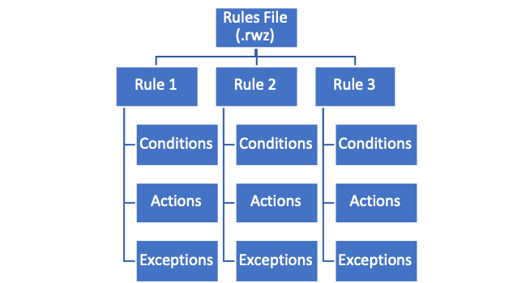
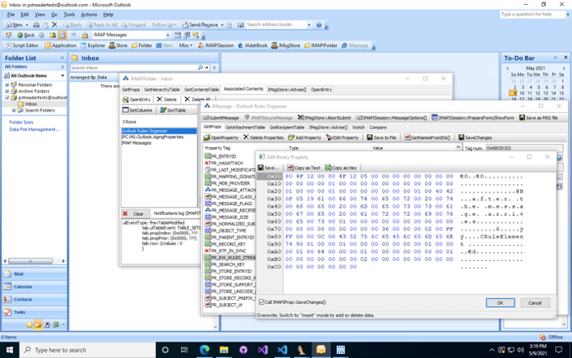

# Outlook Rules Wizard (.rwz) File Format

This document specifies the binary format Microsoft Outlook uses for its rules: the format of exported `.rwz` files and of the copy of the rules Outlook keeps in the mailbox. It also records how each version of Outlook, from Outlook 97 to Outlook 2013, reads, writes and uses the format. Microsoft publishes none of this. It was worked out from 330 sample files and from Outlook's own code.

**Where to start.** [§1](#1-introduction) gives the big picture: what a rule is, where Outlook keeps rules, and a complete example file decoded byte by byte. [§3](#3-format-versions) explains how to tell the versions of the format apart. [§4](#4-rulesheader)–[§8](#8-parameters) define every structure in the order they appear in a file. [§9](#9-versions-and-compatibility) explains how Outlook versions read and write each other's rules, and [§10](#10-reading-and-writing) gives checklists for readers and writers. [§11](#11-how-outlook-uses-rules) describes what Outlook does with rules beyond the file: server rules, running rules, importing them and the dialogs. [Appendix A](#appendix-a-version-history) summarises what changed in each version of Outlook.

**The evidence from Outlook's code**, with the address of every function cited, is in a companion document, [Decompilation notes](Decompilation.md). Its notes by topic follow this document's section order, and it keeps the detailed findings for each version of Outlook.

## Contents

* [About this document](#about-this-document)
* [1. Introduction](#1-introduction)
  * [1.1 Rules](#11-rules)
  * [1.2 Where rules are stored](#12-where-rules-are-stored)
  * [1.3 The format at a glance](#13-the-format-at-a-glance)
  * [1.4 Outlook versions at a glance](#14-outlook-versions-at-a-glance)
  * [1.5 Conventions](#15-conventions)
  * [1.6 Glossary](#16-glossary)
  * [1.7 References](#17-references)
* [2. Common data types](#2-common-data-types)
  * [2.1 Count](#21-count)
  * [2.2 String](#22-string)
  * [2.3 Counted entry ID](#23-counted-entry-id)
  * [2.4 OleDateTime](#24-oledatetime)
  * [2.5 Object tag](#25-object-tag)
  * [2.6 GUID](#26-guid)
* [3. Format versions](#3-format-versions)
  * [3.1 Generations](#31-generations)
  * [3.2 Identifying the format](#32-identifying-the-format)
  * [3.3 Version stamps](#33-version-stamps)
  * [3.4 Version-dependent fields](#34-version-dependent-fields)
  * [3.5 Version 0 streams (G0s)](#35-version-0-streams-g0s)
* [4. RulesHeader](#4-rulesheader)
  * [4.1 Fields](#41-fields)
  * [4.2 Unknown1–3](#42-unknown13)
  * [4.3 ClearCategoriesRuleCreated](#43-clearcategoriesrulecreated)
  * [4.4 Server settings](#44-server-settings)
  * [4.5 Inbox Assistant settings](#45-inbox-assistant-settings)
  * [4.6 ExtraData](#46-extradata)
  * [4.7 Values written by each version](#47-values-written-by-each-version)
* [5. Rule](#5-rule)
  * [5.1 RuleHeader](#51-ruleheader)
  * [5.2 Rule flags and Outlook's own rules](#52-rule-flags-and-outlooks-own-rules)
  * [5.3 Element](#53-element)
  * [5.4 Element order](#54-element-order)
  * [5.5 Rules from newer versions](#55-rules-from-newer-versions)
* [6. RulesFooter](#6-rulesfooter)
* [7. Elements](#7-elements)
  * [7.1 Identifiers](#71-identifiers)
  * [7.2 Mandatory](#72-mandatory)
  * [7.3 Conditions](#73-conditions)
  * [7.4 Actions](#74-actions)
  * [7.5 Exceptions](#75-exceptions)
  * [7.6 Identifiers outside the tables](#76-identifiers-outside-the-tables)
  * [7.7 Element definitions](#77-element-definitions)
* [8. Parameters](#8-parameters)
  * [8.1 EventParameter](#81-eventparameter)
  * [8.2 ItemTypeParameter](#82-itemtypeparameter)
  * [8.3 WordParameter](#83-wordparameter)
  * [8.4 AddressParameter](#84-addressparameter)
  * [8.5 FlaggedForActionParameter](#85-flaggedforactionparameter)
  * [8.6 ImportanceParameter](#86-importanceparameter)
  * [8.7 SensitivityParameter](#87-sensitivityparameter)
  * [8.8 CategoryParameter](#88-categoryparameter)
  * [8.9 FormParameter](#89-formparameter)
  * [8.10 SizeParameter](#810-sizeparameter)
  * [8.11 TimeParameter](#811-timeparameter)
  * [8.12 FormTypeParameter](#812-formtypeparameter)
  * [8.13 SendersListParameter](#813-senderslistparameter)
  * [8.14 RelevanceRangeParameter](#814-relevancerangeparameter)
  * [8.15 AccountParameter](#815-accountparameter)
  * [8.16 ProfileStampParameter](#816-profilestampparameter)
  * [8.17 AddressBookParameter](#817-addressbookparameter)
  * [8.18 AlertParameter](#818-alertparameter)
  * [8.19 FolderParameter](#819-folderparameter)
  * [8.20 PathParameter / MessageParameter](#820-pathparameter--messageparameter)
  * [8.21 FlagParameter](#821-flagparameter)
  * [8.22 DeferParameter](#822-deferparameter)
  * [8.23 CustomActionParameter](#823-customactionparameter)
  * [8.24 RelevanceParameter](#824-relevanceparameter)
  * [8.25 ServerReplyParameter](#825-serverreplyparameter)
  * [8.26 ScriptParameter](#826-scriptparameter)
  * [8.27 FlagForFollowUpParameter](#827-flagforfollowupparameter)
  * [8.28 RetentionPolicyParameter](#828-retentionpolicyparameter)
  * [8.29 FlagColorParameter](#829-flagcolorparameter)
* [9. Versions and compatibility](#9-versions-and-compatibility)
  * [9.1 Version words](#91-version-words)
  * [9.2 A rule's own version](#92-a-rules-own-version)
  * [9.3 Upgrading rules](#93-upgrading-rules)
  * [9.4 Exporting to older formats](#94-exporting-to-older-formats)
  * [9.5 How Outlook 2000 chooses the stamp](#95-how-outlook-2000-chooses-the-stamp)
  * [9.6 Reading other versions' streams](#96-reading-other-versions-streams)
* [10. Reading and writing](#10-reading-and-writing)
  * [10.1 Reading](#101-reading)
  * [10.2 Writing](#102-writing)
* [11. How Outlook uses rules](#11-how-outlook-uses-rules)
  * [11.1 The rules message](#111-the-rules-message)
  * [11.2 Exchange server rules](#112-exchange-server-rules)
  * [11.3 Running rules on the client](#113-running-rules-on-the-client)
  * [11.4 Importing rules from Outlook Express](#114-importing-rules-from-outlook-express)
  * [11.5 The Rules Wizard and Rules and Alerts](#115-the-rules-wizard-and-rules-and-alerts)
* [Appendix A. Version history](#appendix-a-version-history)
  * [Outlook 97](#outlook-97)
  * [Outlook 98](#outlook-98)
  * [Outlook 2000](#outlook-2000)
  * [Outlook 2002](#outlook-2002)
  * [Outlook 2003](#outlook-2003)
  * [Outlook 2007](#outlook-2007)
  * [Outlook 2010](#outlook-2010)
  * [Outlook 2013](#outlook-2013)
  * [Outlook 2016 and later](#outlook-2016-and-later)
* [Appendix B. Open questions](#appendix-b-open-questions)
* [Appendix C. Corrections to earlier notes](#appendix-c-corrections-to-earlier-notes)
* [References](#references)

## About this document

Each statement was established in one of these ways:

| Evidence | Meaning |
|---|---|
| *(no marker)* | **Verified.** Checked against every one of 330 sample files written by Outlook 97, 98, 2000, 2003, 2007 and 2019. |
| An Outlook version | **Traced.** Read from that version's code. A statement such as "Outlook 2002–2013 discard Unknown1" means that the code of every version studied in that range was checked and behaves the same way. The addresses are in [Decompilation notes](Decompilation.md). |
| **[Inferred]** | Consistent with all samples and code, but the *meaning* comes from interpretation (for example, a match with an MFC or MAPI structure), not observation. |
| **[Unknown]** | The field's layout is known but its meaning is not. Observed values are listed. |

The versions studied are Outlook 97, 98, 2000, 2002, 2003, 2007, 2010 and 2013. The binaries are listed in [Decompilation §1.1](Decompilation.md#11-binaries). Where the text says a version was **not traced**, that version reads and writes the same bytes, but the behaviour described wasn't looked for in its code. Outlook 2016, 2019 and Microsoft 365 weren't disassembled. They still write the Outlook 2010 format, as the Outlook 2019 samples show.

Writers SHOULD reproduce observed values for fields marked [Unknown]. Readers SHOULD accept any value.

`docs/RWZ Format.docx` contains earlier experimental notes. Where those notes and this document disagree, this document has been checked against the sample corpus and takes precedence ([Appendix C](#appendix-c-corrections-to-earlier-notes)).

---

## 1. Introduction

### 1.1 Rules

An Outlook rule is a set of conditions, actions and exceptions that Outlook evaluates against messages as they arrive or are sent<sup>[1]</sup>. Outlook shows a rule as a sentence:

```
Apply this rule after the message arrives
from Hugh Bellamy
and with 'invoice' in the subject
move it to the Finance folder
except if it is marked as High importance
```

Each line is an **element**: a condition, an action or an exception, identified by a number ([§7](#7-elements)). Most elements have **parameters**, the underlined values in Outlook's dialogs, such as the people, the words or the folder ([§8](#8-parameters)). A rules file holds any number of rules:



Rules began in Outlook 97 as the *Rules Wizard* add-in (`RULESWIZ.DLL`)<sup>[2]</sup>, and were built into Outlook from Outlook 98 onwards<sup>[3]</sup>. Outlook 2003 renamed the Rules Wizard **Rules and Alerts**. The format has kept the same shape since Outlook 97. Later versions added fields and elements, and Outlook 2002 switched strings to UTF-16.

Rules run in one of two places. When every part of a rule can be expressed as an Exchange server rule, Outlook also uploads it to the server, which then runs it even while Outlook is closed. Other rules are **client-only** and run only while Outlook is running ([§11.2](#112-exchange-server-rules)).

### 1.2 Where rules are stored

Where Outlook stores rules depends on its version<sup>[4]</sup>:

* **Outlook 2002 and later.** Rules are stored in the mailbox or PST<sup>[5]</sup>. The rules stream is the `PidTagRwRulesStream` (`PR_RW_RULES_STREAM`, `0x68020102`) property of a message named `Outlook Rules Organizer`, whose message class is `IPM.RuleOrganizer`<sup>[6]</sup>. The message is in the associated contents table<sup>[7]</sup> of the Inbox folder ([§11.1](#111-the-rules-message)).

  

* **Outlook 2000 and earlier.** Rules are stored on disk at `%APPDATA%\Microsoft\Outlook\<ProfileName>.rwz`. Outlook 97's own copy (its *profile copy* in this document) uses a different layout from the files it exports ([§3.1](#31-generations)). When a store has no rules message yet, Outlook 2003 and 2007 import this file once and save the rules into the store. This wasn't traced in Outlook 2010 or 2013.

Users can also import and export rules as `.rwz` files. When exporting, Outlook 2003 and later offer to write the file in the current format or in a format for Outlook 2002, 2000 or 98 ([§9.4](#94-exporting-to-older-formats)):


The server treats the rules stream as client-specific and opaque<sup>[8]</sup>. `.rwz` files and `PidTagRwRulesStream` values share the format defined here. At the same version they differ only in the rules' version stamps ([§9.2](#92-a-rules-own-version)).

### 1.3 The format at a glance

A rules stream is a header, the rules, and a footer:

```
Stream   := RulesHeader  Rule[NumberOfRules]  RulesFooter
Rule     := RuleHeader   Element[NumberOfElements]
Element  := ObjectTag  Identifier  NumberOfParameters  Parameter[NumberOfParameters]
```

* The **RulesHeader** ([§4](#4-rulesheader)) holds the version stamp that identifies the format ([§3](#3-format-versions)), some settings, and the number of rules.
* Each **rule** ([§5](#5-rule)) has a header with its name and state, then its elements.
* Each **element** has an identifier ([§7](#7-elements)) and parameters whose layout depends on the identifier ([§8](#8-parameters)).
* The **RulesFooter** ([§6](#6-rulesfooter)) holds the last template directory used and the time the rules were last synchronized with the Exchange server.

The oldest layout, Outlook 97's exports, has no header or footer, only the rule count and the rules ([§3.1](#31-generations)).

**Origins.** The format is the output of MFC's `CArchive` serialization in Outlook 97, and most of its shape follows from that:

* Rule elements are `CObject`s of class `CRuleElement` (runtime-class schema 0), written with `CArchive::WriteObject`. Each element is therefore preceded by an object tag ([§2.5](#25-object-tag)).
* A rule (`CRule`) writes its name, Enabled, RunError and ServerRule, then its element list, a `CObList`. `CRule` is not written as an object, so it has no tag.
* `CRuleElement::Serialize` writes the element ID and a has-parameter flag ([§5.3](#53-element)), and then calls the parameter object's own `Serialize`.
* Counts use `CArchive::WriteCount` ([§2.1](#21-count)), strings use `CString`'s length encoding ([§2.2](#22-string)), and dates are written with `operator<<(CArchive&, COleDateTime)` ([§2.4](#24-oledatetime)).
* `RULESWIZ.DLL` (Outlook 97) statically links MFC. It contains the class names `CObject`, `CArchive`, `CRule`, `CRuleComponent` and `CRuleElement`.
* Outlook 98 and later no longer use MFC's `CArchive`, but their own archive classes write the same bytes.

Parameter objects all derive from one base class, whose `Serialize` writes a Reserved field ([§8](#8-parameters)). Each element's definition says which parameter class to create, so the class is never written: parameters carry no class tag. Most string parameters (words, categories, paths, messages) share a single "Reserved + CString" class in Outlook 97. Class names such as `CWordParameter` and `CFolderParameter` come from Outlook's binaries (`docs/Rules Sever Side.xlsx`).

**An example.** The smallest Outlook 2010 stream holds one enabled rule named `RULENAME`, applied "after the message arrives":

```
00 00 14 00                         VersionStamp        0x00140000 (v14)
00 00 14 06                         WriterVersion       index 6, stamp 0x140000
00 00 00 00 ×3                      Unknown1–3
00 00 00 00                         ClearCategoriesRuleCreated
00 00 00 00  00 00 00 00            ServerRulesOutOfDate, ServerUpdateMode
01 00 00 00                         PromptToConvertInboxAssistantRules
01 00 00 00                         ConvertInboxAssistantRules
00 00 00 00                         ExtraDataSize = 0
01 00                               NumberOfRules = 1
  00 00 14 00                       Rule.VersionStamp
  08 52 00 55 00 … 45 00            Name = StringW "RULENAME"
  01 00 00 00                       Enabled
  00 00 00 00 ×4                    RunError, ServerRule, Flags, ServerRuleId
  36 00 00 00                       DataSize = 54
  02 00                             NumberOfElements = 2
  FF FF 00 00 0C 00 "CRuleElement"  new-class tag, schema 0
    90 01 00 00  01 00 00 00        Identifier 0x190, 1 parameter
    00 00 00 00  01 00 00 00          Reserved, Flags = after received
  01 80                             class tag 1
    64 00 00 00  01 00 00 00        Identifier 0x064, 1 parameter
    00 00 00 00  01 00 00 00          Reserved, Value = 1
00 00 00 00                         TemplateDirectoryLength = 0
02 00 00 00  00 00 … 00             Timestamp: null
00 00 00 00                         Unknown
```

### 1.4 Outlook versions at a glance

| Version | Writes | Main changes |
|---|---|---|
| Outlook 97 | 970102 (its own copy); exports have no stamp | The first version: the Rules Wizard add-in. Its exports use the bare G0 layout. |
| Outlook 98 | 970812 | Built into Outlook. Adds the rule Flags field, the folder's SecondaryStore, the message header, junk-mail and Net Folders conditions, and "stop processing more rules". |
| Outlook 2000 | 970812, or 980413 once a rule needs it | Several words per word condition. Adds the account, relevance, redirect, server reply, forward as attachment, print, start application and permanently delete elements. Creates junk-mail and Download Options rules of its own. |
| Outlook 2002 | 1000000 | Rules move into the mailbox. UTF-16 strings; a version word, extra data and per-rule version, server ID and size. Adds "on this computer only", the address book, scripts and "mark it as read". Imports Outlook Express rules. |
| Outlook 2003 | 1100000 | **Rules and Alerts.** Adds meeting invitations, Alert E-mail, Desktop Alerts and coloured flags. The Junk E-mail Filter replaces the junk-mail rules, which Outlook now deletes. |
| Outlook 2007 | 1200000 | Adds InfoPath forms, RSS feeds, "any category", follow-up flags and "clear message's categories", with a "Clear categories on mail" rule of its own. |
| Outlook 2010 | `0x140000` | Adds the retention policy action. Drops two hidden actions and the rule-set mask. Deletes the Net Folders rule. Outlook Express import no longer works. |
| Outlook 2013 | `0x140000` | No new stamp. Switches off relevance and custom actions, stops making the Clear categories rule, and removes Outlook Express import. |
| Outlook 2016 and later | `0x140000` | Not disassembled. Still the Outlook 2010 format (Outlook 2019 samples). "Start application" and "run a script" are hidden. |

[Appendix A](#appendix-a-version-history) lists every change by version.

### 1.5 Conventions

* All integers are **little-endian**.
* `u8`, `u16` and `u32` are unsigned integers of 1, 2 and 4 bytes. `i32` is a signed 32-bit integer and `f64` is an IEEE 754 double.
* Structures are packed. There is no alignment padding anywhere in the stream.
* Field sizes are shown in parentheses, for example **Count (2 bytes)**, or in a Size column. "Variable" means the size depends on the content.
* Element identifiers are written in hex (`0x00CB`). Version stamps up to 1200000 are written in decimal, as Outlook defines them, and later ones in hex (`0x140000`).

### 1.6 Glossary

**ANSI string**: a sequence of 8-bit characters in the writer's code page. In practice this is ASCII or Windows-1252.

**Client-only**: an element that only Outlook can carry out, not the Exchange server, such as playing a sound. A rule with a client-only element runs only while Outlook is running ([§11.2](#112-exchange-server-rules)).

**COleDateTime**: the MFC date/time class. See [§2.4](#24-oledatetime).

**DATE / OLE Automation date**: an 8-byte IEEE double holding the number of days since 1899-12-30 00:00. The fractional part is the time of day. See [MS-DTYP] and [MS-OAUT].

**Deferred action**: how an Exchange server rule hands a message back to Outlook to carry out the rule's client-only parts ([§11.2.4](#1124-client-only-parts-and-deferred-actions)).

**Element**: one condition, action or exception of a rule ([§7](#7-elements)).

**Format generation**: one of the layouts described in [§3.1](#31-generations).

**Server rule**: a rule stored in the Exchange server's rules table and run by the server ([§11.2](#112-exchange-server-rules)).

**UTF-16**: UTF-16 little-endian, with no byte order mark and no terminating NUL unless stated otherwise.

**Version stamp**: a number that identifies a version of the format ([§3.3](#33-version-stamps)).

**Version word**: a version stamp in bits 0–23 and its position in Outlook's table of stamps in bits 24–31 ([§9.1](#91-version-words)).

**MAY, SHOULD, MUST, SHOULD NOT, MUST NOT**: as defined in [RFC2119].

### 1.7 References

* [MS-DTYP] Microsoft, "Windows Data Types". https://learn.microsoft.com/en-us/openspecs/windows_protocols/ms-dtyp
* [MS-OAUT] Microsoft, "OLE Automation Protocol". https://learn.microsoft.com/en-us/openspecs/windows_protocols/ms-oaut
* [MS-OXCDATA] Microsoft, "Data Structures". https://learn.microsoft.com/en-us/openspecs/exchange_server_protocols/ms-oxcdata
* [MS-OXPROPS] Microsoft, "Exchange Server Protocols Master Property List".
* [MS-OXORULE] Microsoft, "Email Rules Protocol".
* [MFC-CArchive] Microsoft, "CArchive Class" and Technical Note TN002, "Persistent Object Data Format".
* [RFC2119] Bradner, S., "Key words for use in RFCs to Indicate Requirement Levels", BCP 14, RFC 2119, March 1997.

Numbered references (<sup>[1]</sup> and so on) are listed at the [end of the document](#references).

---

## 2. Common data types

### 2.1 Count

A count written with MFC's `CArchive::WriteCount`:

| Field | Size | Description |
|---|---|---|
| Count16 | 2 | The count, if it is less than `0xFFFF`. |
| Count32 | 4, optional | Present only if Count16 is `0xFFFF`. The count. |

RulesHeader.NumberOfRules, RuleHeader.NumberOfElements and FormParameter.NumberOfProperties are counts. Outlook 97 writes all three with `WriteCount`. **[Inferred]** Later versions write the same bytes. No sample has a count of 65535 or more, so the 6-byte form has never been observed.

### 2.2 String

A length-prefixed string. The same prefix encodes two kinds of character data:

* **String8**: the characters are ANSI, and the length counts bytes.
* **StringW**: the characters are UTF-16, and the length counts UTF-16 code units, not bytes or grapheme clusters.

| Field | Size | Description |
|---|---|---|
| Length | 1 | Number of characters if less than `0xFF`. |
| Length16 | 2, optional | Present only if Length is `0xFF`. Number of characters if less than `0xFFFF`. |
| Length32 | 4, optional | Present only if Length16 is `0xFFFF`. Number of characters. **[Inferred]** from MFC; never observed. |
| Value | variable | The characters. There is no NUL terminator. |

Writers MUST use the shortest encoding: 1 byte for 0–254, 3 bytes for 255–65534.

MFC writes a `0xFF 0xFFFE` marker before Unicode `CString`s. This format never contains that marker: the format generation alone decides whether a string is ANSI or UTF-16.

In this document, **String** means "String8 in the ANSI generations and StringW in the Unicode generation" ([§3.1](#31-generations)). Outlook 2002–2013 decide this per version: a String is UTF-16 from version 1000000 and ANSI below it. StringW and String8 mean that encoding in every generation.

### 2.3 Counted entry ID

| Field | Size | Description |
|---|---|---|
| Size | 4 | Length of EntryID in bytes. |
| EntryID | Size | A MAPI entry ID ([MS-OXCDATA] §2.2). |

### 2.4 OleDateTime

The serialized form of an MFC `COleDateTime` (12 bytes).

| Field | Size | Description |
|---|---|---|
| Status | 4 | `0` = valid, `1` = invalid, `2` = null. Only `0` and `2` have been observed. |
| Date | 8 | An OLE Automation date (`f64`). |

When Status is null, Date is `0.0`. Dates before 1899-12-30 are negative, and their fractional part still counts the time of day forward from midnight: `-1.25` is 1899-12-29 06:00 ([MS-OAUT]).

### 2.5 Object tag

Every rule element is preceded by an MFC object tag (`u16`):

| Value | Meaning |
|---|---|
| `0xFFFF` | **New class** (`wNewClassTag`). A class descriptor follows: Schema (`u16`, always `0`), NameLength (`u16`, always `12`), Name (NameLength ANSI bytes, always `CRuleElement`). |
| `0x8001` | **Class reference** (`wClassTag \| 1`). The object's class is entry 1 of the archive's class map, which is `CRuleElement`. |

The class descriptor is written once per stream, before the first element of the first rule. Every later element in the stream, including the first element of rules 2…N, uses `0x8001`. A rule with zero elements writes no tag.

MFC can also emit `0x7FFF` (big object tag) and object back-references (`0x0001`–`0x7FFE`). Neither has been observed. Readers MAY treat them as corruption.

How Outlook handles tags:

* **Reading.** Outlook 2000–2013 are looser than MFC. After `0xFFFF` they read Schema, NameLength and the name into a fixed buffer (456 bytes in Outlook 2000, 260 in Outlook 2007) without checking the name, and they treat **any** other tag as a reference to `CRuleElement`.
* **Writing.** Outlook 2000–2013 write the class descriptor once per archive, before the stream's first element, and `0x8001` after that.
* **Empty slots.** When Outlook 2002–2013 write a rule whose element list has an empty slot, they write the null tag `0x0000` with nothing after it. Their own readers would then misread it: Outlook 2010's has no case for that tag. No sample contains one.

### 2.6 GUID

16 bytes, laid out as a Windows `GUID` ([MS-DTYP] §2.3.4).

---

## 3. Format versions

### 3.1 Generations

The format has four layouts, called *generations* in this document:

| Generation | First u32 | Written by | Strings |
|---|---|---|---|
| **G0** (Outlook 97 export) | anything not listed below | Outlook 97's Export Rules | ANSI |
| **G0s** (version stamp 0) | `0x00000000` | Outlook 2003's Export Rules, when the rules were last saved by a newer Outlook ([§3.5](#35-version-0-streams-g0s)) | ANSI |
| **G1** (ANSI) | `970102`, `970812`, `980413` | Outlook 97's profile copy; Outlook 98; Outlook 2000 (usually as `970812`, [§9.5](#95-how-outlook-2000-chooses-the-stamp)); Outlook 2002 and later exporting "for Outlook 98/2000" | ANSI |
| **G2** (Unicode) | `1000000`, `1100000`, `1200000`, `0x00140000` | Outlook 2002 and later | UTF-16 |

**G0** has no version stamp. Its first 2 bytes are the rule count ([§2.1](#21-count)), and its next byte is the first rule name's length. Every Outlook 97 sample starts `01 00` (one rule). G0 is Outlook 97's **Export Rules** format: the exporter writes the rule count with `CArchive::WriteCount` and then each rule, with no header or footer. The rules Outlook 97 keeps for itself use the G1 layout with version stamp 970102 ([§3.3](#33-version-stamps)).

Within G1, version stamp 970102 lacks two fields that 970812 has ([§3.4](#34-version-dependent-fields)).

Field presence by generation:

| Structure / field | G0 | G0s | G1 (970102) | G1 (970812+) | G2 |
|---|---|---|---|---|---|
| RulesHeader.VersionStamp | – | ✓ (=0) | ✓ | ✓ | ✓ |
| RulesHeader.WriterVersion | – | – | – | – | ✓ |
| RulesHeader.Unknown1 … ConvertInboxAssistantRules | – | ✓ | ✓ | ✓ | ✓ |
| RulesHeader.ExtraDataSize, ExtraData | – | – | – | – | ✓ |
| RuleHeader.VersionStamp | – | – | – | – | ✓ |
| RuleHeader.Flags | – | – | – | ✓ | ✓ |
| RuleHeader.ServerRuleId, DataSize | – | – | – | – | ✓ |
| Folder parameter's SecondaryStore | – | – | – | ✓ | ✓ |
| DocumentProperty MatchIfMissing | ✓ | – | ✓ | ✓ | ✓ |
| RulesFooter | – | ✓ | ✓ | ✓ | ✓ |

### 3.2 Identifying the format

The first four bytes identify the generation. A G0 stream can only begin with four zero bytes if it has no rules, and then it is only 2 bytes long (`00 00`). Readers MUST therefore treat a stream shorter than 4 bytes as G0.

Readers SHOULD identify the format by **range** rather than by exact stamp, as Outlook does. Later builds of a version may then write slightly different stamps, and Outlook 2010 and 2013 already know `0x150000`. A G0 stream's first four bytes are its rule count, then the first rule name's length and first character (or the Enabled field when the name is empty). They are therefore either below 960706 or at least `0x01000000`, never inside a stamp range:

| First u32 | Format |
|---|---|
| `0` | G0s |
| below 960706, or `0x01000000` and above | G0 |
| 960706 – 970811 | G1, Outlook 97 profile layout (no rule Flags or folder SecondaryStore) |
| 970812 – 980412 | G1, Outlook 98 |
| 980413 – 999999 | G1, Outlook 2000 |
| 1000000 – 1099999 | G2, Outlook 2002 |
| 1100000 – 1199999 | G2, Outlook 2003 |
| 1200000 – `0x13FFFF` | G2, Outlook 2007 |
| `0x140000` – `0xFFFFFF` | G2, Outlook 2010 and later |

Stamps 960706–970811 also cover pre-release builds whose footer or folder fields differ ([§3.4](#34-version-dependent-fields)). No such file has been seen.

How each version of Outlook recognises a stream:

* **Outlook 97** accepts its own copy at versions 960706 to 970102 and rejects any other.
* **Outlook 98** accepts any stamp from 960706 to 970812. It imports an unsigned (G0) file as version 970102.
* **Outlook 2000** refuses stamps of 1000000 or more, and warns about stamps newer than its own, 980413.
* **Outlook 2002** treats a first u32 with any of its top four bits set (`0x10000000` or more) as G0, which it reads as version 970102. Any stamp above 1000000 is read with the Outlook 2002 layout, and rules whose own stamp is newer are kept unparsed ([§5.5](#55-rules-from-newer-versions)).
* **Outlook 2003** does the same with 1100000 in place of 1000000: any stamp above 1100000 is read with the Outlook 2003 layout and kept as 1100000.
* **Outlook 2007** does the same with 1200000.
* **Outlook 2010 and 2013** do the same with `0x140000`: a G0 stream is read as 970102, and any stamp above `0x140000` is read with the Outlook 2010 layout, which is the Outlook 2002 layout. So Outlook 2013 reads a stream stamped `0x150000` with that layout too.

### 3.3 Version stamps

Outlook identifies format versions with 24-bit *version stamps*. Up to Outlook 2000 a stamp is a `YYMMDD` build date. From Outlook 2002 it is the product's major version × 100000. From Outlook 2010 it is the major version written as hex digits (`0x14` = 14).

| Index | Stamp (decimal) | Stamp (hex) | Meaning |
|---|---|---|---|
| — | 960706 | `0x0EA8C2` | The oldest version Outlook 97 accepts in its profile copy of the rules; anything older is rejected. |
| — | 960723 | `0x0EA8D3` | Footer TemplateDirectory added. |
| — | 960820 | `0x0EA934` | Footer Timestamp added. |
| — | 960918 | `0x0EA996` | "Version 960918" appears in `RULESWIZ.DLL`'s About text. Never written to files. |
| — | 960925 | `0x0EA99D` | Footer Unknown added. |
| 0 | 970102 | `0x0ECD76` | **Outlook 97.** The stamp `RULESWIZ.DLL` writes to its profile copy of the rules (the G1 layout), and the newest version it accepts. DocumentProperty MatchIfMissing ([§8.9](#89-formparameter)) was added in this version. Its exports (G0) have no stamp; Outlook 98 imports them as version 970102. Never observed in a sample. |
| — | 970718 | `0x0ECFDE` | Folder parameter SecondaryStore added. |
| 1 | 970812 | `0x0ED03C` | **Outlook 98.** Adds the rule Flags field ([§5.1](#51-ruleheader)). Outlook 98 accepts 960706–970812 and doesn't know 980413. |
| 2 | 980413 | `0x0EF5BD` | **Outlook 2000.** Adds no fields: the layout is the same as 970812, but Outlook 2000 reads NumberOfParameters as a count ([§5.3](#53-element)) and defines more elements ([§7](#7-elements)). It refuses stamps of 1000000 or more and warns about stamps newer than its own. Outlook 2000 only writes this stamp once the rules need it; otherwise it writes 970812 ([§9.5](#95-how-outlook-2000-chooses-the-stamp)). |
| 3 | 1000000 | `0x0F4240` | **Outlook 2002** (v10). Adds WriterVersion, the header's extra data, and the rule header's VersionStamp, ServerRuleId and DataSize, and switches strings to UTF-16. Outlook 2002 writes at most this stamp, and doesn't move older rules to it by itself ([§9.3](#93-upgrading-rules)). |
| 4 | 1100000 | `0x10C8E0` | **Outlook 2003** (v11). Adds no fields: the layout is the same as 1000000. Outlook 2003 writes at most this stamp, and new profiles start with it. It adds elements that need it ([§9.4](#94-exporting-to-older-formats)) and the rule without an element list ([§5.5](#55-rules-from-newer-versions)). |
| 5 | 1200000 | `0x124F80` | **Outlook 2007** (v12). Adds no fields. Outlook 2007 writes at most this stamp, and new profiles start with it. It adds elements that need it. |
| 6 | 1310720 | `0x140000` | **Outlook 2010** (v14) and later. Adds no fields: the layout is the same as 1000000. Outlook 2010 writes at most this stamp, and new profiles start with it. It adds the element that needs it, `0x0153`. Outlook 2013 writes at most this stamp too, and new profiles start with it. Outlook 2019 still writes this stamp. |
| 7 | 1376256 | `0x150000` | v15 (Outlook 2013). Never written and never observed in a file. Outlook 2010's and 2013's tables of stamps have it, but Outlook 2013 still writes `0x140000`. It keeps a rule stamped `0x150000` unparsed, and reads a stream stamped `0x150000` with the Outlook 2002 layout. |

**Outlook's table of stamps.** From Outlook 2002 on, Outlook keeps a table of the stamps it knows, and records a stamp's position in that table next to the stamp in its version words ([§9.1](#91-version-words)). The Index column is that position. Indices 0–7 match the order of a table found in a disassembly of a modern 64-bit Outlook build (`docs/Internals/RWZ Decompilation Notes.docx`). The tables differ by version:

| Version | Table |
|---|---|
| Outlook 2002 | Indices 0–5 as above, then 1300000 at index 6 (a v13 that never shipped). |
| Outlook 2003 | The same as Outlook 2002's, ending with a `0` at index 7. |
| Outlook 2007 | `0x140000` at index 6, then `0` at index 7. So Outlook 2007 knew Outlook 2010's stamp before Outlook 2010 existed. |
| Outlook 2010 and 2013 | All eight stamps above, with `0x150000` at index 7, ending with a `0` at index 8. |

### 3.4 Version-dependent fields

Within a generation, a few fields are present only from a given version. Outlook 97 and 98 read and write these fields only when the stream's version is at least the stamp shown, and every later version up to Outlook 2013 applies the same checks. No other field depends on the version. The generations of [§3.1](#31-generations) differ in more ways than this, because Outlook 2002 also changed the string encoding and the rule header.

| Since | Field | Section |
|---|---|---|
| 960723 | Footer TemplateDirectory | [§6](#6-rulesfooter) |
| 960820 | Footer Timestamp | [§6](#6-rulesfooter) |
| 960925 | Footer Unknown | [§6](#6-rulesfooter) |
| 970102 | DocumentProperty MatchIfMissing | [§8.9](#89-formparameter) |
| 970718 | Folder parameter SecondaryStore | [§8.19](#819-folderparameter) |
| 970812 | RuleHeader Flags | [§5.1](#51-ruleheader) |

Unsigned (G0) streams count as version 970102. G0s streams are version 0, so they have none of these fields except the footer, which Outlook 2003 always writes but reads only from 960723 ([§3.5](#35-version-0-streams-g0s)).

### 3.5 Version 0 streams (G0s)

Two samples (`Versions/Outlook2003/*`) start with a version stamp of 0. The layout is G1 with VersionStamp 0 and without the rule's Flags. The missing field follows from the stamp: rule Flags are only read and written from version 970812, and 0 is below that.

Outlook 2003's Export Rules writes this layout by accident. Its default file type, "Rules Wizard rules", uses the stamp at WriterVersion's index in Outlook 2003's table of stamps ([§9.1](#91-version-words)). When WriterVersion holds a stamp that table doesn't have, such as Outlook 2010's `0x140000`, the index is the table's length, 7, and the entry there is the table's terminating `0`. Outlook then writes the whole file at version 0:

* no WriterVersion or ExtraData;
* no rule VersionStamp, Flags, ServerRuleId or DataSize;
* no folder SecondaryStore or DocumentProperty MatchIfMissing ([§3.4](#34-version-dependent-fields));
* ANSI strings;
* and the footer, which its writer always adds.

Neither G0s sample has a folder or a document property to confirm the third point.

The rest of the G0s header fits too. Outlook 2003 writes both server settings as `0`, and keeps ClearCategoriesRuleCreated as it found it: here `1`, which Outlook 2007 had set and Outlook 2010 kept ([§4](#4-rulesheader)). Outlook 2003 imports such a file at version 0, reading the same fields, but stops before the footer, which its loader only reads from version 960723 ([§6](#6-rulesfooter)). Outlook 2010 and 2013 would write the same layout for a WriterVersion whose stamp they don't know ([§9.4](#94-exporting-to-older-formats)).

---

## 4. RulesHeader

### 4.1 Fields

| Field | Size | Generations | Description |
|---|---|---|---|
| VersionStamp | 4 | G0s, G1, G2 | The format's version stamp ([§3.3](#33-version-stamps)), or `0` in G0s. Writers converting between formats SHOULD write the stamp of the target format; readers SHOULD preserve an unrecognised stamp within a known range ([§3.2](#32-identifying-the-format)). |
| WriterVersion | 4 | G2 | A version word for the rules as a whole ([§9.1](#91-version-words)). Bits 0–23: the version stamp the rules have been brought up to, normally the stamp of the newest Outlook that saved them. Bits 24–31: that stamp's index in Outlook's table of stamps. |
| Unknown1 | 4 | not G0 | **[Unknown]** Writers SHOULD write `0`; readers MUST accept any value ([§4.2](#42-unknown13)). |
| Unknown2 | 4 | not G0 | As Unknown1. |
| Unknown3 | 4 | not G0 | As Unknown1. |
| ClearCategoriesRuleCreated | 4 | not G0 | Flags, of which only bit `0x1` is known: Outlook 2007 has created its "Clear categories on mail (recommended)" rule ([§4.3](#43-clearcategoriesrulecreated)). Readers MUST accept any value. |
| ServerRulesOutOfDate | 4 | not G0 | `1` when the copy of the rules on the Exchange server needs updating ([§4.4](#44-server-settings)). |
| ServerUpdateMode | 4 | not G0 | The "Update server" option of the Rules Wizard's Options dialog: `1` = Manually, `2` = Automatically, `0` = not set ([§4.4](#44-server-settings)). |
| PromptToConvertInboxAssistantRules | 4 | not G0 | The "Prompt to convert Inbox Assistant rules" option: `1` = ask whether to convert the old Exchange Inbox Assistant rules found on the server ([§4.5](#45-inbox-assistant-settings)). Always `1` observed. |
| ConvertInboxAssistantRules | 4 | not G0 | The last answer to that prompt: `1` = Yes (convert), `0` = No ([§4.5](#45-inbox-assistant-settings)). Always `1` observed, but `0` is valid. Readers MUST accept both. |
| ExtraDataSize | 4 | G2 | Number of bytes of ExtraData. Always `0` observed. |
| ExtraData | ExtraDataSize | G2 | Readers MUST skip it and SHOULD preserve it ([§4.6](#46-extradata)). |
| NumberOfRules | 2 (or 6) | all | Number of Rule structures that follow, as a Count ([§2.1](#21-count)). |

The header is 38 bytes in G0s and G1, 46 bytes plus ExtraDataSize in G2, and 2 bytes in G0. Outlook 2000–2013 read and write the fields in this order.

### 4.2 Unknown1–3

Always `0` in the samples, but values of `1` have been seen in the copy of the rules stored in the mailbox. No version studied gives them a meaning:

* **Outlook 97, 98 and 2000** load and save Unknown1–3 unchanged. Nothing else reads or writes them, and new profiles start with `0`.
* **Outlook 2002–2013** discard Unknown1 when loading and always write `0`. They still load and save Unknown2 and Unknown3 unchanged.
* **Outlook 2007, 2010 and 2013** use Unknown2 and Unknown3 only in the loader, the saver, the code for new profiles (which leaves them `0`) and the routine that copies the rules. So they only preserve them. **[Inferred]** The search looked for code near the other header fields, so a use in an unrelated routine could still be missed.

What wrote the `1`s in the mailbox is still unknown; a version after Outlook 2013 is the most likely source ([Appendix B](#appendix-b-open-questions)).

### 4.3 ClearCategoriesRuleCreated

This field was called Unknown4 before Outlook 2007 explained it. Outlook 97–2003 only preserve it, and new profiles get `0`.

**Outlook 2007** uses bit `0x1` to record that it has created its "Clear categories on mail (recommended)" rule. It checks the bit and the registry value `AcceptCategories` after loading the rules:

* If `AcceptCategories` is `0` (the default) and the bit is clear, Outlook adds a rule named "Clear categories on mail (recommended)" with "assigned to any category" (`0x00F6`) and "clear message's categories" (`0x0152`), and VersionStamp 1200000. Outlook then sets the bit. It doesn't add the rule if WriterVersion is below 1000000, if a rule with exactly those elements already exists, or if a store property (`0x66570014`, an 8-byte value) has a top word of `8` or more, which **[Inferred]** marks a server of Exchange 2007 or later.
* If the bit is already set, Outlook only raises an existing rule of that shape to VersionStamp 1200000.
* If `AcceptCategories` is non-zero and the bit is set, Outlook marks the rule deleted and clears the bit.

So a user who deletes the rule doesn't get it back, because the bit stays set. Outlook finds the rule by its elements (`0x0064`, `0x00F6` and `0x0152`), not by its name or Flags.

**Outlook 2010** runs the same code. It creates the same rule, still with VersionStamp 1200000, and sets, keeps or clears the bit in the same cases.

**Outlook 2013** still loads and saves the field, but no longer makes the rule: the registry value `AcceptCategories` and the rule's name are gone from it. Nothing in Outlook 2013 sets the bit, so it only keeps a `1` it finds.

Every sample with `1` was written by Outlook 2007 (stamp 1200000), by Outlook 2010 or later over rules that had been through Outlook 2007, or by Outlook 2003 exporting such rules (the G0s samples).

### 4.4 Server settings

* **ServerRulesOutOfDate** is set when the rules or options change, or when an upload fails for lack of server space, and cleared after a successful upload. When updates are automatic, Outlook uploads at startup if it is set (Outlook 97).
* **ServerUpdateMode** is the "Update server" setting of the Options dialog in Outlook 97, 98 and 2000, which also has an Update Now button: `1` = Manually (only when the user clicks "Update Now"), `2` = Automatically. Switching from Manually to Automatically triggers an immediate upload. `0` means not set, as written by Outlook 2002 and later.
* **Outlook 2002–2013** discard both fields when loading and write `0` for both. No "Update server" option was found in Outlook 2003's, 2007's, 2010's or 2013's resources.

### 4.5 Inbox Assistant settings

Before Outlook, Exchange users kept server rules with the Exchange client's *Inbox Assistant*. Outlook offers to convert them into its own rules ([§11.2.7](#1127-inbox-assistant-and-out-of-office-rules)).

* **PromptToConvertInboxAssistantRules** is Outlook 97's option "Prompt to convert Inbox Assistant rules": `1` = ask whether to convert the Inbox Assistant rules found on the server. "Do not prompt me again" clears it. Outlook 98 has the same option and prompt. Outlook 2000's Options dialog no longer has the option, but the prompt is unchanged, so "Do not prompt me again" still clears it.
* **ConvertInboxAssistantRules** is the last answer to that prompt: `1` = Yes (convert), `0` = No. Outlook 98 and 2000 still show the prompt, with Yes, No, "Do not prompt me again" and "I want to use the Inbox Assistant instead".
* **Outlook 2002–2013** only keep both fields: they load, save and copy them unchanged. No such option was found in Outlook 2003's, 2007's, 2010's or 2013's resources.

### 4.6 ExtraData

Outlook 2002–2013 load these bytes and write them back unchanged. Nothing else reads them, and even the routine that copies the header leaves them out. Outlook 2010 and 2013 write nothing of their own there: they write ExtraDataSize `0` when they hold no bytes. **[Inferred]** It is room for later versions to add header data that older ones keep.

### 4.7 Values written by each version

What a new profile starts with:

| Version | VersionStamp | Unknown1–3, ClearCategoriesRuleCreated | ServerRulesOutOfDate, ServerUpdateMode | Inbox Assistant fields |
|---|---|---|---|---|
| Outlook 98 | — | `0` | `0`, `2` (Automatically) | `1`, `1` |
| Outlook 2000 | 970812 | `0` | `0`, `2` (Automatically) | `1`, `1` |
| Outlook 2002 | 1000000 | `0` (Unknown1 always written as `0`) | always written as `0` | `1`, `1` |
| Outlook 2003 | 1100000, WriterVersion `0x0010C8E0` | `0` | always written as `0` | `1`, `1` |
| Outlook 2007 | 1200000 | `0` | always written as `0` | `1`, `1` |
| Outlook 2010 | `0x140000`, WriterVersion `0x06140000` | `0` | always written as `0` | `1`, `1` |
| Outlook 2013 | `0x140000`, WriterVersion `0x06140000` | `0` | always written as `0` | `1`, `1` |

ClearCategoriesRuleCreated, ServerRulesOutOfDate and ServerUpdateMode in the samples depend on the writer, not the target format:

| Writer | (ClearCategoriesRuleCreated, ServerRulesOutOfDate, ServerUpdateMode) |
|---|---|
| Outlook 98 / 2000 | (0, 1, 2) |
| Outlook 2002 | (kept, 0, 0) |
| Outlook 2003 | (kept, 0, 0) |
| Outlook 2007 | (1 once it has made its Clear categories rule, 0, 0) |
| Outlook 2010 and later | (0 or kept `1`, 0, 0). Outlook 2010 sets `1` once it has made the Clear categories rule, as Outlook 2007 does. Outlook 2013 no longer makes the rule, so it only keeps a `1` it finds. |

---

## 5. Rule

```
Rule := RuleHeader  Element[RuleHeader.NumberOfElements]
```

### 5.1 RuleHeader

| Field | Size | Generations | Description |
|---|---|---|---|
| VersionStamp | 4 | G2 | The rule's own version word, laid out like RulesHeader.WriterVersion ([§9.1](#91-version-words)). The rest of the rule is laid out for this version ([§9.2](#92-a-rules-own-version)). Always equal to RulesHeader.VersionStamp in the samples. Readers SHOULD honour it; writers SHOULD write the stream's stamp. |
| Name | variable | all | String (String8 in G0, G0s and G1; StringW in G2). Outlook limits rule names to 255 characters. May hold a template name after a tab (below). |
| Enabled | 4 | all | `1` = enabled, `0` = disabled. Readers SHOULD treat any non-zero value as enabled. New rules default to enabled. |
| RunError | 4 | all | Non-zero after the rule failed while Outlook was running it on the client (below). Always `0` observed. Readers SHOULD treat any non-zero value as an error. |
| ServerRule | 4 | all | `1` once the rule has been saved to the Exchange server's rules table (below). Usually `0`; `1` in 3 rules written by Outlook 2010 or later. |
| Flags | 4 | G1 (970812+), G2 | `0` for rules the user creates. Outlook sets bits on rules it creates itself ([§5.2](#52-rule-flags-and-outlooks-own-rules)). |
| ServerRuleId | 4 | G2 | The ID of the rule's copy on the Exchange server. `0` for rules never saved to the server (below). Observed `0`, `1` and `2`, non-zero exactly when ServerRule is `1`. |
| DataSize | 4 | G2 | Number of bytes from the end of this field to the end of the rule: NumberOfElements, every object tag, and every element. Matched exactly in all 116 G2 rules. `0` means the rule has **no element list** ([§5.5](#55-rules-from-newer-versions)). Readers MUST accept a DataSize of `0`. |
| NumberOfElements | 2 (or 6) | all | Number of elements in this rule, as a Count ([§2.1](#21-count)): Outlook 97 writes the element list, a `CObList`, with `CObList::Serialize`. Absent when DataSize is `0`. |

**Name and template.** Outlook 97 writes `<rule name>` TAB `<template name>`, where the template is the wizard template the rule was made from, for example `Forward within 20 days\tBuild as I go`. Every Outlook 97 sample has the tab, and samples from later versions sometimes do. Outlook 98–2013 split the name at the first tab when loading and save only the part before it, so they drop the template name. (Outlook 98 still keeps it in memory.)

**RunError.** How it is set has changed over time:

* **Outlook 97** gives new rules `0`. It copies and saves the field but never reads it.
* **Outlook 98** runs the actions one by one. After each, it sets RunError to the action's HRESULT, so a failure stores an error code such as `0x80004005` rather than `1`, and sets Enabled to whether the action succeeded. A failure also shows an error naming the rule. The remaining actions still run, and a later success resets both fields.
* **Outlook 2000**: when an action of a client rule fails, Outlook sets RunError to `1`, turns the rule off (Enabled = `0`) and shows an error message naming the rule. A rule that runs without error gets `0`.
* **Outlook 2002, 2003 and 2007** run the actions one by one and, after each, set RunError to whether that action failed. When an action fails they also turn the rule off and add it to the "Rules in Error" window instead of showing a message. Because the field is set after every action, a later action that succeeds sets it back to `0`, though the rule stays off: Outlook doesn't turn a rule back on when it later runs without error.
* **Outlook 2010 and 2013** do the same, but no longer keep RunError as a separate number. Like Enabled, it is a bit of the rule's state in memory. Loading sets the bit for any non-zero value, and saving writes `1` or `0`. So an older error code, such as the `0x80004005` Outlook 98 stores, is written back as `1`.
* **Outlook 2010 updates** (14.0.7261) also mark a rule as failed when it contains an element that the update no longer allows ([§11.3.6](#1136-unsafe-actions)): such a rule is saved with RunError `1`, and gets the RunError bit when it is loaded.

**ServerRule.** Outlook 97 serializes the rule and writes `PR_RULE_PROVIDER_DATA`, `PR_RULE_STATE` and the other server-rule properties through MAPI, then sets this field to `1` ([§11.2.2](#1122-uploading-rules)). It is cleared again if saving fails or the server rules are reset. Every later version, up to Outlook 2013, reads and writes the field in the same place, and changes it only in the code for server rules:

* it sets `1` once a rule's server copy has been written;
* it sets `0` when that fails, or when the rule isn't uploaded, for example because its version is newer than Outlook's own;
* it resets every rule to `0` before the server rules are rebuilt;
* it sets `1` on a rule it rebuilds from a server rule ([§11.2.5](#1125-reading-server-rules-back)), Outlook 2000 and later. Outlook 2000 also enables the rule there when the server rule is enabled, and Outlook 2002 does so for rules it didn't create.

Outlook 2003 also reads the field in one other place. When the junk-mail options or the Download Options dialog save their own special rule, Outlook keeps the stored rule unchanged if its ServerRule and Enabled match the new one. Otherwise it replaces the rule and marks the rules as changed.

**Flags.** Outlook 98–2013 read and write it only for streams of version 970812 or later, which is why Outlook 97's formats don't have it ([§3.4](#34-version-dependent-fields)). Outlook 98 and 2000 copy it to and from offset `0x18` of the rule's server copy (`PR_RULE_PROVIDER_DATA`, [§11.2.2](#1122-uploading-rules)). From Outlook 2002 the provider data embeds the whole rule instead. Outlook 98–2013 clear Flags to `0` when the user edits a rule that has bit `0x1` or `0x2` set, so those bits **[Inferred]** mark errors that editing fixes ([§5.2](#52-rule-flags-and-outlooks-own-rules)).

**ServerRuleId.** When Outlook 2002 first saves a rule to the server, it gives it the next number from a counter. The counter isn't stored anywhere: when Outlook reads the server's rules, it sets the counter to the highest ID found at offset 4 of their provider data ([§11.2.2](#1122-uploading-rules)). Outlook stores the number at that offset of the rule's own `PR_RULE_PROVIDER_DATA` too, and uses it to match local rules with server rules. Importing a rules file clears it. Outlook 2003–2013 work the same way: a rule with ServerRuleId `0` gets the next number when its server rule is built, importing clears the field, and reading the server's rules resets the counter to `0` and raises it to the highest ID. Outlook 2010 and 2013 also use ServerRuleId to match a deferred action message to its rule ([§11.2.4](#1124-client-only-parts-and-deferred-actions)).

**VersionStamp and DataSize.** A rule's version decides the layout of the rest of the rule ([§9.2](#92-a-rules-own-version)). DataSize lets a reader skip a rule whose version or elements it doesn't know ([§5.5](#55-rules-from-newer-versions)).

### 5.2 Rule flags and Outlook's own rules

Outlook 2000 and 2002 create some rules themselves and set their Flags: three junk-mail rules from a built-in table, and the Download Options rule. They then look for them by flag, not by name, which is why a renamed rule is still recognised. Copying a rule in the Rules Wizard clears all flags on the copy.

| Bit | Rule | Elements Outlook 2000 creates |
|---|---|---|
| `0x01`, `0x02` | **[Unknown]** | None. No version from Outlook 98 to 2013 sets these bits (below). |
| `0x08` | Junk e-mail rule | Condition `0x00EB` (junk senders), action `0x012C` (move to folder). |
| `0x10` | Adult content rule | Condition `0x00EC` (adult content senders), action `0x012C`. |
| `0x20` | "Exception List" rule | Condition `0x00E9` (senders on my Exception List), action `0x0143` (don't search for commercial or adult content). |
| `0x40` | The "big item rule" of the "Download Options" dialog ("Don't download messages larger than *n* KB", with exceptions for chosen senders, high importance and a flag, and a "Restore Default Rule" button) | Condition `0x00E0` (size), actions `0x0130` and `0x012C`, exceptions `0x01F7`, `0x01FE` and `0x01FC`. |

The sample `ExceptionList/Outlook2000_ExceptionList_*.rwz` holds the `0x20` rule as Outlook 2000 creates it.

**Bits `0x01` and `0x02`.** No version up to Outlook 2013 sets them. Outlook 98 and 2000 only clear all the flags when the user edits a rule with either bit set, and carry the bits unchanged to and from the server copy of the rule. So another writer sets them, probably a later Outlook or an Exchange client ([Appendix B](#appendix-b-open-questions)). Outlook 2003–2013 tolerate bad rules that have them: if reading the elements of a rule with either bit set fails, Outlook moves back to where the elements began and carries on instead of failing the load. It doesn't then skip DataSize bytes, so this only works when the rule is the last thing in the stream, as when Outlook reads one rule from a server rule's provider data. In a rules stream, the next rule would be read from the wrong place. Outlook 2010 and 2013 can also take Flags from a server rule, in one case of rebuilding a rule from it: they copy `PR_RULE_PROVIDER_DATA` from offset `0x18` on into the Flags value, `cb` − `0x18` bytes into 4 bytes. Offset `0x18` is where Outlook 98 and 2000 keep Flags in a server rule, so bits written there by those versions can come back. Provider data longer than `0x1C` bytes would overrun the 4-byte value.

**What each version does with its own rules:**

* **Outlook 98** keeps its junk filter as a hidden rule in memory, not in the file ([§8.13](#813-senderslistparameter)).
* **Outlook 2000 and 2002** create the four rules in the table, and find them again by their flags. Outlook 98's and 2000's Net Folders feature adds a hidden rule named `#NET FOLDERS#`, with condition `0x00E7` and action `0x0141`, which Outlook finds again by its name ([§7.3](#73-conditions)).
* **Outlook 2003** replaces the junk-mail rules with its Junk E-mail Filter. Every time it saves the rules, it first deletes each rule with Flags `0x08`, `0x10` or `0x20`, and each rule containing condition `0x00E9`, `0x00EB` or `0x00EC`. It keeps the Download Options rule (`0x40`), but at version 1100000 writes it with no element list ([§5.5](#55-rules-from-newer-versions)).
* **Outlook 2007** deletes the same junk-mail rules on every save and keeps the Download Options rule, writing its elements at 1200000. It also creates one new rule of its own, which it finds by its elements rather than by a flag ([§4.3](#43-clearcategoriesrulecreated)).
* **Outlook 2010** deletes the same junk-mail rules and keeps the Download Options rule. It also deletes any rule named `#NET FOLDERS#` when it saves. Outlook 2007 doesn't.
* **Outlook 2013** does the same as Outlook 2010.

### 5.3 Element

| Field | Size | Description |
|---|---|---|
| ObjectTag | 2 (+ class descriptor) | See [§2.5](#25-object-tag). |
| Identifier | 4 | Element identifier ([§7](#7-elements)). |
| NumberOfParameters | 4 | Number of parameter structures that follow (below). |
| Parameters | variable | NumberOfParameters parameters. Their layout depends on Identifier ([§8](#8-parameters)). |

Parameter counts:

* "Simple" elements, such as "sent only to me" and "delete it", have **0** parameters.
* Most elements have **1** parameter.
* Word-list elements ([§8.3](#83-wordparameter)) have **one parameter per word or phrase**. The condition matches if any of them matches.
* A simple element with a non-zero count is invalid.

**NumberOfParameters over time.** Outlook 97 and 98 write `1` if the element has a parameter object and `0` if not, and read any non-zero value as "has a parameter"; Outlook 98's word parameter holds a single string. From Outlook 2000 on, Outlook **reads the field as a count** and reads that many parameters. Outlook 2000–2013 write the number of parameters, except that at version 970812 exactly they write at most `1` and only the first parameter ([§9.5](#95-how-outlook-2000-chooses-the-stamp)). Files that store several words as several parameters, as Outlook 2007 does even when exporting "for Outlook 98", therefore need Outlook 2000 or later **[Inferred]**.

**Elements Outlook doesn't know.** In Outlook 2000–2013, an identifier that isn't in Outlook's tables makes the whole load fail, except `0x00EA`, which is read as `0x00EB` ([§7.6](#76-identifiers-outside-the-tables)). Outlook 2010 and 2013 no longer define `0x014D` and `0x014E`, so a stream containing either fails to load in them. A reader can't skip an unknown element on its own, because its parameter layout is unknown. In G2 it can skip the whole rule using DataSize ([§5.5](#55-rules-from-newer-versions)).

**Elements Outlook drops.** Outlook 2003 and 2007 also drop some elements they know when loading: those whose rule-set mask lacks bit `0x2`, which are only `0x014D` and `0x014E` ([§7.7](#77-element-definitions)). Outlook 2010 and 2013 drop none.

### 5.4 Element order

Every rule observed starts with:

1. `0x0190`: the message-type element ([§8.1](#81-eventparameter)), and
2. `0x0064`: "for each *item type*" ([§8.2](#82-itemtypeparameter)).

These are followed by conditions, then actions, then exceptions, in the order the user added them. Readers SHOULD NOT depend on this order. Writers MUST emit `0x0190` and `0x0064` first. Every version from Outlook 97 to 2013 defines both elements, and every rule it writes starts with them.

### 5.5 Rules from newer versions

In G2, DataSize lets an older version keep rules it can't read:

* **Outlook 2002** parses a rule's elements only when the rule's version is 1000000 or older. For a newer rule it stores the DataSize bytes unparsed and writes them back unchanged.
* **Outlook 2003** does the same for rules newer than 1100000, **Outlook 2007** for rules newer than 1200000, and **Outlook 2010 and 2013** for rules newer than `0x140000`. So Outlook 2013 keeps a rule stamped `0x150000` as bytes.

Outlook doesn't run a rule it keeps unparsed ([§11.3.2](#1132-processing-the-rules)) and doesn't upload it to the server.

Readers SHOULD do the same: keep a rule whose version is newer than they support, or that contains an element they don't know, as bytes, and write it back unchanged.

**No element list.** When DataSize is `0`, NumberOfElements and the elements are absent and the next rule follows at once:

* **Outlook 2003** writes the Download Options rule (Flags `0x40`, [§5.2](#52-rule-flags-and-outlooks-own-rules)) this way at version 1100000, and skips that rule's element list when reading it at that version.
* **Outlook 2007–2013** do this only at exactly 1100000. At later versions they write the rule's elements.

---

## 6. RulesFooter

| Field | Size | Description |
|---|---|---|
| TemplateDirectoryLength | 4 | Number of characters in TemplateDirectory. Outlook keeps it ≤ 260 (`MAX_PATH`). |
| TemplateDirectory | variable | The directory used most recently in the "reply using template" browse dialog, for example `C:\Users\<user>\AppData\Roaming\Microsoft\Templates`. ANSI bytes in G0s and G1; UTF-16 code units in G2. No length prefix (unlike [§2.2](#22-string)) and no NUL terminator. Often empty. Writers MUST keep it under 260 characters (below). |
| Timestamp | 12 | An OleDateTime ([§2.4](#24-oledatetime)): when the rules were last synchronized with the Exchange server. Null if they never have been (below). |
| Unknown | 4 | MUST be `0` (all 291 footers). Outlook 97–2013 load and save it unchanged, and nothing else reads or writes it (in Outlook 98, other uses weren't looked for). |

The footer is absent in G0. After the footer the stream MUST end: no sample has trailing bytes.

Outlook 97's loader reads each footer field only if the stream's version is new enough: TemplateDirectory from 960723, Timestamp from 960820, and Unknown from 960925 ([§3.4](#34-version-dependent-fields)). Every stream with a version stamp is newer than that, so all three are always present. Outlook 98–2013 apply the same three checks. G0s streams (version 0) are the one case where they matter: Outlook 2003 reads them without the footer, though it writes one ([§3.5](#35-version-0-streams-g0s)).

**TemplateDirectory length.** Outlook 97 reads at most 259 bytes into a 260-byte buffer, so writers MUST keep it under 260 characters. Outlook 2000–2013 read at most 260 characters. If the length is larger, they don't skip the rest, and the following fields are read from the wrong place.

**Timestamp.**

* **Outlook 97**: when the Rules Wizard window saves, it supplies this timestamp; other saves write the stored value again. `RULESWIZ.DLL` has the message "Your client rules have been modified more recently than your Exchange Server rules", but no code uses it, so Outlook 97 never compares this timestamp.
* **Outlook 98** is the first version to compare it with the server's rules, and asks the user which set to keep when they disagree ([§11.2.6](#1126-client-and-server-rules-conflict)).
* **Outlook 2002** keeps it in memory as minutes since 1601-01-01 (OLE days × 1440 + 157255200). It uses `0x5AE980E0` for "none", and writes that value as a null OleDateTime. Each upload to the server sets the provider-data timestamp to the current local time and then stores that same value here ([§11.2.2](#1122-uploading-rules)).
* **Outlook 2003–2013** keep the "none" value `0x5AE980E0`, and compare as Outlook 2002 does.

Observed values:

* Status is null in 231 of 291 samples: those rules were never synchronized with an Exchange server.
* A valid timestamp of `-109205.0` is 1601-01-01 00:00, the `FILETIME` epoch. It is a zero `FILETIME` converted to an OLE date, and means "never saved".
* Several Outlook 2000 samples hold `-649728.2264`, about the year 120 AD. This is presumably garbage: an uninitialised value or a conversion bug.

---

## 7. Elements

### 7.1 Identifiers

Identifiers are grouped by range:

| Range | Group |
|---|---|
| `0x0064`, `0x0190` | Mandatory |
| `0x00C8`–`0x012B` (200–299) | Conditions |
| `0x012C`–`0x018F` (300–399) | Actions |
| `0x01F4`–`0x0257` (500–599) | Exceptions |

Which elements each version knows:

| Version | Conditions | Actions | Exceptions |
|---|---|---|---|
| Outlook 97 | `0x00C8`–`0x00E6` | `0x012C`–`0x0140` | `0x01F4`–`0x0212` |
| Outlook 98 | to `0x00EC` | to `0x0143` | to `0x0213` |
| Outlook 2000 | to `0x00EE` | to `0x014A` | adds `0x0214` |
| Outlook 2002 | to `0x00F0` | to `0x014C` | to `0x0215` |
| Outlook 2003 | adds `0x00F1`, `0x00F3` | adds `0x014D`–`0x0150` | adds `0x0216` |
| Outlook 2007 | adds `0x00F4`–`0x00F7` | adds `0x0151`, `0x0152` | adds `0x0218`–`0x021B` |
| Outlook 2010 | no change | adds `0x0153`; drops `0x014D`, `0x014E` | no change |
| Outlook 2013 | no change, but `0x00ED` is switched off | no change, but `0x0145` is switched off | no change |

Outlook 97 also defines `0x0064` and `0x0190`, as does every later version. The definition tables of each version are in [Decompilation notes](Decompilation.md#3-outlook-97-ruleswizdll).

For conditions `0x00C8`–`0x00E6`, the matching exception is the condition's identifier + 300 (`0x012C`). After that the exception numbers are assigned in sequence and the +300 relationship breaks: `0x00E8` → `0x0213`, `0x00EE` → `0x0214`, `0x00F0` → `0x0215`, and so on ([§7.5](#75-exceptions)).

In the tables below, the "UI text" column gives the Rules Wizard's English wording, with the parameter in italics. "Param" refers to [§8](#8-parameters), and "—" means the element has no parameters. "Client" marks elements that make a rule client-only, according to `docs/Rules Sever Side.xlsx` ([§11.2.1](#1121-which-rules-run-on-the-server)). "Defined in" lists the versions whose element definition tables contain the element; "—" means no table from Outlook 97 to 2013 has it.

### 7.2 Mandatory

| ID | Meaning | Param | Defined in |
|---|---|---|---|
| `0x0064` | "For each *message*": which kinds of item the rule applies to. | [§8.2](#82-itemtypeparameter) | 97–2013 |
| `0x0190` | "Apply this rule *after the message arrives*": when the rule runs. | [§8.1](#81-eventparameter) | 97–2013 |

Every version from Outlook 97 to 2013 defines both, and every rule it writes starts with them ([§5.4](#54-element-order)).

### 7.3 Conditions

| ID | UI text | Param | Client | Notes | Defined in |
|---|---|---|---|---|---|
| `0x00C8` | where my name is in the To box ("sent directly to me" in Outlook 97) | — | | | 97–2013 |
| `0x00C9` | sent only to me | — | | | 97–2013 |
| `0x00CA` | where my name is not in the To box | — | | | 97–2013 |
| `0x00CB` | from *people or public group* | [§8.4](#84-addressparameter) | | | 97–2013 |
| `0x00CC` | sent to *people or public group* | [§8.4](#84-addressparameter) | | | 97–2013 |
| `0x00CD` | with *specific words* in the subject | [§8.3](#83-wordparameter) | | | 97–2013 |
| `0x00CE` | with *specific words* in the body | [§8.3](#83-wordparameter) | | | 97–2013 |
| `0x00CF` | with *specific words* in the subject or body | [§8.3](#83-wordparameter) | | | 97–2013 |
| `0x00D0` | flagged for *action* | [§8.5](#85-flaggedforactionparameter) | | | 97–2013 |
| `0x00D2` | marked as *importance* | [§8.6](#86-importanceparameter) | | | 97–2013 |
| `0x00D3` | marked as *sensitivity* | [§8.7](#87-sensitivityparameter) | | | 97–2013 |
| `0x00D4` | where my name is in the To box and it is a meeting | — | | Never created by the Rules Wizard; supported by Outlook 97's evaluator ([§7.6](#76-identifiers-outside-the-tables)). | — |
| `0x00D5` | where my name is not in the To box and it is a meeting | — | | As `0x00D4`. | — |
| `0x00D7` | assigned to *category* category | [§8.8](#88-categoryparameter) | ✓ | | 97–2013 |
| `0x00DA` | sent to *people or public group* as Cc | [§8.4](#84-addressparameter) | | As `0x00D4`. **[Inferred]** parameter, from the evaluator reading the element's address list. | — |
| `0x00DB` | sent to *people or public group* | [§8.4](#84-addressparameter) | | As `0x00DA`, but the same test as `0x00CC`. | — |
| `0x00DC` | which is an automatic reply ("which is an Out of Office message" before Outlook 2010) | — | | Matches messages whose `PR_MESSAGE_CLASS` is `IPM.Note.Rules.OofTemplate.Microsoft`, ignoring case, on the client and on the server: the class of the Exchange Out of Office template, which Exchange's auto-replies carry (Outlook 2003–2013). | 97–2013 |
| `0x00DE` | which has an attachment | — | | | 97–2013 |
| `0x00DF` | with *selected properties* of documents or forms | [§8.9](#89-formparameter) | ✓ | | 97–2013 |
| `0x00E0` | with a size *in a specific range* | [§8.10](#810-sizeparameter) | | | 97–2013 |
| `0x00E1` | received *in a specific date span* | [§8.11](#811-timeparameter) | | | 97–2013 |
| `0x00E2` | where my name is in the Cc box | — | | | 97–2013 |
| `0x00E3` | where my name is in the To or Cc box | — | | | 97–2013 |
| `0x00E4` | uses the *form name* form | [§8.12](#812-formtypeparameter) | | Not functional in Outlook 2019. | 97–2013 |
| `0x00E5` | with *specific words* in the recipient's address | [§8.3](#83-wordparameter) | ✓ | | 97–2013 |
| `0x00E6` | with *specific words* in the sender's address | [§8.3](#83-wordparameter) | | | 97–2013 |
| `0x00E7` | *none* (Net Folders) | — | | Only seen in the hidden `#NET FOLDERS#` rule created by Outlook 98's and 2000's Net Folders (`NetFolders/Outlook2000_NetFolders_Default.rwz`). Outlook 98 defines it with no parameter, the text "(none)" and empty masks, so the wizard never offers it. In Outlook 2000 it means "the subject begins with `#NET FOLDERS#`": Outlook turns it into a prefix test on `PR_SUBJECT`. Net Folders' own messages carry that subject. Outlook 2010 and 2013 no longer match it, and delete the rule when they save ([§5.2](#52-rule-flags-and-outlooks-own-rules)). | 98–2013 |
| `0x00E8` | with *specific words* in the message header | [§8.3](#83-wordparameter) | | Added in Outlook 98. | 98–2013 |
| `0x00E9` | from senders on my *Exception List* | [§8.13](#813-senderslistparameter) | ✓ | Junk-mail feature of Outlook 98 and 2000. Never matches when Outlook 98–2002 run rules ([§8.13](#813-senderslistparameter)). Outlook 2003 removed the feature: it still reads the element, but deletes rules that use it when it saves ([§5.2](#52-rule-flags-and-outlooks-own-rules)), and never matches it, or `0x00EA`–`0x00EC`, when running rules. Outlook 2007–2013 still delete such rules when they save. Outlook 2010 and 2013 still define it, but its UI text is gone (it shows "(none)"), they read its parameter as a plain String ([§8.13](#813-senderslistparameter)), and they never match it. | 98–2013 |
| `0x00EA` | *older form of `0x00EB`* | [§8.13](#813-senderslistparameter) | ✓ | Not in Outlook 98's or 2000's tables, but Outlook 2000–2013 read it as `0x00EB`. Probably from pre-release Outlook 98 builds. | — |
| `0x00EB` | suspected to be junk e-mail or from *Junk Senders* | [§8.13](#813-senderslistparameter) | ✓ | Added in Outlook 98, removed in 2003, as `0x00E9`. | 98–2013 |
| `0x00EC` | containing adult content or from *Adult Content Senders* | [§8.13](#813-senderslistparameter) | ✓ | Added in Outlook 98, removed in 2003, as `0x00E9`. | 98–2013 |
| `0x00ED` | with a relevance *in a specific range* | [§8.14](#814-relevancerangeparameter) | ✓ | Added in Outlook 2000. Hidden unless `HKCU\Software\Microsoft\Office\8.0\Outlook\Relevance` exists. Not traced in Outlook 2002–2007. Outlook 2010 still has a test for it, but won't let the wizard use it ([§7.7](#77-element-definitions)). Outlook 2013 switches it off: it still defines it, but with no parameter class and empty masks, so the wizard never offers it, its parameter is read as a plain String ([§8.14](#814-relevancerangeparameter)), and the condition always fails. | 2000–2013 |
| `0x00EE` | through the *specified* account | [§8.15](#815-accountparameter) | ✓ | Added in Outlook 2000. Offered only for incoming mail until Outlook 2002 allowed it on sent mail too. | 2000–2013 |
| `0x00EF` | on this computer only ("on this machine only" in Outlook 2002–2007) | [§8.16](#816-profilestampparameter) | ✓ | Added in Outlook 2002. | 2002–2013 |
| `0x00F0` | sender is in *specified* Address Book | [§8.17](#817-addressbookparameter) | ✓ | Added in Outlook 2002. Requires `0x00EF`. | 2002–2013 |
| `0x00F1` | which is a meeting invitation or update | — | | Added in Outlook 2003. | 2003–2013 |
| `0x00F3` | which is an *Alert E-mail* | [§8.18](#818-alertparameter) | | Added in Outlook 2003. Created only from an Office alert source ([§11.5](#115-the-rules-wizard-and-rules-and-alerts)). | 2003–2013 |
| `0x00F4` | of the *specific* form type (InfoPath) | [§8.12](#812-formtypeparameter) | ✓ | Requires InfoPath. Added in Outlook 2007. | 2007–2013 |
| `0x00F5` | from RSS feeds with *specified text* in the title | [§8.3](#83-wordparameter) | | Added in Outlook 2007. Matches the feed's name exactly, ignoring case, not words in the item's title ([§11.3.3](#1133-condition-tests)). | 2007–2013 |
| `0x00F6` | assigned to any category | — | | Added in Outlook 2007. | 2007–2013 |
| `0x00F7` | from any RSS feed | — | | Added in Outlook 2007. Its definition names a parameter class that holds only Reserved, but the wizard creates the element without one, so it is written with NumberOfParameters `0` (as in the sample). Outlook reads a parameter if the count says there is one: readers SHOULD accept zero or one 4-byte Reserved parameter. Its exception `0x021B` is the same. | 2007–2013 |

### 7.4 Actions

| ID | UI text | Param | Client | Notes | Defined in |
|---|---|---|---|---|---|
| `0x012C` | move it to the *specified* folder | [§8.19](#819-folderparameter) | | | 97–2013 |
| `0x012D` | delete it | — | | | 97–2013 |
| `0x012E` | forward it to *people or public group* | [§8.4](#84-addressparameter) | | | 97–2013 |
| `0x012F` | reply using *a specific template* | [§8.20](#820-pathparameter--messageparameter) | ✓ | Path to an `.oft` file. | 97–2013 |
| `0x0130` | display *a specific message* in the New Item Alert window ("notify me using …" in Outlook 97–2002) | [§8.20](#820-pathparameter--messageparameter) | ✓ | | 97–2013 |
| `0x0131` | flag message for *action in a number of days* | [§8.21](#821-flagparameter) | ✓ | The pre-2007 flag. Outlook 2007–2013 offer it only for rules on sent messages; `0x0151` replaces it for received mail. | 97–2013 |
| `0x0132` | clear the Message flag | — | ✓ | | 97–2013 |
| `0x0133` | assign it to the *category* category | [§8.8](#88-categoryparameter) | ✓ | | 97–2013 |
| `0x0136` | play *a sound* | [§8.20](#820-pathparameter--messageparameter) | ✓ | | 97–2013 |
| `0x0137` | mark it as *importance* | [§8.6](#86-importanceparameter) | ✓ | Outlook 2013 doesn't offer it for stores that **[Inferred]** are Exchange ActiveSync accounts ([§8.6](#86-importanceparameter)). | 97–2013 |
| `0x0138` | mark it as *sensitivity* | [§8.7](#87-sensitivityparameter) | ✓ | | 97–2013 |
| `0x0139` | move a copy to the *specified* folder | [§8.19](#819-folderparameter) | | | 97–2013 |
| `0x013A` | notify me when it is read | — | ✓ | Sent-mail rules. | 97–2013 |
| `0x013B` | notify me when it is delivered | — | ✓ | Sent-mail rules. | 97–2013 |
| `0x013C` | Cc the message to *people or public group* | [§8.4](#84-addressparameter) | | Sent-mail rules. | 97–2013 |
| `0x013E` | defer delivery by *a number of* minutes | [§8.22](#822-deferparameter) | ✓ | Sent-mail rules. | 97–2013 |
| `0x013F` | perform *a custom action* | [§8.23](#823-customactionparameter) | ✓ | Runs an action implemented by a DLL. Reported as removed in Outlook 2010, but Outlook 2010 RTM still defines it, still has the "Select Custom Action" dialog, and still runs it. Outlook 2010's later updates refuse it unless an administrator allows unsafe actions ([§11.3.6](#1136-unsafe-actions)). Outlook 2013 removes it in practice: it still defines it and reads and writes its parameter, but the wizard won't use it, Outlook doesn't run it, and the "Select Custom Action" dialog and the text "a custom action" are gone. | 97–2013 |
| `0x0140` | *none* | — | | Defined by Outlook 97 with no UI text, no parameter and every flag clear: a hidden or retired action. No version runs it. | 97–2013 |
| `0x0141` | *none* (Net Folders) | — | ✓ | Only seen in the hidden `#NET FOLDERS#` rule, with `0x00E7`. Defined by Outlook 98 as client-only, with empty masks. In Outlook 2000 it hands the message to Net Folders: Outlook moves it into a folder whose entry ID is kept in property `0x60010102`, schedules Net Folders to process it, and stops processing more rules. Not traced in Outlook 2002. Outlook 2003 and 2007 still stop processing more rules after it. Outlook 2010 and 2013 do nothing for it. They also delete the `#NET FOLDERS#` rule whenever they save ([§5.2](#52-rule-flags-and-outlooks-own-rules)), and remove any server rule whose name starts with `#NET` when they read the server's rules ([§11.2.5](#1125-reading-server-rules-back)). | 98–2013 |
| `0x0142` | stop processing more rules | — | | Added in Outlook 98. On the server it is the rule state `ST_EXIT_LEVEL` ([§11.2.3](#1123-server-forms-of-elements)). | 98–2013 |
| `0x0143` | do not search message for commercial or adult content | — | ✓ | Added in Outlook 98 with empty masks, so only the junk-mail feature creates it. Removed in 2003. Not traced in Outlook 2000–2002. Outlook 2003 and 2007 still define it but do nothing for it. Outlook 2010 and 2013 still define it, without its UI text, and do nothing for it. | 98–2013 |
| `0x0144` | redirect it to *people or public group* | [§8.4](#84-addressparameter) | | Added in Outlook 2000. | 2000–2013 |
| `0x0145` | add *number* to relevance | [§8.24](#824-relevanceparameter) | ✓ | Added in Outlook 2000. Hidden; see `0x00ED`. Not traced in Outlook 2002–2010, apart from Outlook 2003's handler and Outlook 2010 RTM, which won't let the wizard use it. Outlook 2013 switches it off as it does `0x00ED`: no parameter class, empty masks, the parameter read as a plain String, and an action that does nothing. | 2000–2013 |
| `0x0146` | have server reply using *a specific message* | [§8.25](#825-serverreplyparameter) | | Added in Outlook 2000. | 2000–2013 |
| `0x0147` | forward it to *people or public group* as an attachment | [§8.4](#84-addressparameter) | | Added in Outlook 2000. | 2000–2013 |
| `0x0148` | print it | — | ✓ | Added in Outlook 2000. | 2000–2013 |
| `0x0149` | start *application* | [§8.20](#820-pathparameter--messageparameter) | ✓ | Added in Outlook 2000. Refused by Outlook 2010's later updates unless unsafe actions are allowed ([§11.3.6](#1136-unsafe-actions)). Hidden in Outlook 2016 and later. | 2000–2013 |
| `0x014A` | permanently delete it | — | ✓ | Added in Outlook 2000. Outlook also requires `0x0142`. | 2000–2013 |
| `0x014B` | run *a script* | [§8.26](#826-scriptparameter) | ✓ | Added in Outlook 2002. Refused by Outlook 2010's later updates unless unsafe actions are allowed ([§11.3.6](#1136-unsafe-actions)). Hidden in Outlook 2016 and later. | 2002–2013 |
| `0x014C` | mark it as read | — | ✓ | Added in Outlook 2002. | 2002–2013 |
| `0x014D` | have server reply using *a specific message* | [§8.20](#820-pathparameter--messageparameter) | | A hidden twin of `0x0146` with the same text, defined by Outlook 2003 with a Reserved and String parameter, event mask `0x2` and no item types. Outlook 2003 discards it when loading ([§7.7](#77-element-definitions)), so it never appears in a rule it saves. Outlook 2007 still defines and discards it, and still runs it like "reply using a template". Never observed in a file. Outlook 2010 and 2013 no longer define it, so a stream holding it fails to load, and they have no handler for it. | 2003–2007 |
| `0x014E` | notify me using a .NET notification | — | | Hidden in Outlook 2003 and 2007, with no parameter and empty masks. Discarded when loading, as `0x014D`, and has no handler. Never observed in a file. Outlook 2010 and 2013 no longer define it, as `0x014D`. | 2003–2007 |
| `0x014F` | display a Desktop Alert | — | ✓ | Added in Outlook 2003. | 2003–2013 |
| `0x0150` | flag message with *a colored flag* (`RuleElementFlagColorAction`) | [§8.29](#829-flagcolorparameter) | ✓ | Added in Outlook 2003. Never observed in a file. Outlook 2007–2013 still read and run it but hide it: its event mask is empty, so the wizard no longer offers it. | 2003–2013 |
| `0x0151` | flag message for *follow up at this time* | [§8.27](#827-flagforfollowupparameter) | ✓ | Added in Outlook 2007. | 2007–2013 |
| `0x0152` | clear message's categories | — | | Added in Outlook 2007. | 2007–2013 |
| `0x0153` | apply retention policy: *retention policy* | [§8.28](#828-retentionpolicyparameter) | | Added in Outlook 2010, and the only element that needs version `0x140000` ([§9.4](#94-exporting-to-older-formats)). Offered only when retention policies are available. It sets the message's `PR_POLICY_TAG` and `PR_RETENTION_PERIOD`, on the client and on the server. Outlook 2013 is the same. | 2010–2013 |

### 7.5 Exceptions

Every exception has the same parameter layout as its condition, and is defined in exactly the same versions (Outlook 97–2013). The conditions without an exception are `0x00E7`, `0x00E9`, `0x00EB`, `0x00EC`, `0x00ED`, `0x00EF` and `0x00F3`. Outlook shows an exception as its condition preceded by "except", for example "except if sent directly to me".

| ID | Condition | ID | Condition |
|---|---|---|---|
| `0x01F4` | `0x00C8` | `0x020B` | `0x00DF` |
| `0x01F5` | `0x00C9` | `0x020C` | `0x00E0` |
| `0x01F6` | `0x00CA` | `0x020D` | `0x00E1` |
| `0x01F7` | `0x00CB` | `0x020E` | `0x00E2` |
| `0x01F8` | `0x00CC` | `0x020F` | `0x00E3` |
| `0x01F9` | `0x00CD` | `0x0210` | `0x00E4` |
| `0x01FA` | `0x00CE` | `0x0211` | `0x00E5` |
| `0x01FB` | `0x00CF` | `0x0212` | `0x00E6` |
| `0x01FC` | `0x00D0` | `0x0213` | `0x00E8` |
| `0x01FE` | `0x00D2` | `0x0214` | `0x00EE` |
| `0x01FF` | `0x00D3` | `0x0215` | `0x00F0` |
| `0x0203` | `0x00D7` | `0x0216` | `0x00F1` |
| `0x0208` | `0x00DC` | `0x0218` | `0x00F4` |
| `0x020A` | `0x00DE` | `0x0219` | `0x00F5` |
| | | `0x021A` | `0x00F6` |
| | | `0x021B` | `0x00F7` |

### 7.6 Identifiers outside the tables

Some identifiers appear in Outlook's code but in no definition table, so no version can load a rule that contains them.

**Outlook 97's evaluator.** The client-side evaluator of Outlook 97 handles four conditions, and their exceptions, that the wizard can't create:

| ID | Exception | Test |
|---|---|---|
| `0x00D4` | `0x0200` | my name is in the To box **and** it is a meeting |
| `0x00D5` | `0x0201` | my name is **not** in the To box **and** it is a meeting |
| `0x00DA` | `0x0206` | sent to the element's addresses as Cc recipients: the recipient test with `PR_RECIPIENT_TYPE` = 2 (`MAPI_CC`) |
| `0x00DB` | `0x0207` | sent to the element's addresses: the same recipient test as "sent to" (`0x00CC`), with type 1 (`MAPI_TO`) |

None of these IDs is in Outlook 97's definition table, so Outlook 97 can't load a file that contains them. Readers SHOULD still accept them.

**Server-rule and run code.** The code that builds server rules and runs rules also has cases for identifiers that no table defines:

* the conditions `0x00D1`, `0x00D6`, `0x00D8`, `0x00D9` and `0x00DD`. Outlook 98, 2000 and 2003 send `0x00D6` and `0x00D8` to the server as "from", and Outlook 98 and 2003 send `0x00D9` as "words in the body" (Outlook 2000 has a separate case for it). Outlook 98, 2002 and 2003 have no client test for any of the five ([§11.3.3](#1133-condition-tests));
* the exceptions `0x0202`, `0x0204` and `0x0205` (Outlook 2003's server-rule code);
* the actions `0x0134`, which the server-rule code of Outlook 98–2013 treats as move, and `0x0135`, treated as forward. Neither has a client handler;
* the action `0x013D`, which Outlook 98 makes when it converts an Inbox Assistant rule whose action it can't express ([§11.2.7](#1127-inbox-assistant-and-out-of-office-rules)). It has no handler either.

Rebuilding a rule from a server rule can also ask for `0x00DD` ([§11.2.5](#1125-reading-server-rules-back)), which then fails.

**`0x00EA`** is read as `0x00EB` by Outlook 2000–2013 ([§7.3](#73-conditions)). Any other unknown identifier makes the load fail ([§5.3](#53-element)).

### 7.7 Element definitions

Outlook keeps a *definition* for each element. Definitions aren't written to the file, but they decide which elements the Rules Wizard offers, which rules can run on the server, and which elements a version keeps when it loads a file. A definition holds:

* the element's group: condition, action, exception, item type (`0x0064`) or event (`0x0190`);
* its parameter class (the *kind*), which decides the layout in [§8](#8-parameters). The kind numbers changed between versions, but the kind isn't written to the file, so that doesn't change the format;
* an **item-type mask** and an **event mask** (below);
* a **client-only** flag, which matches the client-only column of `docs/Rules Sever Side.xlsx` for every Outlook 97 element ([§11.2.1](#1121-which-rules-run-on-the-server));
* the string ID of its UI text, for example "with %s in the subject". Two more strings come from it: text + 1000 is the placeholder shown underlined until a value is chosen ("specific words"), and text + 2000 is the prompt in the edit dialog ("Specify a word or phrase to search for in the subject:"). For `0x0064` the placeholder is "message" and the prompt is "Select a message type:".

**The masks.** The wizard offers an element, and a rule is consistent, only if both of the element's masks overlap the rule's. The rule's masks are built from its `0x0064` item types ([§8.2](#82-itemtypeparameter)) and its `0x0190` events ([§8.1](#81-eventparameter)): `0x1` = arrives, `0x4` = sent. For example, "notify me when it is read" and "Cc the message to" have events `4`, so they're only offered for rules on sent messages. Outlook 97 never sets bit `0x2` of either rule mask. In the item-type mask it would be an item type Outlook 97 never defines. In the event mask, the rule's events are copied as `0x1` → `0x1` and `0x4` → `0x4`, and the third event, "after the server receives the message" (`0x8`), is never mapped. **[Inferred]** Bit `0x2` was meant for that third event. Outlook 2010 clears event bit `0x2` in every definition, and Outlook 98–2002 reserve item-type bits `0x2` and `0x4` that no item type uses ([§8.2](#82-itemtypeparameter)).

**Which elements the wizard offers.** Later versions add tests that hide or refuse elements:

* **Hidden elements.** In Outlook 2010 and 2013, the wizard leaves out an element it may not offer, unless the rule already contains it. An element may not be offered when a flag of its definition is clear (only Alert E-mail, `0x00F3`, which only alerts create), and the InfoPath elements (`0x00F4`, `0x0218`) when InfoPath isn't available. Outlook 2013 also hides "perform a custom action" (`0x013F`).
* **Refused elements.** Outlook 2010 RTM won't let the wizard use the relevance elements (`0x00ED`, `0x0145`). Its later updates also refuse the custom action, "start application" and "run a script" unless unsafe actions are allowed ([§11.3.6](#1136-unsafe-actions)). Outlook 2013 refuses only the custom action.
* **Server-only actions.** Outlook 2002 added a field to its definitions that is set only for redirect (`0x0144`) and server reply (`0x0146`). Outlook 2002 and 2003 never use it. Outlook 2010 and 2013 hide these two actions when the store has no Exchange server rules, such as a PST. **[Inferred]** The field therefore marks the actions that only the Exchange server can carry out.
* **Availability.** Outlook 2010 and 2013 offer the retention policy action (`0x0153`) only when retention policies are available. Outlook 2013 also checks "mark it as *importance*" (`0x0137`, [§8.6](#86-importanceparameter)).

**The rule-set mask (Outlook 2003 and 2007).** Each of Outlook 2003's element definitions has a mask of the kinds of rule set the element belongs to, and Outlook's own rules always use kind `2`. The mask isn't written to the file, but it decides which elements survive loading:

* After reading an element whose mask lacks bit `0x2`, Outlook discards it and doesn't add it to the rule. Only the hidden actions `0x014D` and `0x014E` have such a mask (`1`). Nothing in Outlook 2003 creates either of them: they appear only in the definition table, so Outlook 2003 can neither make nor keep them.
* The mask also decides one more thing. The Rules Wizard offers only elements whose mask overlaps the rule's. In a rule set without bit `0x1`, Outlook treats `0x0136` (play a sound), `0x0149` (start application), `0x014B` (run a script), `0x00EE`/`0x0214` (account), `0x00F0`/`0x0215` (address book), and moving or copying to some folders, as tied to this computer, and links them to the condition "on this computer only" (`0x00EF`).

**[Inferred]** Bit `0x1` marks rules that run on the server: no element there depends on the computer, and `0x014D` is the only element whose event mask is `0x2`, the event bit that is **[Inferred]** meant for "after the server receives the message". Nothing in Outlook 2003 or 2007 supports this guess, though, and the Out of Office rules don't explain it ([§11.2.7](#1127-inbox-assistant-and-out-of-office-rules), [Appendix B](#appendix-b-open-questions)). Outlook 2007 still drops these elements.

Outlook 2010 removes the rule-set mask. Its definitions still have the field, but it is `0` in every one and is no longer used: no element is dropped when loading, and the two elements with mask `1`, `0x014D` and `0x014E`, are gone. So the whole mechanism, and with it any use of bit `0x1`, is gone. Outlook 2013 is the same.

---

## 8. Parameters

An element's parameters follow its NumberOfParameters ([§5.3](#53-element)). The element's identifier alone decides their layout: Outlook looks up the element's definition and creates the matching parameter class, so no class tag is written ([§1.3](#13-the-format-at-a-glance)). Class names in the headings below come from strings in Outlook's binaries, matched to parameters by name only **[Inferred]**.

**Reserved.** Every parameter starts with a 4-byte **Reserved** field. It MUST be `0` (all 791 parameters observed). It is a field of the common parameter base class: the constructor sets it to `0`, and the base `Serialize` writes it first. In Outlook 97–2002 the class also has a virtual getter and setter for it, but nothing in Outlook 97 calls them, and no parameter class reads or writes the field directly. Outlook 2003–2013 drop the getter and setter, and nothing else reads the field. It is reserved ([Appendix B](#appendix-b-open-questions)).

**Strings.** A String parameter is UTF-16 from version 1000000 and ANSI below it, whatever the element (Outlook 2002–2013). String8 parameters are ANSI in every generation.

**Checked versions.** Every parameter of Outlook 2000 and 2002 reads and writes these layouts. Outlook 2010's and 2013's serializers were checked field by field against them. Where a version changed which class an element uses, the section says so.

The tables below list the fields after Reserved.

### 8.1 EventParameter
Used by `0x0190`.

| Field | Size | Description |
|---|---|---|
| Flags | 4 | When the rule runs. A bitmask; the UI joins set bits with " or ". `0x01` = after the message arrives, `0x04` = after I send the message, `0x08` = after the server receives the message. |

Observed values: `0x01` (272 rules) and `0x04` (6 rules).

Outlook 98–2013 read and write this parameter the same way. What each bit means was traced only in Outlook 97. Outlook 98's resources still offer all three choices, including "after the server receives the message". Outlook 2003–2013 offer only "after the message arrives" and "after I send the message" (Outlook 2010 and 2013 name their blank-rule templates "Apply rule on messages I receive" and "Apply rule on messages I send"). When Outlook 2003–2013 run rules, `0x01` matches received messages and `0x04` sent ones ([§11.3.1](#1131-when-rules-run)).

### 8.2 ItemTypeParameter
Used by `0x0064` ("For each %s").

| Field | Size | Description |
|---|---|---|
| ItemTypes | 4 | A bitmask of the kinds of item the rule applies to, shown joined with " or ". Outlook 97 defines only `0x1` = "message", which is also the default. Its rule evaluator treats this element as always matching. Always `1` (278 of 278). |

Outlook 98–2013 read and write this parameter the same way, and every sample uses `1`. In Outlook 98–2002 the element definitions' item-type masks are `7`, `5` or `1`, reserving bits `0x2` and `0x4` that no item type ever uses. From Outlook 2003 every mask is `1` (or `0`), so "message" is the only item type left.

### 8.3 WordParameter
`CWordParameter`. Used by `0x00CD`–`0x00CF`, `0x00E5`, `0x00E6`, `0x00E8`, `0x00F5` and their exceptions.

| Field | Size | Description |
|---|---|---|
| Value | variable | String. One word or phrase. |

An element has one WordParameter per word or phrase. The words are combined with OR. They are not delimited inside one string.

**One phrase or several.** Outlook 97 and 98 allow only **one phrase per condition**. The prompt is "Specify a word or phrase to search for…", typed into a single text box (the "Parameter Text" dialog), and the element reads at most one parameter. Several words per condition, stored as several parameters, came with Outlook 2000.

**Matching.** In every version the match is a substring search that ignores case and word boundaries:

* **Outlook 97** matches the whole phrase as a substring of the subject or body, ignoring case.
* **Outlook 98** lowercases the text and the word and searches for the word in the text.
* **Outlook 2002–2013** match if any parameter occurs anywhere in the text. They compare upper-cased characters through Office's string search; Outlook 2010 and 2013 slide the word along the text and compare it at each position. An empty or missing subject or body never matches (Outlook 2003, 2007 and 2010). For "subject or body" (`0x00CF`), Outlook tests the subject first, then the body (Outlook 2003 and 2010).

### 8.4 AddressParameter
Used by `0x00CB`, `0x00CC`, `0x012E`, `0x013C`, `0x0144`, `0x0147`, `0x01F7` and `0x01F8`.

This is a serialized MAPI `ADRLIST`. For each `ADRENTRY`, Outlook 97 writes `ulReserved1` and `cValues`, copies the property array into one block (MAPI `ScCopyProps`), relocates its pointers to offsets from 0 (`ScRelocProps`), and writes the block's size and bytes. The uninitialised bytes inside `SPropValue`s are copied as they were in memory.

| Field | Size | Description |
|---|---|---|
| NumberOfEntries | 4 | `ADRLIST.cEntries`. |
| Entries | variable | NumberOfEntries × AdrEntry. |
| MatchAny | 4 | How the names are combined in the rule text: non-zero = " or ", `0` = " and ". Outlook 97 sets `1` for the conditions and exceptions (`0x00CB`, `0x00CC`, `0x01F7`, `0x01F8`) and `0` for the actions. All samples agree: 14 conditions with `1`, 11 actions with `0`. |
| IsCc | 4 | Set to `1` only for the "Cc the message to" action (`0x013C`); `0` otherwise. Outlook 97 never reads it: the Cc action always sets `PR_RECIPIENT_TYPE` to `MAPI_CC` itself. |

**AdrEntry**

| Field | Size | Description |
|---|---|---|
| Reserved1 | 4 | `ADRENTRY.ulReserved1`. Values vary and are often uninitialised memory; some are property tags such as `0x0FFF0102`. Readers MUST ignore it. Writers SHOULD write `0`. |
| NumberOfValues | 4 | `ADRENTRY.cValues`. |
| BlockSize | 4 | Size in bytes of the block that follows: the PropValue array plus the data area. |
| PropValues | 16 × NumberOfValues | SPropValue records. |
| Data | variable | Strings and binary values referenced by offsets. Offsets are measured from the first byte of PropValues. |

**SPropValue (16 bytes)**

| Field | Size | Description |
|---|---|---|
| PropTag | 4 | A property tag: the type in the low 16 bits and the ID in the high 16 bits ([MS-OXCDATA] §2.9). |
| AlignPad | 4 | `dwAlignPad`. Uninitialised memory. MUST be ignored and SHOULD be preserved when round-tripping. |
| Value | 8 | `union _PV`. Its encoding depends on the property type (below). |

| Type | Value encoding |
|---|---|
| `PT_LONG` (`0x0003`), `PT_ERROR` (`0x000A`) | `u32` in bytes 0–3. Bytes 4–7 are uninitialised. |
| `PT_BOOLEAN` (`0x000B`) | **[Inferred]** `u16` in bytes 0–1; the rest is uninitialised. Never observed. |
| `PT_UNICODE` (`0x001F`) | Bytes 0–3: offset to a NUL-terminated UTF-16 string in Data. |
| `PT_STRING8` (`0x001E`) | Bytes 0–3: offset to a NUL-terminated ANSI string in Data. |
| `PT_BINARY` (`0x0102`) | Bytes 0–3: `cb`. Bytes 4–7: offset to `cb` bytes in Data. |
| Others | Never observed. Readers SHOULD reject them. |

Observed property tags:

| Tag | Name | Notes |
|---|---|---|
| `0x0C150003` | PR_RECIPIENT_TYPE | `1` = MAPI_TO |
| `0x0FFE0003` | PR_OBJECT_TYPE | |
| `0x0FFF0102` | PR_ENTRYID | |
| `0x300B0102` | PR_SEARCH_KEY | |
| `0x3001001E/1F` | PR_DISPLAY_NAME | |
| `0x3002001E/1F` | PR_ADDRTYPE | |
| `0x3003001E/1F` | PR_EMAIL_ADDRESS | |
| `0x39000003` | PR_DISPLAY_TYPE | |
| `0x39FE000A` | PR_SMTP_ADDRESS | Stored as `PT_ERROR` `MAPI_E_NOT_FOUND` (`0x8004010F`) when unresolved. |
| `0x3A13001F`, `0x3D010102`, … | others | Copied from the address book entry. |

Even G2 files may use `PT_STRING8` properties. The property types are independent of the format generation.

**Versions.**

* **Outlook 98** copies each entry's properties with `ScDupPropset` and relocates them with `ScRelocProps`. It has no conversion step, since every format it writes is ANSI.
* **Outlook 2000** writes an entry with no values as BlockSize `0` and no block, and an empty address list as NumberOfEntries `0`. When showing the rule, it lists at most 10 names, and takes each name from a `PT_STRING8` PR_DISPLAY_NAME.
* **Outlook 2002–2013** copy and relocate the properties in the same way, giving the same layout as Outlook 97. When writing a format older than 1000000 they first convert the properties with `HrConvertSPropValues`, presumably to ANSI so that older versions can read them.

### 8.5 FlaggedForActionParameter
Used by `0x00D0` and `0x01FC`. This is the same class as FlagParameter ([§8.21](#821-flagparameter)), with IsCondition set.

| Field | Size | Description |
|---|---|---|
| Days | 4 | Unused by conditions. Always `0`. |
| Action | variable | String. Localised flag text, for example `Follow up`, `Forward`, `Do not Forward`, or `Any`. "Any" is only offered when IsCondition is set. |
| IsCondition | 4 | `1`: Outlook sets it for these elements. It switches the text from "*action* within *n* days" to just "*action*". |

Outlook 98–2013 read and write this layout the same way, and every version sets IsCondition to `1` for these conditions and leaves it `0` for the action `0x0131`.

### 8.6 ImportanceParameter
`CImportanceDialog`. Used by `0x00D2`, `0x0137` and `0x01FE`.

| Field | Size | Description |
|---|---|---|
| Importance | 4 | PR_IMPORTANCE value: `0` = low, `1` = normal, `2` = high. |

From Outlook 2003 the action `0x0137` has a parameter class of its own: the same class as the conditions', created with a flag set in memory. The flag isn't written, so the layout is unchanged. Outlook 2007–2013 keep this.

Outlook 2013 offers the action only when the store doesn't support the interface `{1291AD20-0F92-4833-BF72-A0F763DDB434}`. The interface is undocumented. **[Inferred]** Only Exchange ActiveSync stores support it, such as an Outlook.com account added in Outlook 2013, so Outlook 2013 doesn't offer "mark it as importance" for them. The evidence is in [Decompilation §10.2](Decompilation.md#102-definitions-and-parameters).

### 8.7 SensitivityParameter
`CSensitivityDialog`. Used by `0x00D3`, `0x0138` and `0x01FF`.

| Field | Size | Description |
|---|---|---|
| Sensitivity | 4 | PR_SENSITIVITY value: `0` = normal, `1` = personal, `2` = private, `3` = confidential. |

### 8.8 CategoryParameter
`CCategoryParameter`. Used by `0x00D7`, `0x0133` and `0x0203`.

| Field | Size | Description |
|---|---|---|
| Categories | variable | String. Category names separated by `;`. |

### 8.9 FormParameter
`CFormParameter`. Used by `0x00DF` and `0x020B`.

| Field | Size | Description |
|---|---|---|
| Forms | variable | String. Form display names separated by `;`. |
| NumberOfProperties | 2 (or 6) | Number of DocumentProperty records that follow, as a Count ([§2.1](#21-count)). Outlook 97 writes it with MFC `CArray::Serialize`, which is why it is narrower than NumberOfClasses. |
| Properties | variable | DocumentProperty records. |
| NumberOfClasses | 4 | Number of message classes that follow. This count is a `u32`. |
| Classes | variable | String8 (ANSI in every generation). Message classes, for example `IPM.Appointment`. |

**DocumentProperty**

| Field | Size | Description |
|---|---|---|
| Field | variable | String. Display name of the property, for example `Author`. Outlook limits it to 32 characters. |
| PropTag | 4 | A property tag. Observed IDs are named-property IDs (≥ `0x8000`, for example `0x81A2001F` and `0x8308001F`), which are **mapped per store**. The ID is not portable between stores; Field identifies the property (below). |
| StringMatch | 4 | `0` = contains, `1` = is exactly, `2` = does not contain. |
| StringValue | variable | String. |
| NumberMatch | 4 | `0` = equals, `1` = not equal to, `2` = at most, `3` = at least, `4` = more than, `5` = less than. |
| NumberValue1 | 4 | `i32`. Compared with 16-bit (`PT_I2`) properties. |
| NumberValue2 | 4 | `i32`. Compared with 32-bit (`PT_LONG`) properties. |
| BoolMatch | 4 | `0` = yes / true, `1` = no / false. |
| Unknown1 | 4 | **[Unknown]** Always `1`. Every constructor in Outlook 97–2013 sets it to `1`, and in every version checked nothing but serializing and copying uses it: the matching code never reads it, and the Document or Form Properties dialog never changes it ([Appendix B](#appendix-b-open-questions)). |
| DateMatch | 4 | `0` = before, `1` = after. |
| DateValue | 12 | OleDateTime. Defaults to the current time. |
| MatchIfMissing | 4 | `1`: if the message lacks this property, test the next property instead; any other value: a missing property fails the condition ([§8.9.1](#891-matchifmissing)). Only present when the stream's version is 970102 or later: every format except G0s, which is version 0. G0 streams count as 970102. Always `0` in the samples, none of which uses a document property. |

**Property IDs are remapped when loading.** When writing a format older than 1000000, Outlook 2002–2013 change a `PT_UNICODE` type in PropTag to `PT_STRING8`. When loading, Outlook 2002 maps Field back to a property ID in the current store by name, so the stored ID only matters if the name isn't found. Outlook 2003–2013 look Field up, ignoring case, in a table of the 26 Office document properties' menu texts ([§8.9.2](#892-office-document-properties)). On a match they use the property's internal name, and otherwise Field itself. They then call `GetIDsFromNames` with `MAPI_CREATE` on the default store's Inbox for that name in `PS_PUBLIC_STRINGS`, and replace PropTag's ID with the result, keeping its type. With `MAPI_CREATE` the name always gets an ID, so the stored ID is always replaced when the lookup succeeds.

#### 8.9.1 MatchIfMissing

* **Outlook 97**: non-zero means that a message without this property counts as a match; `0` means it does not. Every constructor sets it to `0`, and the dialog has no control for it, so Outlook 97 never creates a non-zero value. Its matcher does honour one.
* **Outlook 98–2013** test the properties in order and need all of them to match. MatchIfMissing changes that for the property and the one after it: if the message has the property, Outlook tests it and **skips the next property**; if the message doesn't have it, Outlook ignores it and tests the next property instead. So a pair means "test the property under its first name, or under its other name if the first is missing". A missing property without MatchIfMissing fails the condition. The matchers test for MatchIfMissing equal to `1`, not just non-zero, so any other value behaves like `0`. The pair behaviour therefore dates from Outlook 98, although only Outlook 2003 and later create pairs.
* **Outlook 2000** never sets it either. Its Document Properties dialog keeps a non-zero value when it saves the list again, and adds a copy of that property with the tag of the property's other name (for example `Subject` and `Document Subject`) and MatchIfMissing `0`.
* **Outlook 2003–2013** do set it. When the user picks one of the Office document properties from the dialog's menu ([§8.9.2](#892-office-document-properties)), the new property gets MatchIfMissing `1`. Saving the list adds a copy under the property's other name with MatchIfMissing `0`. Fields of a form get `0`. Outlook 2007–2013 also record the property's place in the table. In Outlook 2010 and 2013, names the user types in get `0`, and the dialog gets IDs for all 52 names (26 properties under both names) with `GetIDsFromNames` and `MAPI_CREATE`.

#### 8.9.2 Office document properties

The document properties Outlook 2003 and later offer are named properties in `PS_PUBLIC_STRINGS` (`{00020329-0000-0000-C000-000000000046}`), each under two names: Office's internal name and its display name. The pair below is what MatchIfMissing links:

| Internal name | Display name | Type |
|---|---|---|
| `Author` | `Author` | `PT_UNICODE` |
| `ByteCount` | `Bytes` | `PT_LONG` |
| `Category` | `Category` | `PT_UNICODE` |
| `CharCount` | `Characters` | `PT_LONG` |
| `Comments` | `Comments` | `PT_UNICODE` |
| `Company` | `Company` | `PT_UNICODE` |
| `CreateDtmRo` | `Created` | `PT_SYSTIME` |
| `Subject` | `Document Subject` | `PT_UNICODE` |
| `EditTime` | `Edit Time` | `PT_UNICODE` |
| `HiddenCount` | `Hidden Slides` | `PT_LONG` |
| `Keywords` | `Keywords` | `PT_MV_UNICODE` |
| `LastAuthor` | `Last Saved By` | `PT_UNICODE` |
| `LastSaveDtm` | `Modified` | `PT_SYSTIME` |
| `LineCount` | `Lines` | `PT_LONG` |
| `Manager` | `Manager` | `PT_UNICODE` |
| `MMClipCount` | `Multimedia Clips` | `PT_LONG` |
| `NoteCount` | `Notes` | `PT_LONG` |
| `PageCount` | `Pages` | `PT_LONG` |
| `ParCount` | `Paragraphs` | `PT_LONG` |
| `PresFormat` | `Presentation Format` | `PT_UNICODE` |
| `LastPrinted` | `Printed` | `PT_SYSTIME` |
| `RevNumber` | `Revision Number` | `PT_UNICODE` |
| `SlideCount` | `Slides` | `PT_LONG` |
| `Template` | `Template` | `PT_UNICODE` |
| `Title` | `Title` | `PT_UNICODE` |
| `WordCount` | `Words` | `PT_LONG` |

The first property of a pair has the internal name's tag, and Field holds the menu text. The menu texts differ slightly from the display names, for example `Creation Time` and `Last Author`. Outlook 2007's, 2010's and 2013's tables are identical to Outlook 2003's.

#### 8.9.3 Comparisons

How Outlook 2003 compares each type:

* Strings (`PT_UNICODE`): "contains" and "does not contain" use `wcsstr`, which is case-sensitive; "is exactly" uses `_wcsicmp`, which ignores case. A multi-valued string (`PT_MV_UNICODE`, for example Keywords) is joined with `;` first.
* Integers: `PT_I2` properties are compared with NumberValue1 and `PT_LONG` properties with NumberValue2, as signed numbers.
* Booleans: BoolMatch `0` matches a non-zero value and `1` matches zero.
* Dates (`PT_SYSTIME`): DateMatch `0` matches dates before DateValue and `1` dates after it.

The property type in PropTag selects which match and value pair applies: strings use StringMatch, integers NumberMatch, booleans BoolMatch and `PT_SYSTIME` DateMatch. The unused fields are written as zero or null.

Outlook 2007 and 2010 compare the same way. Both handle `PT_I2`, `PT_LONG`, `PT_ERROR`, `PT_BOOLEAN`, `PT_UNICODE`, `PT_SYSTIME` and `PT_MV_UNICODE`. A `PT_ERROR` value, which is what Outlook gets for a property the message doesn't have, records that the property is missing, for MatchIfMissing (Outlook 2010). Outlook 2007's branches were checked only for "contains", "is exactly" and integers. Outlook 2013's matcher reads MatchIfMissing in the same way; its branches weren't compared one by one.

### 8.10 SizeParameter
`CSizeParameter`. Used by `0x00E0` and `0x020C`.

| Field | Size | Description |
|---|---|---|
| Minimum | 4 | Minimum size in KB. |
| Maximum | 4 | Maximum size in KB. |

### 8.11 TimeParameter
`CTimeParameter`. Used by `0x00E1` and `0x020D`.

| Field | Size | Description |
|---|---|---|
| HasAfter | 4 | Non-zero if the "after" bound applies. |
| After | 12 | OleDateTime. |
| HasBefore | 4 | Non-zero if the "before" bound applies. |
| Before | 12 | OleDateTime. |

### 8.12 FormTypeParameter
Used by `0x00E4`, `0x0210`, `0x00F4` (`CInfoPathFormTypeParameter`) and `0x0218`.

| Field | Size | Description |
|---|---|---|
| Name | variable | String. Form display name. |
| MessageClass | variable | String8 (ANSI in every generation). For example `IPM.Contact` or `IPM.InfoPathForm.<id>$<id>`. |

### 8.13 SendersListParameter
Used by `0x00E9`, `0x00EB` and `0x00EC`. These elements exist only in G1.

| Field | Size | Description |
|---|---|---|
| Name | variable | String8. Observed values: `Exception List`, `Junk Senders` and `Adult Content Senders`. |

**Outlook 98's junk filter.** Outlook 98 keeps its junk filter as a hidden rule that it builds in memory rather than saving: one "perform a custom action" element (`0x013F`) whose location is `4.0;<Office path>\outlas.dll;1;00000101001100` and whose name is `AntiSpam`. `OUTLAS.DLL` (an Exchange client extension exporting `ScanMessage` and `HrGetAntiSpamList`) turns its built-in keyword lists into MAPI restrictions: `SUBJECT` tests `PR_NORMALIZED_SUBJECT`, `BODY` `PR_BODY`, `HEADER` `PR_TRANSPORT_MESSAGE_HEADERS` and `FROM` `PR_SENDER_EMAIL_ADDRESS`, grouped with `BEGIN_AND`/`BEGIN_OR` tokens, one list for junk and one for adult content. The file `filters.txt` on the CD describes the same lists in prose. The sender lists are the files `Junk Senders.txt`, `Adult Content Senders.txt` and `Exception List.txt`, edited through `OUTLAS.DLL`'s dialogs.

**Matching.** Outlook 98–2002 don't read the parameter. For `0x00EA` and `0x00EB` they check that the message's property `0x1083` (`PT_LONG`, one of the properties Outlook fetches for every message it runs rules on) is `1`, and for `0x00EC` that it is `2`. `0x00E9` never matches. Outlook reads property `0x1083` from the message with `GetProps`, so it is a property stored on the message. No code in `OUTLLIB.DLL` or `OUTLAS.DLL` writes it: its tag appears only in Outlook's list of properties to fetch. What sets it was not found in these binaries. Outlook 2003–2013 never match any of the four.

Outlook 2010 and 2013 no longer have a class for these parameters: they read and write them with the plain String class, which reads the same single string. Their UI texts and the list names (`Exception List`, `Junk Senders`, `Adult Content Senders`) are gone from the resources.

### 8.14 RelevanceRangeParameter
Used by `0x00ED`.

| Field | Size | Description |
|---|---|---|
| Minimum | 4 | |
| Maximum | 4 | |

Outlook 2013's definition of `0x00ED` no longer names this class, so Outlook 2013 reads and writes a `0x00ED` parameter as Reserved and one String, not this layout. The class still exists in Outlook 2013, but nothing uses it.

### 8.15 AccountParameter
`CAccountParameter`. Used by `0x00EE` and `0x0214`, from Outlook 2000.

| Field | Size | Description |
|---|---|---|
| AccountName | variable | String: ANSI in the Outlook 2000 format, UTF-16 in G2. Outlook 2002–2007 write it as a String like any other: UTF-16 from version 1000000, ANSI below. |
| AccountStamp | variable | String8. **[Inferred]** An account identifier formatted as a signed decimal `i32`, for example `1285009305` or `-458008816`. |

Accounts are matched by ID, not by name. Outlook 2003 reads the message's account from the named properties `0x8580` (account name) and `0x8581` (account stamp) in `PSETID_Common` (`{00062008-0000-0000-C000-000000000046}`), looks the account up through Outlook's account manager, and compares the account's property `0x00030003` with the number the AccountParameter gives. Outlook 2010 and 2013 do the same. Not traced in Outlook 2000, 2002 or 2007.

### 8.16 ProfileStampParameter
Used by `0x00EF`.

| Field | Size | Description |
|---|---|---|
| Stamp | 16 | GUID identifying the machine that "this computer" refers to. Files exported from the same machine carry the same GUID. |

The condition matches when Stamp equals this computer's ID (Outlook 2003–2013). The ID also follows the rule to the server:

* **Outlook 2002**: when it uploads such a rule to Exchange, it appends this GUID to the rule's `PR_RULE_PROVIDER` as 32 uppercase hex digits. A deferred action from that rule is then handled only on the machine whose ID matches ([§11.2.4](#1124-client-only-parts-and-deferred-actions)).
* **Outlook 2003**: the Exchange store provider uses this computer's ID to pick out its rules in Cached Exchange Mode ([§11.1](#111-the-rules-message)).
* **Outlook 2007–2013** build the provider name in the same way: `RuleOrganizer`, then `2` if the rule's version is 1000000 or later, then the GUID as 32 hex digits. Outlook 2010's rules list marks a rule whose GUID isn't this computer's.
* Outlook 2007 still exports `HrGetRulesMachineID`, which gives this computer's ID to other components. Outlook 2010 no longer does (its only rules export is `HrImportRules`), and Outlook 2013 exports no rules functions at all.

### 8.17 AddressBookParameter
`CABContListDialog`. Used by `0x00F0` and `0x0215`.

| Field | Size | Description |
|---|---|---|
| EntryID | variable | Counted entry ID ([§2.3](#23-counted-entry-id)) of the address book container. |
| Name | variable | String: UTF-16 in G2, ANSI if written in an older format. |

Outlook 2003–2007 read and write it as Outlook 2002 does. Outlook 2003 tests the condition by taking the sender's address (`PR_SENDER_EMAIL_ADDRESS`), opening the chosen container, and looking for an entry with that `PR_EMAIL_ADDRESS` and `PR_ADDRTYPE`. Outlook 2010 and 2013 do the same with the Unicode properties: `PR_SENDER_EMAIL_ADDRESS_W` (`0x0C1F001F`), `PR_EMAIL_ADDRESS_W` and `PR_ADDRTYPE_W`. Not traced in Outlook 2002 or 2007.

### 8.18 AlertParameter
Used by `0x00F3`.

| Field | Size | Description |
|---|---|---|
| Name | variable | String: UTF-16 in every format that can hold `0x00F3`, which needs version 1100000. The alert's name, a U+0001 character, and the text that identifies messages from the alert. |

Outlook splits Name at the last U+0001. It shows the part before it as the alert's name, and looks for the part after it in the message's transport headers (`PR_TRANSPORT_MESSAGE_HEADERS`) (Outlook 2003–2013). On the client, Outlook 2010 and 2013 use `wcsstr`, which is case-sensitive; on the server, Outlook 2003 uses a substring test that ignores case ([§11.2.3](#1123-server-forms-of-elements)). In the sample (`Conditions/AlertCondition`) the second part is a GUID: `Alert from "Home" about "Documents (All Changes)"` U+0001 `{1D7EAA7A-B10A-485D-A8E9-5B3D611597E1}`.

### 8.19 FolderParameter
`CFolderParameter`. Used by `0x012C` and `0x0139`.

| Field | Size | Description |
|---|---|---|
| FolderEntryID | variable | Counted entry ID of the target folder. |
| StoreEntryID | variable | Counted entry ID of the store that holds the folder. |
| FolderName | variable | String. Display name. |
| SecondaryStore | 4 | Added in version 970718, so it is absent in Outlook 97's formats (G0 and version stamp 970102) and in G0s (version 0). Outlook 98–2013 check the version; Outlook 2010 sets the field to `0` when loading an older stream. **[Unknown]** Always `1` observed. |

### 8.20 PathParameter / MessageParameter
`CLaunchFileParameter`, `CMessageParameter` and `CTemplateParameter`. Used by `0x012F` (template path), `0x0130` (alert message text), `0x0136` (sound file) and `0x0149` (application path). Outlook 2003's and 2007's hidden action `0x014D` uses the same layout.

| Field | Size | Description |
|---|---|---|
| Value | variable | String. |

### 8.21 FlagParameter
Used by `0x0131`.

| Field | Size | Description |
|---|---|---|
| Days | 4 | Due in this many days. Shown as "*action* within *days* days". |
| Action | variable | String. Flag text. |
| IsCondition | 4 | `0` for this action. See [§8.5](#85-flaggedforactionparameter). |

Outlook 98–2013 read and write this layout the same way. Outlook 2007–2013 offer `0x0131` only for rules on sent messages ([§7.4](#74-actions)).

### 8.22 DeferParameter
`CDeferDialog`. Used by `0x013E`.

| Field | Size | Description |
|---|---|---|
| Minutes | 4 | |

### 8.23 CustomActionParameter
Used by `0x013F`.

| Field | Size | Description |
|---|---|---|
| Location | variable | String. The DLL implementing the action. |
| Name | variable | String. |
| Options | variable | String. |
| Value | variable | String. |

Outlook 2013 still reads and writes this layout, but no longer runs the action ([§7.4](#74-actions)).

### 8.24 RelevanceParameter
`CRelevanceParameter`. Used by `0x0145`.

| Field | Size | Description |
|---|---|---|
| Value | 4 | The number to add to the relevance. |

Outlook 2013 has no class for this layout: it reads and writes a `0x0145` parameter as Reserved and one String, as it does `0x00ED`'s ([§8.14](#814-relevancerangeparameter)).

### 8.25 ServerReplyParameter
`CReplyServerParameter`. Used by `0x0146`.

| Field | Size | Description |
|---|---|---|
| MessageEntryID | variable | Counted entry ID of the reply template message, which is stored in the mailbox. |
| Name | variable | String: ANSI in the Outlook 2000 format, UTF-16 in G2. Outlook 2002–2007 write it as a String like any other: UTF-16 from version 1000000, ANSI below. |

The action is sent to the Exchange server ([§11.2.3](#1123-server-forms-of-elements)). When Outlook runs it itself, it uses its "reply using a template" handler: Outlook 2000, 2002, 2003, 2010 and 2013 (not traced in Outlook 2007).

### 8.26 ScriptParameter
Used by `0x014B`.

| Field | Size | Description |
|---|---|---|
| Name | variable | String: UTF-16 in G2, ANSI if written in an older format. The full name of the VBA procedure to run, such as `Project1.CustomMailMessageRule`. This is the string Outlook passes to VBA and shows in the rule. |
| Function | variable | String, like Name. A second string from the same macro-list entry. Outlook stores and copies it but doesn't use it to run the script. Observed equal to Name. |

Outlook 2002–2013 read and write it in this order, and run Name:

* **Running it.** The script action opens the message as an Outlook item, passes it to the procedure as its single argument, and calls the VBA procedure that Name names. If that fails, Outlook reports an error quoting Name. The name is not split between the two strings.
* **Choosing it** (Outlook 2003). The "select script" dialog lists the procedures from a list Outlook reads from its VBA project. Each entry has two strings of up to 255 characters, and choosing one copies the first into Name and the second into Function. The current choice is found by comparing Name. With no procedures, both strings are cleared.

### 8.27 FlagForFollowUpParameter
`ToDoActionDlg`. Used by `0x0151`.

| Field | Size | Description |
|---|---|---|
| FollowUp | 4 | `1` = today, `2` = tomorrow, `3` = this week, `4` = next week, `7` = no date, `10` = complete. |
| Action | variable | StringW. Flag text. |

What the action does (Outlook 2007–2013):

* **Every value:**
  * the flag text (PidLidFlagRequest) is set from Action;
  * `PR_TODO_ITEM_FLAGS` is set to `1`;
  * the to-do title (PidLidToDoTitle) is set from the subject;
  * the to-do ordinal date and sub-ordinal are set.
* **`10` (complete):**
  * `PR_FLAG_STATUS` = `1` (complete);
  * task status = `2` (complete), percent complete = 100% and task complete = true;
  * date completed = now.
* **Any other value:**
  * `PR_FLAG_STATUS` = `2` (flagged) and `PR_FLAG_ICON` = `6` (red).
  * `7` (no date) removes the start and due dates (PidLidCommonStart/End and the task start and due dates) and resets the task's status, percent complete and completion.
  * Values `1`–`6` look up a start and due date rule in a table indexed by FollowUp, so `5` and `6` are also valid, though the samples use only `1`–`4`. **[Inferred]** `5` and `6` are this month and next month, from their table entries.

### 8.28 RetentionPolicyParameter
Used by `0x0153`.

| Field | Size | Description |
|---|---|---|
| PolicyId | 16 | GUID of the retention tag. |
| Name | variable | StringW. |

New in Outlook 2010. The serializer writes Reserved, the 16-byte GUID and then Name as a String (so String8 below version 1000000, though `0x0153` itself needs `0x140000`). In memory the parameter also holds a retention period, which isn't written: Outlook fills it in from the policy. The action sets the message's `PR_POLICY_TAG` (`0x30190102`) to PolicyId and `PR_RETENTION_PERIOD` (`0x301A0003`) to that period. On the server it is two `OP_TAG` actions for the same two properties ([§11.2.3](#1123-server-forms-of-elements)). The UI text is "apply retention policy: %s", with the placeholder "retention policy". Outlook 2010's later updates also look the policy up by its GUID when loading. Outlook 2013 is the same as Outlook 2010.

### 8.29 FlagColorParameter
Used by `0x0150`.

| Field | Size | Description |
|---|---|---|
| Color | 4 | The flag colour, chosen from a list of six colours, `1`–`6`: a `PR_FLAG_ICON` value (`1` = purple … `6` = red), which the action writes to the message ([§11.3.4](#1134-actions)). Outlook 2003 shows the colour's name, or nothing for `0`; a colour of `0` removes the colour. Outlook 2007's follow-up action writes `6` for its red flag, which confirms the numbering ([§8.27](#827-flagforfollowupparameter)). |

---

## 9. Versions and compatibility

### 9.1 Version words

From Outlook 2002, Outlook keeps two kinds of version in a G2 stream: RulesHeader.WriterVersion for the rules as a whole ([§4.1](#41-fields)), and RuleHeader.VersionStamp for each rule ([§5.1](#51-ruleheader)). Both are **version words**:

| Bits | Meaning |
|---|---|
| 0–23 | A version stamp ([§3.3](#33-version-stamps)). |
| 24–31 | That stamp's index in the writer's table of stamps. |

The index lets versions with different stamp schemes compare versions. A stamp missing from the reader's table gets the table's length as its index, and the table's entry there is `0`.

* **Outlook 2002**, when loading, raises the index until its table entry is at least the low 24 bits. It raises both parts when it upgrades the rules ([§9.3](#93-upgrading-rules)), and uses the stamp at the index as the default format for Export Rules ([§9.4](#94-exporting-to-older-formats)).
* **Outlook 2003** does the same. A stamp it doesn't know, such as Outlook 2010's `0x140000`, gets index 7, whose table entry is `0`, so its default export then writes a G0s stream ([§3.5](#35-version-0-streams-g0s)). A new profile starts with WriterVersion `0x0010C8E0` (index 0) until the index is next set.
* **Outlook 2007** knows Outlook 2010's stamp, because its table has `0x140000` at index 6. Otherwise it handles the word as Outlook 2003 does: the loader recomputes the index when the table entry is below the low 24 bits, the index is the position of an exact match or the table's length, 7, for an unknown stamp, and the entry at index 7 is `0`.
* **Outlook 2010 and 2013** handle the word the same way, with a table that is one entry longer: an unknown stamp gets index 8, whose entry is `0`.

Observed WriterVersion values:

| Writer | Target (VersionStamp) | WriterVersion |
|---|---|---|
| Outlook 2007 | 1200000 or 1000000 | `0x05124F80` (index 5, stamp 1200000) |
| Outlook 2007 (one file, `FormsException.rwz`) | 1000000 | `0x03124F80` (index 3) |
| Outlook 2010+ | `0x140000` or 1000000 | `0x06140000` (index 6, stamp `0x140000`) |
| Outlook 2010+ (`New732.rwz`) | 1000000 | `0x03140000` (index 3) |
| Outlook 2010+ (`Outlook2003All.rwz`) | 1100000 | `0x04140000` (index 4) |

### 9.2 A rule's own version

In G2, each rule carries its own version, and the rest of the rule is laid out for that version. A rule with an older stamp keeps that version's layout: for example, ANSI strings and no ServerRuleId or DataSize below 1000000. So one stream can mix layouts.

**Which version a rule is read and written at.**

* **Outlook 2002** uses the rule's stamp as it is when reading. When writing, it uses the older of the stream's version and the rule's.
* **Outlook 2003–2013** use the rule's stamp for both reading and writing, except when exporting, which uses the target version. They keep rules newer than their own version (1100000, 1200000, `0x140000`, and `0x140000` again for Outlook 2013) unparsed ([§5.5](#55-rules-from-newer-versions)).

**Which version a rule starts at.**

* **Outlook 2002** raises a rule's version when the user accepts a prompt that the rule needs a newer one, and when it upgrades all the rules ([§9.3](#93-upgrading-rules)).
* **Outlook 2003** starts new rules at 970812 and raises them as Outlook 2002 does.
* **Outlook 2007** starts new rules at 1000000 instead. The rule it creates itself gets 1200000 ([§4.3](#43-clearcategoriesrulecreated)). A rule below 980413 whose word condition has more than one word is raised to 980413.
* **Outlook 2010** still starts new rules at 1000000. The Clear categories rule still gets 1200000. A rule rebuilt from a server rule gets the version its actions need: 1200000 for "clear message's categories" and `0x140000` for a retention policy ([§11.2.5](#1125-reading-server-rules-back)).
* **Outlook 2013** is the same as Outlook 2010, except that it no longer makes the Clear categories rule.

**Outlook's own copy and exports.** The rules in the mailbox are loaded and saved in a different mode from Export Rules and Import Rules (Outlook 2002–2013):

* **Outlook's own copy** reads and writes every rule's VersionStamp and ServerRuleId, whatever the version. The rest of each rule follows its own stamp.
* **Export Rules** writes those two fields only from version 1000000, and writes the target version as each rule's VersionStamp. It leaves out the rules the target version can't hold ([§9.4](#94-exporting-to-older-formats)).
* **Import Rules** reads those two fields only from 1000000, and clears ServerRuleId.

So at the same G2 version, the mailbox copy and an export differ only in the rules' VersionStamps. The mailbox copy keeps each rule's own stamp (for example 1000000 for a new rule until it is upgraded), and an export writes the target stamp. **[Inferred]** That is why every sample, all of them exports, has rule stamps equal to the header's.

### 9.3 Upgrading rules

Outlook doesn't move rules to its own version by itself.

* **Outlook 2002** writes at most stamp 1000000. The Rules Wizard's Options dialog has a "Rules upgrade" section: "We recommend that you upgrade your rules for better performance, unless you also use a previous version of Outlook". Its "Upgrade Now" button is enabled only while the rules are older. After the user confirms, Outlook sets WriterVersion and every rule's VersionStamp to 1000000.
* **Outlook 2003**'s "Upgrade Now" raises WriterVersion and every rule's VersionStamp to 1100000, and **Outlook 2007**'s raises them in the same way.
* **Outlook 2010**'s raises them to `0x140000`, and the button is enabled only while WriterVersion is below `0x140000`. The Options dialog's advice now reads "unless you also use Outlook 2002 or earlier".
* **Outlook 2013** is the same as Outlook 2010, so it never raises rules to `0x150000`.

**Rules below 1000000.** When the rules are below 1000000 and there are rules, Outlook 2007–2013 ask before going on, and on Yes raise them to their own stamp: Outlook 2007 to 1200000, and Outlook 2010 and 2013 to `0x140000`. Cancel fails the operation. With no rules, Outlook raises the version without asking. Outlook 2007 doesn't count a first rule whose name starts with `#NET`, so a profile holding only the Net Folders rule is raised without asking; Outlook 2010 counts every rule. Outlook asks after loading the rules in three places: next to the Create Rule dialog, in Run Rules Now, and when Rules and Alerts loads a store's rules. Outlook 2007 asks in a fourth place too, which wasn't traced.

### 9.4 Exporting to older formats

When Outlook exports to an older format, it omits every rule that contains an element the older format cannot represent. Rules are dropped whole, never partially. For example, `Outlook2007_RunScript_98.rwz`, `…_FlagForFollowUp_2000.rwz` and `…_DisplayDesktopAlert_98.rwz` all contain zero rules. As a result, parameters that only exist in G2 are always written as UTF-16 in practice.

Outlook 2003 decides with a table of the version each element needs; every other element fits any version:

| Version needed | Elements |
|---|---|
| 980413 | `0x00ED`, `0x0144`–`0x014A` |
| 1000000 | `0x00EE`–`0x00F0`, `0x014B`, `0x014C`, `0x0214` |
| 1100000 | `0x00F1`, `0x00F3`, `0x014F`, `0x0150`, `0x0216` |
| 1200000 | `0x00F4`–`0x00F7`, `0x0151`, `0x0152`, `0x0218`–`0x021B` (Outlook 2007) |
| `0x140000` | `0x0153` (Outlook 2010; otherwise the same as Outlook 2007's table). Outlook 2013's table is the same as Outlook 2010's. |

The account condition (`0x00EE`, `0x0214`) came with Outlook 2000, but Outlook 2003 only exports it for Outlook 2002 and later. Outlook 2000 itself decides differently ([§9.5](#95-how-outlook-2000-chooses-the-stamp)). When saving at a lower version than a rule's own, Outlook 2003 leaves the rule out unless all its elements fit that version.

**File types.**

* **Outlook 2002**'s Export Rules offers three: "Rules Wizard rules (\*.rwz)" writes the stamp at WriterVersion's index ([§9.1](#91-version-words)), "Outlook 2000 Compatible Rules Wizard rules" writes 980413, and "Outlook 98 Compatible Rules Wizard rules" writes 970812.
* **Outlook 2003–2013** offer four: "Rules Wizard rules (\*.rwz)", and "Outlook 2002", "Outlook 2000" and "Outlook 98 Compatible Rules Wizard rules (\*.rwz)" (1000000, 980413 and 970812). With an unknown WriterVersion, the first gives stamp 0, the G0s layout ([§3.5](#35-version-0-streams-g0s)).
* **Outlook 2010 and 2013** cap the first type at `0x140000`, so rules last upgraded by a newer Outlook (WriterVersion index 7, `0x150000`) are exported at `0x140000`. A WriterVersion with an unknown stamp still gives index 8 and stamp `0`, the G0s layout. The file-type names are no longer in Outlook's own resources; the dialog takes them from Office's shared strings.

**Checking descriptions first.** In Outlook 2007–2013, when the rule list has been changed in the dialog since it was last loaded, Export Rules first checks that every element with a parameter has a complete description. Otherwise it stops with an error message.

### 9.5 How Outlook 2000 chooses the stamp

Outlook 2000 keeps a "save version" with its rules and writes that stamp, not its own:

* A new profile starts at 970812. Loading or importing a stream sets it to the stream's stamp, or 970102 if that is lower (so G0 imports count as 970102).
* Some rules need 980413: rules using an element that Outlook 98 doesn't have (`0x00ED`, `0x00EE`, `0x0144`–`0x014A` and `0x0214`), or a word condition with more than one word. When the user creates or imports one of these while the save version is below 980413, Outlook asks first. One message says the rule "will not be compatible with Outlook versions before Outlook 2000"; another says that a rule searching for several words or phrases can't be used by an earlier version. If the user agrees, the save version becomes 980413 for good.
* When saving at a version below 980413, Outlook leaves out every rule that contains an Outlook 2000-only element, and NumberOfRules counts only the rules written. When the version is exactly 970812, each element is written with at most one parameter: NumberOfParameters is `1` and only the first parameter follows ([§5.3](#53-element)).
* Export offers two file types: "Rules Wizard rules (\*.rwz)" uses the current save version, and "Outlook 98 Compatible Rules Wizard rules (\*.rwz)" uses 970812.

That is why most streams written by Outlook 2000 carry 970812. In the samples, the Outlook 2000 files saved with the default settings are 970812, except the one with the Outlook 2000-only "print it" action (980413). The same rules exported for Outlook 98 have 970812, and that "print it" file has no rules at all.

Outlook 2002 and later replace the save version with WriterVersion ([§9.1](#91-version-words)) and each rule's own VersionStamp ([§9.2](#92-a-rules-own-version)). They keep the per-element version check: a rule is left out of an export to a version that can't hold its elements ([§9.4](#94-exporting-to-older-formats)), and an export at exactly 970812 writes at most one parameter per element.

Outlook 2007 doesn't follow these rules when exporting: its exports "for Outlook 98" keep every word of a word condition as a separate parameter. Writers that target Outlook 97 or 98 SHOULD write at most one parameter per element, because those versions read only one ([§5.3](#53-element)).

### 9.6 Reading other versions' streams

What happens when a version of Outlook meets a stream from another version:

* **An older stream.** Every version reads the older layouts ([§3.2](#32-identifying-the-format)). Outlook 2002 and later keep each rule at its own version ([§9.2](#92-a-rules-own-version)), and ask before raising rules below 1000000 (Outlook 2007–2013, [§9.3](#93-upgrading-rules)).
* **A newer stream.** Outlook 97 rejects it, and Outlook 2000 refuses Outlook 2002's format and warns about other newer stamps. Outlook 2002 and later read the header with their own layout, keep newer rules unparsed ([§5.5](#55-rules-from-newer-versions)), and fail on an element they don't know in a rule they do parse ([§5.3](#53-element)).
* **An element a version dropped.** Outlook 2010 and 2013 fail to load a stream containing `0x014D` or `0x014E`. Neither element is ever saved by Outlook 2003 or 2007 ([§7.7](#77-element-definitions)).

---

## 10. Reading and writing

### 10.1 Reading

1. If the stream is shorter than 4 bytes, it is G0. Otherwise identify the generation and version from the first u32 ([§3.2](#32-identifying-the-format)).
2. Read the RulesHeader for that generation ([§4](#4-rulesheader)). In G0 only the rule count is present.
3. For each rule, read the RuleHeader ([§5.1](#51-ruleheader)). Its fields depend on the generation and version ([§3.4](#34-version-dependent-fields)), and in G2 on the rule's own version ([§9.2](#92-a-rules-own-version)).
4. In G2, use DataSize to find the end of the rule. If the rule's version is newer than the reader supports, or the rule contains an element the reader doesn't know, keep the rule's bytes and move on ([§5.5](#55-rules-from-newer-versions)). A DataSize of `0` means the rule has no elements.
5. Read each element: the object tag ([§2.5](#25-object-tag)), the identifier ([§7](#7-elements)), NumberOfParameters, and the parameters for that identifier ([§8](#8-parameters)). Strings are ANSI or UTF-16 by generation ([§2.2](#22-string)).
6. Except in G0, read the RulesFooter ([§6](#6-rulesfooter)). The stream should then end.

Readers SHOULD be lenient where Outlook is: treat any non-zero Enabled as enabled and any non-zero RunError as an error, accept any value in the [Unknown] fields, ignore `SPropValue.AlignPad` and `AdrEntry.Reserved1`, accept zero or one Reserved parameter on `0x00F7` and `0x021B`, and read `0x00EA` as `0x00EB`.

### 10.2 Writing

To produce a stream that Outlook accepts:

1. Choose a generation and VersionStamp. Unless backward compatibility is needed, write G2 with VersionStamp `0x00140000` and WriterVersion `0x06140000`.
2. Header Unknown1–3 and ClearCategoriesRuleCreated = `0`, ServerRulesOutOfDate = `0`, ServerUpdateMode = `0`, PromptToConvertInboxAssistantRules = `1`, ConvertInboxAssistantRules = `1`, ExtraDataSize = `0` with no ExtraData.
3. For each rule, write RuleHeader.VersionStamp = the stream's VersionStamp, and compute DataSize as defined in [§5.1](#51-ruleheader).
4. Write `CRuleElement`'s class descriptor before the stream's first element, and `0x8001` before every other element.
5. Every rule MUST begin with elements `0x0190` and `0x0064`.
6. Write all Reserved fields as `0`. Write SPropValue.AlignPad and AdrEntry.Reserved1 as `0`, or preserve the original values.
7. Write the footer with Status = null (`2`) and Date = `0.0` unless a real timestamp is known.
8. When writing an older format, follow [§9.4](#94-exporting-to-older-formats) and [§9.5](#95-how-outlook-2000-chooses-the-stamp): leave out rules that use elements the format doesn't have, and write at most one parameter per element for Outlook 97 and 98.

---

## 11. How Outlook uses rules

This chapter describes what Outlook does with rules beyond reading and writing the stream. It matters to anyone who wants to predict how Outlook will treat a file: which rules go to the server, when rules run, and how other rules become Outlook rules.

### 11.1 The rules message

From Outlook 2002 the rules live in a hidden message in each store ([§1.2](#12-where-rules-are-stored)). Each store has its own rules, and Outlook saves the rules of every store whose rules have changed.

**Finding it** (Outlook 2003). Outlook opens the Inbox's associated contents table, keeps the rows whose `PR_MESSAGE_CLASS` is `IPM.RuleOrganizer`, sorts them by `PR_LAST_MODIFICATION_TIME`, newest first, and uses the first. So if a store holds several rules messages, the most recently modified wins. It reads the rules from that message's `PR_RW_RULES_STREAM` in its own-copy mode ([§9.2](#92-a-rules-own-version)).

**Creating it.** If there is no rules message and Outlook needs one, it creates an associated message with subject `Outlook Rules Organizer` and writes the stream to `PR_RW_RULES_STREAM`.

**Migrating older rules** (Outlook 2003 and 2007; not traced in Outlook 2010 or 2013). When a store has no rules message, and a per-store "already migrated" setting is still clear, Outlook looks for older rules to import:

1. It reads the profile name (`PR_PROFILE_NAME`) from the profile section and opens `%APPDATA%\Microsoft\Outlook\<profile name>.RWZ`, the file Outlook 2000 and earlier keep.
2. If it can't get the profile name, it opens `PR_RW_RULES_STREAM` on the profile section itself instead.

It loads what it found in import mode, which clears every ServerRuleId, and Outlook 2003 raises the stream's stamp to at least 1100000. It then sets the "migrated" setting and marks the rules to be saved into the store's rules message.

**Cached Exchange Mode.**

* **Outlook 2003** exports a function, `HrTriggerCachedExchangeRules`, that Office 2003's Exchange store provider (`EMSMDB32.DLL`) calls to run the client rules on newly arrived items in the default store's Inbox. Outlook runs the job on its main thread. The store provider also gets this computer's 33-character ID from Outlook's `HrGetRulesMachineID`, and uses it to restrict the server's rules table to three providers: Outlook's own rules (`RuleOrganizer`), the Out of Office Assistant's (`MSFT:TDX OOF Rules`) and the Inbox Assistant's (`MSFT:TDX Rules`). For each provider it matches the plain name as a prefix, or the name (`RuleOrganizer2` for Outlook's rules) followed by the computer ID exactly. The rules themselves are stored and read exactly as in online mode.
* **Outlook 2007** no longer exports the trigger, but still exports `HrGetRulesMachineID`. It already handles cached mode as Outlook 2010 does.
* **Outlook 2010 and 2013** export neither function and have no separate trigger for Cached Exchange Mode. Their cached-mode work is in their handling of deferred action messages ([§11.2.4](#1124-client-only-parts-and-deferred-actions)).

### 11.2 Exchange server rules

#### 11.2.1 Which rules run on the server

A rule can run on the Exchange server only if all three of these hold (Outlook 97):

* it has at least one action;
* none of its elements is client-only ([§7.7](#77-element-definitions)); and
* it doesn't run "after I send the message" (event flag `0x4`).

Otherwise Outlook 97 warns that the rule "is a client-only rule, and will process only when Outlook is running". From Outlook 98 a rule with client-only parts still goes to the server, which hands the client-only parts back to Outlook ([§11.2.4](#1124-client-only-parts-and-deferred-actions)). Outlook 2003 and later use the same three tests to decide which rules the server can run entirely by itself ([§11.3.2](#1132-processing-the-rules)).

#### 11.2.2 Uploading rules

Outlook writes each rule to the Inbox's server rules table as a MAPI rule ([MS-OXORULE]) with these properties (Outlook 98):

* `PR_RULE_SEQUENCE`, from a running counter;
* `PR_RULE_STATE`, with `ST_EXIT_LEVEL` added when the rule stops processing;
* `PR_RULE_CONDITION` and `PR_RULE_ACTIONS` ([§11.2.3](#1123-server-forms-of-elements));
* `PR_RULE_PROVIDER`, `PR_RULE_LEVEL` and `PR_RULE_NAME`;
* `PR_RULE_PROVIDER_DATA`, laid out as follows.

| Offset | Size | Field |
|---|---|---|
| `0x00` | 4 | Version: `1`, or the version the serialized rule that follows was written with: `970812` from Outlook 98, the rule's own stamp (for example `1000000`) from Outlook 2002. |
| `0x04` | 4 | `0` before Outlook 2002. From Outlook 2002, the rule's ServerRuleId ([§5.1](#51-ruleheader)). |
| `0x08` | 8 | A timestamp (OLE date). |
| `0x10` | variable | Versions other than 1 only: the whole rule serialized in this file format (a RuleHeader and its elements, [§5](#5-rule)), in the layout of that version. Outlook 98 and 2002 embed it when the rule has parts the server can't run. The property's size is `0x18` + the rule's length, so 8 zero bytes follow the rule. |
| `0x18` | 4 | Version 1 only, when the rule's Flags are non-zero: the Flags. The property is then `0x1C` bytes; otherwise `0x18`. |

From Outlook 2002 the provider data embeds the rule, Flags included, and offset 0 holds the embedded rule's own version stamp. Outlook 2002 sends `PR_RULE_ID` when it knows it.

**Provider name.** `PR_RULE_PROVIDER` is `RuleOrganizer`, followed by `2` when the rule's version is 1000000 or later (Outlook 2002–2013). For "on this computer only" (`0x00EF`), the GUID of that condition follows as 32 uppercase hex digits ([§8.16](#816-profilestampparameter)). When reading the server's rules, Outlook treats any provider that starts with `RuleOrganizer` as its own and compares the machine ID. The Inbox Assistant's rules use the provider `MSFT:TDX Rules`, and the Out of Office Assistant's `MSFT:TDX OOF Rules` ([§11.2.7](#1127-inbox-assistant-and-out-of-office-rules)).

**Timestamp.** Each upload sets the provider-data timestamp to the current local time and then stores that same value as the footer Timestamp ([§6](#6-rulesfooter)) (Outlook 2002).

**Bookkeeping.** After writing a rule, Outlook sets its ServerRule field, and its ServerRuleId when it is new ([§5.1](#51-ruleheader)). A rule whose version is newer than Outlook's own isn't uploaded. When the server has no room, Outlook 98 deactivates the rules that failed to upload (and Outlook 97 sets ServerRulesOutOfDate, [§4.4](#44-server-settings)).

#### 11.2.3 Server forms of elements

Each condition becomes a MAPI restriction and each server action a MAPI action (Outlook 2002). Exceptions use the restriction of their matching condition ([§7.5](#75-exceptions)), wrapped in `RES_NOT`. The rule's restriction is `RES_AND` of every condition and negated exception; a rule with just one becomes that restriction alone. In Outlook 98, a rule with no condition gets a restriction that matches every message: `PR_MESSAGE_CLASS` exists.

| Element | Server form |
|---|---|
| `0x00C8` sent directly to me | `PR_MESSAGE_TO_ME` = true |
| `0x00C9` sent only to me | `PR_MESSAGE_TO_ME` = true, with tests on `PR_DISPLAY_TO` and `PR_DISPLAY_CC` |
| `0x00CA` my name is not in the To box | `PR_MESSAGE_TO_ME` = false |
| `0x00CB` from | sender restriction (uses `PR_SENDER_NAME`) |
| `0x00CC` sent to | subrestriction on `PR_MESSAGE_RECIPIENTS` (uses `PR_DISPLAY_NAME`) |
| `0x00CD`, `0x00CE`, `0x00E8` words in subject, body, header | content restriction (substring, ignore case) on `PR_SUBJECT`, `PR_BODY`, `PR_TRANSPORT_MESSAGE_HEADERS` |
| `0x00CF` words in subject or body | `PR_SUBJECT` or `PR_BODY` |
| `0x00D0` flagged for action | `PR_FLAG_STATUS` |
| `0x00D2`, `0x00D3` importance, sensitivity | `PR_IMPORTANCE`, `PR_SENSITIVITY` = value |
| `0x00D4`, `0x00D5` meeting conditions | `PR_MESSAGE_CLASS` and `PR_MESSAGE_TO_ME` |
| `0x00DC` Out of Office message | `PR_MESSAGE_CLASS` (Outlook 2013: a content restriction that ignores case) |
| `0x00DE` has an attachment | `PR_MESSAGE_FLAGS` |
| `0x00E0` size | `PR_MESSAGE_SIZE` range |
| `0x00E1` received date | `PR_MESSAGE_DELIVERY_TIME` range |
| `0x00E2` my name is in the Cc box | `PR_MESSAGE_CC_ME`, `PR_MESSAGE_RECIP_ME`, `PR_MESSAGE_TO_ME` |
| `0x00E3` my name is in the To or Cc box | `PR_MESSAGE_RECIP_ME` = true |
| `0x00E4` uses form | `PR_MESSAGE_CLASS` |
| `0x00E6` words in sender's address | `PR_SENDER_SEARCH_KEY` (substring) |
| `0x00E7` Net Folders | `PR_SUBJECT` begins with `#NET FOLDERS#`; also stops processing more rules |
| `0x00F1`, `0x0216` meeting invitation or update (Outlook 2003) | `RES_OR` of two content restrictions on `PR_MESSAGE_CLASS`, prefix and ignore case: `IPM.Schedule.Meeting.Request` and `IPM.Schedule.Meeting.Canceled` |
| `0x00F3` Alert E-mail (Outlook 2003) | Content restriction on `PR_TRANSPORT_MESSAGE_HEADERS`, substring and ignore case, for the part of the alert's name after its last U+0001 |
| `0x00F6`, `0x021A` any category (Outlook 2007) | `RES_EXIST` on the `Keywords` named property in `PS_PUBLIC_STRINGS` (`PT_MV_UNICODE`) |
| `0x00F5`, `0x00F7`, `0x0219`, `0x021B` RSS (Outlook 2007) | A placeholder that never matches on the server: `PR_MESSAGE_CLASS` equal to the empty string. RSS items only arrive on the client. |
| `0x012C` move to folder | `OP_MOVE` |
| `0x012D` delete | `OP_MOVE` to Deleted Items, and stops processing more rules |
| `0x012E` forward | `OP_FORWARD` |
| `0x0139` copy to folder | `OP_COPY` |
| `0x0142` stop processing more rules | `ST_EXIT_LEVEL` in `PR_RULE_STATE` |
| `0x0144` redirect | `OP_FORWARD` with flags `3` (preserve sender, don't change the message) |
| `0x0146` have server reply | `OP_REPLY` with the template message |
| `0x0147` forward as attachment | `OP_FORWARD` with flag `4` (as attachment) |
| `0x0152` clear message's categories (Outlook 2007) | `OP_TAG` on the `Keywords` named property in `PS_PUBLIC_STRINGS`, with an empty value |
| `0x0153` apply retention policy (Outlook 2010) | Two `OP_TAG` actions, setting `PR_POLICY_TAG` to the policy GUID and `PR_RETENTION_PERIOD` to the period |

These have no server form: the conditions `0x00D1`, `0x00D7` (category), `0x00DA`, `0x00DB`, `0x00DD`, `0x00DF` (document properties), `0x00E5` (words in the recipient's address) and every condition from `0x00E9` on except those listed above, their exceptions, and every other action.

**By version.** Outlook 98 already has the same conditions without a server form as Outlook 2002, and sends only move (`0x012C`), delete (`0x012D`), forward (`0x012E`), copy (`0x0139`) and stop processing (`0x0142`) as actions. Outlook 2000 and 2002 add redirect, server reply and forward as attachment. Outlook 2003 adds the meeting and Alert E-mail conditions, Outlook 2007 the category and RSS conditions and "clear message's categories", and Outlook 2010 the retention policy. The server-rule code also accepts identifiers that no definition table has ([§7.6](#76-identifiers-outside-the-tables)).

#### 11.2.4 Client-only parts and deferred actions

A rule with client-only parts still goes to the server, which hands each message it matches back to Outlook:

* **Outlook 98** marks a rule as needing the client when it has a client-only element, or no action the server can carry out. Client-only conditions are `0x00D7`, `0x00DD`, `0x00DF`, `0x00E5` and `0x00E9`–`0x00EC` (and the exceptions `0x0203`, `0x020B` and `0x0211`). Client-only actions are `0x012F`, `0x0130`, `0x0132`, `0x0133`, `0x0136`, `0x013A`, `0x013B`, `0x013F`, `0x0141` and `0x0143`. Outlook leaves the client-only elements out of the server rule. A rule that needs the client then gets its whole action list replaced by a single deferred action: its server actions are dropped, and Outlook runs the rule itself when the deferred action arrives.
* **Outlook 2002** keeps the server actions alongside the deferred action. The rule starts with an `OP_DEFER_ACTION` action whose data is the one byte `"1"`, and the whole rule is embedded in its provider data ([§11.2.2](#1122-uploading-rules)). When the rule fires, Exchange delivers a *deferred action message* (class `IPC.Microsoft Exchange 4.0.Deferred Action`). Outlook matches it to the rule by `PR_RULE_PROVIDER` and runs the client-only parts from the embedded copy. Failures arrive as `IPC.Microsoft Exchange 4.0.Deferred Error` messages and are listed in "Rules in Error". A rule with "on this computer only" is handled only on the computer whose ID is in its provider name ([§8.16](#816-profilestampparameter)).
* **Outlook 2003** matches deferred action messages to rules as Outlook 2002 does. A message whose provider is `MSFT:TDX OOF Rules` or `MSFT:TDX Rules` comes from an Exchange assistant's rule rather than one of Outlook's.
* **Outlook 2010 and 2013** match a deferred action message to its rule by ServerRuleId, for rules from version 1000000 to `0x140000`.

**Running deferred actions.** For a rule that the server matched and handed back, Outlook 2003 runs a shorter version of the run ([§11.3.2](#1132-processing-the-rules)). It skips the rule if it is disabled or can't be run, and retests only the conditions and exceptions that are client-only, apart from "on this computer only". If there are none, it runs the actions without testing anything, because the server has already matched the rest. Outlook 2007–2013 also retest the RSS conditions `0x00F5` and `0x00F7` and their exceptions `0x0219` and `0x021B`.

**Cleaning up** (Outlook 2007–2013). In Cached Exchange Mode, a routine named `HrCleanupDAM` opens the message that a deferred action message refers to (`PR_DAM_ORIGINAL_ENTRYID`). If the message can't be found, it deletes the deferred action message. Otherwise it reads the message's property `0x0E2E0003`. When bit `0x1` of that property is clear, it runs the deferred actions with run mode `4` ([§11.3.1](#1131-when-rules-run)). When bit `0x1` is set, it skips the message, which its debug message calls a "stale hidden message".

#### 11.2.5 Reading server rules back

When Outlook reads the server's rules, it turns them back into its own rules:

* **Outlook 98** maps `PR_RULE_STATE`'s `ST_ENABLED` (`0x1`) and `ST_EXIT_LEVEL` (`0x10`) to Enabled and a "stop processing more rules" action, and restores the rule's Flags from offset `0x18` of the provider data.
* **Outlook 2000** builds local rules from the rows of the server's rules table in one of two ways. One copies Flags from offset `0x18` of the provider data, turns the rule on when `PR_RULE_STATE` has `ST_ENABLED`, sets ServerRule, and adds "stop processing more rules" for `ST_EXIT_LEVEL`. The other puts the provider data into a memory stream and builds a new rule object from it before setting ServerRule. What that stream holds was not traced.
* **Outlook 2002** reads a rule it created from the copy embedded in its provider data, Flags included. Any other server rule, such as an Inbox Assistant rule, is rebuilt from its restriction and actions, named from `PR_RULE_NAME` (or a generated name), and enabled if its `ST_ENABLED` bit is set:
  * `OP_MOVE` and `OP_COPY` become move or copy to folder, or "delete it" when the target is Deleted Items;
  * `OP_REPLY` becomes "have server reply using";
  * `OP_FORWARD` becomes forward, redirect or forward as attachment, depending on its flags;
  * `OP_TAG` on `PR_IMPORTANCE` or `PR_SENSITIVITY` becomes "mark it as"; a flag tag becomes "flag message";
  * `OP_DELETE` becomes "delete it";
  * the Inbox Assistant's `OP_DEFER_ACTION`, whose data starts with `n`, becomes an alert or sound action;
  * `ST_ENABLED` becomes Enabled, and `ST_EXIT_LEVEL` adds "stop processing more rules";
  * `OP_OOF_REPLY`, `OP_BOUNCE` and `OP_DELEGATE` have no element.
* **Outlook 2003** rebuilds the conditions of a foreign rule by the property each restriction tests. A restriction inside `RES_NOT` becomes the matching exception (the condition's ID + `0x012C`). Outlook 98's reader recognises the same properties, except `PR_NEWSGROUP_NAME`.

  | Property | Element |
  |---|---|
  | `PR_MESSAGE_TO_ME` | `0x00C8` my name is in the To box when true, `0x00CA` when false |
  | `PR_MESSAGE_CC_ME` | `0x00E2` my name is in the Cc box |
  | `PR_MESSAGE_RECIP_ME` | `0x00E3` my name is in the To or Cc box |
  | `PR_IMPORTANCE` | `0x00D2` |
  | `PR_SENSITIVITY` | `0x00D3` |
  | `PR_MESSAGE_CLASS` | `0x00E4` uses the form, looked up by message class |
  | `PR_SUBJECT`, `PR_NORMALIZED_SUBJECT` | `0x00CD` words in the subject |
  | `PR_BODY` | `0x00CE` words in the body |
  | `PR_TRANSPORT_MESSAGE_HEADERS` | `0x00E8` words in the message header |
  | `PR_SENDER_SEARCH_KEY` | `0x00CB` from, or `0x00E6` words in the sender's address, depending on the test |
  | `PR_SEARCH_KEY` in a recipient subrestriction | `0x00CC` sent to |
  | `PR_MESSAGE_DELIVERY_TIME` | `0x00E1` received in a date span |
  | `PR_MESSAGE_SIZE` | `0x00E0` size |
  | `PR_FLAG_STATUS`, flag request named properties `0x8530`/`0x8531` | `0x00D0` flagged for action |
  | `PR_NEWSGROUP_NAME` (`0x0E24`) | `0x00D7` assigned to category, with the property's value as the category |
  | `PR_MESSAGE_FLAGS` & `MSGFLAG_HASATTACH` | `0x00DE` has an attachment; a test that the flag is clear becomes the opposite (`0x020A` as a condition) |

  `PR_SENDER_NAME`, `PR_DISPLAY_NAME` and `PR_RECIPIENT_TYPE` restrictions are skipped. Other `PR_MESSAGE_FLAGS` tests ask for `0x00DD`, which isn't in the definition tables. Any other property fails with `MAPI_E_NO_SUPPORT` (`0x80040102`). Outlook 2003 reads no `0x00F1` or `0x00F3` back, and nothing produces `0x00E5` or `0x00CF` here.
* **Outlook 2010 and 2013** still turn an `OP_TAG` on `PR_SENSITIVITY` into `0x0138`, and the Keywords tag into `0x0152`, raising the rule to 1200000. An `OP_TAG` on `PR_POLICY_TAG` now becomes `0x0153`, with the rule raised to `0x140000`. In one case they also take Flags from offset `0x18` of the provider data ([§5.2](#52-rule-flags-and-outlooks-own-rules)). When they read the server's rules, they remove every server rule whose `PR_RULE_NAME` starts with `#NET`, the server copies of the old Net Folders rule. The same pass resets the ServerRuleId counter ([§5.1](#51-ruleheader)) and finds the newest provider-data timestamp ([§11.2.6](#1126-client-and-server-rules-conflict)).

#### 11.2.6 Client and server rules conflict

From Outlook 98, Outlook compares the rules it has with the rules on the server, using the footer's Timestamp ([§6](#6-rulesfooter)) and the newest timestamp in the server rules' provider data.

* **Outlook 98** checks when it reads the server's rules, noting whether any local rule could go to the server. If neither side has rules, nothing happens. If both do and the stored footer Timestamp equals the server's newest, nothing happens either. Otherwise it shows a dialog: "Rules created in this profile conflict with rules on the Microsoft Exchange Server. Only one set of rules can be saved. Which rules do you want to save?" with Client, Server and Cancel.
  * **Client** keeps the local rules to be uploaded.
  * **Server** takes the server's timestamp and deletes the local rules that would go to the server.
  * If the chosen side has no rules, Outlook first asks "There are no rules in your current selection. Do you wish to proceed?" and shows the dialog again on No.
  * The message "Your client rules have been modified more recently than your Exchange Server rules" is still in the resources and still unused, as in Outlook 97.
* **Outlook 2000** makes the same check, with the same dialog.
* **Outlook 2002** asks: "The rules on this machine do not match the rules on your Exchange server. Only one set of rules can be kept. You will usually want to keep the rules on the server. Which rules do you want to keep?" (Client / Server).
* **Outlook 2003 and 2007** keep that prompt. Outlook counts the local rules that can go to the server and compares the footer Timestamp with the newest server timestamp. Any difference counts, whichever side is newer. If neither side has anything, nothing happens. If the two differ, Outlook shows the prompt, but only on its main thread; elsewhere it gives up. The prompt's buttons are Client (keep the local rules and this timestamp), Server (take the server's rules and timestamp) and Cancel (give up). The comparison takes flags from its caller. One skips the check, one marks a call from saving, and one makes Outlook prompt when only the local side has rules. No caller sets that last flag, so in practice the prompt appears only when the server has rules and its newest timestamp differs from the footer's. Outlook 2007 rewords the prompt: "The rules on this computer do not match the rules on Microsoft Exchange. …".
* **Outlook 2010 and 2013** keep the reworded prompt and the same logic. A further flag, also tested by Outlook 2007, makes the comparison give up instead of asking. If the first load of the rules fails, they load them again with the flag that skips the comparison cleared. Outlook 2013 also skips the comparison in a store without Exchange server rules, such as a PST.

#### 11.2.7 Inbox Assistant and Out of Office rules

**Converting Inbox Assistant rules** (Outlook 98). When Outlook 98 finds active Inbox Assistant rules on the server, and the option in [§4.5](#45-inbox-assistant-settings) is on, it asks: "Rules Wizard has detected active Inbox Assistant rules located on the Microsoft Exchange Server. Would you like to convert these to Rules Wizard rules?" with Yes, No, "Do not prompt me again" and "I want to use the Inbox Assistant instead". Converted rules are deleted from the server. Rules that can't be converted are reported one by one, with a reason:

| Reason | Cause |
|---|---|
| Too complex | A recipient subrestriction on a property other than `PR_SENDER_NAME` or `PR_DISPLAY_NAME`. |
| Type not supported | A restriction with more than one negated (`RES_NOT`) part. |
| Form conditions | A test of `PR_MESSAGE_CLASS`, which is how forms are expressed. |
| Reply template | A server reply whose template can't be imported. |
| A limitation of the import | Anything else. |

`RES_COMPAREPROPS`, `RES_SIZE` and `RES_EXIST` restrictions are skipped. Actions are converted by MAPI action type: `OP_MOVE` and `OP_COPY` to move or copy, `OP_REPLY` to a reply, `OP_DEFER_ACTION` to an alert or sound, `OP_FORWARD` to forward, `OP_TAG` to a tag action, and `OP_DELETE` to "delete it" (`0x012D`). `OP_OOF_REPLY`, `OP_BOUNCE` and any unknown type become `0x013D`, an action no definition table has, so Outlook 98 can't run them ([§7.6](#76-identifiers-outside-the-tables)). `OP_DELEGATE` adds no element.

**Out of Office rules** are server rules whose `PR_RULE_PROVIDER` is `MSFT:TDX OOF Rules`. They are created by Exchange's Out of Office Assistant, not by the code that reads and writes this format, and are never stored in it:

* **Outlook 2003** has no Out of Office Assistant: neither `OUTLLIB.DLL` nor its resources have its dialogs. Outlook only recognises the provider name on deferred action messages ([§11.2.4](#1124-client-only-parts-and-deferred-actions)), and through the Exchange store provider's cached-mode query ([§11.1](#111-the-rules-message)).
* **Outlook 2007**'s "Out of Office Assistant" dialog is Exchange 2007's: on or off, a time range, and the reply text. It has no rule editor. Its only use of the provider name is the same deferred-action test.
* **Outlook 2010**'s Out of Office dialog is "Automatic Replies", which has a "Rules..." button. `OUTLOOK.EXE` has no rule editor for it. The Exchange assistants' dialogs are in `MAPIR.DLL`, the resources of Office 2010's MAPI: an older "Automatic Replies" dialog with a rule list, "Inbox Assistant" and two "Edit Rule" dialogs. Their conditions are From, Sent To, Sent directly to me, Copied (Cc) to me, Subject and Message body. Their actions include Alert, Delete, Move, Copy, Forward, Reply with template and Return to Sender. The provider names `MSFT:TDX OOF Rules` and `MSFT:TDX Rules` are in `OLMAPI32.DLL`. **[Inferred]** The "Rules..." button opens that editor, which keeps its rules on the server under those providers rather than in this format. `OUTLOOK.EXE` still uses the provider names only in the deferred-action test.
* **Outlook 2013** is the same as Outlook 2010: the same "Automatic Replies" dialog, the same four Exchange assistant dialogs in `MAPIR.DLL`, and the provider names used only in the deferred-action test.

No code in Outlook 2003 or 2007 creates an element with ID `0x014D` or `0x014E`, or a rule with rule-set mask `1`, and Outlook 2010 and 2013 no longer define those elements or the mask ([§7.7](#77-element-definitions)). So the guess that mask bit `0x1` marks Out of Office or other server-only rules is not supported by anything in Outlook 2003 or 2007. If those elements were meant for Out of Office rules, the code that would use them was never shipped in these versions.

#### 11.2.8 Rules Outlook can't show

On an Exchange server of version 14 or later, Outlook 2010's rules window asks the server's `ExchangeMailboxRules14` interface whether the mailbox has rules Outlook can't show. If so, it shows "There are rules created with a different version of Outlook or Outlook Web Access that are not shown". **[Inferred]** These are rules created by Outlook Web Access or Exchange 2010 that this format can't express. Outlook 2013 asks the same interface; there is no `ExchangeMailboxRules15`.

### 11.3 Running rules on the client

#### 11.3.1 When rules run

Every trigger first sets a **run mode**, which says what kind of message is being processed (Outlook 2003):

| Mode | Messages | Rules that match |
|---|---|---|
| `0` | A received message | Rules on received messages (event `0x1`). |
| `2` | A sent message | Rules on sent messages (event `0x4`). Outlook first saves the message. |
| `4` | Messages processed later, in Cached Exchange Mode or in a folder | Both kinds of rule. |

The event test matches a rule whose `0x0190` flags have "arrives" (`0x1`) only in modes `0` and `4`, and "sent" (`0x4`) only in modes `2` and `4` ([§8.1](#81-eventparameter)). The move and copy actions also check the message's store, but only in modes `0` and `4`.

* **Outlook 2003**'s Cached Exchange Mode trigger passes `4` ([§11.1](#111-the-rules-message)), one trigger passes `2`, and the others `0`.
* **Outlook 2007, 2010 and 2013** have four triggers: new mail (mode `0`, **[Inferred]** in Outlook 2007), a sent message (`2`), deferred action messages (`0`, or `4` when the cleanup routine has marked them, [§11.2.4](#1124-client-only-parts-and-deferred-actions)), and messages already in a folder (`4`). The folder run goes through a folder and its subfolders, 500 messages at a time. **[Inferred]** It is used by Run Rules Now and by "Run this rule now on messages already in the current folder" on the wizard's last page.
* Outlook 97–2002 weren't traced.

#### 11.3.2 Processing the rules

Outlook goes through the rules in list order. For each rule (Outlook 2003):

1. The run stops if it was aborted or a rule stopped processing.
2. Rules Outlook can't run are skipped: rules newer than its own version, which it keeps unparsed ([§5.5](#55-rules-from-newer-versions)), and rules it has marked in memory (not in the file's Flags).
3. A rule that can run entirely on the server ([§11.2.1](#1121-which-rules-run-on-the-server)) is normally left to it. Such a rule is skipped while Outlook is online. In Outlook 2010 and 2013 "online" is the MAPI offline state's `MAPIOFFLINE_STATE_ONLINE` bit; in Outlook 2003 it is **[Inferred]** the same. When Outlook is offline, the rule runs on the client only if it moves or copies the message (`0x012C` or `0x0139`). Outlook 2002–2013 have this check; Outlook 98 and 2000 don't have it in this form.
4. Disabled rules are skipped.
5. The conditions and exceptions are tested in order, and testing stops at the first that fails, so they are combined with AND ([§11.3.3](#1133-condition-tests)). If they all pass, the actions run in order ([§11.3.4](#1134-actions)), with RunError and Enabled updated after each ([§5.1](#51-ruleheader)).
6. After the rule, the run stops if one of its actions set the stop flag, and otherwise moves to the next rule. "Stop processing more rules" (`0x0142`) and, in Outlook 2003 and 2007, the Net Folders action (`0x0141`) set it. So do "delete it" and "permanently delete", which also mark the message as gone, so deleting a message always ends processing.

When the run finishes, Outlook saves the rules if any action failed and reported its own error, as the script and redirect actions do, so that the save records the changed RunError.

Outlook 2010 and 2013 run the same steps.

#### 11.3.3 Condition tests

Each condition is a test on the message being processed. Exceptions are tested as their condition with the result inverted. Outlook 2003's tests:

| Element | Test |
|---|---|
| `0x00C8`, `0x00CA`, `0x00E2`, `0x00E3` | Read from `PR_MESSAGE_TO_ME`, `PR_MESSAGE_CC_ME` and `PR_MESSAGE_RECIP_ME`. |
| `0x00C9` sent only to me | Its own test. |
| `0x00CB` from | The sender, against the parameter's addresses. |
| `0x00CC`, `0x00DB` sent to | Matches if any To recipient or any Cc recipient matches. |
| `0x00DA` sent to as Cc | Cc recipients only. |
| `0x00CD`, `0x00CE` words in subject, body | The words of [§8.3](#83-wordparameter), on `PR_SUBJECT` or on the body. |
| `0x00CF` words in subject or body | The subject first, then the body. |
| `0x00D4`, `0x00D5` | "To me" (or not) and a meeting message class. |
| `0x00D7` assigned to category | The parameter's categories, split at `;`, against the message's categories. |
| `0x00DC` automatic reply | `PR_MESSAGE_CLASS` is `IPM.Note.Rules.OofTemplate.Microsoft`, ignoring case. |
| `0x00DF` document properties | [§8.9](#89-formparameter). |
| `0x00E5`, `0x00E6`, `0x00E8` | Words in the recipients' addresses, the sender's address, and `PR_TRANSPORT_MESSAGE_HEADERS`. |
| `0x00E9`–`0x00EC` junk mail | Never match. |
| `0x00EE` account | [§8.15](#815-accountparameter). |
| `0x00EF` on this computer only | The parameter's GUID equals this computer's ID. |
| `0x00F0` sender in address book | [§8.17](#817-addressbookparameter). |
| `0x00F1` meeting invitation or update | `PR_MESSAGE_CLASS` starts with `IPM.Schedule.Meeting.Request` or `IPM.Schedule.Meeting.Canceled`, ignoring case: the same test as the server form. |
| `0x00F3` Alert E-mail | `PR_TRANSPORT_MESSAGE_HEADERS` contains the text after the alert name's last U+0001 ([§8.18](#818-alertparameter)). |
| `0x0064`, `0x0190` | The item type and event are tested too. |

**Other versions.**

* **Outlook 97**'s evaluator has a test for every element in its table, and for the four conditions in [§7.6](#76-identifiers-outside-the-tables). "Is a meeting" means `IPM.Appointment` or `IPM.Schedule.Meeting.Request`, and "is a task" means `IPM.Task` or `IPM.TaskRequest`. "Sent directly to me" reads `PR_MESSAGE_TO_ME`, and "my name in the Cc box" reads `PR_MESSAGE_CC_ME`. The item type (`0x0064`) always matches.
* **Outlook 98** has the same design. `0x00D1`, `0x00D6`, `0x00D8`, `0x00D9` and `0x00DD` have no test, `0x00E9` never matches, and `0x00EA`–`0x00EC` use the junk-mail test ([§8.13](#813-senderslistparameter)). Document properties are matched with MatchIfMissing pairs ([§8.9.1](#891-matchifmissing)).
* **Outlook 2000** has the same design and tests, plus relevance (`0x00ED`).
* **Outlook 2002** fetches the message body only if a rule needs it: word conditions on the body (`0x00CE`, `0x00CF` and their exceptions) or the junk-mail conditions (`0x00E9`–`0x00EC`). It tests `0x00EA`–`0x00EC` with the junk-mail test, which Outlook 2003 replaced with "never matches". In both, `0x00D1`, `0x00D6`, `0x00D8`, `0x00D9`, `0x00DD` and `0x00E9` count as no match.
* **Outlook 2007** adds tests for its new conditions:
  * `0x00F4` InfoPath form type: the message class against each parameter's message class.
  * `0x00F5` RSS feed name: the message class starts with `IPM.Post.Rss`, the "Enable rules on all RSS Feeds" setting is on ([§11.5](#115-the-rules-wizard-and-rules-and-alerts)), and the feed's subscription name (the PostRss named property `0x8906`) equals one of the parameter's strings, ignoring case. Despite the UI text, this is the feed's name, not the item's title.
  * `0x00F6` any category: the message's `Keywords` has at least one value.
  * `0x00F7` any RSS feed: the message class starts with `IPM.Post.Rss` and the RSS setting is on.
* **Outlook 2010** has the same tests as Outlook 2007. `0x00E7` and `0x00E9`–`0x00EC` share a test that always fails. Outlook 2010 RTM still has a test for `0x00ED`.
* **Outlook 2013** is the same as Outlook 2010, except that `0x00ED` now shares the failing test.

#### 11.3.4 Actions

What each action does when Outlook runs it (Outlook 2003):

| Action | Behaviour |
|---|---|
| `0x012C` move, `0x0139` copy | Move or copy the message; one handler for both. |
| `0x012D` delete | Delete the message, and stop processing ([§11.3.2](#1132-processing-the-rules)). |
| `0x014A` permanently delete | Separate from "delete it"; also stops processing. |
| `0x012E` forward, `0x0147` forward as attachment | Forward the message. |
| `0x0144` redirect | Its own handler. |
| `0x012F` reply using template, `0x0146` server reply, `0x014D` | One handler for all three. |
| `0x0130` alert window | Show the message in the New Item Alert window. |
| `0x0131` flag | Flag the message, computing the due date. |
| `0x0132` clear flag | Clear the flag. |
| `0x0133` category | Assign the categories. |
| `0x0136` play a sound | Play the sound through Office. |
| `0x0137` importance, `0x0138` sensitivity | Set the property. |
| `0x013A` read receipt, `0x013B` delivery receipt | Request the receipt. |
| `0x013C` Cc | Add recipients with `PR_RECIPIENT_TYPE`. |
| `0x013E` defer delivery | Compute the delivery time. |
| `0x013F` custom action | Run the custom action. |
| `0x0145` add to relevance | Its own handler. |
| `0x0148` print | Print the message. |
| `0x0149` start application | Its own handler. |
| `0x014B` run a script | Open the message as an Outlook item and call the VBA procedure ([§8.26](#826-scriptparameter)). |
| `0x014C` mark as read | Mark the message read. |
| `0x014F` Desktop Alert | Show Outlook's New Mail Desktop Alert for the message. When Outlook shows it for new mail, it first checks the "Display a New Mail Desktop Alert" option; the rule shows it whatever that option says. |
| `0x0150` coloured flag | Set `PR_FLAG_ICON` to the colour and `PR_FLAG_STATUS` to `2` (flagged). If the message has no flag text, also set the default flag text. Colour `0` instead marks the colour for removal, as "clear the Message flag" does. This confirms that [§8.29](#829-flagcolorparameter)'s Color is a `PR_FLAG_ICON` value. |
| `0x0141` Net Folders, `0x0142` stop processing | Set the run's stop flag. |
| `0x0143` | Nothing. |
| `0x0134`, `0x0135`, `0x013D`, `0x0140`, `0x014E` | No handler. Outlook reports an error for the rule. |

The actions collect their changes to the message and save them together.

**Other versions.**

* **Outlook 98** has a handler for each action from `0x012C` to `0x0142`. Copy (`0x0139`) uses the same handler as move, "play a sound" (`0x0136`) has its own, and "stop processing more rules" (`0x0142`) is handled by the loop. `0x0134`, `0x0135`, `0x013D` and `0x0140` have no handler, as in Outlook 2003.
* **Outlook 2000**: a failing action sets RunError and turns the rule off ([§5.1](#51-ruleheader)). `0x0141` hands the message to Net Folders ([§7.4](#74-actions)).
* **Outlook 2007** adds the follow-up flag (`0x0151`, [§8.27](#827-flagforfollowupparameter)) and "clear message's categories" (`0x0152`), which removes the message's `Keywords`. `0x014D` still runs like "reply using a template", `0x014E` still has no handler, and `0x0141` and `0x0142` still set the stop flag.
* **Outlook 2010** adds the retention policy (`0x0153`, [§8.28](#828-retentionpolicyparameter)). `0x0141` no longer stops processing: like `0x0143`, it does nothing. `0x014D` now has no handler, like `0x0134`, `0x0135`, `0x013D`, `0x0140` and `0x014E`. The custom action (`0x013F`) still runs. "Stop processing more rules" sets the stop flag, and "delete it" also marks the message as deleted and stops.
* **Outlook 2013** no longer runs the custom action: `0x013F` joins the actions without a handler. "Add to relevance" (`0x0145`) does nothing, like `0x0141` and `0x0143`. The other actions run as in Outlook 2010.

#### 11.3.5 Errors

When an action fails, Outlook 2002 and later turn the rule off, set its RunError ([§5.1](#51-ruleheader)), and add it to the "Rules in Error" window, which lists the client rules that failed while running. Outlook 2010 posts the update to its main thread when needed. An action that has no handler reports an error for its rule.

#### 11.3.6 Unsafe actions

Updates to Outlook 2010 (the ISO's update carries 14.0.7261.5000) added a registry value, `EnableUnsafeClientMailRules`, under Outlook's `Security` key. Outlook reads it once. Unless it is non-zero, Outlook refuses "perform a custom action" (`0x013F`), "start application" (`0x0149`) and "run a script" (`0x014B`), as well as relevance (`0x00ED`, `0x0145`), which Outlook 2010 RTM already refuses. The wizard won't use a refused element. A rule that contains one is saved with RunError `1`, and gets the RunError bit when it is loaded ([§5.1](#51-ruleheader)). The fields written are unchanged.

Outlook 2013 RTM and its update 15.0.4517.1509 don't have the value. It came with later updates, as in Outlook 2010.

### 11.4 Importing rules from Outlook Express

Outlook 2002's Import and Export Wizard can import mail rules from Outlook Express 4 and 5 ("Outlook Import Tool" → "Import Rules"). The work is split between two DLLs:

* `IMPMAIL.DLL` (`ImportRules` export) reads the Outlook Express rules.
* `OUTLLIB.DLL`'s `HrImportRules` export loads `IMPMAIL.DLL` and calls `ImportRules` with a table of callbacks. IMPMAIL creates a rule, its elements and their values through those callbacks, so it never writes this file format itself.

Each imported rule is created **turned off**. When the import finishes, Outlook says "Rules and Filters were successfully imported. To enable and edit these rules please launch the Rules Wizard." A rule containing any criterion or action without an Outlook equivalent is left out completely, never partly imported.

**Element codes.** IMPMAIL asks for elements by code, and Outlook maps the codes to identifiers:

| Condition code | Element | | Action code | Element |
|---|---|---|---|---|
| 0, 1 | `0x00CC` sent to | | 1 | `0x012C` move to folder |
| 2 | `0x00CB` from | | 2 | `0x0139` copy to folder |
| 3 | `0x00CD` words in subject | | 3 | `0x012F` reply using template |
| 4 | `0x00E0` size | | 7 | `0x012E` forward |
| 5 | `0x00E5` words in recipient's address | | 9 | `0x0131` flag message |
| 6 | `0x00E6` words in sender's address | | 10 | `0x012D` delete it |
| 7 | `0x00CE` words in body | | 100 | `0x0142` stop processing more rules |
| 8 | `0x00DE` has an attachment | | | |
| 9 | `0x00D2` importance | | | |

**Outlook Express 4.** Rules are registry keys under `HKCU\Software\Microsoft\Outlook Express\Mail\Inbox Rules`, one subkey per rule. Each is named "Outlook Express rule #*n*", because Outlook Express 4 rules have no names.

| Value | Becomes |
|---|---|
| `All Messages` | No conditions. |
| `To`, `CC` | Addresses added to one "sent to" (`0x00CC`) condition. |
| `From` | "from" (`0x00CB`). |
| `Subject` | "with words in the subject" (`0x00CD`). |
| `Size` | "with a size in a specific range" (`0x00E0`), from *Size* + 1 KB to 999999 KB. |
| `Account` | Ignored. |
| `Actions` | A bitmask: `0x01` move to the folder in `Move To Handle`, `0x02` copy to the folder in `Copy To Handle`, `0x04` forward to the addresses in `Forward To`, `0x08` reply using the file in `Reply With File`, `0x20` delete. A rule with `0x10` is not imported. |

**Outlook Express 5.** Rules come from Outlook Express's own rules manager, a COM object (CLSID `{626BAFE0-E5D6-11D1-B1DD-006097D503D9}`). IMPMAIL reads each rule's name (property 0), criteria (property 2: an array of 32-byte items, each with a type and a `PROPVARIANT` value) and actions (property 3: 24-byte items).

| Criterion type | Becomes | | Action type | Becomes |
|---|---|---|---|---|
| 5, 6, 21 | "sent to" (`0x00CC`) | | 1 | copy (`0x0139`) |
| 7 | "from" (`0x00CB`) | | 2 | forward (`0x012E`) |
| 8 | words in subject (`0x00CD`) | | 5 | reply using template (`0x012F`) |
| 9 | words in body (`0x00CE`) | | 6 | move (`0x012C`) |
| 10, 11, 22 | words in recipient's address (`0x00E5`) | | 7 | delete (`0x012D`) |
| 12 | words in sender's address (`0x00E6`) | | 11 | flag (`0x0131`) |
| 13 | importance (`0x00D2`) | | 12 | stop processing more rules (`0x0142`) |
| 14 | has an attachment (`0x00DE`) | | 0, 3, 4, 8–10, 13 | not imported |
| 15 | size (`0x00E0`) | | | |
| 20 | no conditions (all messages) | | | |
| 0–4, 16–19 | not imported | | | |

A criterion whose value is a list (`VT_BLOB` of strings) becomes one word parameter per string ([§8.3](#83-wordparameter)).

**Later versions.**

* **Outlook 2003** maps the codes exactly as Outlook 2002 does. Its `IMPMAIL.DLL` (23 July 2003) still reads `Software\Microsoft\Outlook Express\5.0`, and creates the Outlook Express rules manager in the same way. The completion message now points to "Tools | Rules and Alerts".
* **Outlook 2007** maps the codes in the same way. The Import and Export Wizard now offers "Outlook Express 4.x, 5.x, 6.x or Windows Mail". Its `IMPMAIL.DLL` (26 October 2006) no longer contains the Outlook Express 5 registry key, and the "Outlook Express rule #*n*" naming string is gone from the resources. Instead it creates the same Outlook Express rules-manager COM object as Outlook 2003's `IMPMAIL.DLL` and the identity manager (`{A9AE6C90-1D1B-11D2-B21A-00C04FA357FA}`). **[Inferred]** Outlook Express 6 and Windows Mail provide that object, which is how their rules are read. `IMPMAIL.DLL` exports `ImportRules` and names `outlook.exe` and `HrImportRules`; **[Inferred]** it calls `HrImportRules` back to build the Outlook rules. `OUTLOOK.EXE` itself has no `ImportRules` string.
* **Outlook 2010**'s `HrImportRules` now gets the `ImportRules` function from `IMPMAIL.DLL` itself, and fails with `CO_E_ERRORINDLL` (`0x800401F9`) if it is missing. Its callbacks map the codes exactly as Outlook 2002's, and it loads the rules before the import and saves them after. But Outlook 2010's `IMPMAIL.DLL` (14.0.4760.1000) no longer exports `ImportRules` and no longer contains the Outlook Express rules-manager CLSID; it still has the identity manager's CLSID and still names `outlook.exe` and `HrImportRules`. **[Inferred]** So Outlook 2010 can't import Outlook Express or Windows Mail rules, and the mapping is never reached, even though the Import and Export Wizard still offers "Outlook Express 4.x, 5.x, 6.x or Windows Mail" and the resources keep the rule-naming string "Outlook Express or Windows Mail rule #". The dialog "Importing Inbox Rules" and the message "%1 rules imported. Go to Tools | Rules and Alerts…" are gone. The update's `IMPMAIL.DLL` (14.0.7248.5000) still has no `ImportRules` export and no Outlook Express rules CLSID.
* **Outlook 2013** removes the import. `OUTLOOK.EXE` no longer exports `HrImportRules` and has no `ImportRules` or `impmail` string, the code that mapped the codes is gone, and Office 2013 has no `IMPMAIL.DLL`. The resources drop the strings "Outlook Express 4.x, 5.x, 6.x or Windows Mail", "Outlook Express or Windows Mail" and "Outlook Express or Windows Mail rule #", the rules messages, the `Software\Microsoft\Outlook Express` keys, and the dialogs "Outlook Import Tool", "Import Addresses" and "Import Summary". So the Import and Export Wizard no longer offers it.

### 11.5 The Rules Wizard and Rules and Alerts

How the user interface changed, version by version. Dialog numbers are resource IDs, which stay the same across versions.

**Outlook 97.** The Rules Wizard add-in. Its Options dialog has "Update server" (Manually, Automatically, Update Now) and "Prompt to convert Inbox Assistant rules" ([§4](#4-rulesheader)). It can export rules (G0), and its resources include a "Rules Wizard rule set (\*.rst)" file type.

**Outlook 98.** The Options dialog (2322) has Outlook 97's "Update server" section, Export Rules and Import Rules, and "Prompt to convert Inbox Assistant rules". The Inbox Assistant conversion is dialog 2323 ([§11.2.7](#1127-inbox-assistant-and-out-of-office-rules)), and the client/server conflict dialog is 234 ([§11.2.6](#1126-client-and-server-rules-conflict)).

**Outlook 2000.** The UI strings and dialogs move into a separate resource DLL, `OUTLLIBR.DLL`, with the same IDs. The Options dialog (2322) no longer has the Inbox Assistant option, but the prompt (2323) is unchanged. The Download Options dialog (1129) builds the rule with Flags `0x40` ([§5.2](#52-rule-flags-and-outlooks-own-rules)).

**Outlook 2002.**

* Main dialog 2300: "Apply changes to this folder", the ordered rule list with Move Up and Move Down, the rule description with underlined values to edit, and New, Copy, Modify, Rename, Delete, Run Now and Options. Copy (dialog 2999, "Copy rule to...") copies a rule to another folder's rules.
* Wizard pages 2301 (template or blank rule), 2303 (conditions), 2304 (actions), 2305 (exceptions) and 2306 (name, "Run this rule on messages already in the current folder", "Turn on this rule", "Create this rule on all accounts").
* One dialog per parameter, each matching the parameter's fields in [§8](#8-parameters): "Search Text" 2331 (a list of words, one parameter per entry), "Flagged Message" 2307, "Flag Message" 2316 (flag and "by" days), "Importance" 2312, "Sensitivity" 2314, "Message Size" 2315 (at least / at most, KB), "Date Received" 2318 (after / before), "Document or Form Properties" 2311 (field, condition, value), "Notification Message" 2313, "Deferred Delivery" 2310 (minutes), "Select Custom Action" 2309 (action and "Action value"), "Relevance" 2332, "Account" 2333, and "Edit Exception List" 23001 for the junk-mail lists.
* "Rules in Error" 2326 lists the client rules that failed while running ([§11.3.5](#1135-errors)). "Run Rules Now" 2330 runs chosen rules on a folder, optionally with subfolders.
* Options dialog 2322: "Import and export" with Export Rules and Import Rules buttons, and "Rules upgrade" with Upgrade Now ([§9.3](#93-upgrading-rules)).
* Download Options dialog 1129 builds the Flags `0x40` rule. Dialog 2215, "Offline rules turned on", offers "Turn off big item rule" and "Move big items back to Inbox".
* Remote mail's "Filter Messages" dialog (1910), "Download only header for items larger than…", doesn't create a rule; only "Download Options" does.
* The conflict dialog is resource 234 ("Rules Wizard", buttons Client / Server).
* Each element's text comes from its definition: text, placeholder and prompt, as in Outlook 97 ([§7.7](#77-element-definitions)). Outlook 2002's English wording matches [§7](#7-elements), with "people or distribution list" for *people or public group*.
* The resources still contain Outlook 97's "Rules Wizard rule set (\*.rst)" file type and its "Your client rules have been modified more recently than your Exchange Server rules" message, but no code that loads them was found.

**Outlook 2003.** Compared with Outlook 2002:

* The Rules Wizard becomes **Rules and Alerts** on the Tools menu. Dialog 2300 is now "E-mail Rules", and a new page 2302, "Manage Alerts", lists Office alerts (2334 "New Alert", with an alert source or web site address; 2335 "Alert Properties", with Alert Source, Alert Description, Modify Alert and View Item). These alerts are what create condition `0x00F3`.
* New dialog 2336, "Select Flag Color" ("Flag message using this color"), for `0x0150` ([§8.29](#829-flagcolorparameter)).
* Renamed: 2313 "Notification Message" → "Alert Message", for `0x0130`; 2321 "New Messages of Interest" → "New Item Alerts".
* Removed: 1910 "Filter Messages" and 2323.
* The wizard's templates come in two groups, "Stay Organized" and "Stay Up to Date", plus the blank rules "Check messages when they arrive" and "Check messages after sending". New among them are "Flag messages from someone with a colored flag" and "Send an alert to my mobile device when I get messages from someone". The others include moving messages from someone, with specific words in the subject or sent to a distribution list, deleting a conversation, showing mail in the New Item Alert window, playing a sound, and assigning categories.
* The old junk-mail lists remain as `Junk Senders.txt`, `Adult Content Senders.txt` and `Exception List.txt` strings, next to the new Junk E-mail Filter's options.
* The Options dialog keeps Outlook 2002's "Rules upgrade" section and "Upgrade Now" button.

**Outlook 2007.** Compared with Outlook 2003:

* The main window (2300) adds a "Rule List" and an "Enable rules on all RSS Feeds" checkbox. That is the RSS setting the conditions `0x00F5` and `0x00F7` check.
* A new "Flag Message" dialog (2337, "Flag to:" and "For:") edits the follow-up action `0x0151`.
* "Document or Form Properties" (2311) gains an "Add to List" button.
* The junk-mail list editors are gone ("Edit Junk Senders" 23000, "Edit Exception List" 23001, and the sender dialog 23002), matching the removal of the old junk-mail conditions.

**Outlook 2010.** Compared with Outlook 2007:

* **Main window (2300):** the RSS checkbox becomes "Enable rules on all messages downloaded from RSS Feeds", and the window gains the note about rules Outlook can't show ([§11.2.8](#1128-rules-outlook-cant-show)).
* **Options (2322):** "We recommend that you upgrade your rules for better performance, unless you also use Outlook 2002 or earlier".
* **Run Rules Now (2330):** adds Select All and Unselect All.
* **New Item Alerts (2321)** becomes "New Mail Alerts".
* **Retention policies:** new dialogs "Retention Policies" (3663) and "Add or Remove Retention Policies" (1361), used outside the Rules Wizard; the rule's parameter text is "retention policy".
* **Wording:** "people or distribution list" becomes "people or public group", the Out of Office condition becomes "which is an automatic reply", and "on this machine only" becomes "on this computer only". The blank-rule templates become "Apply rule on messages I receive" and "Apply rule on messages I send", and the template "Delete a conversation" is gone.
* **Removed:** the junk-mail texts ("from senders on my %s", "suspected to be junk e-mail or from %s", "containing adult content or from %s", "Do not search message for commercial or adult content" and the three list names), and the string table entry "Rules Wizard". The dialogs are still titled "Rules Wizard", and "Select Custom Action" (2309) is still there.
* **Export file types** are no longer in `OUTLLIBR.DLL` ([§9.4](#94-exporting-to-older-formats)).

**Outlook 2013.** Compared with Outlook 2010:

* **Removed:** "Select Custom Action" (2309) and the string "a custom action", with the custom action itself ([§7.4](#74-actions)). The UI text "perform %s" is still in the string table, and the definition still points to it.
* **Main window (2300), finish page (2306) and Run Rules Now (2330)** each lose one `NativeFontCtl` control; their texts are unchanged.
* **Unchanged:** the client/server prompt (234), 2301–2305, 2307, 2310, New Mail Alerts (2321), Options (2322), Rules in Error (2326), Create Rule (3002), Automatic Replies (3662) and the retention dialogs (3663, 1361). The relevance texts ("with a relevance %s", "add %s to relevance") and "apply retention policy: %s" are still there.
* The Outlook Express import dialogs are gone ([§11.4](#114-importing-rules-from-outlook-express)).

---

## Appendix A. Version history

What changed in each version of Outlook, in the file and in how Outlook uses it. Each item links to the section with the details.

### Outlook 97

* The **Rules Wizard** add-in (`RULESWIZ.DLL`), built on MFC ([§1.3](#13-the-format-at-a-glance)).
* Keeps its own copy of the rules at version 970102 in the G1 layout, and accepts copies from 960706 to 970102. **Export Rules** writes the bare G0 layout: the rule count and the rules, with no header or footer ([§3.1](#31-generations)).
* Elements `0x00C8`–`0x00E6`, `0x012C`–`0x0140` and `0x01F4`–`0x0212`, plus `0x0064` and `0x0190` ([§7.1](#71-identifiers)). Its evaluator also handles four conditions the wizard can't create ([§7.6](#76-identifiers-outside-the-tables)).
* One word or phrase per word condition; NumberOfParameters is a has-parameter flag ([§5.3](#53-element)).
* The rule name carries the wizard template after a tab ([§5.1](#51-ruleheader)).
* Uploads rules that can run entirely on the Exchange server, and sets ServerRule ([§11.2.1](#1121-which-rules-run-on-the-server)). The Options dialog has "Update server" and "Prompt to convert Inbox Assistant rules" ([§4.4](#44-server-settings), [§4.5](#45-inbox-assistant-settings)).
* Writes the footer Timestamp but never compares it ([§6](#6-rulesfooter)).

### Outlook 98

* Rules are built into Outlook (`OUTLLIB.DLL`), which writes the same bytes with its own archive classes.
* Writes version 970812, which adds the rule **Flags** field; version 970718 added the folder's SecondaryStore ([§3.4](#34-version-dependent-fields)). Accepts 960706–970812, and imports G0 files as 970102 ([§3.2](#32-identifying-the-format)).
* New elements: the Net Folders condition and action (`0x00E7`, `0x0141`), words in the message header (`0x00E8`, `0x0213`), the junk-mail conditions (`0x00E9`, `0x00EB`, `0x00EC`), "stop processing more rules" (`0x0142`) and `0x0143` ([§7](#7-elements)).
* The junk filter is a hidden rule in memory that calls `OUTLAS.DLL` ([§8.13](#813-senderslistparameter)).
* Drops the template from rule names when loading ([§5.1](#51-ruleheader)).
* RunError stores the failing action's HRESULT ([§5.1](#51-ruleheader)).
* Server rules: a rule with client-only parts gets a single deferred action ([§11.2.4](#1124-client-only-parts-and-deferred-actions)), and Flags travel at offset `0x18` of the provider data ([§11.2.2](#1122-uploading-rules)). Compares the footer Timestamp with the server's rules and asks which set to keep ([§11.2.6](#1126-client-and-server-rules-conflict)). Converts Inbox Assistant rules ([§11.2.7](#1127-inbox-assistant-and-out-of-office-rules)).

### Outlook 2000

* Writes 970812, or 980413 once a rule needs it ([§9.5](#95-how-outlook-2000-chooses-the-stamp)). Refuses Outlook 2002's format and warns about newer stamps.
* Reads NumberOfParameters as a count, so a word condition can hold several words ([§5.3](#53-element)).
* New elements: relevance (`0x00ED`, `0x0145`), account (`0x00EE`, `0x0214`), redirect (`0x0144`), server reply (`0x0146`), forward as attachment (`0x0147`), print (`0x0148`), start application (`0x0149`) and permanently delete (`0x014A`) ([§7](#7-elements)).
* A failing action sets RunError to `1`, turns the rule off and shows an error ([§5.1](#51-ruleheader)).
* Creates junk-mail and Download Options rules of its own, found by their Flags ([§5.2](#52-rule-flags-and-outlooks-own-rules)). Net Folders' rule hands messages to Net Folders ([§7.4](#74-actions)).
* Reads object tags more loosely than MFC ([§2.5](#25-object-tag)). UI resources move to `OUTLLIBR.DLL`, and the Inbox Assistant option leaves the Options dialog ([§11.5](#115-the-rules-wizard-and-rules-and-alerts)).

### Outlook 2002

* Writes **1000000**, the G2 layout: UTF-16 strings, WriterVersion and ExtraData in the header, and a version, server ID and size in each rule ([§3.1](#31-generations)). Rules from newer versions are kept unparsed ([§5.5](#55-rules-from-newer-versions)).
* Rules move into the mailbox or PST, in the `Outlook Rules Organizer` message ([§1.2](#12-where-rules-are-stored)).
* Discards Unknown1 and the server settings, and writes `0` for them ([§4](#4-rulesheader)).
* New elements: "on this computer only" (`0x00EF`), the address book (`0x00F0`, `0x0215`), run a script (`0x014B`) and mark as read (`0x014C`). The account condition is allowed on sent mail ([§7](#7-elements)).
* The Options dialog's "Rules upgrade" ([§9.3](#93-upgrading-rules)), and three export file types ([§9.4](#94-exporting-to-older-formats)).
* Server rules embed the whole rule in their provider data, keep their server actions alongside the deferred action, carry a ServerRuleId, and name their provider `RuleOrganizer2` plus the computer's ID for "on this computer only" ([§11.2](#112-exchange-server-rules)).
* Failed rules go to a "Rules in Error" window ([§11.3.5](#1135-errors)).
* Imports Outlook Express 4 and 5 rules ([§11.4](#114-importing-rules-from-outlook-express)).

### Outlook 2003

* Writes **1100000**. The Rules Wizard becomes **Rules and Alerts** ([§11.5](#115-the-rules-wizard-and-rules-and-alerts)).
* New elements: meeting invitation (`0x00F1`, `0x0216`), Alert E-mail (`0x00F3`), Desktop Alert (`0x014F`), coloured flag (`0x0150`), and the hidden `0x014D` and `0x014E` ([§7](#7-elements)).
* A rule-set mask in each element's definition; elements outside Outlook's own rule set are dropped when loading ([§7.7](#77-element-definitions)).
* The Junk E-mail Filter replaces the junk-mail rules: Outlook deletes them on every save, and the junk-mail conditions never match. The Download Options rule is written without an element list ([§5.2](#52-rule-flags-and-outlooks-own-rules)).
* Reads and writes each rule at its own version, and starts new rules at 970812 ([§9.2](#92-a-rules-own-version)). Tolerates errors in rules with Flags `0x1` or `0x2` ([§5.2](#52-rule-flags-and-outlooks-own-rules)).
* Four export file types, and an accidental version-0 export when WriterVersion holds a newer stamp ([§3.5](#35-version-0-streams-g0s)).
* Imports the old `.rwz` file into the mailbox once ([§11.1](#111-the-rules-message)). Runs client rules for Cached Exchange Mode ([§11.1](#111-the-rules-message)).
* Creates MatchIfMissing pairs for Office document properties ([§8.9.1](#891-matchifmissing)).

### Outlook 2007

* Writes **1200000**. The rules code moves into `OUTLOOK.EXE`. Its table of stamps already has Outlook 2010's `0x140000` ([§3.3](#33-version-stamps)).
* New elements: InfoPath forms (`0x00F4`, `0x0218`), RSS feeds (`0x00F5`, `0x00F7`, `0x0219`, `0x021B`), "any category" (`0x00F6`, `0x021A`), the follow-up flag (`0x0151`) and "clear message's categories" (`0x0152`). The old flag action is offered only for sent mail, and the coloured flag is hidden ([§7](#7-elements)).
* Creates a "Clear categories on mail (recommended)" rule once, recorded in ClearCategoriesRuleCreated ([§4.3](#43-clearcategoriesrulecreated)).
* Starts new rules at 1000000, and asks before raising rules below 1000000 ([§9.2](#92-a-rules-own-version), [§9.3](#93-upgrading-rules)).
* Its exports "for Outlook 98" keep every word as a separate parameter ([§9.5](#95-how-outlook-2000-chooses-the-stamp)).
* Cleans up deferred action messages in Cached Exchange Mode ([§11.2.4](#1124-client-only-parts-and-deferred-actions)). Imports Outlook Express 6 and Windows Mail rules ([§11.4](#114-importing-rules-from-outlook-express)).

### Outlook 2010

* Writes **`0x140000`**, the major version as hex digits. Its table of stamps adds `0x150000` ([§3.3](#33-version-stamps)).
* New element: apply retention policy (`0x0153`). Drops `0x014D` and `0x014E`, so a stream holding them fails to load, and removes the rule-set mask and event bit `0x2` ([§7.7](#77-element-definitions)).
* Keeps RunError as a bit, so it writes `0` or `1` ([§5.1](#51-ruleheader)).
* Deletes the `#NET FOLDERS#` rule on every save and removes `#NET` server rules; the Net Folders action no longer stops processing ([§5.2](#52-rule-flags-and-outlooks-own-rules), [§11.2.5](#1125-reading-server-rules-back)).
* Caps the default export at `0x140000` ([§9.4](#94-exporting-to-older-formats)).
* Reads the junk-mail parameters as plain Strings, and drops the junk-mail texts ([§8.13](#813-senderslistparameter)).
* Notes rules Outlook can't show ([§11.2.8](#1128-rules-outlook-cant-show)).
* Outlook Express import no longer works ([§11.4](#114-importing-rules-from-outlook-express)).
* New wording: "people or public group", "which is an automatic reply" and "on this computer only" ([§11.5](#115-the-rules-wizard-and-rules-and-alerts)).
* Later updates refuse custom actions, "start application" and "run a script" unless an administrator allows them ([§11.3.6](#1136-unsafe-actions)).

### Outlook 2013

* Still writes **`0x140000`**. Nothing in Outlook 2013 writes `0x150000` ([§3.3](#33-version-stamps)).
* Switches off relevance: `0x00ED` and `0x0145` are hidden, do nothing, and have their parameters read as plain Strings ([§8.14](#814-relevancerangeparameter), [§8.24](#824-relevanceparameter)).
* No longer runs custom actions, and drops their dialog ([§7.4](#74-actions)).
* No longer creates the Clear categories rule ([§4.3](#43-clearcategoriesrulecreated)).
* Doesn't offer "mark it as importance" for **[Inferred]** Exchange ActiveSync stores ([§8.6](#86-importanceparameter)).
* Removes Outlook Express import, and exports no rules functions ([§11.4](#114-importing-rules-from-outlook-express)).

### Outlook 2016 and later

Not disassembled. The Outlook 2019 samples still use stamp `0x140000` and the Outlook 2010 layout. "Start application" (`0x0149`) and "run a script" (`0x014B`) are hidden, and "uses the *form name* form" (`0x00E4`) doesn't work in Outlook 2019.

---

## Appendix B. Open questions

The details of each search are in [Decompilation notes](Decompilation.md#appendix-open-questions).

1. **RulesHeader Unknown1–3 and the footer's Unknown.** Outlook 97–2013 only preserve them (Outlook 2002 and later discard Unknown1). Searches of Outlook 2007's, 2010's and 2013's code found only the loader, saver, constructor and copy routine ([§4.2](#42-unknown13)). What wrote the `1`s reported in the mailbox copy is still unknown; a version after Outlook 2013 is now the most likely source.
2. **What later versions put in the header's ExtraData.** Outlook 2002–2013 only preserve it, and Outlook 2010 and 2013 write none of their own ([§4.6](#46-extradata)).
3. **Whether versions after Outlook 2013 give the parameter Reserved field a meaning.** Outlook 2007's, 2010's and 2013's base parameter classes still only set it to `0` and serialize it ([§8](#8-parameters)). (Outlook 2003 writes MatchIfMissing `1` for document properties, [§8.9](#89-formparameter).)
4. **Whether `PidTagRwRulesStream` differs from an exported `.rwz`.** Answered for Outlook 2003, 2010 and 2013: the same code writes both, in different modes, and at the same version they differ only in the rules' VersionStamps ([§9.2](#92-a-rules-own-version)). Versions after Outlook 2013 weren't checked.
5. **DocumentProperty Unknown1.** Always `1`. Every constructor in Outlook 97–2013 sets it, and only the serializer and copy routine use it ([§8.9](#89-formparameter)).
6. **Whether stamp `0x150000` changes the layout.** Stamp `0x140000` doesn't: Outlook 2010 reads and writes it with the Outlook 2002 layout. Outlook 2013 doesn't write `0x150000` at all: it still writes `0x140000`, reads a stream stamped `0x150000` with the Outlook 2002 layout, and keeps a rule stamped `0x150000` unparsed ([§3.3](#33-version-stamps)). So no version studied gives `0x150000` a layout, and readers can treat it as G2.
7. **Rule Flags bits `0x1` and `0x2`.** Outlook 97–2013 never set them (in Outlook 2013 the whole `OUTLOOK.EXE` was searched). Outlook 2010 and 2013 can still take them from offset `0x18` of an Outlook 98 or 2000 server rule's provider data; Outlook 2003–2013 forgive errors in single rules that have them; and every version from 98 to 2013 clears all the flags when the user edits such a rule ([§5.2](#52-rule-flags-and-outlooks-own-rules)). That supports the guess that they mark errors, but nothing studied writes them.
8. **The two extra flags in each element definition.** Outlook 97's definitions have two flags that no code in Outlook 97, 98 or 2000 reads ([Decompilation §3.1](Decompilation.md#31-element-definitions)). The first is now answered: in Outlook 2010 and 2013 it means "the wizard may offer this element" ([§7.7](#77-element-definitions)). The second is still unexplained. Outlook 97–2003 never read it, Outlook 2003 and later no longer copy it into their definitions, and although Outlook 2010 changes it for 41 elements, it still has no effect.
9. **The field Outlook 2002 added to its definitions.** Answered for Outlook 2010 and 2013: it marks redirect and server reply, which the wizard hides when the store has no Exchange server rules ([§7.7](#77-element-definitions)). Outlook 2002 and 2003 never use it.
10. **Bit `0x1` of the rule-set mask** that Outlook 2003 added ([§7.7](#77-element-definitions)). Outlook 2003 and 2007 never use it, and the Out of Office rules don't explain it ([§11.2.7](#1127-inbox-assistant-and-out-of-office-rules)). Only `0x014D` and `0x014E` have it, and nothing creates them. Outlook 2010 removes the mask, `0x014D` and `0x014E` altogether, so it can't answer the question either. Neither can Outlook 2013.

## Appendix C. Corrections to earlier notes

* **0x0064 "unknown element".** It is "For each *message*" ([§8.2](#82-itemtypeparameter)).

These items in `docs/RWZ Format.docx` contradict the sample corpus:

* **"Extended" field.** This is NumberOfParameters ([§5.3](#53-element)). It can be 2 or more for word lists.
* **"Separator" / "Padding" / "Class Name" in the rule header.** These are the MFC object tag and the class schema of the next element ([§2.5](#25-object-tag)). They are part of each element's encoding.
* **"Unknown3 MUST NOT be present in Outlook 2000 and earlier."** That field is the rule's Flags, which G1 (Outlook 98/2000) has.
* **"Unknown8 always one … Unknown4–6 unknown."** Unknown7 (PromptToConvertInboxAssistantRules) is also always `1`, and Unknown4–6 are ClearCategoriesRuleCreated, ServerRulesOutOfDate and ServerUpdateMode, which follow the writer ([§4.7](#47-values-written-by-each-version)).
* **Fixed property IDs `0x8222`–`0x823A` for document properties.** Observed IDs differ because they are named-property mappings ([§8.9](#89-formparameter)).
* **PropertyValueArray "Unknown, always zero".** It is `ADRENTRY.ulReserved1`, and is usually non-zero garbage ([§8.4](#84-addressparameter)).
* **Signature (VersionStamp) format "major × 100000 + minor/build".** Only true for stamps 1000000–1200000 ([§3.3](#33-version-stamps)).

## References

1. https://support.microsoft.com/en-us/office/manage-email-messages-by-using-rules-c24f5dea-9465-4df4-ad17-a50704d66c59
2. https://www.computerhope.com/download/updates.htm
3. https://www.slipstick.com/outlook/rules/rules-wizard/
4. https://www.itprotoday.com/email-and-calendaring/how-do-you-delete-and-recreate-corrupt-outlook-rules
5. https://learn.microsoft.com/en-us/openspecs/exchange_server_protocols/ms-oxprops/f1fbd19a-9b2c-4c16-a07b-2242b2c0dece
6. https://learn.microsoft.com/en-us/openspecs/exchange_server_protocols/ms-oxorule/950a82ff-acde-40b3-8f2f-fc46ceb7a182
7. https://learn.microsoft.com/en-us/office/client-developer/outlook/mapi/contents-tables
8. https://learn.microsoft.com/en-us/openspecs/exchange_server_protocols/ms-oxorule/ee0fd52b-1161-49b8-adab-6b8c2e31c3f3
