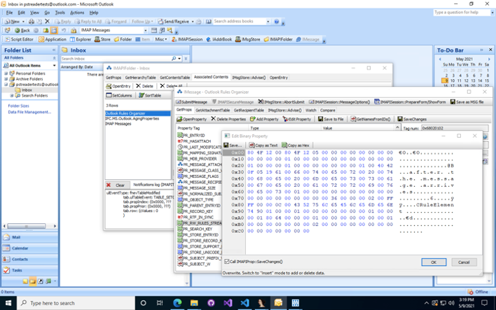
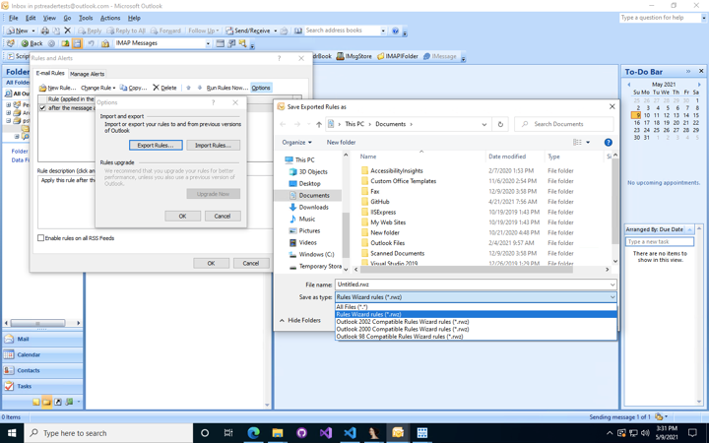

# Outlook Rules Wizard (.rwz) File Format

This document specifies the binary format used by Microsoft Outlook to store client-side rules ("Rules Wizard" rules), both in exported `.rwz` files and in the `PidTagRwRulesStream` property. It is a reverse-engineered specification: nothing here is published by Microsoft.

## Status of this document

Each statement is marked with how it was established:

| Marker | Meaning |
|---|---|
| *(none)* | **Verified.** Checked against every sample file in `Tests/OutlookRulesReaderTests/Resources` (330 files written by Outlook 97, 98, 2000, 2003, 2007 and 2019) by an independent parser. |
| **[Inferred]** | Consistent with all samples, but the *meaning* comes from interpretation (for example, a match with an MFC or MAPI structure), not observation. |
| **[O97]** | Read from the Outlook 97 Rules Wizard's code (`docs/Internals/RULESWIZ.DLL`, disassembled). This shows how Outlook 97 writes and uses the field. Later versions are assumed to keep the meaning wherever the samples agree. See [Appendix D](#appendix-d-findings-from-ruleswizdll). |
| **[O98]** | Read from Outlook 98's code (`OUTLLIB.DLL` from the Outlook 98 CD, disassembled). See [Appendix E](#appendix-e-findings-from-outlook-98). |
| **[O2000]** | Read from Outlook 2000's code (`OUTLLIB.DLL` and its Turkish resource DLL `1055/OUTLLIBR.DLL` from an Outlook 2000 CD, disassembled). See [Appendix F](#appendix-f-findings-from-outlook-2000). |
| **[O2002]** | Read from Outlook 2002's code (`OUTLLIB.DLL` and `IMPMAIL.DLL` from an English Outlook 2002 CD, disassembled). See [Appendix G](#appendix-g-findings-from-outlook-2002) and [Appendix H](#appendix-h-outlook-express-rule-import-outlook-2002). |
| **[O2007]** | Read from Outlook 2007's code (`OUTLOOK.EXE`, which now holds the rules code, and `OUTLLIBR.DLL` from an English Office 2007 Ultimate DVD, disassembled). See [Appendix J](#appendix-j-findings-from-outlook-2007). |
| **[O2003]** | Read from Outlook 2003's code (`OUTLLIB.DLL` and `OUTLLIBR.DLL` from an English Office 2003 DVD, disassembled). See [Appendix I](#appendix-i-findings-from-outlook-2003). |
| **[Unknown]** | The field's layout is known but its meaning is not. Observed values are listed. |

Writers SHOULD reproduce observed values for fields marked [Unknown]. Readers SHOULD accept any value.

`docs/RWZ Format.docx` contains earlier experimental notes. Where those notes and this document disagree, this document has been checked against the sample corpus and takes precedence (see [Appendix C](#appendix-c-corrections-to-earlier-notes)).

---

## 1. Introduction

An Outlook rule is a set of conditions, actions and exceptions that Outlook evaluates against messages as they arrive or are sent<sup>[1]</sup>. Rules began in Outlook 97 as the *Rules Wizard* add-in (`RULESWIZ.DLL`)<sup>[2]</sup> and were built into Outlook from Outlook 98 onwards<sup>[3]</sup>.

### 1.1 Storage

Where Outlook stores rules depends on its version<sup>[4]</sup>:

* **Outlook 2002 and later.** Rules are stored in the mailbox or PST<sup>[5]</sup>. The rules stream is the `PidTagRwRulesStream` (`PR_RW_RULES_STREAM`, `0x68020102`) property of a message named `Outlook Rules Organizer`, whose message class is `IPM.RuleOrganizer`<sup>[6]</sup>. The message is in the associated contents table<sup>[7]</sup> of the Inbox folder.

  

* **Outlook 2000 and earlier.** Rules are stored on disk at `%APPDATA%\Microsoft\Outlook\<ProfileName>.rwz`. **[O2003]** When a store has no rules message yet, Outlook 2003 imports this file once and saves the rules into the store ([Appendix I.5](#i5-the-rules-message-and-cached-exchange-mode)).

Users can also import and export rules as `.rwz` files. When exporting, Outlook 2007 offers to write the file in the current format or in a format for Outlook 2002, 2000 or 98:



The server treats this format as client-specific and opaque<sup>[8]</sup>. `.rwz` files and `PidTagRwRulesStream` values share the format defined here. A few header values are known to differ between them.

### 1.2 Glossary

**ANSI string**: a sequence of 8-bit characters in the writer's code page. In practice this is ASCII or Windows-1252.

**COleDateTime**: the MFC date/time class. See [§2.4](#24-oledatetime).

**DATE / OLE Automation date**: an 8-byte IEEE double holding the number of days since 1899-12-30 00:00. The fractional part is the time of day. See [MS-DTYP] and [MS-OAUT].

**Format generation**: one of the four layouts described in [§3](#3-format-generations).

**VersionStamp**: the version stamp at the start of the stream. See [§4.1](#41-version-stamps).

**UTF-16**: UTF-16 little-endian, with no byte order mark and no terminating NUL unless stated otherwise.

**MAY, SHOULD, MUST, SHOULD NOT, MUST NOT**: as defined in [RFC2119].

### 1.3 References

* [MS-DTYP] Microsoft, "Windows Data Types". https://learn.microsoft.com/en-us/openspecs/windows_protocols/ms-dtyp
* [MS-OXCDATA] Microsoft, "Data Structures". https://learn.microsoft.com/en-us/openspecs/exchange_server_protocols/ms-oxcdata
* [MS-OXPROPS] Microsoft, "Exchange Server Protocols Master Property List".
* [MS-OXORULE] Microsoft, "Email Rules Protocol".
* [MFC-CArchive] Microsoft, "CArchive Class" and Technical Note TN002, "Persistent Object Data Format".
* [RFC2119] Bradner, S., "Key words for use in RFCs to Indicate Requirement Levels", BCP 14, RFC 2119, March 1997.

### 1.4 Conventions

* All integers are **little-endian**.
* `u8`, `u16` and `u32` are unsigned integers of 1, 2 and 4 bytes. `i32` is a signed 32-bit integer and `f64` is an IEEE 754 double.
* Structures are packed. There is no alignment padding anywhere in the stream.
* Field sizes are shown in parentheses, for example **Count (2 bytes)**. "Variable" means the size depends on the content.

---

## 2. Common data types

### 2.1 The stream is an MFC `CArchive`

The format is the output of MFC's `CArchive` serialization **[O97]**. Most of the structure follows from this:

* Rule elements are `CObject`s of class `CRuleElement` (runtime-class schema 0), written with `CArchive::WriteObject`. Each element is preceded by an object tag ([§2.5](#25-object-tag)).
* A rule (`CRule`) writes its name, Enabled, RunError and ServerRule, then its element list, a `CObList`. `CRule` is not written as an object, so it has no tag.
* `CRuleElement::Serialize` writes the element ID, a has-parameter flag ([§4.3.2](#432-element)), and then calls the parameter object's own `Serialize`.
* Length-prefixed strings use `CString`'s length encoding ([§2.2](#22-string)).
* Dates are written with `operator<<(CArchive&, COleDateTime)` ([§2.4](#24-oledatetime)).
* `RULESWIZ.DLL` (Outlook 97) statically links MFC. It contains the class names `CObject`, `CArchive`, `CRule`, `CRuleComponent` and `CRuleElement`.

Parameter objects all derive from one base class, whose `Serialize` writes the Reserved field ([§6](#6-parameters)). Each element's definition says which parameter class to create, so the class is never written: parameters carry no class tag. Most string parameters (words, categories, paths, messages) share a single "Reserved + CString" class **[O97]**. Class names such as `CWordParameter` and `CFolderParameter` come from Outlook's binaries (`docs/Rules Sever Side.xlsx`).

### 2.2 String

A length-prefixed string. The same prefix encodes two kinds of character data:

* **String8**: the characters are ANSI, and the length counts bytes.
* **StringW**: the characters are UTF-16, and the length counts UTF-16 code units, not bytes or grapheme clusters.

| Field | Size | Description |
|---|---|---|
| Length | 1 | Number of characters if less than `0xFF`. |
| Length16 | 2, optional | Present only if Length is `0xFF`. Number of characters if less than `0xFFFF`. |
| Length32 | 4, optional | Present only if Length16 is `0xFFFF`. Number of characters. **[Inferred]** from MFC; never observed. |
| Value | variable | The characters. There is no NUL terminator. |

Writers MUST use the shortest encoding: 1 byte for 0–254, 3 bytes for 255–65534.

MFC writes a `0xFF 0xFFFE` marker before Unicode `CString`s. This format never contains that marker: the format generation alone decides whether a string is ANSI or UTF-16.

In this document, **String** means "String8 in the ANSI generations and StringW in the Unicode generation" ([§3](#3-format-generations)). StringW and String8 mean that encoding in every generation.

### 2.3 Counted entry ID

| Field | Size | Description |
|---|---|---|
| Size | 4 | Length of EntryID in bytes. |
| EntryID | Size | A MAPI entry ID ([MS-OXCDATA] §2.2). |

### 2.4 OleDateTime

The serialized form of an MFC `COleDateTime` (12 bytes).

| Field | Size | Description |
|---|---|---|
| Status | 4 | `0` = valid, `1` = invalid, `2` = null. Only `0` and `2` have been observed. |
| Date | 8 | An OLE Automation date (`f64`). |

When Status is null, Date is `0.0`.

### 2.5 Object tag

Every rule element is preceded by an MFC object tag (`u16`):

| Value | Meaning |
|---|---|
| `0xFFFF` | **New class** (`wNewClassTag`). A class descriptor follows: Schema (`u16`, always `0`), NameLength (`u16`, always `12`), Name (NameLength ANSI bytes, always `CRuleElement`). |
| `0x8001` | **Class reference** (`wClassTag \| 1`). The object's class is entry 1 of the archive's class map, which is `CRuleElement`. |

The class descriptor is written once per stream, before the first element of the first rule. Every later element in the stream, including the first element of rules 2…N, uses `0x8001`. A rule with zero elements writes no tag.

`docs/RWZ Format.docx` described these tags as a "separator" in the rule header. They are part of each element's encoding.

MFC can also emit `0x7FFF` (big object tag) and object back-references (`0x0001`–`0x7FFE`). Neither has been observed. Readers MAY treat them as corruption.

**[O2000]** Outlook 2000 no longer uses MFC's `CArchive`, but its own archive class writes the same bytes. Its writer emits the class descriptor once per archive (a flag on the archive object) and `0x8001` after that. Its reader is looser than MFC's: after `0xFFFF` it reads Schema, NameLength and the name into a 456-byte buffer without checking the name, and it treats **any** other tag as a reference to `CRuleElement`.

**[O2002]** Outlook 2002 reads tags the same way. When it writes a rule whose element list has an empty slot, it writes the null tag `0x0000` with nothing after it, which its own reader would then misread. No sample contains one. **[O2003]** Outlook 2003 reads and writes tags exactly as Outlook 2002 does.

### 2.6 GUID

16 bytes, laid out as a Windows `GUID` ([MS-DTYP] §2.3.4).

---

## 3. Format generations

The first four bytes of the stream identify one of four layouts:

| Generation | First u32 | Written by | Strings | Library (`OutlookRulesVersion`) |
|---|---|---|---|---|
| **G0** (Outlook 97) | anything not listed below | Outlook 97's Export Rules | ANSI | `.outlook97` |
| **G0s** (version stamp 0) | `0x00000000` | Outlook 2003's Export Rules, when the rules were last saved by a newer Outlook; see note | ANSI | `.signatureZero` |
| **G1** (ANSI) | `970102`, `970812`, `980413` | Outlook 97's profile copy; Outlook 98; Outlook 2000 (usually as `970812`, see [§4.1](#41-version-stamps)); Outlook 2002+ exporting "for Outlook 98/2000" | ANSI | `.outlook97Profile`, `.outlook98`, `.outlook2000` |
| **G2** (Unicode) | `1000000`, `1100000`, `1200000`, `0x00140000` | Outlook 2002 and later | UTF-16 | `.outlook2002`, `.outlook2003`, `.outlook2007`, `.outlook2010` |

Within G1, version stamp 970102 lacks two fields that 970812 has ([§4.1.1](#411-version-dependent-fields)).

**G0** has no version stamp. Its first 2 bytes are the rule count, and its next byte is the first rule name's length. Every Outlook 97 sample starts `01 00` (one rule). **[O97]** G0 is Outlook 97's **Export Rules** format: the exporter writes the rule count with `CArchive::WriteCount` and then each rule, with no header or footer. The rules Outlook 97 keeps in the profile use the G1 layout with VersionStamp 970102 ([§4.1](#41-version-stamps)).

A G0 stream can only begin with four zero bytes if it has no rules, and then it is only 2 bytes long (`00 00`). Readers MUST therefore treat a stream shorter than 4 bytes as G0.

Readers SHOULD identify the format by **range** rather than by exact stamp, as Outlook does (Outlook 98 accepts any stamp from 960706 to 970812 **[O98]**). Later builds of a version may then write slightly different stamps, and Outlook 2013 knows `0x150000`. A G0 stream's first four bytes are its rule count, then the first rule name's length and first character (or the Enabled field when the name is empty). They are therefore either below 960706 or at least `0x01000000`, never inside a stamp range:

| First u32 | Format |
|---|---|
| `0` | G0s |
| below 960706, or `0x01000000` and above | G0 |
| 960706 – 970811 | G1, Outlook 97 profile layout (no rule Flags or folder SecondaryStore) |
| 970812 – 980412 | G1, Outlook 98 |
| 980413 – 999999 | G1, Outlook 2000 |
| 1000000 – 1099999 | G2, Outlook 2002 |
| 1100000 – 1199999 | G2, Outlook 2003 |
| 1200000 – `0x13FFFF` | G2, Outlook 2007 |
| `0x140000` – `0xFFFFFF` | G2, Outlook 2010 and later |

Stamps 960706–970811 also cover pre-release builds whose footer or folder fields differ ([§4.1.1](#411-version-dependent-fields)). No such file has been seen.

**[O2002]** Outlook 2002 tests differently: a first u32 with any of its top four bits set (`0x10000000` or more) is G0, which it reads as version 970102. Any stamp above 1000000 is read with the Outlook 2002 layout, and rules whose own stamp is newer are kept unparsed ([§4.3.1](#431-ruleheader)). **[O2003]** Outlook 2003 does the same with 1100000 in place of 1000000: any stamp above 1100000 is read with the Outlook 2003 layout and kept as 1100000. **[O2007]** Outlook 2007 does the same with 1200000.

**G0s** has two samples (`Versions/Outlook2003/*`). The layout is G1 with VersionStamp = 0 and without the rule's Flags. The missing field follows from its version stamp: rule Flags are only read and written when the version is 970812 or later, and 0 is below that **[O98]**. **[O2003]** Outlook 2003's Export Rules writes it. Its default file type, "Rules Wizard rules", uses the stamp at WriterVersion's index in its version table ([§4.2](#42-rulesheader)). When WriterVersion holds a stamp the table doesn't have, such as Outlook 2010's `0x140000`, the index is the table's length, 7, and the entry there is the table's terminating `0`. Outlook then writes the whole file at version 0: no WriterVersion or ExtraData, no rule VersionStamp, Flags, ServerRuleId or DataSize, no folder SecondaryStore or DocumentProperty MatchIfMissing ([§4.1.1](#411-version-dependent-fields)), ANSI strings, and the footer, which its writer always adds. Neither G0s sample has a folder or document property to confirm the last two. The rest of the G0s header fits too: Outlook 2003 writes both server settings as `0` and keeps ClearCategoriesRuleCreated as it found it, here `1`, which Outlook 2007 had set and Outlook 2010 kept ([§4.2](#42-rulesheader)). Outlook 2003 imports such a file at version 0, reading the same fields, but stops before the footer, which its loader only reads from version 960723 on ([§4.4](#44-rulesfooter)).

Field presence by generation:

| Structure / field | G0 | G0s | G1 (970102) | G1 (970812+) | G2 |
|---|---|---|---|---|---|
| RulesHeader.VersionStamp | – | ✓ (=0) | ✓ | ✓ | ✓ |
| RulesHeader.WriterVersion | – | – | – | – | ✓ |
| RulesHeader.Unknown1 … ConvertInboxAssistantRules | – | ✓ | ✓ | ✓ | ✓ |
| RulesHeader.ExtraDataSize, ExtraData | – | – | – | – | ✓ |
| RuleHeader.VersionStamp | – | – | – | – | ✓ |
| RuleHeader.Flags | – | – | – | ✓ | ✓ |
| RuleHeader.ServerRuleId, DataSize | – | – | – | – | ✓ |
| Folder parameter's SecondaryStore | – | – | – | ✓ | ✓ |
| DocumentProperty MatchIfMissing | ✓ | – | ✓ | ✓ | ✓ |
| RulesFooter | – | ✓ | ✓ | ✓ | ✓ |

---

## 4. Top-level structure

```
Stream := RulesHeader  Rule[RulesHeader.NumberOfRules]  RulesFooter?
```

The footer is absent in G0. After the footer the stream MUST end: no sample has trailing bytes.

### 4.1 Version stamps

Outlook identifies format versions with 24-bit "version stamps". Up to Outlook 2000 a stamp is a `YYMMDD` build date. From Outlook 2002 it is the product's major version × 100000. From Outlook 2010 it is the major version written as hex digits (`0x14` = 14):

| Index | Stamp (decimal) | Stamp (hex) | Meaning |
|---|---|---|---|
| — | 960706 | `0x0EA8C2` | The oldest version Outlook 97 accepts in its profile copy of the rules; anything older is rejected **[O97]**. |
| — | 960723 | `0x0EA8D3` | Footer TemplateDirectory added **[O97]**. |
| — | 960820 | `0x0EA934` | Footer Timestamp added **[O97]**. |
| — | 960918 | `0x0EA996` | "Version 960918" appears in `RULESWIZ.DLL`'s About text. Never written to files. |
| — | 960925 | `0x0EA99D` | Footer Unknown added **[O97]**. |
| 0 | 970102 | `0x0ECD76` | **Outlook 97.** The stamp `RULESWIZ.DLL` writes to its profile copy of the rules (the G1 layout), and the newest version it accepts **[O97]**. DocumentProperty MatchIfMissing ([§6.9](#69-formparameter)) was added in this version. Its exports (G0) have no stamp; Outlook 98 imports them as version 970102. Never observed in a sample. |
| — | 970718 | `0x0ECFDE` | Folder parameter SecondaryStore added **[O98]**. |
| 1 | 970812 | `0x0ED03C` | **Outlook 98.** Adds the rule Flags field ([§4.3.1](#431-ruleheader)) **[O98]**. Outlook 98 accepts 960706–970812 and doesn't know 980413. |
| 2 | 980413 | `0x0EF5BD` | **Outlook 2000.** Adds no fields: the layout is the same as 970812, but Outlook 2000 reads NumberOfParameters as a count ([§4.3.2](#432-element)) and defines more elements ([§5](#5-element-identifiers)). It refuses stamps of 1000000 or more and warns about stamps newer than its own **[O2000]**. Outlook 2000 only writes this stamp once the rules need it; otherwise it writes 970812 ([§4.1.2](#412-how-outlook-2000-chooses-the-stamp)). |
| 3 | 1000000 | `0x0F4240` | **Outlook 2002** (v10). Adds WriterVersion, the header's extra data, and the rule header's VersionStamp, ServerRuleId and DataSize, and switches strings to UTF-16 **[O2002]**. Outlook 2002 writes at most this stamp. It doesn't move rules to this version by itself: the Rules Wizard's Options dialog has a "Rules upgrade" section ("We recommend that you upgrade your rules for better performance, unless you also use a previous version of Outlook") whose "Upgrade Now" button is enabled only while the rules are older. After the user confirms, Outlook sets WriterVersion and every rule's VersionStamp to 1000000 **[O2002]**. |
| 4 | 1100000 | `0x10C8E0` | **Outlook 2003** (v11). Adds no fields: the layout is the same as 1000000. Outlook 2003 writes at most this stamp, and new profiles start with it. It adds elements that need it ([§5.5](#55-downgrading)) and the rule without an element list ([§4.3.1](#431-ruleheader)). Its "Upgrade Now" button raises WriterVersion and every rule's VersionStamp to 1100000 **[O2003]**. |
| 5 | 1200000 | `0x124F80` | **Outlook 2007** (v12). Adds no fields. Outlook 2007 writes at most this stamp, and new profiles start with it. It adds elements that need it ([§5.5](#55-downgrading)) **[O2007]**. |
| 6 | 1310720 | `0x140000` | Outlook 2010 (v14) and later. Outlook 2019 still writes this stamp. |
| 7 | 1376256 | `0x150000` | v15 (Outlook 2013). Known to Outlook; never observed in a file. |

Indices 0–7 match the order of a table found in a disassembly of a modern 64-bit Outlook build (`docs/Internals/RWZ Decompilation Notes.docx`). Outlook 2002 has the same table up to index 5, then 1300000 at index 6 (a v13 that never shipped) **[O2002]**. Outlook 2003's table is the same as Outlook 2002's, ending with a `0` at index 7 **[O2003]**. Outlook 2007's table already has `0x140000` at index 6, as later versions do, so it knows Outlook 2010's stamp before Outlook 2010 existed **[O2007]**. The index is used by RulesHeader.WriterVersion ([§4.2](#42-rulesheader)) and the rule header's VersionStamp ([§4.3.1](#431-ruleheader)).

#### 4.1.1 Version-dependent fields

Outlook 97 and 98 read and write these fields only when the stream's version is at least the stamp shown **[O97]** **[O98]**. No other field depends on the version. The format generations of [§3](#3-format-generations) differ in more ways than this, because Outlook 2002 also changed the string encoding and the rule header.

| Since | Field | Section |
|---|---|---|
| 960723 | Footer TemplateDirectory | [§4.4](#44-rulesfooter) |
| 960820 | Footer Timestamp | [§4.4](#44-rulesfooter) |
| 960925 | Footer Unknown | [§4.4](#44-rulesfooter) |
| 970102 | DocumentProperty MatchIfMissing | [§6.9](#69-formparameter) |
| 970718 | Folder parameter SecondaryStore | [§6.19](#619-folderparameter) |
| 970812 | RuleHeader Flags | [§4.3.1](#431-ruleheader) |

Unsigned (G0) streams count as version 970102. Outlook 2000 reads and writes the same fields under the same checks **[O2000]**, and so does Outlook 2003 **[O2003]**. G0s streams are version 0, so they have none of these fields except the footer, which Outlook 2003 always writes but reads only from 960723.

#### 4.1.2 How Outlook 2000 chooses the stamp

**[O2000]** Outlook 2000 keeps a "save version" with its rules and writes that stamp, not its own:

* A new profile starts at 970812. Loading or importing a stream sets it to the stream's stamp, or 970102 if that is lower (so G0 imports count as 970102).
* Some rules need 980413: rules using an element that Outlook 98 doesn't have (`0x00ED`, `0x00EE`, `0x0144`–`0x014A` and `0x0214`), or a word condition with more than one word. When the user creates or imports one of these while the save version is below 980413, Outlook asks first. One message says the rule "will not be compatible with Outlook versions before Outlook 2000"; another says that a rule searching for several words or phrases can't be used by an earlier version. If the user agrees, the save version becomes 980413 for good.
* When saving at a version below 980413, Outlook leaves out every rule that contains an Outlook 2000-only element, and NumberOfRules counts only the rules written. When the version is exactly 970812, each element is written with at most one parameter: NumberOfParameters is `1` and only the first parameter follows ([§4.3.2](#432-element)).
* Export offers two file types: "Rules Wizard rules (\*.rwz)" uses the current save version, and "Outlook 98 Compatible Rules Wizard rules (\*.rwz)" uses 970812.

That is why most streams written by Outlook 2000 carry 970812. In the samples, the Outlook 2000 files saved with the default settings are 970812, except the one with the Outlook 2000-only "print it" action (980413). The same rules exported for Outlook 98 have 970812, and that "print it" file has no rules at all.

Outlook 2007 doesn't follow these rules: its exports "for Outlook 98" keep every word of a word condition as a separate parameter. Writers that target Outlook 97 or 98 SHOULD write at most one parameter per element, because those versions read only one ([§4.3.2](#432-element)).

### 4.2 RulesHeader

| Field | Size | Generations | Description |
|---|---|---|---|
| VersionStamp | 4 | G0s, G1, G2 | The target format's version stamp ([§4.1](#41-version-stamps)), or `0` in G0s. Writers converting between formats SHOULD write the stamp of the target format; readers SHOULD preserve an unrecognised stamp within a known range ([§3](#3-format-generations)). |
| WriterVersion | 4 | G2 | A version word for the rules as a whole. Bits 0–23: the version stamp the rules have been brought up to, normally the stamp of the newest Outlook that saved them. Bits 24–31: that version's position in the table in [§4.1](#41-version-stamps). The position lets versions with different stamp schemes compare versions; a stamp missing from the reader's table gets the table's length. **[O2002]** When loading, Outlook 2002 raises the index until its table entry is at least the low 24 bits. It raises both parts when it upgrades the rules, and uses the stamp at that index as the default format for "Export Rules". **[O2003]** Outlook 2003 does the same. A stamp it doesn't know, such as Outlook 2010's `0x140000`, gets index 7, whose table entry is `0`, so its default export then writes a G0s stream ([§3](#3-format-generations)). A new profile starts with `0x0010C8E0` (index 0) until the index is next set. |
| Unknown1 | 4 | not G0 | Writers SHOULD write `0`; readers MUST accept any value. Always `0` in the samples, but hughbe/OutlookRulesReader#2 reports fields like these being `1` in the copy of the rules stored in the mailbox. **[O97]** **[O98]** **[O2000]** Outlook loads and saves Unknown1–3 and ClearCategoriesRuleCreated unchanged; nothing else reads or writes them, and new profiles start with 0. **[O2002]** Outlook 2002 discards Unknown1 when loading and always writes `0`. |
| Unknown2 | 4 | not G0 | As Unknown1, except that Outlook 2002 also loads and saves Unknown2 unchanged. |
| Unknown3 | 4 | not G0 | As Unknown2. |
| ClearCategoriesRuleCreated | 4 | not G0 | **[O2007]** Flags, of which only bit `0x1` is known: Outlook 2007 has created its "Clear categories on mail (recommended)" rule ([Appendix J](#appendix-j-findings-from-outlook-2007)). Outlook 97–2003 only preserve the field (new profiles get 0) **[O2003]**, and Outlook 2010 and later keep a `1` they find. Every sample with `1` was written by Outlook 2007 (stamp 1200000), by Outlook 2010+ over rules that had been through Outlook 2007, or by Outlook 2003 exporting such rules (the G0s samples). Readers MUST accept any value. This field was called Unknown4 before Outlook 2007 explained it. |
| ServerRulesOutOfDate | 4 | not G0 | **[O97]** `1` when the copy of the rules on the Exchange server needs updating. It is set when the rules or options change, or when an upload fails for lack of server space, and cleared after a successful upload. When updates are automatic, Outlook uploads at startup if it's set. |
| ServerUpdateMode | 4 | not G0 | **[O97]** The "Update server" option in the Rules Wizard's Options dialog: `1` = Manually (only when the user clicks "Update Now"), `2` = Automatically. `0` = not set, as written by Outlook 2010+. Switching from Manually to Automatically triggers an immediate upload. **[O2002]** Outlook 2002 discards ServerRulesOutOfDate and ServerUpdateMode when loading and writes `0` for both, which is why later writers have `(…, 0, 0)` below. Outlook 2003 does the same **[O2003]**. |
| PromptToConvertInboxAssistantRules | 4 | not G0 | **[O97]** The "Prompt to convert Inbox Assistant rules" option: `1` = ask whether to convert the old Exchange Inbox Assistant rules found on the server. Cleared by "Do not prompt me again". Always `1` observed. |
| ConvertInboxAssistantRules | 4 | not G0 | **[O97]** The last answer to that prompt: `1` = Yes (convert), `0` = No. Always `1` observed, but `0` is valid. Readers MUST accept both. |
| ExtraDataSize | 4 | G2 | Number of bytes of ExtraData. Always `0` observed. |
| ExtraData | ExtraDataSize | G2 | **[O2002]** Outlook 2002 loads these bytes and writes them back unchanged. Nothing else reads them, and even its routine that copies the header leaves them out. Outlook 2003 is the same **[O2003]**. **[Inferred]** Room for later versions to add header data that older ones keep. Readers MUST skip it and SHOULD preserve it. |
| NumberOfRules | 2 | all | Number of Rule structures that follow. |

The header is 38 bytes in G0s and G1, 46 bytes plus ExtraDataSize in G2, and 2 bytes in G0.

Observed WriterVersion values:

| Writer | Target (VersionStamp) | WriterVersion |
|---|---|---|
| Outlook 2007 | 1200000 or 1000000 | `0x05124F80` (index 5, stamp 1200000) |
| Outlook 2007 (one file, `FormsException.rwz`) | 1000000 | `0x03124F80` (index 3) |
| Outlook 2010+ | 0x140000 or 1000000 | `0x06140000` (index 6, stamp 0x140000) |
| Outlook 2010+ (`New732.rwz`) | 1000000 | `0x03140000` (index 3) |
| Outlook 2010+ (`Outlook2003All.rwz`) | 1100000 | `0x04140000` (index 4) |

**[O2000]** Outlook 2000 reads and writes these fields in the same order. A new profile starts with Unknown1–3 and ClearCategoriesRuleCreated = `0`, ServerRulesOutOfDate = `0`, ServerUpdateMode = `2` (Automatically) and both Inbox Assistant fields = `1`.

ClearCategoriesRuleCreated, ServerRulesOutOfDate and ServerUpdateMode depend on the writer, not the target format:

| Writer | (ClearCategoriesRuleCreated, ServerRulesOutOfDate, ServerUpdateMode) |
|---|---|
| Outlook 98 / 2000 | (0, 1, 2) |
| Outlook 2003 | (kept, 0, 0) **[O2003]** |
| Outlook 2007 | (1 once it has made its Clear categories rule, 0, 0) **[O2007]** |
| Outlook 2010+ | (0 or kept `1`, 0, 0) |

### 4.3 Rule

```
Rule := RuleHeader  Element[RuleHeader.NumberOfElements]
```

#### 4.3.1 RuleHeader

| Field | Size | Generations | Description |
|---|---|---|---|
| VersionStamp | 4 | G2 | The rule's own version word, laid out like RulesHeader.WriterVersion: bits 0–23 a version stamp, bits 24–31 its index ([§4.2](#42-rulesheader)). Always equal to RulesHeader.VersionStamp in the samples. **[O2002]** The rest of the rule uses this stamp: a rule with an older stamp keeps that version's layout (for example ANSI strings and no ServerRuleId or DataSize below 1000000). When reading, Outlook 2002 uses the rule's stamp as it is; when writing, it uses the older of the stream's version and the rule's (`0x34AB87A5`). Outlook raises a rule's version when the user accepts a prompt that the rule needs a newer one, and when it upgrades all the rules. **[O2003]** Outlook 2003 uses the rule's stamp for both reading and writing, except when exporting, which uses the target version. It keeps rules newer than 1100000 unparsed. New rules start at 970812 and are raised as Outlook 2002's are. Readers SHOULD honour this; writers SHOULD write the stream's stamp. |
| Name | variable | all | String (String8 in G0, G0s and G1; StringW in G2). Outlook limits rule names to 255 characters. **[O97]** Outlook 97 writes `<rule name>` TAB `<template name>`, where the template is the wizard template the rule was made from, for example `Forward within 20 days\tBuild as I go`. Every Outlook 97 sample has the tab; samples from later versions sometimes do. **[O2000]** **[O2002]** Outlook 2000 and 2002 split the name at the first tab when loading and save only the part before it, so they drop the template name. |
| Enabled | 4 | all | `1` = enabled, `0` = disabled. Readers SHOULD treat any non-zero value as enabled. New rules default to enabled **[O97]**. |
| RunError | 4 | all | **[O2000]** `1` after the rule failed while Outlook was running it on the client. When an action of a client rule fails, Outlook 2000 sets this field to `1`, turns the rule off (Enabled = `0`) and shows an error message naming the rule. A rule that runs without error gets `0`. **[O2002]** Outlook 2002 does the same, but adds the rule to a "Rules in Error" window instead of showing a message, and doesn't turn a rule back on when it later runs without error. **[O97]** New rules get `0`; Outlook 97 copies and saves it but never reads it. Always `0` observed. |
| ServerRule | 4 | all | **[O97]** Set to `1` once the rule has been saved to the Exchange server's rules table (Outlook 97 serializes the rule and writes `PR_RULE_PROVIDER_DATA`, `PR_RULE_STATE` and the other server-rule properties through MAPI). Cleared again if saving fails or the server rules are reset. Usually `0`; `1` in 3 rules written by Outlook 2010+. |
| Flags | 4 | G1, G2 | Added in version 970812: Outlook 98 reads and writes it only for streams of that version or later, which is why Outlook 97 exports don't have it **[O98]**. Outlook copies it to and from offset `0x18` of the rule's Exchange server rule (`PR_RULE_PROVIDER_DATA`) **[O98]**. Outlook 98 and 2000 clear it to `0` when the user edits a rule that has bit `0x1` or `0x2` set, so those bits **[Inferred]** mark errors that editing fixes **[O98]** **[O2000]**. The other bits mark rules that Outlook 2000 creates itself and later finds again by their flag ([§4.3.1.1](#4311-rule-flags)). `0` for rules the user creates. |
| ServerRuleId | 4 | G2 | **[O2002]** The ID of the rule's copy on the Exchange server. When Outlook 2002 first saves a rule to the server it gives it the next number from a counter. The counter isn't stored anywhere: when Outlook reads the server's rules it sets it to the highest ID found in their provider data. It also stores the number at offset 4 of the rule's `PR_RULE_PROVIDER_DATA`, and uses it to match local rules with server rules. `0` for rules never saved to the server. Observed `0`, `1` and `2`, non-zero exactly when ServerRule is `1`. Importing a rules file clears it. |
| DataSize | 4 | G2 | Number of bytes from the end of this field to the end of the rule: NumberOfElements, every object tag, and every element. Matched exactly in all 116 G2 rules. **[O2002]** It lets an older version keep rules it can't read. Outlook 2002 parses the elements only when the rule's version is 1000000. For a newer rule it stores the DataSize bytes unparsed and writes them back unchanged. **[O2003]** Outlook 2003 does the same for rules newer than 1100000. A DataSize of `0` means the rule has **no element list**: NumberOfElements and the elements are absent and the next rule follows at once. Outlook 2003 writes the Download Options rule (Flags `0x40`, [§4.3.1.1](#4311-rule-flags)) this way at version 1100000, and skips that rule's element list when reading it at that version. Outlook 2007 does this only at exactly 1100000; at 1200000 it writes the rule's elements **[O2007]**. Readers MUST accept a DataSize of `0`. |
| NumberOfElements | 2 (or 6) | all | Number of elements in this rule. Absent when DataSize is `0`. **[O97]** Written by `CObList::Serialize` with `CArchive::WriteCount`: a `u16`, or `0xFFFF` followed by a `u32` if the count is 65535 or more. |

##### 4.3.1.1 Rule flags

**[O2000]** **[O2002]** Outlook 2000 and 2002 create some rules themselves and set their flags: three junk-mail rules from a built-in table, and the Download Options rule. They then look for them by flag, not by name, which is why a renamed rule is still recognised. Copying a rule in the Rules Wizard clears all flags on the copy:

| Bit | Rule | Elements Outlook 2000 creates |
|---|---|---|
| `0x01`, `0x02` | **[Unknown]** | Outlook 98 and 2000 never set these bits. They only clear all the flags when the user edits a rule with either bit set, and carry the bits unchanged to and from the server copy of the rule. So another writer sets them, probably a later Outlook or an Exchange client. **[O2003]** Outlook 2003 doesn't set them either, but tolerates bad rules that have them: if reading the elements of a rule with either bit set fails, it moves back to where the elements began and carries on instead of failing the load. It doesn't then skip DataSize bytes, so this only works when the rule is the last thing in the stream, as when Outlook reads one rule from a server rule's provider data (`0x30622D34`). In a rules stream the next rule would be read from the wrong place. |
| `0x08` | Junk e-mail rule | Condition `0x00EB` (junk senders), action `0x012C` (move to folder). |
| `0x10` | Adult content rule | Condition `0x00EC` (adult content senders), action `0x012C`. |
| `0x20` | "Exception List" rule | Condition `0x00E9` (senders on my Exception List), action `0x0143` (don't search for commercial or adult content). |
| `0x40` | The "big item rule" of the "Download Options" dialog ("Don't download messages larger than *n* KB", with exceptions for chosen senders, high importance and a flag, and a "Restore Default Rule" button) | Condition `0x00E0` (size), actions `0x0130` and `0x012C`, exceptions `0x01F7`, `0x01FE` and `0x01FC`. |

The sample `ExceptionList/Outlook2000_ExceptionList_*.rwz` holds the `0x20` rule as Outlook 2000 creates it.

**[O2003]** Outlook 2003 replaced these junk-mail rules with its Junk E-mail Filter. Every time it saves the rules, it first deletes each rule with Flags `0x08`, `0x10` or `0x20`, and each rule containing condition `0x00E9`, `0x00EB` or `0x00EC`. It still keeps the Download Options rule (`0x40`), but at version 1100000 it writes that rule with no element list (DataSize `0`, [§4.3.1](#431-ruleheader)).

When Outlook 2000 reads a rule back from the Exchange server, it copies Flags from offset `0x18` of `PR_RULE_PROVIDER_DATA` ([Appendix E](#appendix-e-findings-from-outlook-98)). The rule's MAPI state also maps onto elements: `ST_ENABLED` becomes Enabled, and `ST_EXIT_LEVEL` adds the action `0x0142` (stop processing more rules).

#### 4.3.2 Element

| Field | Size | Description |
|---|---|---|
| ObjectTag | 2 (+ class descriptor) | See [§2.5](#25-object-tag). |
| Identifier | 4 | Element identifier ([§5](#5-element-identifiers)). |
| NumberOfParameters | 4 | Number of parameter structures that follow. **[O97]** Outlook 97 writes `1` if the element has a parameter object and `0` if not, and reads any non-zero value as "has a parameter". Outlook 98 does the same, and its word parameter holds a single string **[O98]**. **Outlook 2000 reads the field as a count** and reads that many parameters **[O2000]**. It writes the number of parameters, except that at version 970812 exactly it writes at most `1` and only the first parameter ([§4.1.2](#412-how-outlook-2000-chooses-the-stamp)). Files that store several words as several parameters, as Outlook 2007 does even when exporting "for Outlook 98", therefore need Outlook 2000 or later **[Inferred]**. |
| Parameters | variable | NumberOfParameters parameters. Their layout depends on Identifier ([§6](#6-parameters)). |

Parameter counts:

* "Simple" elements, such as "sent only to me" and "delete it", have **0** parameters.
* Most elements have **1** parameter.
* Word-list elements ([§6.3](#63-wordparameter)) have **one parameter per word or phrase**. The condition matches if any of them matches.
* A simple element with a non-zero count is invalid.

**[O2000]** An identifier that isn't in Outlook 2000's tables makes the whole load fail, except `0x00EA`, which is read as `0x00EB`. A reader can't skip an unknown element on its own, because the parameter layout is unknown; in G2 it can skip the whole rule using DataSize.

**[O2003]** Outlook 2003 does the same, and also drops some elements it knows. Each of its element definitions has a mask of the kinds of rule set the element belongs to, and Outlook's own rules always use kind `2`. After reading an element whose mask lacks bit `0x2`, Outlook discards it and doesn't add it to the rule. Only the hidden actions `0x014D` and `0x014E` have such a mask (`1`). Nothing in `OUTLLIB.DLL` creates either of them: they appear only in the definition table, so Outlook 2003 can neither make nor keep them. The rule's mask also switches off one more check: the Rules Wizard offers only elements whose mask overlaps the rule's (`0x306053CE`), and in a rule set without bit `0x1`, Outlook treats `0x0136` (play a sound), `0x0149` (start application), `0x014B` (run a script), `0x00EE`/`0x0214` (account), `0x00F0`/`0x0215` (address book), and moving or copying to some folders, as tied to this computer, and links them to the condition "on this computer only" (`0x00EF`, check at `0x3061AB45`). **[Inferred]** Bit `0x1` marks rules that run on the server: no element there depends on the computer, and `0x014D` is the only element whose event mask is `0x2`, the event bit that Appendix D.1 suggests was meant for "after the server receives the message".

#### 4.3.3 Element order

Every rule observed starts with:

1. `0x0190` — the message-type element ([§6.1](#61-eventparameter)), and
2. `0x0064` — "for each *item type*" ([§6.2](#62-itemtypeparameter)).

These are followed by conditions, then actions, then exceptions, in the order the user added them. Readers SHOULD NOT depend on this order. Writers MUST emit `0x0190` and `0x0064` first.

### 4.4 RulesFooter

| Field | Size | Description |
|---|---|---|
| TemplateDirectoryLength | 4 | Number of characters in TemplateDirectory. Outlook keeps it ≤ 260 (`MAX_PATH`). |
| TemplateDirectory | variable | The directory used most recently in the "reply using template" browse dialog, for example `C:\Users\<user>\AppData\Roaming\Microsoft\Templates`. ANSI bytes in G0s and G1; UTF-16 code units in G2. No length prefix (unlike [§2.2](#22-string)) and no NUL terminator. Often empty. **[O97]** Outlook 97 reads at most 259 bytes into a 260-byte buffer, so writers MUST keep it under 260 characters. **[O2000]** **[O2002]** Outlook 2000 and 2002 read at most 260 characters; if the length is larger, they don't skip the rest, and the following fields are read from the wrong place. |
| Timestamp | 12 | An OleDateTime ([§2.4](#24-oledatetime)): when the rules were last synchronized with the Exchange server. Null if they never have been. **[O2002]** Outlook 2002 keeps it in memory as minutes since 1601-01-01 (OLE days × 1440 + 157255200). It uses `0x5AE980E0` for "none", and writes that value as a null OleDateTime. When it reads the server rules, it finds the newest timestamp in their provider data ([Appendix E](#appendix-e-findings-from-outlook-98)) and compares it with this field. If they differ, it asks: "The rules on this machine do not match the rules on your Exchange server. Only one set of rules can be kept. You will usually want to keep the rules on the server. Which rules do you want to keep?" (Client / Server). **[O97]** When the Rules Wizard window saves, it supplies this timestamp; other saves write the stored value again. `RULESWIZ.DLL` has the message "Your client rules have been modified more recently than your Exchange Server rules", but no code uses it, so Outlook 97 never compares this timestamp. See notes. |
| Unknown | 4 | MUST be `0` (all 291 footers). **[O97]** **[O2000]** Loaded and saved unchanged; nothing else reads or writes it. |

**[O97]** Outlook 97's loader reads each footer field only if the stream's version is new enough: TemplateDirectory from 960723, Timestamp from 960820, and Unknown from 960925 ([§4.1](#41-version-stamps)). Every stream with a version stamp is newer than that, so all three are always present.

Timestamp notes:

* Status is null in 231 of 291 samples: those rules were never synchronized with an Exchange server.
* A valid timestamp of `-109205.0` is 1601-01-01 00:00, the `FILETIME` epoch. It is a zero `FILETIME` converted to an OLE date, and means "never saved".
* Several Outlook 2000 samples hold `-649728.2264`, about the year 120 AD. This is presumably garbage: an uninitialised value or a conversion bug.

---

## 5. Element identifiers

Identifiers are grouped by range:

| Range | Group |
|---|---|
| `0x0064`, `0x0190` | Mandatory |
| `0x00C8`–`0x012B` (200–299) | Conditions |
| `0x012C`–`0x018F` (300–399) | Actions |
| `0x01F4`–`0x0257` (500–599) | Exceptions |

Outlook 97 knew only `0x0064`, conditions `0x00C8`–`0x00E6`, actions `0x012C`–`0x0140`, `0x0190`, and exceptions `0x01F4`–`0x0212` **[O97]**. Outlook 98 extends these to conditions `0x00C8`–`0x00EC`, actions `0x012C`–`0x0143` and exceptions `0x01F4`–`0x0213` **[O98]**. Outlook 2000 adds conditions up to `0x00EE` and actions up to `0x014A` **[O2000]**, and Outlook 2002 extends the ranges to conditions `0x00C8`–`0x00F0`, actions `0x012C`–`0x014C` and exceptions `0x01F4`–`0x0215` **[O2002]**. Outlook 2003 adds conditions `0x00F1` and `0x00F3`, actions `0x014D`–`0x0150` and exception `0x0216` **[O2003]**. Outlook 2007 adds conditions `0x00F4`–`0x00F7`, actions `0x0151` and `0x0152`, and exceptions `0x0218`–`0x021B` **[O2007]**. Outlook 97's element table is in [Appendix D](#appendix-d-findings-from-ruleswizdll) and Outlook 98's in [Appendix E](#appendix-e-findings-from-outlook-98). For conditions `0x00C8`–`0x00E6`, the matching exception is the condition's identifier + 300 (`0x012C`). After that the exception numbers are assigned in sequence and the +300 relationship breaks: `0x00E8` → `0x0213`, `0x00EE` → `0x0214`, `0x00F0` → `0x0215`, and so on.

The "Param" column refers to [§6](#6-parameters). "—" means the element has no parameters. "Client" marks elements that make a rule client-only, according to `docs/Rules Sever Side.xlsx`.

### 5.1 Mandatory

| ID | Meaning | Param |
|---|---|---|
| `0x0064` | "For each *message*": which kinds of item the rule applies to **[O97]**. | §6.2 |
| `0x0190` | "Apply this rule *after the message arrives*": when the rule runs **[O97]**. | §6.1 |

### 5.2 Conditions

| ID | UI text | Param | Client | Notes |
|---|---|---|---|---|
| `0x00C8` | where my name is in the To box ("sent directly to me" in Outlook 97) | — | | |
| `0x00C9` | sent only to me | — | | |
| `0x00CA` | where my name is not in the To box | — | | |
| `0x00CB` | from *people or public group* | §6.4 | | |
| `0x00CC` | sent to *people or public group* | §6.4 | | |
| `0x00CD` | with *specific words* in the subject | §6.3 | | |
| `0x00CE` | with *specific words* in the body | §6.3 | | |
| `0x00CF` | with *specific words* in the subject or body | §6.3 | | |
| `0x00D0` | flagged for *action* | §6.5 | | |
| `0x00D2` | marked as *importance* | §6.6 | | |
| `0x00D3` | marked as *sensitivity* | §6.7 | | |
| `0x00D4` | where my name is in the To box and it is a meeting | — | | Never created by the Rules Wizard; supported by Outlook 97's evaluator ([Appendix D.4](#d4-the-rule-evaluator)). |
| `0x00D5` | where my name is not in the To box and it is a meeting | — | | As `0x00D4`. |
| `0x00D7` | assigned to *category* category | §6.8 | ✓ | |
| `0x00DA` | sent to *people or public group* as Cc | §6.4 | | As `0x00D4`. **[Inferred]** parameter, from the evaluator reading the element's address list. |
| `0x00DB` | sent to *people or public group* | §6.4 | | As `0x00DA`, but the same test as `0x00CC`. |
| `0x00DC` | which is an automatic reply / Out of Office message | — | | **[O2003]** Matches messages whose `PR_MESSAGE_CLASS` is `IPM.Note.Rules.OofTemplate.Microsoft`, ignoring case (`lstrcmpiA`), on the client and in the server form: the class of the Exchange Out of Office template, which Exchange's auto-replies carry. |
| `0x00DE` | which has an attachment | — | | |
| `0x00DF` | with *selected properties* of documents or forms | §6.9 | ✓ | |
| `0x00E0` | with a size *in a specific range* | §6.10 | | |
| `0x00E1` | received *in a specific date span* | §6.11 | | |
| `0x00E2` | where my name is in the Cc box | — | | |
| `0x00E3` | where my name is in the To or Cc box | — | | |
| `0x00E4` | uses the *form name* form | §6.12 | | Not functional in Outlook 2019. |
| `0x00E5` | with *specific words* in the recipient's address | §6.3 | ✓ | |
| `0x00E6` | with *specific words* in the sender's address | §6.3 | | |
| `0x00E7` | *none* (Net Folders) | — | | Only seen in the hidden `#NET FOLDERS#` rule created by Outlook 98/2000 Net Folders (`NetFolders/Outlook2000_NetFolders_Default.rwz`). Outlook 98 defines it with no parameter, the text "(none)" and empty masks, so the wizard never offers it **[O98]**. **[O2000]** It means "the subject begins with `#NET FOLDERS#`": Outlook 2000 turns it into a prefix content restriction on `PR_SUBJECT`. Net Folders' own messages carry that subject. |
| `0x00E8` | with *specific words* in the message header | §6.3 | | Added in Outlook 98 **[O98]**. |
| `0x00E9` | from senders on my *Exception List* | §6.13 | ✓ | Junk-mail feature of Outlook 98/2000; removed in 2003, which still reads it but deletes rules that use it when it saves ([§4.3.1.1](#4311-rule-flags)), and never matches it, or `0x00EA`–`0x00EC`, when running rules. Parameter kind `0x18` **[O98]**. |
| `0x00EA` | *older form of `0x00EB`* | §6.13 | ✓ | Not in Outlook 98's or 2000's tables, but Outlook 2000 reads it as `0x00EB` **[O2000]**. Probably from pre-release Outlook 98 builds. |
| `0x00EB` | suspected to be junk e-mail or from *Junk Senders* | §6.13 | ✓ | Added in Outlook 98, removed in 2003 (as `0x00E9`). Parameter kind `0x1A` **[O98]**. |
| `0x00EC` | containing adult content or from *Adult Content Senders* | §6.13 | ✓ | Added in Outlook 98, removed in 2003 (as `0x00E9`). Parameter kind `0x1B` **[O98]**. |
| `0x00ED` | with a relevance *in a specific range* | §6.14 | ✓ | Added in Outlook 2000 **[O2000]**. Hidden unless `HKCU\Software\Microsoft\Office\8.0\Outlook\Relevance` exists. |
| `0x00EE` | through the *specified* account | §6.15 | ✓ | Added in Outlook 2000 **[O2000]**. Offered only for incoming mail until Outlook 2002 allowed it on sent mail too **[O2002]**. |
| `0x00EF` | on this computer only ("on this machine only" in 2002–2007) | §6.16 | ✓ | Added in Outlook 2002 (parameter kind `0x21`) **[O2002]**. |
| `0x00F0` | sender is in *specified* Address Book | §6.17 | ✓ | Added in Outlook 2002 (kind `0x22`) **[O2002]**. Requires `0x00EF`. |
| `0x00F1` | which is a meeting invitation or update | — | | Added in Outlook 2003 **[O2003]**. |
| `0x00F3` | which is an *Alert E-mail* | §6.18 | | Added in Outlook 2003 (parameter kind `0x26`) **[O2003]**. Created only from an Office alert source. |
| `0x00F4` | of the *specific* form type (InfoPath) | §6.12 | ✓ | Requires InfoPath. Added in Outlook 2007 (parameter kind `0x29`: Reserved, String, String8) **[O2007]**. |
| `0x00F5` | from RSS feeds with *specified text* in the title | §6.3 | | Added in Outlook 2007 (parameter kind `0x2A`, the plain String class) **[O2007]**. Matches the feed's name exactly, ignoring case, not words in the item's title ([Appendix J](#appendix-j-findings-from-outlook-2007)). |
| `0x00F6` | assigned to any category | — | | Added in Outlook 2007 **[O2007]**. |
| `0x00F7` | from any RSS feed | — | | Added in Outlook 2007 **[O2007]**. Its definition has parameter kind `0x2B`, whose class holds only Reserved, but the wizard creates the element without one, so it is written with NumberOfParameters `0` (as in the sample). Outlook reads a parameter if the count says there is one: readers SHOULD accept zero or one 4-byte Reserved parameter. Its exception `0x021B` is the same. |

### 5.3 Actions

| ID | UI text | Param | Client | Notes |
|---|---|---|---|---|
| `0x012C` | move it to the *specified* folder | §6.19 | | |
| `0x012D` | delete it | — | | |
| `0x012E` | forward it to *people or public group* | §6.4 | | |
| `0x012F` | reply using *a specific template* | §6.20 | ✓ | Path to an `.oft` file. |
| `0x0130` | display *a specific message* in the New Item Alert window ("notify me using …" in Outlook 98–2002) | §6.20 | ✓ | |
| `0x0131` | flag message for *action in a number of days* | §6.21 | ✓ | Pre-2007 flag. **[O2007]** Outlook 2007 offers it only for rules on sent messages; `0x0151` replaces it for received mail. |
| `0x0132` | clear the Message flag | — | ✓ | |
| `0x0133` | assign it to the *category* category | §6.8 | ✓ | |
| `0x0136` | play *a sound* | §6.20 | ✓ | |
| `0x0137` | mark it as *importance* | §6.6 | ✓ | |
| `0x0138` | mark it as *sensitivity* | §6.7 | ✓ | |
| `0x0139` | move a copy to the *specified* folder | §6.19 | | |
| `0x013A` | notify me when it is read | — | ✓ | Sent-mail rules. |
| `0x013B` | notify me when it is delivered | — | ✓ | Sent-mail rules. |
| `0x013C` | Cc the message to *people or public group* | §6.4 | | Sent-mail rules. |
| `0x013E` | defer delivery by *a number of* minutes | §6.22 | ✓ | Sent-mail rules. |
| `0x013F` | perform *a custom action* | §6.23 | ✓ | Removed in Outlook 2010. |
| `0x0140` | *none* | — | | **[O97]** Defined by Outlook 97 with no UI text, no parameter and every flag clear: a hidden or retired action. |
| `0x0141` | *none* (Net Folders) | — | ✓ | Only seen in the hidden `#NET FOLDERS#` rule, with `0x00E7`. Defined by Outlook 98 as client-only, with empty masks **[O98]**. **[O2000]** It hands the message to Net Folders: Outlook 2000 moves it into a folder whose entry ID is kept in property `0x60010102`, schedules Net Folders to process it, and stops processing more rules. |
| `0x0142` | stop processing more rules | — | | Added in Outlook 98 **[O98]**. When Outlook 98 imports an Exchange server rule that has `ST_EXIT_LEVEL` set, it adds this action. |
| `0x0143` | do not search message for commercial or adult content | — | ✓ | Added in Outlook 98 with empty masks, so only the junk-mail feature creates it **[O98]**. Removed in 2003. |
| `0x0144` | redirect it to *people or public group* | §6.4 | | Added in Outlook 2000 **[O2000]**. |
| `0x0145` | add *number* to relevance | §6.24 | ✓ | Added in Outlook 2000 **[O2000]**. Hidden; see `0x00ED`. |
| `0x0146` | have server reply using *a specific message* | §6.25 | | Added in Outlook 2000 **[O2000]**. |
| `0x0147` | forward it to *people or public group* as an attachment | §6.4 | | Added in Outlook 2000 **[O2000]**. |
| `0x0148` | print it | — | ✓ | Added in Outlook 2000 **[O2000]**. |
| `0x0149` | start *application* | §6.20 | ✓ | Added in Outlook 2000 **[O2000]**. Hidden in Outlook 2016+. |
| `0x014A` | permanently delete it | — | ✓ | Added in Outlook 2000 **[O2000]**. Outlook also requires `0x0142`. |
| `0x014B` | run *a script* | §6.26 | ✓ | Added in Outlook 2002 (kind `0x23`) **[O2002]**. Hidden in Outlook 2016+. |
| `0x014C` | mark it as read | — | ✓ | Added in Outlook 2002 **[O2002]**. |
| `0x014D` | have server reply using *a specific message* | §6.20 | | **[O2003]** A hidden twin of `0x0146` with the same text, defined by Outlook 2003 with parameter kind `0x24` (Reserved and one String), event mask `0x2` and no item types. Outlook 2003 discards it when loading ([§4.3.2](#432-element)), so it never appears in a rule it saves. Never observed in a file. |
| `0x014E` | notify me using a .NET notification | — | | **[O2003]** Hidden, with no parameter and empty masks. Discarded when loading, as `0x014D`. Never observed in a file. |
| `0x014F` | display a Desktop Alert | — | ✓ | Added in Outlook 2003 **[O2003]**. |
| `0x0150` | flag message with *a colored flag* (`RuleElementFlagColorAction`) | §6.29 | ✓ | Added in Outlook 2003 (parameter kind `0x25`) **[O2003]**. Never observed in a file. **[O2007]** Outlook 2007 still reads and runs it but hides it: its event mask is empty, so the wizard no longer offers it. |
| `0x0151` | flag message for *follow up at this time* | §6.27 | ✓ | Added in Outlook 2007 (parameter kind `0x28`) **[O2007]**. |
| `0x0152` | clear message's categories | — | | Added in Outlook 2007 **[O2007]**. |
| `0x0153` | apply retention policy: *retention policy* | §6.28 | | |

### 5.4 Exceptions

Every exception has the same parameter layout as its condition.

| ID | Condition | ID | Condition |
|---|---|---|---|
| `0x01F4` | `0x00C8` | `0x020B` | `0x00DF` |
| `0x01F5` | `0x00C9` | `0x020C` | `0x00E0` |
| `0x01F6` | `0x00CA` | `0x020D` | `0x00E1` |
| `0x01F7` | `0x00CB` | `0x020E` | `0x00E2` |
| `0x01F8` | `0x00CC` | `0x020F` | `0x00E3` |
| `0x01F9` | `0x00CD` | `0x0210` | `0x00E4` |
| `0x01FA` | `0x00CE` | `0x0211` | `0x00E5` |
| `0x01FB` | `0x00CF` | `0x0212` | `0x00E6` |
| `0x01FC` | `0x00D0` | `0x0213` | `0x00E8` |
| `0x01FE` | `0x00D2` | `0x0214` | `0x00EE` |
| `0x01FF` | `0x00D3` | `0x0215` | `0x00F0` |
| `0x0203` | `0x00D7` | `0x0216` | `0x00F1` |
| `0x0208` | `0x00DC` | `0x0218` | `0x00F4` |
| `0x020A` | `0x00DE` | `0x0219` | `0x00F5` |
| | | `0x021A` | `0x00F6` |
| | | `0x021B` | `0x00F7` |

### 5.5 Downgrading

When Outlook exports to an older format, it omits every rule that contains an element the older format cannot represent. Rules are dropped whole, never partially. For example, `Outlook2007_RunScript_98.rwz`, `…_FlagForFollowUp_2000.rwz` and `…_DisplayDesktopAlert_98.rwz` all contain zero rules.

As a result, parameters that only exist in G2 are always written as UTF-16 in practice.

**[O2003]** Outlook 2003 decides with a table of the version each element needs; every other element fits any version:

| Version needed | Elements |
|---|---|
| 980413 | `0x00ED`, `0x0144`–`0x014A` |
| 1000000 | `0x00EE`–`0x00F0`, `0x014B`, `0x014C`, `0x0214` |
| 1100000 | `0x00F1`, `0x00F3`, `0x014F`, `0x0150`, `0x0216` |
| 1200000 | `0x00F4`–`0x00F7`, `0x0151`, `0x0152`, `0x0218`–`0x021B` **[O2007]** |

The account condition (`0x00EE`, `0x0214`) came with Outlook 2000, but Outlook 2003 only exports it for Outlook 2002 and later. Its Export Rules offers four file types: "Rules Wizard rules (\*.rwz)" (the stamp at WriterVersion's index, [§4.2](#42-rulesheader)), and "Outlook 2002", "Outlook 2000" and "Outlook 98 Compatible Rules Wizard rules (\*.rwz)" (1000000, 980413 and 970812).

---

## 6. Parameters

MFC class names in the headings below are matched to parameters by name only, from strings in Outlook's binaries **[Inferred]**.

Every parameter starts with a 4-byte **Reserved** field. It MUST be `0` (all 791 parameters observed). **[O97]** It is a field of the common parameter base class. The constructor sets it to `0`, the base `Serialize` writes it first, and the class has a virtual getter and setter for it. Nothing in Outlook 97 calls them, and no parameter class reads or writes the field directly: it is reserved. **[O2003]** Outlook 2003's base class (vtable `0x30124B70`) still sets it to `0` and serializes it (`0x3061626A`), but no longer has the getter and setter; nothing else reads it.

The tables below list the fields after Reserved.

### 6.1 EventParameter
Used by `0x0190`.

| Field | Size | Description |
|---|---|---|
| Flags | 4 | When the rule runs. A bitmask; the UI joins set bits with " or ". `0x01` = after the message arrives, `0x04` = after I send the message, `0x08` = after the server receives the message **[O97]**. |

Observed values: `0x01` (272 rules) and `0x04` (6 rules).

### 6.2 ItemTypeParameter
Used by `0x0064` ("For each %s"). `ItemTypeParameter` in the library; `Rule.itemTypes` holds its value.

| Field | Size | Description |
|---|---|---|
| ItemTypes | 4 | **[O97]** A bitmask of the kinds of item the rule applies to, shown joined with " or ". Outlook 97 defines only `0x1` = "message", which is also the constructor's default. Its rule evaluator treats this element as always matching. Always `1` (278 of 278). |

### 6.3 WordParameter
`CWordParameter`. Used by `0x00CD`–`0x00CF`, `0x00E5`, `0x00E6`, `0x00E8`, `0x00F5` and their exceptions.

| Field | Size | Description |
|---|---|---|
| Value | variable | String. One word or phrase. |

An element has one WordParameter per word or phrase. The words are combined with OR. They are not delimited inside one string.

Outlook 97 and 98 allow only **one phrase per condition** **[O97]** **[O98]**:

* the prompt is "Specify a word or phrase to search for…", typed into a single text box (the "Parameter Text" dialog);
* the element reads at most one parameter;
* Outlook 97 matches the whole phrase as a substring of the subject or body, ignoring case.

Several words per condition, stored as several parameters, came with Outlook 2000 **[O2000]**.

**[O2003]** Outlook 2003 matches if any parameter occurs anywhere in the text: a substring search with no word boundaries, through `MSO.DLL` ordinal 1353 with comparison mode `1`, which compares upper-cased characters, so it ignores case. An empty or missing subject or body never matches ([Appendix I.6](#i6-evaluating-conditions-on-the-client)).

### 6.4 AddressParameter
Used by `0x00CB`, `0x00CC`, `0x012E`, `0x013C`, `0x0144`, `0x0147`, `0x01F7` and `0x01F8`.

This is a serialized MAPI `ADRLIST` **[O97]**. For each `ADRENTRY`, Outlook 97 writes `ulReserved1` and `cValues`, copies the property array into one block (MAPI `ScCopyProps`), relocates its pointers to offsets from 0 (`ScRelocProps`), and writes the block's size and bytes. The uninitialised bytes inside `SPropValue`s are copied as they were in memory.

| Field | Size | Description |
|---|---|---|
| NumberOfEntries | 4 | `ADRLIST.cEntries`. |
| Entries | variable | NumberOfEntries × AdrEntry. |
| MatchAny | 4 | **[O97]** How the names are combined in the rule text: non-zero = " or ", `0` = " and ". Outlook 97 sets `1` for the conditions and exceptions (`0x00CB`, `0x00CC`, `0x01F7`, `0x01F8`) and `0` for the actions. All samples agree: 14 conditions with `1`, 11 actions with `0`. |
| IsCc | 4 | **[O97]** Set to `1` only for the "Cc the message to" action (`0x013C`); `0` otherwise. Outlook 97 never reads it: the Cc action always sets `PR_RECIPIENT_TYPE` to `MAPI_CC` itself. |

**AdrEntry**

| Field | Size | Description |
|---|---|---|
| Reserved1 | 4 | `ADRENTRY.ulReserved1`. Values vary and are often uninitialised memory; some are property tags such as `0x0FFF0102`. Readers MUST ignore it. Writers SHOULD write `0`. |
| NumberOfValues | 4 | `ADRENTRY.cValues`. |
| BlockSize | 4 | Size in bytes of the block that follows: the PropValue array plus the data area. |
| PropValues | 16 × NumberOfValues | SPropValue records. |
| Data | variable | Strings and binary values referenced by offsets. Offsets are measured from the first byte of PropValues. |

**[O2000]** Outlook 2000 writes an entry with no values as BlockSize `0` and no block, and an empty address list as NumberOfEntries `0`. When showing the rule, it lists at most 10 names, and takes each name from a `PT_STRING8` PR_DISPLAY_NAME.

**SPropValue (16 bytes)**

| Field | Size | Description |
|---|---|---|
| PropTag | 4 | A property tag: the type in the low 16 bits and the ID in the high 16 bits ([MS-OXCDATA] §2.9). |
| AlignPad | 4 | `dwAlignPad`. Uninitialised memory. MUST be ignored and SHOULD be preserved when round-tripping. |
| Value | 8 | `union _PV`. Its encoding depends on the property type (below). |

| Type | Value encoding |
|---|---|
| `PT_LONG` (`0x0003`), `PT_ERROR` (`0x000A`) | `u32` in bytes 0–3. Bytes 4–7 are uninitialised. |
| `PT_BOOLEAN` (`0x000B`) | **[Inferred]** `u16` in bytes 0–1; the rest is uninitialised. Supported by the library but never observed. |
| `PT_UNICODE` (`0x001F`) | Bytes 0–3: offset to a NUL-terminated UTF-16 string in Data. |
| `PT_STRING8` (`0x001E`) | Bytes 0–3: offset to a NUL-terminated ANSI string in Data. |
| `PT_BINARY` (`0x0102`) | Bytes 0–3: `cb`. Bytes 4–7: offset to `cb` bytes in Data. |
| Others | Never observed. Readers SHOULD reject them. |

Observed property tags:

| Tag | Name | Notes |
|---|---|---|
| `0x0C150003` | PR_RECIPIENT_TYPE | `1` = MAPI_TO |
| `0x0FFE0003` | PR_OBJECT_TYPE | |
| `0x0FFF0102` | PR_ENTRYID | |
| `0x300B0102` | PR_SEARCH_KEY | |
| `0x3001001E/1F` | PR_DISPLAY_NAME | |
| `0x3002001E/1F` | PR_ADDRTYPE | |
| `0x3003001E/1F` | PR_EMAIL_ADDRESS | |
| `0x39000003` | PR_DISPLAY_TYPE | |
| `0x39FE000A` | PR_SMTP_ADDRESS | Stored as `PT_ERROR` `MAPI_E_NOT_FOUND` (`0x8004010F`) when unresolved. |
| `0x3A13001F`, `0x3D010102`, … | others | Copied from the address book entry. |

Even G2 files may use `PT_STRING8` properties. The property types are independent of the format generation.

**[O2002]** Outlook 2002 copies each entry's properties with `ScDupPropset` and relocates them with `ScRelocProps`, giving the same layout as Outlook 97. When writing a format older than 1000000 it first converts the properties with `HrConvertSPropValues`, presumably to ANSI so that older versions can read them.

### 6.5 FlaggedForActionParameter
Used by `0x00D0` and `0x01FC`. **[O97]** This is the same class as FlagParameter ([§6.21](#621-flagparameter)), with IsCondition set.

| Field | Size | Description |
|---|---|---|
| Days | 4 | Unused by conditions. Always `0`. |
| Action | variable | String. Localised flag text, for example `Follow up`, `Forward`, `Do not Forward`, or `Any`. "Any" is only offered when IsCondition is set **[O97]**. |
| IsCondition | 4 | `1` **[O97]**: the factory sets it for these elements. It switches the text from "*action* within *n* days" to just "*action*". |

### 6.6 ImportanceParameter
`CImportanceDialog`. Used by `0x00D2`, `0x0137` and `0x01FE`.

| Field | Size | Description |
|---|---|---|
| Importance | 4 | PR_IMPORTANCE value: `0` = low, `1` = normal, `2` = high. |

**[O2003]** Outlook 2003 gives the action `0x0137` its own parameter kind, `0x27`: the same class as the conditions' kind `0x06`, created with an in-memory flag set. The flag isn't written, so the layout is unchanged.

### 6.7 SensitivityParameter
`CSensitivityDialog`. Used by `0x00D3`, `0x0138` and `0x01FF`.

| Field | Size | Description |
|---|---|---|
| Sensitivity | 4 | PR_SENSITIVITY value: `0` = normal, `1` = personal, `2` = private, `3` = confidential. |

### 6.8 CategoryParameter
`CCategoryParameter`. Used by `0x00D7`, `0x0133` and `0x0203`.

| Field | Size | Description |
|---|---|---|
| Categories | variable | String. Category names separated by `;`. |

### 6.9 FormParameter
`CFormParameter`. Used by `0x00DF` and `0x020B`.

| Field | Size | Description |
|---|---|---|
| Forms | variable | String. Form display names separated by `;`. |
| NumberOfProperties | 2 (or 6) | Number of DocumentProperty records that follow. **[O97]** Written by MFC `CArray::Serialize` with `CArchive::WriteCount` (`u16`, or `0xFFFF` + `u32`), which is why it is narrower than NumberOfClasses. |
| Properties | variable | DocumentProperty records. |
| NumberOfClasses | 4 | Number of message classes that follow. This count is a `u32`. |
| Classes | variable | String8 (ANSI in every generation). Message classes, for example `IPM.Appointment`. |

**DocumentProperty**

| Field | Size | Description |
|---|---|---|
| Field | variable | String. Display name of the property, for example `Author`. Outlook limits it to 32 characters. |
| PropTag | 4 | A property tag. Observed IDs are named-property IDs (≥ `0x8000`, for example `0x81A2001F` and `0x8308001F`), which are **mapped per store**. The ID is not portable between stores; Field identifies the property. |
| StringMatch | 4 | `0` = contains, `1` = is exactly, `2` = does not contain. |
| StringValue | variable | String. |
| NumberMatch | 4 | `0` = equals, `1` = not equal to, `2` = at most, `3` = at least, `4` = more than, `5` = less than. |
| NumberValue1 | 4 | `i32`. Compared with 16-bit (`PT_I2`) properties **[O97]**. |
| NumberValue2 | 4 | `i32`. Compared with 32-bit (`PT_LONG`) properties **[O97]**. |
| BoolMatch | 4 | `0` = yes / true, `1` = no / false. |
| Unknown1 | 4 | **[Unknown]** Always `1`. **[O97]** Every constructor sets it to `1`; the matching code never reads it, and the Document or Form Properties dialog never changes it. Outlook 2000 is the same **[O2000]**, and Outlook 2002's constructors still set it to `1` **[O2002]**. So do Outlook 2003's; it only copies the field **[O2003]**. |
| DateMatch | 4 | `0` = before, `1` = after. |
| DateValue | 12 | OleDateTime. Defaults to the current time **[O97]**. |
| MatchIfMissing | 4 | **[O97]** Non-zero: a message without this property counts as a match; `0`: it does not. Only present when the stream's version is 970102 or later: every format except G0s, which is version 0 **[O2003]**. G0 streams count as 970102. Every constructor sets it to `0`, and the dialog has no control for it, so Outlook 97 never creates a non-zero value. Its matcher does honour one. **[O2000]** Outlook 2000 never sets it either. Its Document Properties dialog keeps a non-zero value when it saves the list again, and adds a copy of that property with the tag of the property's other name (for example `Subject` and `Document Subject`) and MatchIfMissing `0`. **[O2003]** Outlook 2003's matcher (`0x30612940`) tests the properties in order and needs all of them to match. MatchIfMissing changes that for the property and the one after it: if the message has the property, Outlook tests it and **skips the next property**; if the message doesn't have it, Outlook ignores it and tests the next property instead. So a pair means "test the property under its first name, or under its other name if the first is missing". A missing property without MatchIfMissing fails the condition. Outlook 2003 does set MatchIfMissing. When the user picks one of the Office document properties listed below from the dialog's menu, the new property gets MatchIfMissing `1` (`0x30607080`, called from `0x3060A64A`), and saving the list adds the copy under the other name with MatchIfMissing `0` (`0x30607FA4`). Fields of a form get `0`. Always `0` in the samples, none of which uses a document property. |

**[O2002]** When writing a format older than 1000000, Outlook 2002 changes a `PT_UNICODE` type in PropTag to `PT_STRING8`. When loading, it maps Field back to a property ID in the current store by name, so the stored ID only matters if the name isn't found.

**[O2003]** The document properties Outlook offers are named properties in `PS_PUBLIC_STRINGS` (`{00020329-0000-0000-C000-000000000046}`), each under two names: Office's internal name and its display name. The pair below is what MatchIfMissing links:

| Internal name | Display name | Type |
|---|---|---|
| `Author` | `Author` | `PT_UNICODE` |
| `ByteCount` | `Bytes` | `PT_LONG` |
| `Category` | `Category` | `PT_UNICODE` |
| `CharCount` | `Characters` | `PT_LONG` |
| `Comments` | `Comments` | `PT_UNICODE` |
| `Company` | `Company` | `PT_UNICODE` |
| `CreateDtmRo` | `Created` | `PT_SYSTIME` |
| `Subject` | `Document Subject` | `PT_UNICODE` |
| `EditTime` | `Edit Time` | `PT_UNICODE` |
| `HiddenCount` | `Hidden Slides` | `PT_LONG` |
| `Keywords` | `Keywords` | `PT_MV_UNICODE` |
| `LastAuthor` | `Last Saved By` | `PT_UNICODE` |
| `LastSaveDtm` | `Modified` | `PT_SYSTIME` |
| `LineCount` | `Lines` | `PT_LONG` |
| `Manager` | `Manager` | `PT_UNICODE` |
| `MMClipCount` | `Multimedia Clips` | `PT_LONG` |
| `NoteCount` | `Notes` | `PT_LONG` |
| `PageCount` | `Pages` | `PT_LONG` |
| `ParCount` | `Paragraphs` | `PT_LONG` |
| `PresFormat` | `Presentation Format` | `PT_UNICODE` |
| `LastPrinted` | `Printed` | `PT_SYSTIME` |
| `RevNumber` | `Revision Number` | `PT_UNICODE` |
| `SlideCount` | `Slides` | `PT_LONG` |
| `Template` | `Template` | `PT_UNICODE` |
| `Title` | `Title` | `PT_UNICODE` |
| `WordCount` | `Words` | `PT_LONG` |

The table is at `0x306095B0`. The first property of a pair has the internal name's tag, and Field holds the menu text (string IDs `0x79E0`–`0x79F9`, which differ slightly from the display names, for example `Creation Time` and `Last Author`).

**[O2003]** How Outlook 2003 compares each type (`0x30612940`):

* Strings (`PT_UNICODE`): "contains" and "does not contain" use `wcsstr`, which is case-sensitive; "is exactly" uses `_wcsicmp`, which ignores case. A multi-valued string (`PT_MV_UNICODE`, for example Keywords) is joined with `;` first.
* Integers: `PT_I2` properties are compared with NumberValue1 and `PT_LONG` properties with NumberValue2, as signed numbers.
* Booleans: BoolMatch `0` matches a non-zero value and `1` matches zero.
* Dates (`PT_SYSTIME`): DateMatch `0` matches dates before DateValue and `1` dates after it.

The property type in PropTag selects which match/value pair applies: strings use StringMatch, integers NumberMatch, booleans BoolMatch and `PT_SYSTIME` DateMatch. The unused fields are written as zero or null.

### 6.10 SizeParameter
`CSizeParameter`. Used by `0x00E0` and `0x020C`.

| Field | Size | Description |
|---|---|---|
| Minimum | 4 | Minimum size in KB. |
| Maximum | 4 | Maximum size in KB. |

### 6.11 TimeParameter
`CTimeParameter`. Used by `0x00E1` and `0x020D`.

| Field | Size | Description |
|---|---|---|
| HasAfter | 4 | Non-zero if the "after" bound applies. |
| After | 12 | OleDateTime. |
| HasBefore | 4 | Non-zero if the "before" bound applies. |
| Before | 12 | OleDateTime. |

### 6.12 FormTypeParameter
Used by `0x00E4`, `0x0210`, `0x00F4` (`CInfoPathFormTypeParameter`) and `0x0218`.

| Field | Size | Description |
|---|---|---|
| Name | variable | String. Form display name. |
| MessageClass | variable | String8 (ANSI in every generation). For example `IPM.Contact` or `IPM.InfoPathForm.<id>$<id>`. |

### 6.13 SendersListParameter
Used by `0x00E9`, `0x00EB` and `0x00EC`. These elements exist only in G1.

| Field | Size | Description |
|---|---|---|
| Name | variable | String8. Observed values: `Exception List`, `Junk Senders` and `Adult Content Senders`. |

### 6.14 RelevanceRangeParameter
Used by `0x00ED`.

| Field | Size | Description |
|---|---|---|
| Minimum | 4 | |
| Maximum | 4 | |

### 6.15 AccountParameter
`CAccountParameter`. Used by `0x00EE` and `0x0214`, from Outlook 2000.

| Field | Size | Description |
|---|---|---|
| AccountName | variable | String: ANSI in the Outlook 2000 format **[O2000]**, UTF-16 in G2. |
| AccountStamp | variable | String8. **[Inferred]** An account identifier formatted as a signed decimal `i32`, for example `1285009305` or `-458008816`. |

### 6.16 ProfileStampParameter
Used by `0x00EF`.

| Field | Size | Description |
|---|---|---|
| Stamp | 16 | GUID identifying the machine that "this machine" refers to. Files exported from the same machine carry the same GUID. **[O2002]** When Outlook 2002 uploads such a rule to Exchange, it appends this GUID to the rule's `PR_RULE_PROVIDER` as 32 uppercase hex digits. A deferred action from that rule is then handled only on the machine whose ID matches (see [Appendix G](#appendix-g-findings-from-outlook-2002)). |

### 6.17 AddressBookParameter
`CABContListDialog`. Used by `0x00F0` and `0x0215`.

| Field | Size | Description |
|---|---|---|
| EntryID | variable | Counted entry ID ([§2.3](#23-counted-entry-id)) of the address book container. |
| Name | variable | String **[O2002]**: UTF-16 in G2, ANSI if written in an older format. |

### 6.18 AlertParameter
Used by `0x00F3`.

| Field | Size | Description |
|---|---|---|
| Name | variable | String **[O2003]**: UTF-16 in every format that can hold `0x00F3`, which needs version 1100000. The alert's name, a U+0001 character, and the text that identifies messages from the alert. |

**[O2003]** Outlook 2003 splits Name at the last U+0001 (`MsoWzIndexRight`). It shows the part before it as the alert's name (`0x30633648`), and looks for the part after it in the message's transport headers (`0x306336A5`, [Appendix I](#appendix-i-findings-from-outlook-2003)). In the sample (`Conditions/AlertCondition`) the second part is a GUID: `Alert from "Home" about "Documents (All Changes)"` U+0001 `{1D7EAA7A-B10A-485D-A8E9-5B3D611597E1}`. The library exposes the two parts as `AlertParameter.displayName` and `identifier`.

### 6.19 FolderParameter
`CFolderParameter`. Used by `0x012C` and `0x0139`.

| Field | Size | Description |
|---|---|---|
| FolderEntryID | variable | Counted entry ID of the target folder. |
| StoreEntryID | variable | Counted entry ID of the store that holds the folder. |
| FolderName | variable | String. Display name. |
| SecondaryStore | 4 | Added in version 970718 **[O98]**, so it is absent in Outlook 97's formats (G0 and version stamp 970102) and in G0s (version 0) **[O2003]**. **[Unknown]** Always `1` observed. |

### 6.20 PathParameter / MessageParameter
`CLaunchFileParameter`, `CMessageParameter` and `CTemplateParameter`. Used by `0x012F` (template path), `0x0130` (alert message text), `0x0136` (sound file) and `0x0149` (application path). Outlook 2003's hidden action `0x014D` uses the same layout **[O2003]**.

| Field | Size | Description |
|---|---|---|
| Value | variable | String. |

### 6.21 FlagParameter
Used by `0x0131`.

| Field | Size | Description |
|---|---|---|
| Days | 4 | Due in this many days. Shown as "*action* within *days* days". |
| Action | variable | String. Flag text. |
| IsCondition | 4 | `0` for this action **[O97]**. See [§6.5](#65-flaggedforactionparameter). |

### 6.22 DeferParameter
`CDeferDialog`. Used by `0x013E`.

| Field | Size | Description |
|---|---|---|
| Minutes | 4 | |

### 6.23 CustomActionParameter
Used by `0x013F`.

| Field | Size | Description |
|---|---|---|
| Location | variable | String. The DLL implementing the action. |
| Name | variable | String. |
| Options | variable | String. |
| Value | variable | String. |

### 6.24 RelevanceParameter
`CRelevanceParameter`. Used by `0x0145`.

| Field | Size | Description |
|---|---|---|
| Value | 4 | The number to add to the relevance. |

### 6.25 ServerReplyParameter
`CReplyServerParameter`. Used by `0x0146`.

| Field | Size | Description |
|---|---|---|
| MessageEntryID | variable | Counted entry ID of the reply template message, which is stored in the mailbox. |
| Name | variable | String: ANSI in the Outlook 2000 format **[O2000]**, UTF-16 in G2. |

### 6.26 ScriptParameter
Used by `0x014B`.

| Field | Size | Description |
|---|---|---|
| Name | variable | String **[O2002]**: UTF-16 in G2, ANSI if written in an older format. **[Unknown]** Presumably the VBA project/module name. |
| Function | variable | String, like Name. |

### 6.27 FlagForFollowUpParameter
`ToDoActionDlg`. Used by `0x0151`.

| Field | Size | Description |
|---|---|---|
| FollowUp | 4 | `1` = today, `2` = tomorrow, `3` = this week, `4` = next week, `7` = no date, `10` = complete. |
| Action | variable | StringW. Flag text. |

**[O2007]** What the action does (`0x304E5750`):

* **Every value:**
  * the flag text (PidLidFlagRequest) is set from Action;
  * `PR_TODO_ITEM_FLAGS` is set to `1`;
  * the to-do title (PidLidToDoTitle) is set from the subject;
  * the to-do ordinal date and sub-ordinal are set.
* **`10` (complete):**
  * `PR_FLAG_STATUS` = `1` (complete);
  * task status = `2` (complete), percent complete = 100% and task complete = true;
  * date completed = now.
* **Any other value:**
  * `PR_FLAG_STATUS` = `2` (flagged) and `PR_FLAG_ICON` = `6` (red).
  * `7` (no date) removes the start and due dates (PidLidCommonStart/End and the task start and due dates) and resets the task's status, percent complete and completion.
  * Values `1`–`6` look up a start and due date rule in a table (`0x30B64330`, indexed by FollowUp), so `5` and `6` are also valid, though the samples use only `1`–`4`. **[Inferred]** `5` and `6` are this month and next month, from their table entries.

### 6.28 RetentionPolicyParameter
Used by `0x0153`.

| Field | Size | Description |
|---|---|---|
| PolicyId | 16 | GUID of the retention tag. |
| Name | variable | StringW. |

### 6.29 FlagColorParameter
Used by `0x0150`. `FlagColorParameter` in the library.

| Field | Size | Description |
|---|---|---|
| Color | 4 | **[O2003]** The flag colour, chosen from a list of six colours, `1`–`6`: a `PR_FLAG_ICON` value (`1` = purple … `6` = red), which the action writes to the message ([Appendix I.2](#i2-running-client-rules)). Outlook 2007's follow-up action writes `6` for its red flag, which confirms the numbering ([§6.27](#627-flagforfollowupparameter)). Outlook 2003 shows the colour's name, or nothing for `0`; a colour of `0` removes the colour. |

---

## 7. Writing

To produce a stream that Outlook accepts:

1. Choose a generation and VersionStamp. Unless backward compatibility is needed, write G2 with VersionStamp `0x00140000` and WriterVersion `0x06140000`.
2. Header Unknown1–3 and ClearCategoriesRuleCreated = `0`, ServerRulesOutOfDate = `0`, ServerUpdateMode = `0`, PromptToConvertInboxAssistantRules = `1`, ConvertInboxAssistantRules = `1`, ExtraDataSize = `0` with no ExtraData.
3. For each rule, write RuleHeader.VersionStamp = the stream's VersionStamp, and compute DataSize as defined in [§4.3.1](#431-ruleheader).
4. Write `CRuleElement`'s class descriptor before the stream's first element, and `0x8001` before every other element.
5. Every rule MUST begin with elements `0x0190` and `0x0064`.
6. Write all Reserved fields as `0`. Write SPropValue.AlignPad and AdrEntry.Reserved1 as `0`, or preserve the original values.
7. Write the footer with Status = null (`2`) and Date = `0.0` unless a real timestamp is known.
8. When writing an older format, follow [§4.1.2](#412-how-outlook-2000-chooses-the-stamp) and [§5.5](#55-downgrading): leave out rules that use elements the format doesn't have, and write at most one parameter per element for Outlook 97 and 98.

## Appendix A. Worked example

The smallest G2 stream: one enabled rule named `RULENAME`, applied "after the message arrives", written by this library (`ExportTests.testEmptyRule`):

```
00 00 14 00                         VersionStamp        0x00140000 (v14)
00 00 14 06                         WriterVersion       index 6, stamp 0x140000
00 00 00 00 ×3                      Unknown1–3
00 00 00 00                         ClearCategoriesRuleCreated
00 00 00 00  00 00 00 00             ServerRulesOutOfDate, ServerUpdateMode
01 00 00 00                         PromptToConvertInboxAssistantRules
01 00 00 00                         ConvertInboxAssistantRules
00 00 00 00                         ExtraDataSize = 0
01 00                               NumberOfRules = 1
  00 00 14 00                       Rule.VersionStamp
  08 52 00 55 00 … 45 00            Name = StringW "RULENAME"
  01 00 00 00                       Enabled
  00 00 00 00 ×4                    RunError, ServerRule, Flags, ServerRuleId
  36 00 00 00                       DataSize = 54
  02 00                             NumberOfElements = 2
  FF FF 00 00 0C 00 "CRuleElement"  new-class tag, schema 0
    90 01 00 00  01 00 00 00        Identifier 0x190, 1 parameter
    00 00 00 00  01 00 00 00          Reserved, Flags = after received
  01 80                             class tag 1
    64 00 00 00  01 00 00 00        Identifier 0x064, 1 parameter
    00 00 00 00  01 00 00 00          Reserved, Value = 1
00 00 00 00                         TemplateDirectoryLength = 0
02 00 00 00  00 00 … 00             Timestamp: null
00 00 00 00                         Unknown
```

## Appendix B. Open questions

1. RulesHeader Unknown1–3 and the footer's Unknown. Outlook 97–2003 only preserve them (Outlook 2002 and later discard Unknown1), and Outlook 2007's loader and saver treat them the same way (its other code was not searched).
2. What later versions put in the header's ExtraData. Outlook 2002 and 2003 only preserve it, and Outlook 2007's loader and saver do the same.
3. Whether versions after Outlook 2007 give the parameter Reserved field a meaning. Outlook 2007's base parameter class still only sets it to `0` and serializes it. (Outlook 2003 writes MatchIfMissing `1` for document properties, [§6.9](#69-formparameter).)
4. Whether `PidTagRwRulesStream` differs from an exported `.rwz` in versions after Outlook 2003. In Outlook 2003 both are written by the same code with the same layout; only the mode differs (Outlook's own copy keeps rule VersionStamps and ServerRuleIds, [Appendix I.5](#i5-the-rules-message-and-cached-exchange-mode)).
5. DocumentProperty Unknown1: always `1`, and never read by Outlook 97–2003. Outlook 2007's three constructors still set it to `1`.
6. Whether stamp 0x150000 changes the layout.
7. Rule Flags bits `0x1`/`0x2`. Outlook 97–2007 never set them; Outlook 2003 and 2007 forgive errors in single rules that have them ([§4.3.1.1](#4311-rule-flags)).
8. The meaning of the definition flags at `+0x20` and `+0x24` (Appendix D.1). Outlook 97–2003 never read `+0x24`; Outlook 2003 reads `+0x20` only to build the description of `0x00F3`, the one element where it is `0`. Also the meaning of the field Outlook 2002 added to its definition records ([Appendix G](#appendix-g-findings-from-outlook-2002)), and of bit `0x1` of the rule-set mask Outlook 2003 added. Outlook 2003 and 2007 never use it, and the Out of Office rules don't explain it ([Appendix I.7](#i7-out-of-office-rules)). Only `0x014D` and `0x014E` have it, and nothing creates them.

## Appendix C. Corrections to earlier notes

* **0x0064 "unknown element".** It is "For each *message*" ([§6.2](#62-itemtypeparameter)).

These items in `docs/RWZ Format.docx` contradict the sample corpus:

* **"Extended" field.** This is NumberOfParameters ([§4.3.2](#432-element)). It can be 2 or more for word lists.
* **"Separator" / "Padding" / "Class Name" in the rule header.** These are the MFC object tag and the class schema of the next element ([§2.5](#25-object-tag)).
* **"Unknown3 MUST NOT be present in Outlook 2000 and earlier."** That field is the rule's Flags, which G1 (Outlook 98/2000) has.
* **"Unknown8 always one … Unknown4–6 unknown."** Unknown7 (PromptToConvertInboxAssistantRules) is also always `1`, and Unknown4–6 are ClearCategoriesRuleCreated, ServerRulesOutOfDate and ServerUpdateMode, which follow the writer ([§4.2](#42-rulesheader)).
* **Fixed property IDs `0x8222`–`0x823A` for document properties.** Observed IDs differ because they are named-property mappings ([§6.9](#69-formparameter)).
* **PropertyValueArray "Unknown, always zero".** It is `ADRENTRY.ulReserved1`, and is usually non-zero garbage.
* **Signature (VersionStamp) format "major × 100000 + minor/build".** Only true for stamps 1000000–1200000 ([§4.1](#41-version-stamps)).

## Appendix D. Findings from RULESWIZ.DLL

`docs/Internals/RULESWIZ.DLL` is the Outlook 97 Rules Wizard add-in: a 32-bit DLL that statically links MFC. It was disassembled with `objdump`, starting from the MFC runtime-class records for `CRule`, `CRuleElement` and `CRuleComponent` and following their vtables. Code addresses are given so the work can be checked.

| Item | Address |
|---|---|
| `CRuleElement` runtime class (size `0x54`, schema 0) | `0x10084DF0` |
| `CRuleElement::Serialize` | `0x1003B475` |
| `CRule::Serialize` | `0x100334A9` |
| Parameter base `Serialize` (writes Reserved) | `0x10032DC9` |
| Parameter factory (definition kind → class) | `0x100492B6`, jump table `0x1006E2C0` |
| Element definition table, built in code | `0x1000629A`–`0x10008437` |
| Element ID → definition lookup | `0x1004A866` |
| Upload of rules to the Exchange server (sets ServerRule) | `0x10043185`, `0x10035A8D` |

### D.1 Element definitions

Outlook 97 builds one definition object per element. Its fields are:

* `+0x08`: a group letter: `C` for conditions, `A` actions, `X` exceptions, `E` for `0x0190`, `I` for `0x0064`.
* `+0x0C`: the parameter kind.
* `+0x18`: two packed 16-bit values ("Pair").
* `+0x1C`: the client-only flag. It matches the client-only column of `docs/Rules Sever Side.xlsx` for every Outlook 97 element.
* `+0x20`, `+0x24`: two more flags. Outlook 97 sets them in its constructors and copy constructor, but no code reads them: every read of those offsets in `RULESWIZ.DLL` belongs to another class **[O97]**. No reader was found in Outlook 98 or 2000 either. They have no effect on the file format. In Outlook 2000's tables, `+0x24` is `0` for `0x00E3`–`0x00ED`, `0x013E`–`0x0143`, the exceptions `0x020F`–`0x0213` and the exception `0x020A`, and `1` for every other element, including the ones Outlook 2000 added.
* `+0x28`: the string ID of the UI text, for example "with %s in the subject". Two more strings come from it: text + `0x3E8` is the placeholder shown underlined until a value is chosen ("specific words"), and text + `0x7D0` is the prompt in the edit dialog ("Specify a word or phrase to search for in the subject:").

The definition class is `CRuleComponent` (runtime class `0x10084F00`, size `0x30`). For `0x0064` the placeholder is "message" and the prompt is "Select a message type:".

Pair is a pair of masks that decide where the wizard offers an element **[O97]**:

* The first value is the **item types** the element applies to, matched against the rule's `0x0064` ItemTypes ([§6.2](#62-itemtypeparameter)).
* The second value is the **events** it can be used with, matched against the rule's `0x0190` flags ([§6.1](#61-eventparameter)): `0x1` = arrives, `0x4` = sent.

The rule's own mask is built from those two elements. An element is offered, and a rule is consistent, only if both of its values overlap the rule's. For example, "notify me when it is read" and "Cc the message to" have events `4`, so they're only offered for rules on sent messages. Bit `0x2` of either value is never set in the rule's mask by Outlook 97. In the item-type value it would be an item type Outlook 97 never defines. In the event value, the rule's events are copied as `0x1` → `0x1` and `0x4` → `0x4`, and the third event ("after the server receives", `0x8`) is never mapped. **[Inferred]** Bit `0x2` was meant for that third event.

| ID | Group | Kind | Pair | Client-only | `+0x20`/`+0x24` | Outlook 97 text |
|---|---|---|---|---|---|---|
| `0x0064` | I | `0x0E` item type | 7, 7 | | 1/1 | For each %s |
| `0x00C8` | C | — | 7, 3 | | 1/1 | sent directly to me |
| `0x00C9` | C | — | 7, 3 | | 1/1 | sent only to me |
| `0x00CA` | C | — | 7, 3 | | 1/1 | where my name is not in the To box |
| `0x00CB` | C | `0x01` address (OR) | 7, 3 | | 1/1 | from %s |
| `0x00CC` | C | `0x01` address (OR) | 7, 7 | | 1/1 | sent to %s |
| `0x00CD` | C | `0x09` words | 7, 7 | | 1/1 | with %s in the subject |
| `0x00CE` | C | `0x09` words | 5, 7 | | 1/1 | with %s in the body |
| `0x00CF` | C | `0x09` words | 5, 7 | | 1/1 | with %s in the subject or body |
| `0x00D0` | C | `0x11` flag (condition) | 1, 3 | | 1/1 | flagged for %s |
| `0x00D2` | C | `0x06` importance | 7, 7 | | 1/1 | marked as %s |
| `0x00D3` | C | `0x07` sensitivity | 7, 7 | | 1/1 | marked as %s |
| `0x00D7` | C | `0x08` category | 7, 7 | ✓ | 1/1 | assigned to %s |
| `0x00DC` | C | — | 7, 3 | | 1/1 | which is an Out of Office message |
| `0x00DE` | C | — | 1, 7 | | 1/1 | which has an attachment |
| `0x00DF` | C | `0x13` form properties | 1, 7 | ✓ | 1/1 | with %s of documents or forms |
| `0x00E0` | C | `0x14` size | 1, 7 | | 1/1 | with a size %s |
| `0x00E1` | C | `0x15` time | 1, 3 | | 1/1 | received %s |
| `0x00E2` | C | — | 7, 3 | | 1/1 | where my name is in the Cc box |
| `0x00E3` | C | — | 7, 3 | | 0/0 | where my name is in the To or Cc box |
| `0x00E4` | C | `0x17` form type | 1, 7 | | 1/0 | uses the %s form |
| `0x00E5` | C | `0x09` words | 1, 7 | ✓ | 1/0 | with %s in the recipient's address |
| `0x00E6` | C | `0x09` words | 1, 1 | | 1/0 | with %s in the sender's address |
| `0x012C` | A | `0x04` folder | 7, 3 | | 1/1 | move it to the %s folder |
| `0x012D` | A | — | 7, 3 | | 1/1 | delete it |
| `0x012E` | A | `0x02` address (AND) | 7, 3 | | 1/1 | forward it to %s |
| `0x012F` | A | `0x05` path | 7, 3 | ✓ | 1/1 | reply using %s |
| `0x0130` | A | `0x0A` message | 7, 3 | ✓ | 1/1 | notify me using %s |
| `0x0131` | A | `0x0C` flag (action) | 7, 7 | ✓ | 1/1 | flag message for %s |
| `0x0132` | A | — | 7, 3 | ✓ | 1/1 | clear the Message Flag |
| `0x0133` | A | `0x08` category | 7, 7 | ✓ | 1/1 | assign it to the %s category |
| `0x0136` | A | `0x0D` path | 7, 3 | ✓ | 1/1 | play %s |
| `0x0137` | A | `0x06` importance | 7, 7 | ✓ | 1/1 | mark it as %s |
| `0x0138` | A | `0x07` sensitivity | 7, 4 | ✓ | 1/1 | mark it as %s |
| `0x0139` | A | `0x04` folder | 7, 7 | | 1/1 | move a copy to the %s folder |
| `0x013A` | A | — | 7, 4 | ✓ | 1/1 | notify me when it is read |
| `0x013B` | A | — | 7, 4 | ✓ | 1/1 | notify me when it is delivered |
| `0x013C` | A | `0x10` address (AND, Cc) | 7, 4 | | 1/1 | Cc the message to %s |
| `0x013E` | A | `0x12` defer | 7, 4 | ✓ | 1/0 | defer delivery by %s minutes |
| `0x013F` | A | `0x16` custom action | 7, 7 | ✓ | 1/0 | perform %s |
| `0x0140` | A | — | 0, 0 | | 0/0 | *(none)* |
| `0x0190` | E | `0x0F` event | 7, 7 | | 1/1 | Apply this rule %s |

Each exception `0x01F4`–`0x0212` has the same kind as its condition (+300). Its text is the "except …" form, for example "except if sent directly to me".

### D.2 Parameter classes

| Kind | Used by | Layout after Reserved |
|---|---|---|
| `0x01`, `0x02`, `0x10` | address elements | ADRLIST, MatchAny, IsCc ([§6.4](#64-addressparameter)) |
| `0x04` | folders | [§6.19](#619-folderparameter) |
| `0x05`, `0x08`, `0x09`, `0x0A`, `0x0D` | path, category, words, message, sound | one CString |
| `0x06` / `0x07` | importance / sensitivity | `u32` |
| `0x0C`, `0x11` | flag action / flagged-for condition | Days, Action, IsCondition ([§6.21](#621-flagparameter)) |
| `0x0E` | `0x0064` | ItemTypes, default `1` |
| `0x0F` | `0x0190` | event Flags |
| `0x12`, `0x14`, `0x15`, `0x16`, `0x17` | defer, size, time, custom action, form type | [§6](#6-parameters) |
| `0x13` | form properties | CString, `CArray` of 112-byte document-property objects, then the message-class list |

### D.3 Server rules

A rule can run on the Exchange server only if all three of these hold **[O97]**:

* it has at least one action;
* none of its elements is client-only (`+0x1C`); and
* it doesn't run "after I send the message" (event flag `0x4`).

Otherwise Outlook warns that the rule "is a client-only rule, and will process only when Outlook is running".

### D.4 The rule evaluator

The client-side evaluator (`0x100122CF`) switches on the element ID and runs one test against the message. Message-class tests: "is a meeting" means `IPM.Appointment` or `IPM.Schedule.Meeting.Request`; "is a task" means `IPM.Task` or `IPM.TaskRequest`. "Sent directly to me" reads `PR_MESSAGE_TO_ME`, and "my name in the Cc box" reads `PR_MESSAGE_CC_ME`.

The evaluator also handles IDs that aren't in the definition table, so the wizard can't create them:

| ID | Exception | Test |
|---|---|---|
| `0x00D4` | `0x0200` | my name is in the To box **and** it is a meeting |
| `0x00D5` | `0x0201` | my name is **not** in the To box **and** it is a meeting |
| `0x00DA` | `0x0206` | sent to the element's addresses as Cc recipients: the recipient test with `PR_RECIPIENT_TYPE` = 2 (`MAPI_CC`) |
| `0x00DB` | `0x0207` | sent to the element's addresses: the same recipient test as "sent to" (`0x00CC`), with type 1 (`MAPI_TO`) |

None of these IDs is in Outlook 97's definition table, so Outlook 97 can't load a file that contains them. Readers SHOULD still accept them.

### D.5 Saving and exporting

| Operation | Code | Layout written |
|---|---|---|
| Save to the profile | `0x1003E031` | VersionStamp `970102`; the eight header fields of [§4.2](#42-rulesheader) from the application's settings; `WriteCount` + each rule; then the footer (template directory length and bytes, timestamp, Unknown). |
| Export Rules | `0x10039E30` | `WriteCount` + each rule (G0). |
| Load from the profile | `0x1000C713` | Rejects versions below 960706 or above 970102. |

## Appendix E. Findings from Outlook 98

`OUTLLIB.DLL` comes from `EN/OL98/CORE*.CAB` on the Outlook 98 CD. Its Rules Wizard extension is registered in `rwiz1.ecf` (`Path="OUTLLIB.DLL"`, `Entry Point=ExchEntryPoint`). The file is LZX-compressed across four cabinets and was extracted with `cabextract`.

**Serialization.** Outlook 98 doesn't use MFC's `CArchive`. It reimplements the same byte format on top of its own stream class, with one routine for both loading and storing:

* `CRule::Serialize` (`0x6E454A21`) handles the name (split on a tab into rule and template names), Enabled, RunError, ServerRule, then the Flags (only from 970812), then the element list.
* The element list (`0x6E454B20`) reads the count and, for each element, the object tag (`0xFFFF` plus class descriptor, or a class reference), then calls the element's serializer.
* Each element (`0x6E454C69`) reads its ID, looks up the definition, reads the has-parameter flag, and creates and serializes at most one parameter.

**Versions.** The current version is kept at app `+0x134`. Outside the loader, three fields depend on it: the folder SecondaryStore (≥ 970718), the rule Flags (≥ 970812) and DocumentProperty MatchIfMissing (≥ 970102). The loader (`0x6E4547C2`) accepts 960706–970812 and applies the same footer gates as Outlook 97. Importing an unsigned (G0) file treats it as version 970102 (`0x6E77767B`). The full list is in [§4.1.1](#411-version-dependent-fields).

**Header.** The header fields map to app fields U1 `+0x38`, U2 `+0x60`, U3 `+0x64`, U4 `+0x3C`, U5 `+0x18`, U6 `+0x1C`, U7 `+0x20` and U8 `+0x24`. A new profile starts with U1–U4 = 0.

**Element definitions.** Outlook 98 builds its definitions from five static tables of 40-byte records, built by `0x6E45444B`:

| Table | Address | Records |
|---|---|---|
| item type (`0x0064`) | `0x6E4553A0` | 1 |
| conditions | `0x6E4553C8` | 27 |
| actions | `0x6E455800` | 21 |
| exceptions | `0x6E455B48` | 23 |
| event (`0x0190`) | `0x6E455EE0` | 1 |

Each record is ID, group, kind, order, string ID, item-type mask (u16), event mask (u16), `+0x20` flag, client-only, `+0x24` flag, and UI text ID: the same fields as Outlook 97's definitions (Appendix D.1). The tables list elements in the order the wizard shows them.

Compared with Outlook 97, Outlook 98 adds:

* conditions `0x00E7` (hidden), `0x00E8` (message header), `0x00E9`, `0x00EB` and `0x00EC` (junk mail, parameter kinds `0x18`, `0x1A` and `0x1B`, all client-only);
* actions `0x0141` (hidden), `0x0142` (stop processing more rules) and `0x0143` (do not search for commercial or adult content);
* exception `0x0213` (message header).

Relevance (`0x00ED`, `0x0145`) isn't in Outlook 98, so it arrived with Outlook 2000.

**Importing Exchange server rules** (`0x6E77751B`). `PR_RULE_STATE`'s `ST_ENABLED` (`0x1`) and `ST_EXIT_LEVEL` (`0x10`) become Enabled and a "stop processing more rules" action. The rule Flags are restored from offset `0x18` of the rule's provider data.

**Saving rules to the Exchange server** (`0x6E776D15`, `0x6E77FB3A`). Each rule becomes a server rule with these properties:

* `PR_RULE_SEQUENCE`, from a running counter;
* `PR_RULE_STATE`, with `ST_EXIT_LEVEL` added when the rule stops processing;
* `PR_RULE_CONDITION` and `PR_RULE_ACTIONS`;
* `PR_RULE_PROVIDER`, `PR_RULE_LEVEL` and `PR_RULE_NAME`;
* `PR_RULE_PROVIDER_DATA`, laid out as follows.

| Offset | Size | Field |
|---|---|---|
| `0x00` | 4 | Version: `1`, or the version the serialized rule that follows was written with: `970812` from Outlook 98, the rule's own stamp (for example `1000000`) from Outlook 2002 **[O2002]**. |
| `0x04` | 4 | `0` before Outlook 2002. **[O2002]** The rule's ServerRuleId ([§4.3.1](#431-ruleheader)). |
| `0x08` | 8 | A timestamp (OLE date). |
| `0x10` | variable | Versions other than 1 only: the whole rule serialized in this file format (a RuleHeader and its elements, [§4.3](#43-rule)), in the layout of that version. Outlook 98 and 2002 embed it when the rule has parts the server can't run. The property's size is `0x18` + the rule's length, so 8 zero bytes follow the rule. |
| `0x18` | 4 | Version 1 only, when the rule's Flags are non-zero: the Flags. The property is then `0x1C` bytes; otherwise `0x18`. |

## Appendix F. Findings from Outlook 2000

The CD image (an Alcohol 120% `.mdf`, a Turkish Outlook 2000) stores raw 2448-byte sectors with 2048 data bytes at offset 16. `PFILES/MSOFFICE/OFFICE/OUTLLIB.DLL` holds the code. From Outlook 2000 on, the UI strings and dialogs are in a separate resource DLL (`1055/OUTLLIBR.DLL` for Turkish), with the same string IDs as before.

* **Serialization.** Serializers now take the stream's version as an argument. The only version checks on fields are the same as Outlook 98's ([§4.1.1](#411-version-dependent-fields)), so the Outlook 2000 format adds no fields. Every structure in this document was checked against Outlook 2000's code: header (`0x3A528E9B`), rule (`0x3A52830D`), element list (`0x3A528426`), element (`0x3A528652`), and every parameter kind. Apart from the differences noted in each section (marked **[O2000]**), they match.
* **Save version** (`[rules + 0x130]`). 970812 for a new profile, the loaded stamp (at least 970102) after a load, and 980413 once the user accepts a rule that needs it ([§4.1.2](#412-how-outlook-2000-chooses-the-stamp)). The check that a rule can be saved at a version is `0x3A526103`, which asks each element's definition (`0x3A526149`).
* **Version check** (`0x3A529056`). A stamp of 1000000 or more is refused, and a stamp newer than 980413 gets a warning.
* **Element reader** (`0x3A5286D9`). It reads the ID, rewrites `0x00EA` as `0x00EB`, looks up the definition (`0x3A52663B`: conditions `0x00C8`–`0x00EE`, actions `0x012C`–`0x014A`; anything else fails the load), then reads NumberOfParameters as a **count** and that many parameters. The writer writes the count of the element's parameter list, or at most 1 at version 970812.
* **Built-in rules** (`0x3A8723C6`, table at `0x3A4FE7E0`). The junk-mail rules and their flags ([§4.3.1.1](#4311-rule-flags)). The `#NET FOLDERS#` rule is created by `0x3A528163`: elements `0x00E7` and `0x0141`, added to the rules, and found again by name.
* **Running client rules** (`0x3A873D94`). The action switch is at `0x3A873EF9`. A failing action sets RuleHeader RunError to `1` and disables the rule ([§4.3.1](#431-ruleheader)).
* **Download Options** (dialog 1129, `0x3A86F375`). Builds the large-message rule with Flags `0x40`.
* **Definition tables** (40-byte records, the same layout as Outlook 98's): item type `0x3A5271A8`, conditions `0x3A5271D0` (29), actions `0x3A527658` (28), exceptions `0x3A527AB8` (24), event `0x3A527E78`.
* **New elements:** `0x00ED` (relevance range, client-only), `0x00EE` and `0x0214` (account, client-only), `0x0144` (redirect), `0x0145` (add to relevance, client-only), `0x0146` (server reply), `0x0147` (forward as attachment), `0x0148` (print, client-only), `0x0149` (start application, client-only) and `0x014A` (permanently delete, client-only). "Play a sound" (`0x0136`) moved to a new parameter class with the same layout.
* **Parameter factory** (jump table `0x3A5269F4`, kinds 1–`0x20`). New kinds: `0x1C` add to relevance (Reserved, u32), `0x1D` server reply (Reserved, entry ID, String), `0x1E` account (Reserved, String, String), and `0x1F`/`0x20` sound and application paths (Reserved, String). Every other kind's layout is unchanged from Outlook 98.

## Appendix G. Findings from Outlook 2002

The CD image (`OFFICE10.mdf`, an English Outlook 2002 from April 2001) stores raw 2448-byte sectors with 2048 data bytes at offset 16. `OFFICE1.CAB` holds `OUTLLIB.DLL` (version of 7 March 2001), which contains the code, and `OUTLLIBR.DLL`, which holds the resources. Addresses below are in `OUTLLIB.DLL`.

* **Header** (load `0x34AB9841`, save `0x34AB9CC9`). Same field order as before, plus WriterVersion and the ExtraData block ([§4.2](#42-rulesheader)). Unknown1, ServerRulesOutOfDate and ServerUpdateMode are read and discarded and written as `0`. Unknown2, Unknown3, ClearCategoriesRuleCreated, the two Inbox Assistant settings, ExtraData and the footer's Unknown are only loaded, saved and copied (`0x34AB9F95`). New profiles get Unknown2, Unknown3 and ClearCategoriesRuleCreated = `0`, both Inbox Assistant settings = `1` and stamp 1000000 (constructor `0x3463EA33`).
* **Version words** (table at `0x347B6890`: 970102, 970812, 980413, 1000000, 1100000, 1200000, 1300000). Both WriterVersion and each rule's VersionStamp hold a stamp in bits 0–23 and a table index in bits 24–31. `0x34AB9648` reads the stamp at a word's index, `0x34AB960D` and `0x34AB871F` set the index from a stamp, and `0x34ABA443` upgrades the rules and copies the result into every rule. "Export Rules" (`0x34ABE0D0`) offers three file types: "Rules Wizard rules (\*.rwz)" writes the stamp at WriterVersion's index, "Outlook 2000 Compatible Rules Wizard rules" writes 980413, and "Outlook 98 Compatible Rules Wizard rules" writes 970812.
* **Rule** (`0x34AB8768`). VersionStamp, Name, Enabled, RunError, ServerRule, Flags (from 970812), ServerRuleId and DataSize (from 1000000), then the elements. The rule's contents use the older of the stream's version and the rule's own ([§4.3.1](#431-ruleheader)). Rules newer than 1000000 are kept as unparsed bytes. Load and save of Outlook's own copy pass mode 0; in that mode the rule's VersionStamp and ServerRuleId are read and written whatever the version. Import (mode 2) clears ServerRuleId, and export (mode 4) leaves out rules that the target version can't hold.
* **Element list** (`0x34ABA4B6`) and **element** (`0x34ABF690`). Unchanged from Outlook 2000, including writing at most one parameter at version 970812 and reading `0x00EA` as `0x00EB`. An unknown identifier fails the load.
* **Strings** (`0x34AC3468`). UTF-16 from 1000000, ANSI below. Every String in this document uses it, including the address book and script names.
* **Definition tables** (44-byte records): item type `0x34665280`, conditions `0x346652B0` (31), actions `0x34665808` (32, with `0x0130` and `0x0133` listed twice), exceptions `0x34665D88` (25), event `0x346661D8`. The records gain a field at `+0x20`, set only for `0x0144` (redirect) and `0x0146` (server reply). **[Unknown]** its meaning: the definition class has a getter for it (vtable slot 2), but no caller was found. The two older flags (record `+0x18` and `+0x24`) still have no reader. New elements: `0x00EF`, `0x00F0`, `0x014B`, `0x014C` and `0x0215`.
* **Parameter factory** (jump table `0x34ACC6C8`, kinds 1–`0x23`). New kinds: `0x21` "on this computer only" (Reserved, GUID), `0x22` address book (Reserved, entry ID, String) and `0x23` script (Reserved, String, String). Every other kind keeps its layout.
* **Server rules** (upload `0x34AC6B1C`, provider data built at `0x34ABAFD0`, server rules read at `0x34ABAF64`). The provider data's layout is unchanged, but offset 0 now holds the embedded rule's own version stamp and offset 4 the rule's ServerRuleId ([Appendix E](#appendix-e-findings-from-outlook-98)). `PR_RULE_ID` is sent when known. While reading the server's rules, Outlook sets its ServerRuleId counter to the highest ID it finds.
* **Footer Timestamp** (date helper `0x34ACD3D2`, check `0x3464018C`, server rules read at `0x346402E9`). See [§4.4](#44-rulesfooter). The conflict dialog is resource `0xEA` ("Rules Wizard", buttons Client / Server).
* **Exchange server rules** (built at `0x34AC6B1C`). Each condition becomes a MAPI restriction and each server action a MAPI action.
  * **Restriction.** Exceptions use the restriction of their matching condition (the condition's identifier + 300, or the pairs in [§5.4](#54-exceptions)), wrapped in `RES_NOT`. The rule's restriction is `RES_AND` of every condition and negated exception; a rule with just one becomes that restriction alone.
  * **Client part.** An element whose definition is client-only is left out of the server rule. The rule then starts with an `OP_DEFER_ACTION` action whose data is the one byte `"1"`, and the whole rule is embedded in its provider data ([Appendix E](#appendix-e-findings-from-outlook-98)). When the rule fires, Exchange delivers a deferred action message (class `IPC.Microsoft Exchange 4.0.Deferred Action`). Outlook matches it to the rule by `PR_RULE_PROVIDER` and runs the client-only parts from the embedded copy. Failures arrive as `IPC.Microsoft Exchange 4.0.Deferred Error` messages and are listed in "Rules in Error".
  * **Provider name.** `PR_RULE_PROVIDER` is `RuleOrganizer`, followed by `2` when the rule's version is 1000000 or later. For "on this machine only" (`0x00EF`), the machine's GUID follows as 32 uppercase hex digits. When reading the server's rules, Outlook treats any provider that starts with `RuleOrganizer` as its own and compares the machine ID. The Inbox Assistant's rules use the provider `MSFT:TDX Rules`.
  * **Timestamp.** Each upload sets the provider-data timestamp to the current local time and then stores that same value as the footer Timestamp ([§4.4](#44-rulesfooter)).
  * **Reading server rules back** (`0x34AC7EBF`). A rule created by Outlook comes back from the copy embedded in its provider data. Any other server rule, such as an Inbox Assistant rule, is rebuilt from its restriction and actions (`0x34AAFAF1`, `0x34AAFEC9`):
    * `OP_MOVE` and `OP_COPY` become move or copy to folder, or "delete it" when the target is Deleted Items;
    * `OP_REPLY` becomes "have server reply using";
    * `OP_FORWARD` becomes forward, redirect or forward as attachment, depending on its flags;
    * `OP_TAG` on `PR_IMPORTANCE` or `PR_SENSITIVITY` becomes "mark it as"; a flag tag becomes "flag message";
    * `OP_DELETE` becomes "delete it";
    * the Inbox Assistant's `OP_DEFER_ACTION`, whose data starts with `n`, becomes an alert or sound action;
    * `ST_ENABLED` becomes Enabled, and `ST_EXIT_LEVEL` adds "stop processing more rules";
    * `OP_OOF_REPLY`, `OP_BOUNCE` and `OP_DELEGATE` have no element.

  | Element | Server form |
  |---|---|
  | `0x00C8` sent directly to me | `PR_MESSAGE_TO_ME` = true |
  | `0x00C9` sent only to me | `PR_MESSAGE_TO_ME` = true, with tests on `PR_DISPLAY_TO` and `PR_DISPLAY_CC` |
  | `0x00CA` my name is not in the To box | `PR_MESSAGE_TO_ME` = false |
  | `0x00CB` from | sender restriction (uses `PR_SENDER_NAME`) |
  | `0x00CC` sent to | subrestriction on `PR_MESSAGE_RECIPIENTS` (uses `PR_DISPLAY_NAME`) |
  | `0x00CD`, `0x00CE`, `0x00E8` words in subject, body, header | content restriction (substring, ignore case) on `PR_SUBJECT`, `PR_BODY`, `PR_TRANSPORT_MESSAGE_HEADERS` |
  | `0x00CF` words in subject or body | `PR_SUBJECT` or `PR_BODY` |
  | `0x00D0` flagged for action | `PR_FLAG_STATUS` |
  | `0x00D2`, `0x00D3` importance, sensitivity | `PR_IMPORTANCE`, `PR_SENSITIVITY` = value |
  | `0x00D4`, `0x00D5` meeting conditions | `PR_MESSAGE_CLASS` and `PR_MESSAGE_TO_ME` |
  | `0x00DC` Out of Office message | `PR_MESSAGE_CLASS` |
  | `0x00DE` has an attachment | `PR_MESSAGE_FLAGS` |
  | `0x00E0` size | `PR_MESSAGE_SIZE` range |
  | `0x00E1` received date | `PR_MESSAGE_DELIVERY_TIME` range |
  | `0x00E2` my name is in the Cc box | `PR_MESSAGE_CC_ME`, `PR_MESSAGE_RECIP_ME`, `PR_MESSAGE_TO_ME` |
  | `0x00E3` my name is in the To or Cc box | `PR_MESSAGE_RECIP_ME` = true |
  | `0x00E4` uses form | `PR_MESSAGE_CLASS` |
  | `0x00E6` words in sender's address | `PR_SENDER_SEARCH_KEY` (substring) |
  | `0x00E7` Net Folders | `PR_SUBJECT` begins with `#NET FOLDERS#`; also stops processing more rules |
  | `0x012C` move to folder | `OP_MOVE` |
  | `0x012D` delete | `OP_MOVE` to Deleted Items, and stops processing more rules |
  | `0x012E` forward | `OP_FORWARD` |
  | `0x0139` copy to folder | `OP_COPY` |
  | `0x0142` stop processing more rules | `ST_EXIT_LEVEL` in `PR_RULE_STATE` |
  | `0x0144` redirect | `OP_FORWARD` with flags `3` (preserve sender, don't change the message) |
  | `0x0146` have server reply | `OP_REPLY` with the template message |
  | `0x0147` forward as attachment | `OP_FORWARD` with flag `4` (as attachment) |

  These have no server form: conditions `0x00D1`, `0x00D7` (category), `0x00DA`, `0x00DB`, `0x00DD`, `0x00DF` (document properties), `0x00E5` (words in recipient's address) and everything from `0x00E9` on, and every other action.
* **Client rules.** Before running client rules on a message, Outlook 2002 fetches the message body only if a rule needs it: word conditions on the body (`0x00CE`, `0x00CF` and their exceptions) or the junk-mail conditions (`0x00E9`–`0x00EC`). The matching code itself was not traced.
* **Remote mail.** The "Filter Messages" dialog (1910), "Download only header for items larger than…", doesn't create a Rules Wizard rule; only "Download Options" (1129) does, with Flags `0x40`.
* **Rules Wizard UI** (resources in `OUTLLIBR.DLL`).
  * Main dialog 2300: "Apply changes to this folder", the ordered rule list with Move Up / Move Down, the rule description with underlined values to edit, and New, Copy, Modify, Rename, Delete, Run Now and Options. Copy (dialog 2999, "Copy rule to...") copies a rule to another folder's rules.
  * Wizard pages 2301 (template or blank rule), 2303 (conditions), 2304 (actions), 2305 (exceptions) and 2306 (name, "Run this rule on messages already in the current folder", "Turn on this rule", "Create this rule on all accounts").
  * One dialog per parameter, each matching the parameter's fields in [§6](#6-parameters): "Search Text" 2331 (a list of words, one parameter per entry), "Flagged Message" 2307, "Flag Message" 2316 (flag and "by" days), "Importance" 2312, "Sensitivity" 2314, "Message Size" 2315 (at least / at most, KB), "Date Received" 2318 (after / before), "Document or Form Properties" 2311 (field, condition, value), "Notification Message" 2313, "Deferred Delivery" 2310 (minutes), "Select Custom Action" 2309 (action and "Action value"), "Relevance" 2332, "Account" 2333, and "Edit Exception List" 23001 for the junk-mail lists.
  * "Rules in Error" 2326: a list of the client rules that failed while running ([§4.3.1](#431-ruleheader)). "Run Rules Now" 2330 runs chosen rules on a folder, optionally with subfolders.
  * Options dialog 2322 (`0x34AB6DDC`): "Import and export" with Export Rules and Import Rules buttons, and "Rules upgrade" with Upgrade Now ([§4.1](#41-version-stamps)).
  * Download Options dialog 1129 builds the Flags `0x40` rule. Dialog 2215, "Offline rules turned on", offers "Turn off big item rule" and "Move big items back to Inbox".
  * Each element's text comes from its definition record: text, placeholder (text + `0x3E8`) and prompt (text + `0x7D0`), as in Outlook 97. Outlook 2002's English wording matches [§5](#5-element-identifiers), with "people or distribution list" for *people or public group*.
  * The resources still contain Outlook 97's "Rules Wizard rule set (\*.rst)" file type and its "Your client rules have been modified more recently than your Exchange Server rules" message, but no code that loads them was found.
* **Built-in rules** (junk-mail table entries at `0x346F005C` and `0x346F0088`). Unchanged from Outlook 2000: Flags `0x08` (Junk Senders, `0x00EB`), `0x10` (Adult Content Senders, `0x00EC`), `0x20` (Exception List, `0x00E9` and `0x0143`) and `0x40` (Download Options). No code sets Flags bits `0x1` or `0x2`.

## Appendix H. Outlook Express rule import (Outlook 2002)

Outlook 2002's Import and Export Wizard can import mail rules from Outlook Express 4 and 5 ("Outlook Import Tool" → "Import Rules"). The work is split between two DLLs **[O2002]**:

* `IMPMAIL.DLL` (`ImportRules` export) reads the Outlook Express rules.
* `OUTLLIB.DLL`'s `HrImportRules` export loads `IMPMAIL.DLL` and calls `ImportRules` with a table of callbacks (built at `0x34AA2E96`). IMPMAIL creates a rule, its elements and their values through those callbacks, so it never writes this file format itself.

Each imported rule is created **turned off**. When the import finishes, Outlook says "Rules and Filters were successfully imported. To enable and edit these rules please launch the Rules Wizard." A rule containing any criterion or action without an Outlook equivalent is left out completely, never partly imported.

**Element codes.** IMPMAIL asks for elements by code; `OUTLLIB.DLL` maps the codes to identifiers:

| Condition code | Element | | Action code | Element |
|---|---|---|---|---|
| 0, 1 | `0x00CC` sent to | | 1 | `0x012C` move to folder |
| 2 | `0x00CB` from | | 2 | `0x0139` copy to folder |
| 3 | `0x00CD` words in subject | | 3 | `0x012F` reply using template |
| 4 | `0x00E0` size | | 7 | `0x012E` forward |
| 5 | `0x00E5` words in recipient's address | | 9 | `0x0131` flag message |
| 6 | `0x00E6` words in sender's address | | 10 | `0x012D` delete it |
| 7 | `0x00CE` words in body | | 100 | `0x0142` stop processing more rules |
| 8 | `0x00DE` has an attachment | | | |
| 9 | `0x00D2` importance | | | |

**Outlook Express 4.** Rules are registry keys under `HKCU\Software\Microsoft\Outlook Express\Mail\Inbox Rules`, one subkey per rule. Each is named "Outlook Express rule #*n*", because Outlook Express 4 rules have no names.

| Value | Becomes |
|---|---|
| `All Messages` | No conditions. |
| `To`, `CC` | Addresses added to one "sent to" (`0x00CC`) condition. |
| `From` | "from" (`0x00CB`). |
| `Subject` | "with words in the subject" (`0x00CD`). |
| `Size` | "with a size in a specific range" (`0x00E0`), from *Size* + 1 KB to 999999 KB. |
| `Account` | Ignored. |
| `Actions` | A bitmask: `0x01` move to the folder in `Move To Handle`, `0x02` copy to the folder in `Copy To Handle`, `0x04` forward to the addresses in `Forward To`, `0x08` reply using the file in `Reply With File`, `0x20` delete. A rule with `0x10` is not imported. |

**Outlook Express 5.** Rules come from Outlook Express's own rules manager, a COM object. IMPMAIL reads each rule's name (property 0), criteria (property 2: an array of 32-byte items, each with a type and a `PROPVARIANT` value) and actions (property 3: 24-byte items).

| Criterion type | Becomes | | Action type | Becomes |
|---|---|---|---|---|
| 5, 6, 21 | "sent to" (`0x00CC`) | | 1 | copy (`0x0139`) |
| 7 | "from" (`0x00CB`) | | 2 | forward (`0x012E`) |
| 8 | words in subject (`0x00CD`) | | 5 | reply using template (`0x012F`) |
| 9 | words in body (`0x00CE`) | | 6 | move (`0x012C`) |
| 10, 11, 22 | words in recipient's address (`0x00E5`) | | 7 | delete (`0x012D`) |
| 12 | words in sender's address (`0x00E6`) | | 11 | flag (`0x0131`) |
| 13 | importance (`0x00D2`) | | 12 | stop processing more rules (`0x0142`) |
| 14 | has an attachment (`0x00DE`) | | 0, 3, 4, 8–10, 13 | not imported |
| 15 | size (`0x00E0`) | | | |
| 20 | no conditions (all messages) | | | |
| 0–4, 16–19 | not imported | | | |

A criterion whose value is a list (`VT_BLOB` of strings) becomes one word parameter per string ([§6.3](#63-wordparameter)).

## Appendix I. Findings from Outlook 2003

The DVD image (`en_microsoft_office_2003_dvd.iso`, Office 2003 Professional, August 2003) is a plain ISO 9660 image. `L2561403.CAB` holds `OUTLLIB.DLL` (9 August 2003), which contains the code, and `OUTLLIBR.DLL` (English resources). Both were extracted with `cabextract` and disassembled with `objdump`. Addresses below are in `OUTLLIB.DLL` (image base `0x30040000`).

Every structure in this document was checked against this code. Outlook 2003 reads and writes exactly the layout Outlook 2002 does; the differences are in which versions and elements it accepts, and in what it does with some rules.

* **Version table** (`0x3032CCF8`). 970102, 970812, 980413, 1000000, 1100000, 1200000, 1300000, then `0`, as in Outlook 2002. `0x30617DF0` sets WriterVersion's index from a stamp (the table's length, 7, for an unknown stamp) and `0x30617E26` reads the stamp at the index ([§4.2](#42-rulesheader)).
* **Header** (load `0x3061929B`, save `0x30619600`, copy `0x3061A0D1`). Same fields and handling as Outlook 2002. A first u32 with a top-four bit set is G0, read as 970102; a stamp above 1100000 is read as 1100000. New profiles (constructor `0x300C3BF4`) get stamp 1100000, WriterVersion `0x0010C8E0`, Unknown1–3 and ClearCategoriesRuleCreated = `0` and both Inbox Assistant settings = `1`. When Outlook imports the rules from a message's `PR_RW_RULES_STREAM` (`0x302AF45F`), it then raises the stamp to 1100000 if it is lower.
* **Upgrade Now** (`0x30619895`). Raises WriterVersion to 1100000 (index 4) and copies it into every rule's VersionStamp.
* **Export Rules** (`0x3061CB05`). Four file types: the stamp at WriterVersion's index, 1000000, 980413 and 970812 ([§5.5](#55-downgrading)). With an unknown WriterVersion the first gives stamp 0, the G0s layout ([§3](#3-format-generations)).
* **Rule list** (`0x3061911B`). When saving at a lower version than a rule's own, a rule is left out unless all its elements fit that version (`0x306186F6`, element versions at `0x30632290`).
* **Rule** (`0x30618B6B`). VersionStamp (from 1000000, or always in Outlook's own copy), Name, Enabled, RunError, ServerRule, Flags (from 970812), ServerRuleId and DataSize (from 1000000), then the element list. The rule's contents use its own stamp. Rules above 1100000 are kept as raw bytes. DataSize `0` means no element list; the Flags `0x40` rule is written that way at 1100000. A failure reading the elements of a rule with Flags `0x1` or `0x2` is ignored ([§4.3.1](#431-ruleheader), [§4.3.1.1](#4311-rule-flags)).
* **Saving** (`0x30619C51`). Before every save, deletes the Outlook 98–2002 junk-mail rules: Flags `0x08`, `0x10` or `0x20`, or an element `0x00E9`, `0x00EB` or `0x00EC` (test at `0x30618729`).
* **Element list** (`0x30618810`) and **element** (`0x3061EDAC`). Unchanged from Outlook 2002: `0x00EA` is read as `0x00EB`, an unknown identifier fails the load (error `0x0032007A`), and at version 970812 at most one parameter is written. New: an element whose definition's rule-set mask lacks bit `0x2` is discarded ([§4.3.2](#432-element)).
* **Definition tables** (48-byte records, built by `0x300C1A98` and `0x300C2DED`): item type `0x300C1B08` (1), conditions `0x300C1B38` (33), actions `0x300C2168` (34), exceptions `0x300C27C8` (26), event `0x300C2CA8` (1). Each record is ID, group, kind, order, string ID, item-type and event masks, the `+0x20` flag, client-only, Outlook 2002's field, the `+0x24` flag, UI text ID, and a new rule-set mask. The `+0x24` flag is no longer copied into the definition objects. The `+0x20` flag is `0` only for `0x00F3`, and Outlook reads it only when building that element's description. Outlook 2002's field is still set only for `0x0144` and `0x0146`, and its getter (vtable slot 3 of the definition class, `0x30126BB0`) still has no caller that was found. The rule-set mask is `3` for most elements, `2` for some (for example the client-only ones, the body word conditions `0x00CE` and `0x00CF`, and Cc `0x013C`), and `1` for `0x014D` and `0x014E`. Every rule Outlook 2003 makes or loads has mask `2` (stored at rule `+0x7C`; set at `0x305F86EC`, `0x3062A8F8`, and passed as `2` by every caller of the rule serializer). The only code that refers to `0x014D` or `0x014E` is their definition records.
* **New elements:** conditions `0x00F1` ("which is a meeting invitation or update") and `0x00F3` ("which is an Alert E-mail"), exception `0x0216`, and actions `0x014D` (a hidden "have server reply using"), `0x014E` ("notify me using a .NET notification", hidden), `0x014F` ("display a Desktop Alert") and `0x0150` ("flag message with a colored flag"). None of them is in Outlook 2002's definition tables, whose last IDs are `0x00F0`, `0x014C` and `0x0215`, so Outlook 2002 can't load them. Because they all need version 1100000 (or, for `0x014D` and `0x014E`, are never written), Outlook 2002 meets them only inside rules stamped 1100000, which it keeps unparsed ([§4.3.1](#431-ruleheader)).
* **Parameter factory** (`0x30632768`, jump table `0x30632C7A`, kinds 1–`0x27`). New kinds: `0x24` (`0x014D`: the default class, Reserved and a String), `0x25` (`0x0150`: Reserved and a `u32`, [§6.29](#629-flagcolorparameter)), `0x26` (`0x00F3`: Reserved and a String, [§6.18](#618-alertparameter)) and `0x27` (`0x0137`: the importance class, [§6.6](#66-importanceparameter)). Every other kind keeps its layout.
* **Rule versions.** Reading and writing use the rule's own stamp; exporting uses the target's ([§4.3.1](#431-ruleheader)). Outlook 2002 instead writes with the older of the stream's and the rule's.
* **Single rules.** Each server rule's provider data holds one rule, which Outlook reads through a stream of its own (`0x30622D34`, mode 1). This is where tolerating errors in rules with Flags `0x1`/`0x2` is safe.
* **Rule-set mask.** The Rules Wizard lists only elements whose mask overlaps its own (`0x306053CE`). Outlook's own rules always use `2`; no code makes a rule set with bit `0x1`, and nothing creates `0x014D` or `0x014E`. For rule sets without bit `0x1`, `0x3061AB45` marks the computer-specific elements (sound, application, script, account, address book), which are tied to "on this computer only" (`0x00EF`, `0x3061EC0B`).
* **Document Properties dialog.** Its menu lists the 26 Office document properties ([§6.9](#69-formparameter), table `0x306095B0`) as commands 4000 and up, and form fields as commands 5000 and up. A document property is created with MatchIfMissing `1`, and its copy under the property's other name with `0`.
* **Parameter Reserved field** and **DocumentProperty Unknown1**: set (to `0` and `1`), serialized and copied, never otherwise read.
* **UI.** The Options dialog keeps Outlook 2002's "Rules upgrade" section and "Upgrade Now" button.

### I.1 Exchange server rules

Outlook 2003 builds server rules as Outlook 2002 does ([Appendix G](#appendix-g-findings-from-outlook-2002)): the condition switch is at `0x3062B4B2` and the action switch at `0x3062BB2E`. Compared with Outlook 2002's table, it adds two conditions and their exceptions:

| Element | Server form |
|---|---|
| `0x00F1`, `0x0216` meeting invitation or update | `RES_OR` of two content restrictions on `PR_MESSAGE_CLASS`, prefix and ignore case: `IPM.Schedule.Meeting.Request` and `IPM.Schedule.Meeting.Canceled` (`0x3062A543`) |
| `0x00F3` Alert E-mail | Content restriction on `PR_TRANSPORT_MESSAGE_HEADERS`, substring and ignore case, for the part of the alert's name after its last U+0001 (`0x3062A5E7`) |

The actions with a server form are unchanged (`0x012C`, `0x012D`, `0x012E`, `0x0139`, `0x0142`, `0x0144`, `0x0146`, `0x0147`). The switches also accept the IDs `0x00D6`, `0x00D8` (as "from"), `0x00D9` (as words in the body), `0x0202`, `0x0204`, `0x0205`, `0x0134` (as move) and `0x0135` (as forward), none of which is in the definition tables, so no rule can contain them.

`PR_RULE_PROVIDER` is still `RuleOrganizer` (`0x3012E210`), and a deferred action message is matched to its rule as in Outlook 2002 (`0x30601897`). Each server rule's provider data is read as a one-rule stream (`0x30622D34`).

**Reading foreign server rules back** (`0x3060BCCA` and the functions after it). Outlook 2003 rebuilds rules it didn't write, such as Inbox Assistant rules, from their restrictions. It dispatches on the property tag of each property or content restriction (`0x3060BD21`). A restriction inside `RES_NOT` becomes the matching exception (the condition's ID + `0x012C`).

| Property | Element |
|---|---|
| `PR_MESSAGE_TO_ME` | `0x00C8` my name is in the To box when true, `0x00CA` when false |
| `PR_MESSAGE_CC_ME` | `0x00E2` my name is in the Cc box |
| `PR_MESSAGE_RECIP_ME` | `0x00E3` my name is in the To or Cc box |
| `PR_IMPORTANCE` | `0x00D2` |
| `PR_SENSITIVITY` | `0x00D3` |
| `PR_MESSAGE_CLASS` | `0x00E4` uses the form, looked up by message class |
| `PR_SUBJECT`, `PR_NORMALIZED_SUBJECT` | `0x00CD` words in the subject |
| `PR_BODY` | `0x00CE` words in the body |
| `PR_TRANSPORT_MESSAGE_HEADERS` | `0x00E8` words in the message header |
| `PR_SENDER_SEARCH_KEY` | `0x00CB` from, or `0x00E6` words in the sender's address, depending on the test |
| `PR_SEARCH_KEY` in a recipient subrestriction | `0x00CC` sent to |
| `PR_MESSAGE_DELIVERY_TIME` | `0x00E1` received in a date span |
| `PR_MESSAGE_SIZE` | `0x00E0` size |
| `PR_FLAG_STATUS`, flag request named properties `0x8530`/`0x8531` | `0x00D0` flagged for action |
| `PR_NEWSGROUP_NAME` (`0x0E24`) | `0x00D7` assigned to category, with the property's value as the category |
| `PR_MESSAGE_FLAGS` & `MSGFLAG_HASATTACH` | `0x00DE` has an attachment; a test that the flag is clear becomes the opposite (`0x020A` as a condition) |

`PR_SENDER_NAME`, `PR_DISPLAY_NAME` and `PR_RECIPIENT_TYPE` restrictions are skipped. Other `PR_MESSAGE_FLAGS` tests ask for `0x00DD`, which isn't in the definition tables. Any other property fails with `MAPI_E_NO_SUPPORT` (`0x80040102`). Outlook 2003 reads no `0x00F1` or `0x00F3` back, and nothing produces `0x00E5` or `0x00CF` here.

### I.2 Running client rules

The action switch for client rules is at `0x305FCA9E`. Each action calls a method of the object that runs the rule. Compared with Outlook 2002:

* `0x014F` (display a Desktop Alert) and `0x0150` (flag with a colour) have their own handlers. The actions are methods of the message being processed (vtable `0x301253E8`), which collects property changes in a fixed property list (`0x30712D0C`) and saves them together.
  * **Flag with a colour** (`0x306131C4`): sets `PR_FLAG_ICON` to the colour and `PR_FLAG_STATUS` to `2` (flagged). If the message has no flag text (named property, list index `0x24`), it sets the default flag text from Office's resources. Colour `0` instead marks the colour for removal, as "clear the Message flag" does. This confirms that [§6.29](#629-flagcolorparameter)'s Color is a `PR_FLAG_ICON` value.
  * **Display a Desktop Alert** (`0x3061198E`): shows Outlook's New Mail Desktop Alert for the message (`0x3026F08D`). When Outlook shows it for new mail, it first checks the "Display a New Mail Desktop Alert" option; the rule shows it whatever that option says.
* `0x014D` runs the same handler as "reply using a template" (`0x012F`) and "have server reply" (`0x0146`).
* `0x014E` has no handler: like `0x0134`, `0x0135`, `0x013D` and `0x0140`, it goes to the default case, which reports an error for the rule.

### I.3 Import

`HrImportRules` (`0x305FF920`) maps the Outlook Express element codes exactly as Outlook 2002 does ([Appendix H](#appendix-h-outlook-express-rule-import-outlook-2002)): conditions 0–9 at `0x305FF29E`, actions 1, 2, 3, 7, 9, 10 and 100 at `0x305FF483`. `IMPMAIL.DLL` (23 July 2003) still reads `Software\Microsoft\Outlook Express\5.0`. The completion message now points to "Tools | Rules and Alerts".

### I.4 Rules and Alerts dialogs

Resources in `OUTLLIBR.DLL`, compared with Outlook 2002's:

* The Rules Wizard becomes **Rules and Alerts** on the Tools menu. Dialog 2300 is now "E-mail Rules", and a new page 2302, "Manage Alerts", lists Office alerts (2334 "New Alert", with an alert source or web site address; 2335 "Alert Properties", with Alert Source, Alert Description, Modify Alert and View Item). These alerts are what create condition `0x00F3`.
* New dialog 2336, "Select Flag Color" ("Flag message using this color"), for `0x0150` ([§6.29](#629-flagcolorparameter)).
* Renamed: 2313 "Notification Message" → "Alert Message", for `0x0130`; 2321 "New Messages of Interest" → "New Item Alerts".
* Removed: 1910 "Filter Messages" and 2323.
* The wizard's template strings come in two groups, "Stay Organized" and "Stay Up to Date", plus blank rules "Check messages when they arrive" and "Check messages after sending". New among them are "Flag messages from someone with a colored flag" and "Send an alert to my mobile device when I get messages from someone"; the others include moving messages from someone, with specific words in the subject or sent to a distribution list, deleting a conversation, showing mail in the New Item Alert window, playing a sound, and assigning categories.
* The old junk-mail lists remain as `Junk Senders.txt`, `Adult Content Senders.txt` and `Exception List.txt` strings, next to the new Junk E-mail Filter's options.

### I.5 The rules message and Cached Exchange Mode

**Finding the rules message** (`0x300C3E70`). Outlook opens the folder's associated contents table, keeps the rows whose `PR_MESSAGE_CLASS` is `IPM.RuleOrganizer`, sorts them by `PR_LAST_MODIFICATION_TIME`, newest first, and uses the first. So if a store holds several rules messages, the most recently modified wins. It reads the rules from that message's `PR_RW_RULES_STREAM` in its own-copy mode, which reads and writes every rule's VersionStamp and ServerRuleId whatever the version ([§4.3.1](#431-ruleheader)).

**Creating it** (`0x302AF31F`). If there is no rules message and Outlook needs one, it creates an associated message with subject `Outlook Rules Organizer` and writes the stream to `PR_RW_RULES_STREAM`.

**Migrating older rules** (`0x300C4294`). When a store has no rules message, and a per-store "already migrated" setting is still clear, Outlook 2003 looks for older rules to import:

1. It reads the profile name (`PR_PROFILE_NAME`) from the profile section and opens `%APPDATA%\Microsoft\Outlook\<profile name>.RWZ`, the file Outlook 2000 and earlier keep ([§1.1](#11-storage)).
2. If it can't get the profile name, it opens `PR_RW_RULES_STREAM` on the profile section itself instead.

It loads what it found in import mode, which clears every ServerRuleId, and raises the stream's stamp to at least 1100000 (`0x302AF4A3`). It then sets the "migrated" setting and marks the rules to be saved into the store's rules message.

**Cached Exchange Mode.** `HrTriggerCachedExchangeRules` (exported, `0x30623A77`) is new in Outlook 2003. It takes a structure whose first field must be `1`. It queues a job on Outlook's main thread and waits for it (`0x306239C0`). The job opens the default store's Inbox (`GetReceiveFolder`) and runs the client rules on newly arrived items (`0x306021E4`). The caller is the Exchange store provider, `EMSMDB32.DLL` (Office 2003, version 11.0.5604). It finds the loaded `outllib.dll`, looks up `HrTriggerCachedExchangeRules` and calls it (`0x35C020ED`). It also loads `HrGetRulesMachineID` to get this computer's 33-character ID, and uses it to restrict the server's rules table to three providers (`0x35C04E98`): Outlook's own rules (`RuleOrganizer`), the Out of Office Assistant's (`MSFT:TDX OOF Rules`) and the Inbox Assistant's (`MSFT:TDX Rules`). For each provider it matches the plain name as a prefix, or the name (`RuleOrganizer2` for Outlook's rules) followed by the computer ID exactly. The rules themselves are stored and read exactly as in online mode.

**Saving.** Each store has its own rules object, and Outlook saves every rules object marked as changed (`0x30623B37`, which calls `0x30619C51` for each).

### I.6 Evaluating conditions on the client

`0x305FC9F6` tests a rule's conditions and exceptions in order and stops at the first that fails, so they are combined with AND. `0x305FC012` tests one element by calling a method of the message being processed (vtable `0x301253E8`). Exceptions are tested as their condition with the result inverted.

| Element | Test |
|---|---|
| `0x00C8`, `0x00CA`, `0x00E2`, `0x00E3` | Read from `PR_MESSAGE_TO_ME`, `PR_MESSAGE_CC_ME` and `PR_MESSAGE_RECIP_ME`. |
| `0x00C9` sent only to me | Its own test (`0x306123D5`). |
| `0x00CB` from | The sender, against the parameter's addresses. |
| `0x00CC`, `0x00DB` sent to | Matches if any To recipient or any Cc recipient matches. |
| `0x00DA` sent to as Cc | Cc recipients only. |
| `0x00CD`, `0x00CE` words in subject, body | The words of [§6.3](#63-wordparameter), on `PR_SUBJECT` or on the body. |
| `0x00CF` words in subject or body | The subject first, then the body. |
| `0x00D4`, `0x00D5` | "To me" (or not) and a meeting message class. |
| `0x00D7` assigned to category | The parameter's categories, split at `;`, against the message's categories. |
| `0x00DF` document properties | [§6.9](#69-formparameter). |
| `0x00E5`, `0x00E6`, `0x00E8` | Words in the recipients' addresses, the sender's address, and `PR_TRANSPORT_MESSAGE_HEADERS`. |
| `0x00E9`–`0x00EC` junk mail | Never match. |
| `0x00EF` on this computer only | The parameter's GUID equals this computer's ID (`0x30701BD0`). |
| `0x00F1` meeting invitation or update | `PR_MESSAGE_CLASS` starts with `IPM.Schedule.Meeting.Request` or `IPM.Schedule.Meeting.Canceled`, ignoring case: the same test as the server form. |
| `0x00F3` Alert E-mail | `PR_TRANSPORT_MESSAGE_HEADERS` contains the text after the alert name's last U+0001 (`MsoWzStrStr`). |
| `0x0064`, `0x0190` | The item type and event are tested too. |

Every other condition has its own method; the switch is at `0x305FC057` (IDs `0x0064`–`0x00EF`), with the later IDs and the exceptions tested by comparisons after it.

### I.7 Out of Office rules

Out of Office rules are server rules whose `PR_RULE_PROVIDER` is `MSFT:TDX OOF Rules`. They are created by Exchange's Out of Office Assistant, not by the code that reads and writes this format:

* **Outlook 2003.** `OUTLLIB.DLL` has no Out of Office Assistant: neither it nor `OUTLLIBR.DLL` has its dialogs. Outlook only recognises the provider name:
  * on deferred action messages (`0x30601BF8`), where a provider of `MSFT:TDX OOF Rules` or `MSFT:TDX Rules` marks the message as coming from an Exchange assistant's rule rather than one of Outlook's;
  * through `EMSMDB32.DLL`'s cached-mode query ([Appendix I.5](#i5-the-rules-message-and-cached-exchange-mode)).
* **Outlook 2007.** `OUTLOOK.EXE` has an "Out of Office Assistant" dialog, but it is Exchange 2007's: on or off, a time range, and the reply text. It has no rule editor. Its only use of the provider name is the same deferred-action test (`0x303AA6F7`).
* **Rule elements.** No code in either version creates an element with ID `0x014D` or `0x014E`, or a rule with rule-set mask `1`.

So the guess that mask bit `0x1` marks Out of Office or other server-only rules ([§4.3.2](#432-element)) is not supported by anything in Outlook 2003 or 2007. If those elements were meant for Out of Office rules, the code that would use them was never shipped in these versions.

## Appendix J. Findings from Outlook 2007

The DVD image (`en_office_ultimate_2007_DVD_X12-22244.iso`) is a plain ISO 9660 image. Outlook 2007 moved the code that was in `OUTLLIB.DLL` into `OUTLOOK.EXE` (27 October 2006, in `Ultimater.WW/UltrWW.cab`); the English resources are `OUTLLIBR.DLL` in `Outlook.en-us/OutlkLR.cab`. Addresses below are in `OUTLOOK.EXE` (image base `0x30000000`).

Outlook 2007 reads and writes the same layout as Outlook 2003. The differences:

* **Version table** (`0x309BB564`): 970102, 970812, 980413, 1000000, 1100000, 1200000, `0x140000`, then `0`. Index 6 is Outlook 2010's stamp rather than Outlook 2002's 1300000.
* **Header** (load `0x3078B710`, save `0x309AD4E2`). Same fields and handling as before: Unknown1, ServerRulesOutOfDate and ServerUpdateMode are discarded and written as `0`; Unknown2, Unknown3, the Inbox Assistant settings, ExtraData and the footer's Unknown are kept. A stamp above 1200000 is read as 1200000. New profiles (constructor `0x309BAFBC`) get stamp 1200000 and Unknown1–3 and ClearCategoriesRuleCreated = `0`.
* **ClearCategoriesRuleCreated and the "Clear categories on mail" rule** (`0x309AD2C2`). Outlook 2007 reads the registry value `AcceptCategories` and checks header ClearCategoriesRuleCreated bit `0x1`:
  * If `AcceptCategories` is `0` (the default) and the bit is clear, Outlook adds a rule named "Clear categories on mail (recommended)" (string `0x7539`). The rule has "assigned to any category" (`0x00F6`) and "clear message's categories" (`0x0152`) and VersionStamp 1200000. Outlook then sets the bit. It doesn't add the rule if WriterVersion is below 1000000, if a rule with exactly those elements already exists, or if a store property (`0x66570014`, an 8-byte value) has a top word of `8` or more, which [Inferred] marks a server of Exchange 2007 or later.
  * If the bit is already set, Outlook only raises an existing rule of that shape to VersionStamp 1200000.
  * If `AcceptCategories` is non-zero and the bit is set, Outlook marks the rule deleted and clears the bit.
  So a user who deletes the rule doesn't get it back, because the bit stays set. Outlook finds the rule by its elements (`0x309AD253`: `0x0064`, `0x00F6` and `0x0152`), not by name or Flags.
* **Rule** (`0x309ACE2A`). Same fields. Rules above 1200000 are kept unparsed. The Download Options rule (Flags `0x40`) is stored without elements only at exactly 1100000. Errors in rules with Flags `0x1`/`0x2` are tolerated as in Outlook 2003.
* **Element list.** Elements whose rule-set mask lacks bit `0x2` are still dropped (`0x307E5BA0`); `0x014D` and `0x014E` still have mask `1`. Whether anything in Outlook 2007 uses bit `0x1` was not settled.
* **Definition tables** (48-byte records from `0x309AA560`): item type (1), conditions (37), actions (36), exceptions (30), event (1). New elements: conditions `0x00F4`–`0x00F7`, actions `0x0151` and `0x0152`, exceptions `0x0218`–`0x021B`. Changed: `0x0131` (flag for action in days) has event mask `0x4`, so it is offered only for sent mail; `0x0150` (coloured flag) has an empty event mask and is no longer offered.
* **Parameter factory** (`0x309AC233`, jump table `0x309AC16B`, kinds 1–`0x2B`). New kinds: `0x28` follow-up flag (`0x0151`: Reserved, `u32`, String, [§6.27](#627-flagforfollowupparameter)), `0x29` InfoPath form type (`0x00F4`: Reserved, String, String8, [§6.12](#612-formtypeparameter)), `0x2A` RSS title words (`0x00F5`: the plain String class) and `0x2B` (`0x00F7`: Reserved only).
* **Version needed** (`0x3032BED9`). As in Outlook 2003, plus 1200000 for `0x00F4`–`0x00F7`, `0x0151`, `0x0152` and `0x0218`–`0x021B` ([§5.5](#55-downgrading)).
* **Server rules** (condition switch `0x3099D6CF`). New server forms:
  * `0x00F6` and `0x021A` (any category): `RES_EXIST` on the `Keywords` named property in `PS_PUBLIC_STRINGS` (`PT_MV_UNICODE`).
  * `0x00F5`, `0x00F7`, `0x0219` and `0x021B` (RSS): a placeholder that never matches on the server, `PR_MESSAGE_CLASS` equal to the empty string. RSS items only arrive on the client.
  * "Assigned to category" (`0x00D7`) still has no server form.
* **Unchanged from Outlook 2003:**
  * **Document properties:** the serializer (`0x304E106F`) and the three constructors (`0x30655378`, `0x30655572`, `0x3065563F`) are the same. Unknown1 is always `1`, and the constructor used for Office document properties sets MatchIfMissing to `1` ([§6.9](#69-formparameter)).
  * **Definition records:** the definition objects (`0x309ABA90`) still don't copy the record's `+0x24` flag.
  * **Junk-mail rules:** they are still deleted on save (`0x309CD433`, called from the save loop at `0x309AD4D5`).
  * **Old rules files:** the `.RWZ` migration path is kept (`0x309BB4E3`).
  * **Rule Flags `0x1`/`0x2`:** no code sets them; the writes found at those offsets are on message objects, not rules.
* **Import.** `HrImportRules` (`0x304DDDF6`) maps the import codes to the same elements as Outlook 2002 and 2003 ([Appendix H](#appendix-h-outlook-express-rule-import-outlook-2002)). The Import and Export Wizard now offers "Outlook Express 4.x, 5.x, 6.x or Windows Mail". `IMPMAIL.DLL` (26 October 2006) no longer contains the Outlook Express 5 registry key, and the "Outlook Express rule #*n*" naming string is gone from the resources; how it finds Outlook Express 6 and Windows Mail rules was not traced.
* **Rules and Alerts dialogs** (`OUTLLIBR.DLL`, compared with Outlook 2003's):
  * The main window (2300) adds a "Rule List" and an "Enable rules on all RSS Feeds" checkbox. That is the RSS setting the conditions `0x00F5` and `0x00F7` check.
  * A new "Flag Message" dialog (2337, "Flag to:" and "For:") edits the follow-up action `0x0151`.
  * "Document or Form Properties" (2311) gains an "Add to List" button.
  * The junk-mail list editors are gone ("Edit Junk Senders" 23000, "Edit Exception List" 23001, and the sender dialog 23002), matching the removal of the old junk-mail conditions.
* **Running rules.** The client condition switch is at `0x302C459F` (IDs `0x0064`–`0x00F4`, later IDs by comparisons after it) and the action switch at `0x302F1676` (`0x012C`–`0x0152`). The tests and actions are methods of the message being processed (vtable `0x30197F1C`, with its property list at `0x30AB409C`). `0x014D` still runs like "reply using a template", and `0x014E` still has no handler. The new elements:
  * `0x00F4` InfoPath form type: the message class against each parameter's message class.
  * `0x00F5` RSS feed name: the message class starts with `IPM.Post.Rss`, an RSS setting is on, and the feed's subscription name (the PostRss named property `0x8906`) equals one of the parameter's strings (`_wcsicmp`, so whole name, ignoring case). Despite the UI text, this is the feed's name, not the item's title.
  * `0x00F6` any category: the message's `Keywords` has at least one value.
  * `0x00F7` any RSS feed: the message class starts with `IPM.Post.Rss` and the RSS setting is on.
  * `0x0151` flag for follow-up: [§6.27](#627-flagforfollowupparameter).
  * `0x0152` clear categories: removes the message's `Keywords`.
  * Rule-set mask bit `0x1`: no use was found in the rules code, but not every caller could be checked.

## References

1. https://support.microsoft.com/en-us/office/manage-email-messages-by-using-rules-c24f5dea-9465-4df4-ad17-a50704d66c59
2. https://www.computerhope.com/download/updates.htm
3. https://www.slipstick.com/outlook/rules/rules-wizard/
4. https://www.itprotoday.com/email-and-calendaring/how-do-you-delete-and-recreate-corrupt-outlook-rules
5. https://learn.microsoft.com/en-us/openspecs/exchange_server_protocols/ms-oxprops/f1fbd19a-9b2c-4c16-a07b-2242b2c0dece
6. https://learn.microsoft.com/en-us/openspecs/exchange_server_protocols/ms-oxorule/950a82ff-acde-40b3-8f2f-fc46ceb7a182
7. https://learn.microsoft.com/en-us/office/client-developer/outlook/mapi/contents-tables
8. https://learn.microsoft.com/en-us/openspecs/exchange_server_protocols/ms-oxorule/ee0fd52b-1161-49b8-adab-6b8c2e31c3f3
